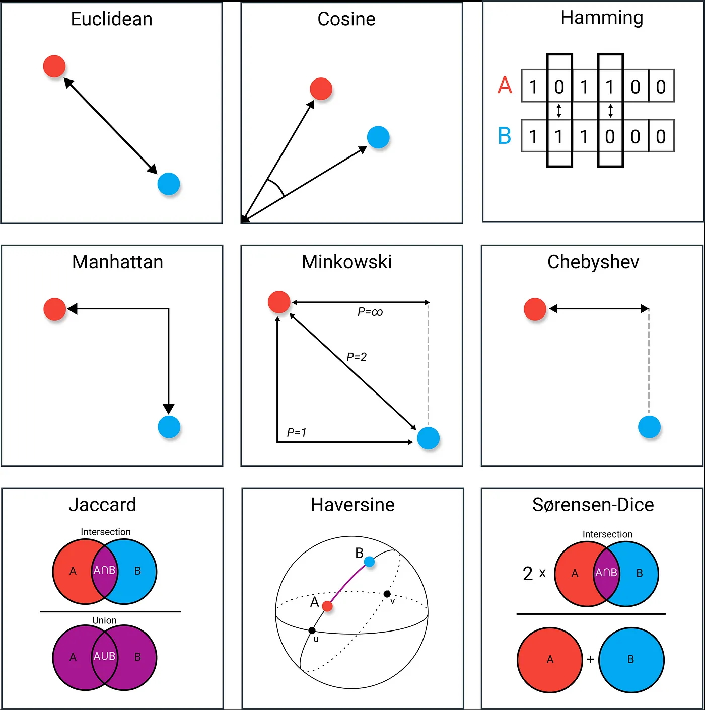
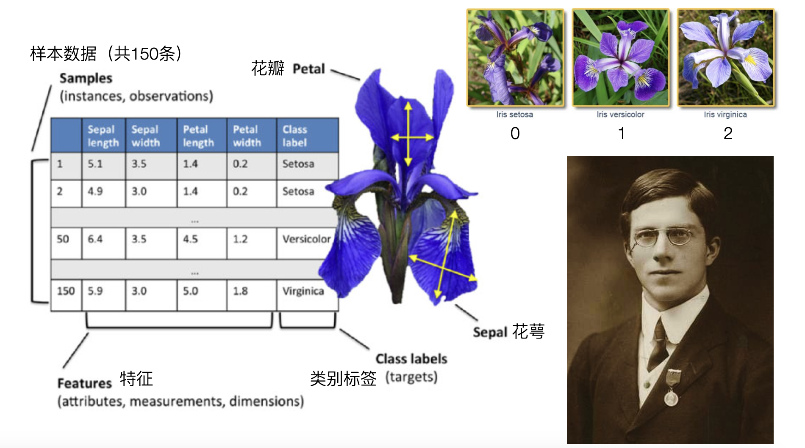
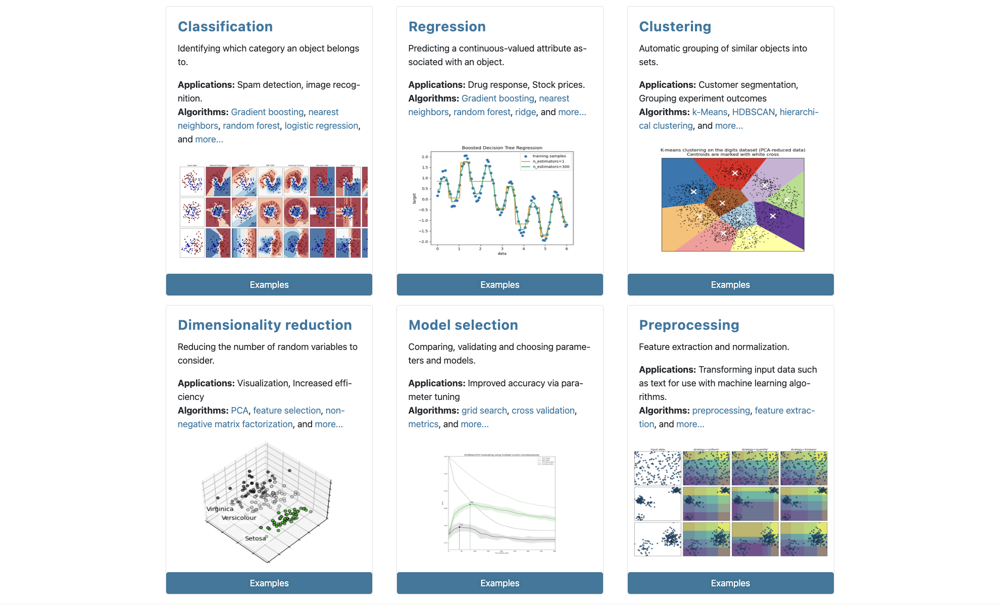
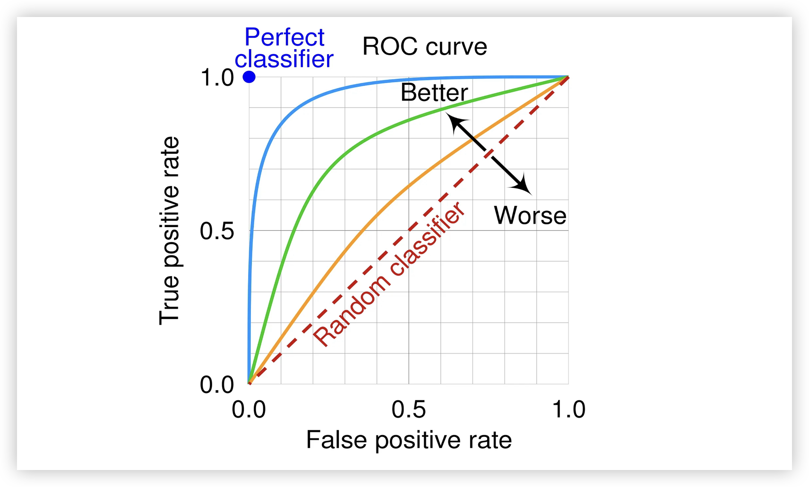
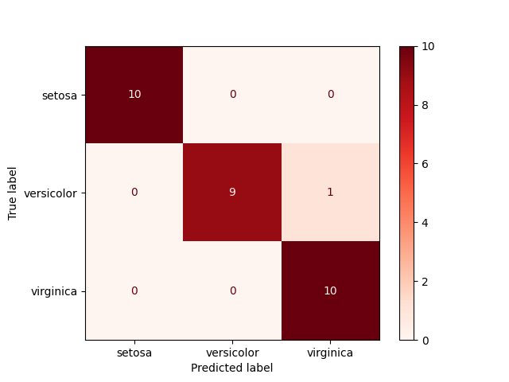
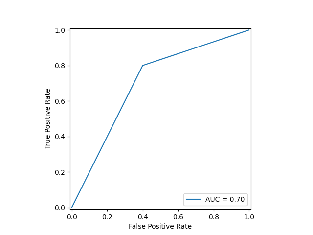
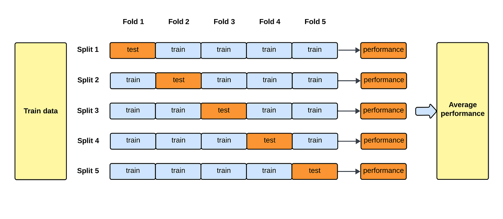
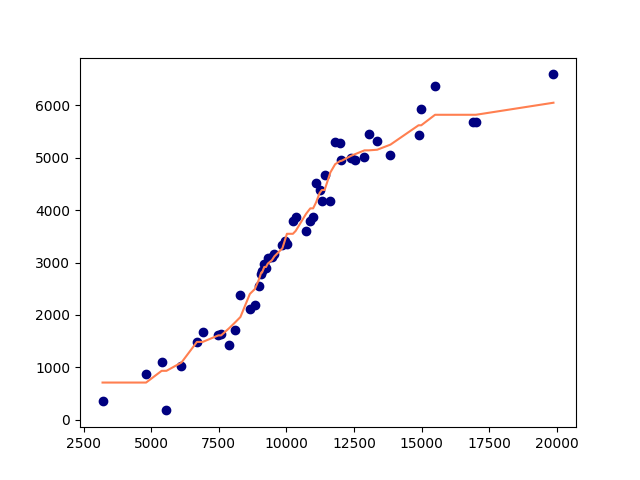

## Thuật toán k láng giềng gần nhất

Thuật toán k láng giềng gần nhất (kNN) là một phương pháp thống kê phi tham số được sử dụng cho cả bài toán phân loại và hồi quy, do hai nhà thống kê người Mỹ là Evelyn Fix và Joseph Hodges đề xuất vào năm 1951. Nguyên lý của thuật toán kNN là tìm từ dữ liệu lịch sử $\small{k}$ mẫu láng giềng gần nhất với mẫu mới được đưa vào, sau đó dựa trên số đông trong các láng giềng đó thuộc lớp nào để phân loại mẫu mới, hoặc xuất ra giá trị mục tiêu cho mẫu mới; thuật toán này chúng tôi đã minh họa sơ lược ở bài trước. Khác với các thuật toán học máy chủ đạo, thuật toán k láng giềng gần nhất không có quá trình huấn luyện/học tập tường minh; nó sử dụng tư tưởng giản dị, mộc mạc kiểu "gần mực thì đen, gần đèn thì rạng" để thực hiện phân loại hoặc hồi quy. Thuật toán k láng giềng gần nhất có hai vấn đề then chốt: thứ nhất là việc lựa chọn giá trị $\small{k}$ như thế nào, tức là dùng bao nhiêu láng giềng gần nhất để xác định lớp hoặc giá trị mục tiêu của mẫu mới; thứ hai là làm thế nào để xác định hai mẫu là gần hay xa, điều này liên quan đến vấn đề đo lường khoảng cách.

### Đo lường khoảng cách

Chúng ta có thể sử dụng khoảng cách (distance) để đo lường độ tương đồng giữa hai mẫu trong không gian đặc trưng. Các phép đo khoảng cách thường dùng bao gồm khoảng cách Minkowski, khoảng cách Mahalanobis, khoảng cách Cosine, khoảng cách chỉnh sửa (Edit distance), v.v. Khoảng cách Minkowski đối với hai vector $\small{n}$ chiều $\small{\mathbf{x}=(x_{1}, x_{2}, \cdots, x_{n})}$ và $\small{\mathbf{y}=(y_{1}, y_{2}, \cdots, y_{n})}$ được định nghĩa là:

$$
d(\mathbf{x}, \mathbf{y}) = (\sum_{i=1}^{n}{\vert x_{i} - y_{i} \rvert}^{p})^{\frac{1}{p}}
$$

Trong đó, $\small{p \ge 1}$; mặc dù $\small{p \lt 1}$ vẫn có thể tính toán được nhưng không còn thỏa mãn chặt chẽ định nghĩa về khoảng cách, nên thường không được coi là một khoảng cách thực sự.

Khi $\small{p = 1}$, khoảng cách Minkowski chính là **khoảng cách Manhattan**:

$$
d(\mathbf{x}, \mathbf{y}) = \sum_{i=1}^{n} \lvert x_{i} - y_{i} \rvert
$$

Khi $\small{p = 2}$, khoảng cách Minkowski chính là **khoảng cách Euclid**:

$$
d(\mathbf{x}, \mathbf{y}) = \sqrt{\sum_{i=1}^{n}(x_{i} - y_{i})^{2}}
$$

Khi $\small{p \to \infty}$, khoảng cách Minkowski chính là **khoảng cách Chebyshev**:

$$
d(\mathbf{x}, \mathbf{y}) = \underset{i}{max}(\lvert x_{i} - y_{i} \rvert)
$$

Các phương thức đo khoảng cách khác chúng ta sẽ giới thiệu khi cần sử dụng tới. Khi dùng thuật toán k láng giềng gần nhất để phân loại, tập dữ liệu của chúng ta thường là dữ liệu số (numeric), lúc này việc sử dụng trực tiếp khoảng cách Euclid là một lựa chọn rất tốt.



### Giới thiệu tập dữ liệu

Tiếp theo, xin trân trọng giới thiệu một tập dữ liệu quan trọng mà chúng ta sẽ sử dụng xuyên suốt sau này — tập dữ liệu hoa diên vĩ (Iris dataset). Tập dữ liệu Iris là một trong những tập dữ liệu nổi tiếng và kinh điển nhất trong lĩnh vực học máy, do nhà thực vật học *Edgar S. Anderson* thu thập tại bán đảo Gaspé, Quebec, Canada, và được nhà thống kê người Anh *Ronald A. Fisher* giới thiệu lần đầu tiên vào năm 1936 trong bài báo *《The Use of Multiple Measurements in Taxonomic Problems》*. Nó được sử dụng rộng rãi cho việc nhập môn và thực nghiệm các thuật toán học máy.



Tập dữ liệu hoa diên vĩ có tổng cộng 150 mẫu, bao gồm 3 loài hoa diên vĩ: Iris setosa (diên vĩ bờ biển), Iris versicolor (diên vĩ biến màu) và Iris virginica (diên vĩ Virginia), như hình trên, mỗi loài có đúng 50 mẫu. Dữ liệu mỗi mẫu chứa 4 đặc trưng (features) và 1 nhãn lớp (class label). Bốn đặc trưng lần lượt là: chiều dài đài hoa (Sepal length), chiều rộng đài hoa (Sepal width), chiều dài cánh hoa (Petal length) và chiều rộng cánh hoa (Petal width), đều là các số dương có đơn vị tính bằng centimet. Nhãn lớp trong tập dữ liệu có ba giá trị 0, 1, 2, tương ứng với ba loài hoa diên vĩ nêu trên.

#### Tải tập dữ liệu

Chúng ta có thể tải tập dữ liệu này thông qua thư viện học máy nổi tiếng của Python là scikit-learn. Thư viện scikit-learn bao gồm đầy đủ các thuật toán phân loại, hồi quy, phân cụm, đồng thời còn cung cấp các mô hình như Perceptron đa tầng (MLP), máy vector hỗ trợ (SVM), rừng ngẫu nhiên, bao quát từ tiền xử lý dữ liệu, kỹ nghệ đặc trưng cho đến huấn luyện mô hình, đánh giá mô hình và tinh chỉnh tham số, như hình dưới đây. Chúng tôi khuyến khích các bạn sử dụng thư viện này để thực hiện các thao tác trong học máy. Trên [trang web chính thức](https://scikit-learn.org/stable/) của scikit-learn còn cung cấp tài liệu hướng dẫn sử dụng, tài liệu API và các ví dụ thực tế; bạn đọc quan tâm có thể tự truy cập để tìm hiểu thêm.



Vì các bài học tiếp theo hầu như đều sử dụng thư viện này, các bạn có thể cài đặt thư viện bằng lệnh dưới đây:

```
pip install scikit-learn
```

Nếu bạn đã mở IPython hoặc Jupyter nhưng chưa cài đặt scikit-learn, có thể cài đặt bằng lệnh ma thuật sau:

```
%pip install scikit-learn
```

Sau khi cài đặt hoàn tất, chúng ta có thể tải tập dữ liệu hoa diên vĩ và xem phần mô tả giới thiệu của tập dữ liệu này bằng đoạn mã dưới đây:

```Python
from sklearn.datasets import load_iris

# Tải tập dữ liệu hoa diên vĩ
iris = load_iris()
# Xem phần mô tả giới thiệu tập dữ liệu
print(iris.DESCR)
```

Tiếp theo, chúng ta có thể lấy các đặc trưng và nhãn trong tập dữ liệu, mã nguồn như sau:

```python
# Đặc trưng (mảng 2 chiều 150 hàng 4 cột, lần lượt là dài đài hoa, rộng đài hoa, dài cánh hoa, rộng cánh hoa)
X = iris.data
# Nhãn (mảng 1 chiều 150 phần tử, chứa ba giá trị 0, 1, 2 đại diện cho 3 loài hoa diên vĩ)
y = iris.target
```

Nếu muốn xem tập dữ liệu hoa diên vĩ một cách trực quan hơn, chúng ta có thể dùng các đặc trưng và nhãn thu được ở trên để tạo một đối tượng DataFrame; bạn đọc quan tâm có thể tự mình thử nghiệm.

#### Phân chia tập dữ liệu

Thông thường, chúng ta cần chia dữ liệu gốc thành tập huấn luyện (training set) và tập kiểm tra (test set), trong đó tập huấn luyện là dữ liệu được chọn để huấn luyện mô hình, còn tập kiểm tra là dữ liệu được giữ lại để kiểm tra hiệu quả huấn luyện của mô hình. Đối với tập dữ liệu hoa diên vĩ ở trên, chúng ta có thể chọn 80% dữ liệu (120 mẫu) làm tập huấn luyện và giữ lại 20% dữ liệu (30 mẫu) làm tập kiểm tra. Đoạn mã dưới đây sử dụng NumPy để thực hiện phân chia tập dữ liệu:

```python
# Ghép các đặc trưng và nhãn vào cùng một mảng
data = np.hstack((X, y.reshape(-1, 1)))
# Dùng hàm xáo trộn ngẫu nhiên để làm xáo trộn dữ liệu gốc
np.random.shuffle(data)
# Chọn 80% dữ liệu làm tập huấn luyện
train_size = int(y.size * 0.8)
train, test = data[:train_size], data[train_size:]
X_train, y_train = train[:, :-1], train[:, -1]
X_test, y_test = test[:, :-1], test[:, -1]
```

Dĩ nhiên, cách phân chia tập dữ liệu đơn giản hơn là sử dụng hàm `train_test_split` được đóng gói sẵn trong scikit-learn. Chúng ta chỉ cần truyền vào đặc trưng và nhãn, chỉ định `train_size` hoặc `test_size` là có thể đạt được thao tác tương tự. Hàm `train_test_split` trả về một bộ 4 phần tử (tuple), lần lượt đại diện cho: đặc trưng huấn luyện, đặc trưng kiểm tra, nhãn huấn luyện và nhãn kiểm tra.

```python
from sklearn.model_selection import train_test_split

X_train, X_test, y_train, y_test = train_test_split(X, y, train_size=0.8, random_state=3)
```

> **Giải thích**: Tham số `random_state` của hàm `train_test_split` trong đoạn mã trên có thể hiểu là seed (hạt giống) của bộ sinh số ngẫu nhiên. Nếu bạn sử dụng cùng hạt giống ngẫu nhiên với tôi, tập huấn luyện và tập kiểm tra mà chúng ta phân chia sẽ hoàn toàn giống nhau.

### Cài đặt phân loại kNN

Dưới đây, trước tiên chúng ta chưa dùng scikit-learn mà sử dụng các thư viện khoa học dữ liệu cơ bản là NumPy và SciPy để tự cài đặt thuật toán kNN. Mục đích của việc này là giúp bạn hiểu rõ hơn nguyên lý của thuật toán; trên cơ sở đó, chúng ta sẽ cảm nhận được sức mạnh của scikit-learn và hiểu rõ tại sao các lớp, hàm, tham số trong đó lại được thiết kế như vậy.

#### Cài đặt dựa trên NumPy

Thuật toán k láng giềng gần nhất cần tính toán khoảng cách. Trước tiên, chúng ta thiết kế hàm tính khoảng cách Euclid giữa hai điểm dữ liệu, mã nguồn như sau:

```python
import numpy as np


def euclidean_distance(u, v):
    """Tính khoảng cách Euclid giữa hai vector n chiều"""
    return np.sqrt(np.sum(np.abs(u - v) ** 2))
```

Tiếp theo, chúng ta thiết kế hàm sinh nhãn cho dữ liệu mới dựa trên nhãn của các láng giềng:

```python
from scipy import stats


def make_label(X_train, y_train, X_one, k):
    """
    Sinh nhãn cho dữ liệu mới dựa trên k láng giềng gần nhất trong dữ liệu lịch sử
    :param X_train: Đặc trưng trong tập huấn luyện
    :param y_train: Nhãn trong tập huấn luyện
    :param X_one: Đặc trưng của mẫu cần dự đoán (dữ liệu mới)
    :param k: Số lượng láng giềng
    :return: Nhãn được sinh cho mẫu cần dự đoán (yếu vị / mode của nhãn các láng giềng)
    """
    # Tính khoảng cách giữa x và từng mẫu huấn luyện
    distes = [euclidean_distance(X_one, X_i) for X_i in X_train]
    # Tìm chỉ mục của k khoảng cách nhỏ nhất thông qua một lần phân hoạch và lấy nhãn tương ứng
    labels = y_train[np.argpartition(distes, k - 1)[:k]]
    # Lấy yếu vị (mode) của các nhãn
    return stats.mode(labels).mode
```

> **Giải thích**: Hàm `np.partition` có thể thực hiện một lần phân hoạch trên mảng, đưa k phần tử tương đối nhỏ về bên trái của mảng và n - k phần tử tương đối lớn về bên phải của mảng, hiệu quả tương tự như thao tác phân hoạch (partition) một lần trong thuật toán sắp xếp nhanh (quicksort). Hàm `np.argpartition` trong đoạn mã trên đưa chỉ mục của k phần tử nhỏ hơn về bên trái của mảng; bằng cách cắt lát `[:k]` và lập chỉ mục nâng cao (fancy indexing) trên `y_train`, chúng ta có thể thu được nhãn tương ứng của k mẫu có khoảng cách nhỏ nhất với dữ liệu mới. Cuối cùng, thông qua hàm `mode` của module stats trong thư viện scipy, chúng ta có thể lấy được giá trị xuất hiện nhiều nhất (yếu vị / mode) của nhãn, và dùng nó làm nhãn lớp dự đoán cho dữ liệu mới.

Sau khi hoàn thành các bước chuẩn bị trên, hàm dự đoán bằng k láng giềng gần nhất đã sẵn sàng, mã nguồn như sau:

```python
def predict_by_knn(X_train, y_train, X_new, k=5):
    """
    Thuật toán kNN
    :param X_train: Đặc trưng trong tập huấn luyện
    :param y_train: Nhãn trong tập huấn luyện
    :param X_new: Mảng chứa các mẫu cần dự đoán
    :param k: Số lượng láng giềng (mặc định là 5)
    :return: Mảng lưu kết quả dự đoán (nhãn)
    """
    return np.array([make_label(X_train, y_train, X, k) for X in X_new])
```

Chúng ta sử dụng tập huấn luyện và tập kiểm tra của dữ liệu hoa diên vĩ đã chuẩn bị ở trên để làm thử nghiệm, xem hàm `predict_by_knn` của chúng ta có hoạt động tốt hay không. `y_pred` trong đoạn mã dưới đây là loại của 30 bông hoa diên vĩ mà chúng ta dự đoán thông qua hàm; so sánh nó với `y_test`, chúng ta có thể thấy hiệu quả dự đoán của mình:

```python
y_pred = predict_by_knn(X_train, y_train, X_test)
y_pred == y_test
```

Đầu ra ở đây của tôi là:

```
array([ True,  True,  True,  True,  True,  True,  True,  True,  True,
        True,  True,  True,  True,  True,  True,  True, False,  True,
        True,  True,  True,  True,  True,  True,  True,  True,  True,
        True,  True,  True])
```

Trong kết quả đầu ra có một giá trị `False`, điều này biểu thị nhãn dự đoán không khớp với nhãn thực tế, là một kết quả dự đoán sai; tức là độ chính xác dự đoán của chúng ta là $\small{\frac{29}{30}}$, tương đương `96.67%`. Dĩ nhiên, nếu tham số `random_state` bạn chỉ định khi chia tập huấn luyện và tập kiểm tra khác với tôi, kết quả thu được ở đây có thể sẽ khác.

#### Cài đặt dựa trên scikit-learn

Sử dụng scikit-learn để hiện thực hóa thuật toán kNN thì đơn giản hơn rất nhiều. Về cơ bản chúng ta chỉ cần thực hiện ba thao tác là có thể nhận được kết quả mong muốn, mã nguồn như sau:

```python
from sklearn.neighbors import KNeighborsClassifier

# Tạo mô hình
model = KNeighborsClassifier()
# Huấn luyện mô hình
model.fit(X_train, y_train)
# Dự đoán kết quả
y_pred = model.predict(X_test)
```

Chúng ta hãy xem kết quả đầu ra, xem có hoàn toàn trùng khớp với đoạn code chúng ta tự viết tay hay không:

```python
y_pred == y_test
```

Đầu ra:

```
array([ True,  True,  True,  True,  True,  True,  True,  True,  True,
        True,  True,  True,  True,  True,  True,  True, False,  True,
        True,  True,  True,  True,  True,  True,  True,  True,  True,
        True,  True,  True])
```

Dĩ nhiên, những yếu tố mà thư viện scikit-learn cân nhắc tới chắc chắn phong phú hơn nhiều so với code chúng ta tự viết. Ví dụ, nếu muốn biết độ chính xác (accuracy) của dự đoán mô hình, chúng ta có thể sử dụng phương thức sau:

```python
model.score(X_test, y_test)
```

Đầu ra:

```
0.9666666666666667
```

### Đánh giá mô hình

Dĩ nhiên, để đánh giá hiệu quả dự đoán của một bộ phân loại có tốt hay không, không thể chỉ nhìn đơn giản vào độ chính xác (accuracy), bởi vì trong trường hợp mất cân bằng lớp (class imbalance), độ chính xác rất có thể sẽ đánh lừa nhận định của bạn. Ví dụ, nếu số lượng mẫu hoa diên vĩ Virginia trong dữ liệu kiểm tra của chúng ta rất ít, thì ngay cả khi mô hình hoàn toàn không thể nhận diện được hoa diên vĩ Virginia, mô hình vẫn thể hiện độ chính xác rất cao. Do đó, chúng ta còn cần khảo sát các chỉ số như độ chuẩn xác (precision), độ thu hồi (recall), điểm F1 (F1-score), v.v. Và **ma trận nhầm lẫn** (confusion matrix) là công cụ dùng để thể hiện chi tiết hiệu suất của mô hình phân loại, áp dụng cho cả bài toán phân loại nhị phân và phân loại đa lớp. Ma trận nhầm lẫn cho bài toán phân loại nhị phân như sau:

|      | **Dự đoán là dương tính (Positive)** | **Dự đoán là âm tính (Negative)** |
| ---- | ------------------------- | ------------------------- |
| **Thực tế là dương tính (Positive)** | True Positive (TP) | False Negative (FN) |
| **Thực tế là âm tính (Negative)** | False Positive (FP) | True Negative (TN) |

Chúng ta hãy lấy một ví dụ để giải thích cách sử dụng ma trận nhầm lẫn và tính toán các chỉ số đánh giá của mô hình phân loại. Giả sử mục tiêu của một hệ thống xét nghiệm y tế là dự đoán xem người bệnh có mắc một căn bệnh nào đó hay không, lớp "dương tính" biểu thị "mắc bệnh", lớp "âm tính" biểu thị "không mắc bệnh", kết quả kiểm tra của 1000 mẫu như sau:

|      | **Dự đoán là mắc bệnh** | **Dự đoán là không mắc bệnh** |
| ---- | -------------- | ---------------- |
| **Thực tế là mắc bệnh** | 80 (TP) | 20 (FN) |
| **Thực tế là không mắc bệnh** | 30 (FP) | 870 (TN) |

1. **Độ chính xác** (Accuracy).

$$
\text{Accuracy} = \frac{\text{TP} + \text{TN}}{\text{TP} + \text{FP} + \text{FN} + \text{TN}}
$$

Trong ví dụ trên, độ chính xác dự đoán của mô hình là: $\frac{80 + 870}{80 + 30 + 20 + 870} = \frac{950}{1000} = 0.95$.

2. **Độ chuẩn xác** (Precision). Độ chuẩn xác đo lường tỷ lệ các mẫu thực sự thuộc lớp dương tính trong số tất cả các mẫu được dự đoán là dương tính, thường được gọi là tỷ lệ đoán trúng.

$$
\text{Precision} = \frac{\text{TP}}{\text{TP} + \text{FP}}
$$

Trong ví dụ trên, độ chuẩn xác dự đoán của mô hình là: $\frac{80}{80 + 30} = \frac{80}{110} = 0.73$.

3. **Độ thu hồi** (Recall). Độ thu hồi đo lường tỷ lệ các mẫu được mô hình dự đoán chính xác là dương tính trong số tất cả các mẫu thực tế thuộc lớp dương tính, thường được gọi là độ nhạy hoặc tỷ lệ dương tính thật (True Positive Rate).

$$
\text{Recall} = \frac{\text{TP}}{\text{TP} + \text{FN}}
$$

Trong ví dụ trên, độ thu hồi dự đoán của mô hình là: $\frac{80}{80 + 20} = \frac{80}{100} = 0.8$.

4. **Điểm F1** (F1 Score). Điểm F1 là trung bình điều hòa của độ chuẩn xác và độ thu hồi, nó tìm kiếm sự cân bằng giữa độ chuẩn xác và độ thu hồi, đặc biệt thích hợp trong các tình huống cần đánh đổi giữa cả hai.
  
$$
\text{F1 Score} = \frac{2}{\frac{1}{\text{Precision}} + \frac{1}{\text{Recall}}} = 2 \times \frac{\text{Precision} \times \text{Recall}}{\text{Precision} + \text{Recall}}
$$

Trong ví dụ trên, điểm F1 dự đoán của mô hình là: $2 \times \frac{0.7273 \times 0.8}{0.7273 + 0.8} = 0.76$.

5. **Độ đặc hiệu** (Specificity) và **tỷ lệ dương tính giả** (False Positive Rate, viết tắt là FPR). Độ đặc hiệu đo lường tỷ lệ các mẫu được mô hình dự đoán chính xác là âm tính trong số tất cả các mẫu thực tế thuộc lớp âm tính, tương tự như độ thu hồi nhưng nhắm vào mẫu âm tính.

$$
\text{Specificity} = \frac{\text{TN}}{\text{TN} + \text{FP}} \\\\
\text{FPR} = 1 - \text{Specificity}
$$

Trong ví dụ trên, độ đặc hiệu dự đoán của mô hình là: $\frac{870}{870 + 30} = \frac{870}{900} = 0.97$.

6. **Đường cong ROC** và **chỉ số AUC**.

    - **Đường cong ROC** (Receiver Operating Characteristic Curve) biểu diễn mối quan hệ giữa độ thu hồi (TPR) và tỷ lệ dương tính giả (FPR), như hình dưới đây.

        

    - **AUC** (Area Under the Curve) là diện tích dưới đường cong ROC, đo lường khả năng phân biệt giữa lớp dương tính và lớp âm tính của mô hình. Phạm vi giá trị của AUC nằm trong đoạn $\small[0, 1]$, giá trị càng gần 1 biểu thị khả năng phân biệt lớp dương và âm của mô hình càng mạnh. Khi 0.5 < AUC < 1, chứng tỏ mô hình của chúng ta tốt hơn đoán mò ngẫu nhiên, chỉ cần bộ phân loại này thiết lập ngưỡng (threshold) thích hợp thì sẽ có giá trị dự đoán. Khi AUC = 0.5, chứng tỏ mô hình không khác gì đoán mò ngẫu nhiên, mô hình không có giá trị dự đoán. Khi AUC < 0.5, mô hình còn tệ hơn đoán mò ngẫu nhiên, nhưng chỉ cần luôn dự đoán ngược lại thì hiệu quả thực tế của nó lại vượt trội hơn đoán ngẫu nhiên.

Đối với bài toán phân loại đa lớp, số hàng và số cột của ma trận nhầm lẫn đều bằng số lượng lớp; ma trận nhầm lẫn là một ma trận vuông, tức là nếu có $\small{n}$ lớp thì ma trận nhầm lẫn sẽ có kích thước $\small{n \times n}$. Dựa trên kết quả dự đoán của tập dữ liệu hoa diên vĩ mà chúng ta thu được ở trên, trước tiên chúng ta in ra giá trị thực tế và giá trị dự đoán, sau đó lập ma trận nhầm lẫn tương ứng như sau:

```python
print(y_test)
print(y_pred)
```

Đầu ra:

```
[0 0 0 0 0 2 1 0 2 1 1 0 1 1 2 0 1 2 2 0 2 2 2 1 0 2 2 1 1 1]
[0 0 0 0 0 2 1 0 2 1 1 0 1 1 2 0 2 2 2 0 2 2 2 1 0 2 2 1 1 1]
```

|      | **Dự đoán là lớp 0 (Iris setosa)** | **Dự đoán là lớp 1 (Iris versicolor)** | **Dự đoán là lớp 2 (Iris virginica)** |
| :---- | :---------------: | :---------------: | :---------------: |
| **Thực tế là lớp 0 (Iris setosa)** | 10 | 0 | 0 |
| **Thực tế là lớp 1 (Iris versicolor)** | 0 | 9 | 1 |
| **Thực tế là lớp 2 (Iris virginica)** | 0 | 0 | 10 |


Chúng ta có thể sử dụng các hàm `confusion_matrix` và `classification_report` trong scikit-learn để xuất ma trận nhầm lẫn và báo cáo đánh giá, mã nguồn như sau:

```python
from sklearn.metrics import classification_report, confusion_matrix

# Xuất ma trận nhầm lẫn của mô hình phân loại
print('Ma trận nhầm lẫn: ')
print(confusion_matrix(y_test, y_pred))
# Xuất báo cáo đánh giá mô hình phân loại
print('Báo cáo đánh giá: ')
print(classification_report(y_test, y_pred))
```

Đầu ra:

```
Ma trận nhầm lẫn: 
[[10  0  0]
 [ 0  9  1]
 [ 0  0 10]]
Báo cáo đánh giá: 
              precision    recall  f1-score   support

           0       1.00      1.00      1.00        10
           1       1.00      0.90      0.95        10
           2       0.91      1.00      0.95        10

    accuracy                           0.97        30
   macro avg       0.97      0.97      0.97        30
weighted avg       0.97      0.97      0.97        30
```

Nếu muốn hiển thị ma trận nhầm lẫn dưới dạng trực quan hóa, bạn có thể sử dụng đoạn mã sau:

```python
import matplotlib.pyplot as plt
from sklearn.metrics import ConfusionMatrixDisplay

# Tạo đối tượng hiển thị ma trận nhầm lẫn
cm_display_obj = ConfusionMatrixDisplay(confusion_matrix(y_test, y_pred), display_labels=iris.target_names)
# Vẽ và hiển thị ma trận nhầm lẫn
cm_display_obj.plot(cmap=plt.cm.Reds)
plt.show()
```

> **Giải thích**: Trong đó `iris.target_names` chính là tên tiếng Anh của ba loài hoa diên vĩ tương ứng với các nhãn lớp `0`, `1`, `2`.



Đối với bài toán phân loại nhị phân, nếu muốn vẽ đường cong ROC và hiển thị giá trị AUC, có thể sử dụng đoạn mã như sau:

```python
from sklearn.metrics import roc_curve, auc
from sklearn.metrics import RocCurveDisplay

# Tự tạo thủ công một tập giá trị thực tế và giá trị dự đoán tương ứng
y_test_ex = np.array([0, 0, 0, 1, 1, 0, 1, 1, 1, 0])
y_pred_ex = np.array([1, 0, 0, 1, 1, 0, 1, 1, 0, 1])
# Dùng hàm roc_curve để tính FPR (tỷ lệ dương tính giả) và TPR (tỷ lệ dương tính thật)
fpr, tpr, _ = roc_curve(y_test_ex, y_pred_ex)
# Dùng hàm auc để tính giá trị AUC và vẽ đồ thị qua lớp RocCurveDisplay
RocCurveDisplay(fpr=fpr, tpr=tpr, roc_auc=auc(fpr, tpr)).plot()
plt.show()
```



### Tinh chỉnh tham số

Như trước đây chúng ta đã nói, thuật toán kNN có hai vấn đề then chốt: một là đo lường khoảng cách, hai là lựa chọn giá trị k. Khi sử dụng `KNeighborsClassifier` của scikit-learn để tạo mô hình phân loại, chúng ta có thể thiết lập các siêu tham số cho mô hình, dưới đây là một số tham số quan trọng:

1. `n_neighbors`: Số lượng láng giềng, chính là giá trị k trong thuật toán kNN.
2. `weights`: Có thể chọn `uniform` hoặc `distance`, lựa chọn trước biểu thị trọng số của tất cả các mẫu là như nhau, lựa chọn sau biểu thị khoảng cách càng gần thì trọng số càng cao, giá trị mặc định là `uniform`. Dĩ nhiên, chúng ta cũng có thể truyền vào một hàm tự định nghĩa để xác định trọng số của từng mẫu.
3. `algorithm`: Có bốn tùy chọn là `auto`, `ball_tree`, `kd_tree`, `brute`, giá trị mặc định là `auto`. Trong đó `ball_tree` là một cấu trúc dạng cây, dựa trên phương pháp phân chia hình cầu để phân bổ các điểm dữ liệu vào cấu trúc cây phân tầng, có hiệu năng tốt hơn trong ngữ cảnh dữ liệu nhiều chiều và thưa thớt; `kd_tree` cũng là một cấu trúc dạng cây, bằng cách chọn một chiều để chia không gian thành nhiều vùng con rồi mới tìm kiếm, từ đó tránh việc phải so sánh với tất cả các láng giềng; đối với dữ liệu ít chiều và phân bố không gian đồng đều thì `kd_tree` có hiệu quả tốt, nhưng trong không gian nhiều chiều sẽ gặp phải vấn đề lời nguyền số chiều (curse of dimensionality); tùy chọn `auto` sẽ tự động chọn `ball_tree` hoặc `kd_tree` dựa trên số chiều của dữ liệu đầu vào; tùy chọn `brute` sử dụng thuật toán tìm kiếm vét cạn (vét cạn toàn bộ), khi xử lý tập dữ liệu nhỏ thì đây là một lựa chọn đơn giản và hiệu quả.
4. `leaf_size`: Khi sử dụng thuật toán `ball_tree` hoặc `kd_tree`, tham số này dùng để giới hạn số lượng mẫu tối đa trong các nút lá của cấu trúc cây, giá trị mặc định là `30`; tham số này sẽ ảnh hưởng đến hiệu năng xây dựng cây và tìm kiếm nút.
5. `p`: Tham số `p` trong công thức khoảng cách Minkowski, giá trị mặc định là 2, tương ứng với việc tính khoảng cách Euclid.

Chúng ta có thể sử dụng phương pháp **tìm kiếm dạng lưới** (Grid Search) và **kiểm định chéo** (Cross Validation) để điều chỉnh các siêu tham số của mô hình, đánh giá khả năng khái quát hóa của mô hình và nâng cao hiệu quả dự đoán. Tìm kiếm dạng lưới là việc duyệt qua toàn bộ không gian siêu tham số đã cho bằng phương pháp vét cạn để tìm ra tổ hợp siêu tham số tối ưu; còn kiểm định chéo là việc chia tập huấn luyện thành nhiều tập con, thông qua việc huấn luyện và đánh giá nhiều lần trên các tập huấn luyện và tập xác thực khác nhau để đánh giá toàn diện hiệu quả dự đoán của mô hình. Kiểm định chéo K-Fold (K-Fold Cross Validation) là phương pháp kiểm định chéo thường dùng nhất, bằng cách chia tập dữ liệu thành K tập con, mỗi lần chọn một trong các tập con làm tập xác thực và K-1 tập con còn lại làm tập huấn luyện, lặp lại quy trình này đối với từng tập con, hoàn thành K lần huấn luyện và đánh giá rồi lấy giá trị trung bình làm đánh giá hiệu năng cuối cùng của mô hình, như hình dưới đây:



Đoạn mã dưới đây sử dụng `GridSearchCV` trong thư viện scikit-learn để thực hiện tìm kiếm dạng lưới và kiểm định chéo, qua đó tìm ra các tham số tối ưu khi áp dụng thuật toán kNN trên tập dữ liệu hoa diên vĩ:

```python
from sklearn.model_selection import GridSearchCV

# Tìm kiếm dạng lưới kết hợp kiểm định chéo
gs = GridSearchCV(
    estimator=KNeighborsClassifier(),
    param_grid={
        'n_neighbors': [1, 3, 5, 7, 9, 11, 13, 15],
        'weights': ['uniform', 'distance'],
        'p': [1, 2]
    },
    cv=5
)
gs.fit(X_train, y_train)
```

Có thể lấy các tham số tối ưu và điểm số tương ứng thông qua đoạn mã sau:

```python
print('Tham số tối ưu:', gs.best_params_)
print('Điểm số:', gs.best_score_)
```

Đầu ra:

```
Tham số tối ưu: {'n_neighbors': 5, 'p': 2, 'weights': 'uniform'}
Điểm số: 0.9666666666666666
```

Nếu cần sử dụng mô hình tối ưu đã huấn luyện để dự đoán, bạn có thể thực hiện theo đoạn mã như sau:

```python
gs.predict(X_test)
```

### Hồi quy kNN

Thuật toán kNN thường được dùng để giải quyết các bài toán phân loại, tuy nhiên nó cũng có thể dùng để giải quyết các bài toán hồi quy. Tư tưởng cơ bản của nó cũng là tìm ra k láng giềng gần nhất với mẫu mới, sau đó dựa vào nhãn của k láng giềng này (trong bài toán hồi quy chúng ta thường gọi là giá trị mục tiêu) để dự đoán giá trị mục tiêu của mẫu mới. Vì thứ chúng ta cần dự đoán không phải là nhãn lớp rời rạc mà là một giá trị số, nên thông thường sẽ dùng cách lấy trung bình hoặc trung bình có trọng số các giá trị mục tiêu của k láng giềng để thu được giá trị dự đoán cho mẫu mới. Hãy quay lại ví dụ dùng thu nhập hàng tháng để dự đoán chi tiêu mua sắm trực tuyến ở bài trước, sau đó sử dụng `KNeighborsRegressor` trong scikit-learn để xây dựng mô hình hồi quy. Trước tiên chúng ta thực hiện một số bước chuẩn bị, mã nguồn như sau:

```python
# Thu nhập hàng tháng
incomes = np.array([
    9558, 8835, 9313, 14990, 5564, 11227, 11806, 10242, 11999, 11630,
    6906, 13850, 7483, 8090, 9465, 9938, 11414, 3200, 10731, 19880,
    15500, 10343, 11100, 10020, 7587, 6120, 5386, 12038, 13360, 10885,
    17010, 9247, 13050, 6691, 7890, 9070, 16899, 8975, 8650, 9100,
    10990, 9184, 4811, 14890, 11313, 12547, 8300, 12400, 9853, 12890
])
# Chi tiêu mua sắm trực tuyến hàng tháng
outcomes = np.array([
    3171, 2183, 3091, 5928, 182, 4373, 5297, 3788, 5282, 4166,
    1674, 5045, 1617, 1707, 3096, 3407, 4674, 361, 3599, 6584,
    6356, 3859, 4519, 3352, 1634, 1032, 1106, 4951, 5309, 3800,
    5672, 2901, 5439, 1478, 1424, 2777, 5682, 2554, 2117, 2845,
    3867, 2962,  882, 5435, 4174, 4948, 2376, 4987, 3329, 5002
])
X = np.sort(incomes).reshape(-1, 1)  # Sắp xếp thu nhập rồi chuyển thành mảng 2 chiều
y = outcomes[np.argsort(incomes)]    # Sắp xếp chi tiêu mua sắm trực tuyến theo thứ tự thu nhập
```

> **Giải thích**: Ngay cả khi chỉ có một đặc trưng duy nhất, chúng ta cũng cần định dạng biến độc lập thành mảng hai chiều, bởi vì phương thức `fit` mà chúng ta sử dụng khi huấn luyện mô hình không chấp nhận mảng một chiều làm đối số đầu tiên của nó. Việc sắp xếp trước X và y ở đây là nhằm phục vụ cho việc vẽ biểu đồ phân tán và đồ thị đường gấp khúc theo thứ tự giá trị X tăng dần lát nữa.

Tiếp theo, chúng ta tạo mô hình hồi quy kNN:

```python
from sklearn.neighbors import KNeighborsRegressor

# Tạo mô hình
model = KNeighborsRegressor()
# Huấn luyện mô hình
model.fit(X, y)
# Dự đoán kết quả
y_pred = model.predict(X)
```

Ở trên, chúng ta trực tiếp dùng toàn bộ dữ liệu lịch sử để huấn luyện mô hình, sau đó kiểm tra xem hiệu quả dự đoán thực sự ra sao bằng cách vẽ đồ thị dưới đây:

```python
# Biểu đồ phân tán của dữ liệu gốc
plt.scatter(X, y, color='navy')
# Đồ thị đường của kết quả dự đoán
plt.plot(X, y_pred, color='coral')
plt.show()
```



Mô hình hồi quy kNN có độ phức tạp tính toán khá cao và rất nhạy cảm với dữ liệu nhiễu; trong nhiều trường hợp, nó có thể không phải là một lựa chọn tốt. Dĩ nhiên, việc làm thế nào để đánh giá hiệu quả của một mô hình hồi quy, chúng ta sẽ dành lại để giải thích trong các chương tiếp theo.

### Tóm tắt

Thuật toán kNN là một thuật toán học máy đơn giản nhưng không kém phần mạnh mẽ, thích hợp cho các nhiệm vụ phân loại và hồi quy trên các tập dữ liệu nhỏ. Ưu điểm của nó là đơn giản dễ hiểu, không có quá trình huấn luyện tường minh, không phụ thuộc vào giả định về phân phối dữ liệu và có thể thích ứng với các quy luật dữ liệu phức tạp. Dĩ nhiên, nhược điểm của thuật toán kNN cũng rất rõ ràng, vấn đề lớn nhất nằm ở hiệu quả tính toán; do đó khi tập dữ liệu lớn thì nó có thể không phải là lựa chọn tốt nhất. Ngoài ra, thuật toán kNN rất nhạy cảm với nhiễu, đồng thời kết quả dự đoán phụ thuộc vào việc lựa chọn giá trị k và mẫu có cân bằng hay không (số lượng mẫu của các lớp có xấp xỉ bằng nhau hay không). Giá trị k quá nhỏ có thể dẫn đến quá khớp, giá trị k quá lớn lại có thể dẫn đến chưa khớp; còn các mẫu không cân bằng có thể dẫn đến thiên lệch lớp (Class Imbalance Bias), nghĩa là nếu phần lớn các mẫu huấn luyện đều thuộc lớp A còn lớp B có ít mẫu hơn, thì khi phân loại, kNN sẽ dễ dự đoán mẫu kiểm tra thành lớp A hơn.
