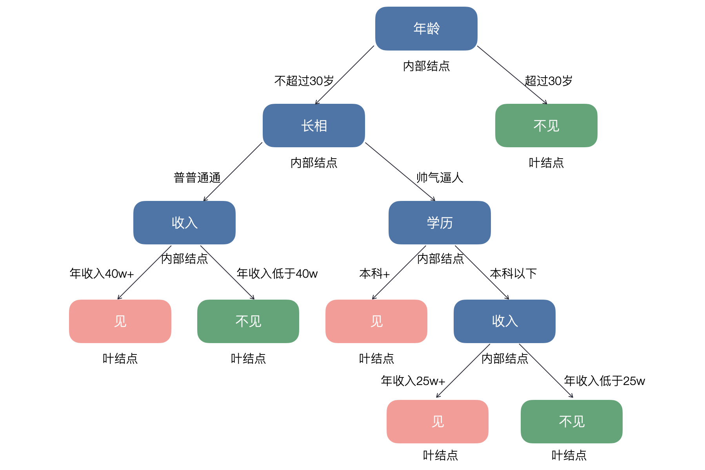
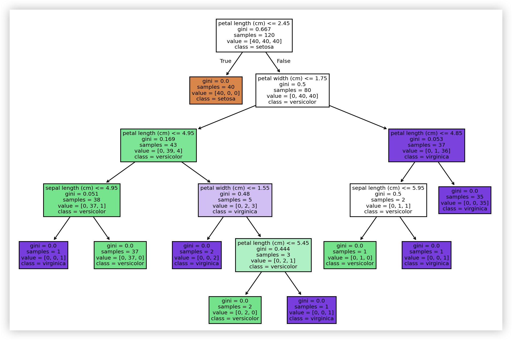
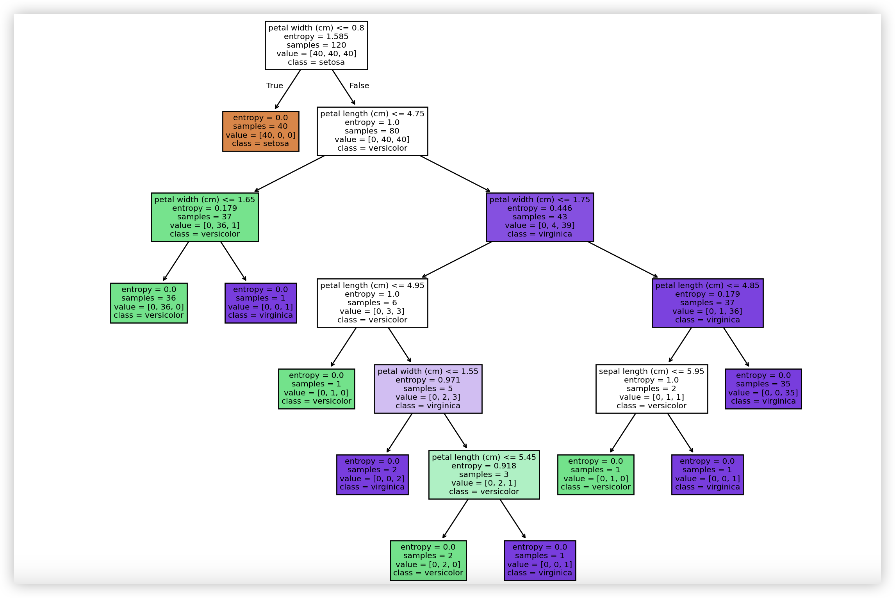
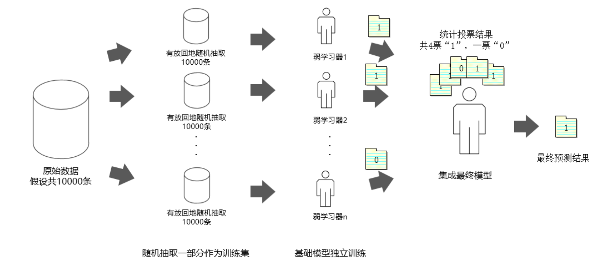

## Cây quyết định và rừng ngẫu nhiên

**Cây quyết định** (Decision Tree) là một thuật toán học có giám sát dựa trên cấu trúc dạng cây, có thể dùng cho cả bài toán **phân loại** và **hồi quy**. Nó thực hiện dự đoán mục tiêu bằng cách chia nhỏ dần tập dữ liệu thành các tập con khác nhau cho đến khi thỏa mãn các điều kiện dừng nào đó. Trong cuộc sống hàng ngày, chúng ta cũng thường áp dụng các phương pháp tương tự để đưa ra quyết định; ví dụ, phương pháp quyết định của một cô gái khi hẹn gặp đối tượng xem mắt có thể được vẽ thành cây quyết định như hình dưới đây:



> **Giải thích**: Hình trên chỉ dùng để giúp các bạn hiểu cây quyết định là gì, không mang tính định hướng tiêu cực và cũng không đại diện cho quan điểm tình yêu hay hôn nhân của người viết.

Nếu có kiến thức lập trình cơ bản, bạn sẽ nhận thấy quá trình dự đoán bằng cây quyết định tương đương với việc thực thi một chuỗi các cấu trúc `if...else...`; còn nếu bạn quen thuộc hơn với lý thuyết xác suất, thì việc xây dựng cây quyết định cũng có thể xem như quá trình tính toán xác suất có điều kiện dựa trên tiền đề không gian đặc trưng. Các nút trong cây quyết định có thể chia làm hai loại: nút nội bộ (nút màu xanh dương trong hình trên) và nút lá (nút màu đỏ và màu xanh lá trong hình trên), trong đó nút nội bộ tương ứng với phép kiểm tra thuộc tính đặc trưng của mẫu (điều kiện phân tách đặc trưng), còn nút lá đại diện cho kết quả quyết định (nhãn phân loại hoặc giá trị mục tiêu hồi quy). Cây quyết định có thể dùng để giải quyết cả bài toán phân loại lẫn bài toán hồi quy; trong bài này chúng ta vẫn đặt trọng tâm vào bài toán phân loại.

### Xây dựng cây quyết định

#### Lựa chọn đặc trưng

Huấn luyện mô hình cây quyết định gồm ba bước cốt lõi: lựa chọn đặc trưng, xây dựng cây quyết định và cắt tỉa cây quyết định. Lựa chọn đặc trưng quyết định việc dùng những đặc trưng nào để đưa ra phán đoán; trong tập dữ liệu huấn luyện, mỗi mẫu có thể có nhiều thuộc tính, vai trò của các thuộc tính khác nhau là lớn nhỏ khác nhau. Tác dụng của việc lựa chọn đặc trưng là sàng lọc ra những đặc trưng có mối tương quan cao với kết quả phân loại, tức là những đặc trưng có năng lực phân loại mạnh; những đặc trưng như vậy cần xuất hiện ở vị trí phía trên của cây quyết định. Nếu một đặc trưng có thể khiến cho các nút nhánh sau khi phân loại thuộc về cùng một lớp càng nhiều càng tốt, tức là nút đó có **độ thuần khiết** (purity) cao, thì đặc trưng đó có năng lực phân loại mạnh đối với tập dữ liệu. Ở đây nảy sinh câu hỏi đầu tiên: chúng ta nên dựa trên tiêu chuẩn nào để lựa chọn đặc trưng có năng lực phân loại mạnh? Trong mô hình cây quyết định, chúng ta có ba phương pháp để chọn đặc trưng có năng lực phân loại mạnh, lần lượt là: **độ lợi thông tin** (information gain), **tỷ số độ lợi thông tin** (gain ratio) và **chỉ số Gini** (Gini index).

Để nói rõ về độ lợi thông tin, trước hết chúng ta cần giới thiệu khái niệm **entropy thông tin** (information entropy). Năm 1948, Claude Shannon trong bài báo nổi tiếng mang tên "Lý thuyết toán học về truyền thông" đã đề xuất khái niệm "entropy thông tin", giải quyết bài toán đo lường thông tin và định lượng hóa giá trị của thông tin. "Entropy" vốn là khái niệm trong lĩnh vực nhiệt động lực học, phản ánh mức độ hỗn loạn của hệ thống: entropy càng lớn thì mức độ hỗn loạn của hệ thống càng cao. Trong lý thuyết thông tin, entropy có thể xem là thước đo độ không chắc chắn của biến ngẫu nhiên (hoặc tập dữ liệu): entropy càng lớn thì độ không chắc chắn của biến (dữ liệu) càng lớn, khi đó lượng thông tin cần thu thập để xác định nó cũng càng lớn; ngược lại, entropy càng thấp thì độ thuần khiết của dữ liệu càng cao, độ không chắc chắn càng nhỏ.

Ví dụ: Hai người A và B tham gia một cuộc thi bắn súng. Nếu xét từ thành tích lịch sử, tỷ lệ thắng của A là 100%, thì chúng ta rất dễ chấp nhận kết quả A sẽ chiến thắng; nhưng nếu từ thành tích lịch sử, tỷ lệ thắng của A là 50%, thì chúng ta rất khó xác định ai sẽ là người chiến thắng cuối cùng. Claude Shannon đề xuất có thể dùng công thức sau để mô tả độ không chắc chắn này:

$$
H(D) = -\sum_{i = 1}^{k} P(x_i)log_2P(x_i)
$$

Trong đó, $\small{D}$ đại diện cho tập dữ liệu, $\small{k}$ đại diện cho tổng số lớp, $\small{P(x_i)}$ biểu thị tỷ lệ (xác suất) của mẫu thuộc lớp thứ $\small{i}$ trong tập dữ liệu. Chúng ta dùng $\small{x_1}$ và $\small{x_2}$ để biểu thị lần lượt việc A thắng và B thắng; rất rõ ràng, khi $\small{P(x_1)=0.5}$, $\small{P(x_2)=0.5}$ thì $\small{H=1}$, độ không chắc chắn là lớn nhất; khi $\small{P(x_1)=1}$, $\small{P(x_2)=0}$ thì $\small{H=0}$, độ không chắc chắn là nhỏ nhất; khi $\small{P(x_1)=0.8}$, $\small{P(x_2)=0.2}$ thì $\small{H \approx 0.72}$.

Rõ ràng, càng biết nhiều thông tin thì độ không chắc chắn của biến ngẫu nhiên (tập dữ liệu) càng nhỏ. Những thông tin này có thể trực tiếp nhắm vào sự kiện ngẫu nhiên mà chúng ta muốn biết, hoặc có thể là thông tin về các sự kiện khác có liên quan đến sự kiện ngẫu nhiên mà chúng ta quan tâm. Về mặt toán học có thể chứng minh chặt chẽ rằng những thông tin liên quan này cũng có thể làm giảm hoặc loại bỏ độ không chắc chắn; vì vậy chúng ta định nghĩa **entropy có điều kiện** (conditional entropy), biểu thị độ không chắc chắn của tập dữ liệu $\small{D}$ dưới điều kiện đã biết đặc trưng $\small{A}$. Công thức tính entropy có điều kiện như sau:

$$
H(D \vert A) = \sum_{v \in A}\frac{\lvert D_{v} \rvert}{\lvert D \rvert}H(D_{v})
$$

Trong công thức trên, chúng ta cho $\small{v}$ nhận tất cả các giá trị khả dĩ của đặc trưng $\small{A}$, trong đó $\small{D_{v}}$ đại diện cho tập con các mẫu có giá trị đặc trưng $\small{A}$ bằng $\small{v}$, còn $\small{\frac{\lvert D_{v} \rvert}{\lvert D \rvert}}$ đại diện cho trọng số, tức là tỷ lệ mẫu có giá trị đặc trưng bằng $\small{v}$. Có thể chứng minh rằng $\small{H(D) \ge H(D \vert A)}$, tức là sau khi có thêm thông tin của đặc trưng $\small{A}$, độ không chắc chắn của tập dữ liệu $\small{D}$ đã giảm xuống. Dĩ nhiên, cần chú ý trường hợp đẳng thức xảy ra: khi tăng thêm thông tin của đặc trưng $\small{A}$ nhưng độ không chắc chắn của $\small{D}$ không giảm, điều đó chứng tỏ thông tin chúng ta thu được không có liên quan gì đến nội dung cần nghiên cứu.

Từ những bước đệm trên, tiếp theo chúng ta có thể đưa ra định nghĩa về **độ lợi thông tin** (information gain): đó là mức độ suy giảm độ không chắc chắn của tập dữ liệu $\small{D}$ sau khi nhận được thông tin về đặc trưng $\small{A}$. Nói cách khác, độ lợi thông tin là một lượng mô tả mức độ gia tăng tính xác định của tập dữ liệu; độ lợi thông tin của một đặc trưng càng lớn thì năng lực phân loại của đặc trưng đó càng mạnh, sau khi cho trước đặc trưng đó thì tính xác định của tập dữ liệu càng lớn. Độ lợi thông tin có thể được mô tả trực quan qua công thức toán học dưới đây:

$$
g(D, A) = E(D) - E(D \vert A)
$$

Hàm tính entropy thông tin và độ lợi thông tin như sau:

```python
import numpy as np


def entropy(y):
    """
    Tính entropy thông tin
    :param y: Giá trị mục tiêu của tập dữ liệu
    :return: Entropy thông tin
    """
    _, counts = np.unique(y, return_counts=True)
    prob = counts / y.size
    return -np.sum(prob * np.log2(prob))


def info_gain(x, y):
    """
    Tính độ lợi thông tin
    :param x: Đặc trưng đã cho
    :param y: Giá trị mục tiêu của tập dữ liệu
    :return: Độ lợi thông tin
    """
    values, counts = np.unique(x, return_counts=True)
    new_entropy = 0
    for i, value in enumerate(values):
        prob = counts[i] / x.size
        new_entropy += prob * entropy(y[x == value])
    return entropy(y) - new_entropy
```

Thuật toán ID3 kinh điển trong cây quyết định chính là dựa trên độ lợi thông tin để lựa chọn đặc trưng. Chúng ta vẫn lấy tập dữ liệu hoa diên vĩ làm ví dụ, chia tập dữ liệu thành tập huấn luyện và tập kiểm tra, sau đó tính entropy thông tin ban đầu trên tập huấn luyện cũng như độ lợi thông tin sau khi đưa vào bốn đặc trưng (chiều dài đài hoa, chiều rộng đài hoa, chiều dài cánh hoa, chiều rộng cánh hoa) lần lượt là bao nhiêu, mã nguồn như sau:

```python
from sklearn.datasets import load_iris
from sklearn.model_selection import train_test_split

iris = load_iris()
X, y = iris.data, iris.target
X_train, X_test, y_train, y_test = train_test_split(X, y, train_size=0.8, random_state=3)
print(f'H(D)    = {entropy(y_train)}')
print(f'g(D,A0) = {info_gain(X_train[:, 0], y_train)}')
print(f'g(D,A1) = {info_gain(X_train[:, 1], y_train)}')
print(f'g(D,A2) = {info_gain(X_train[:, 2], y_train)}')
print(f'g(D,A3) = {info_gain(X_train[:, 3], y_train)}')
```

Đầu ra:

```
H(D)    = 1.584962500721156
g(D,A0) = 0.9430813063736728
g(D,A1) = 0.5692093930591595
g(D,A2) = 1.4475439590905472
g(D,A3) = 1.4420095891994646
```

> **Lưu ý**: Nếu khi phân chia tập huấn luyện và tập kiểm tra, tham số `random_state` của hàm `train_test_split` khác với mã nguồn trên của tôi, kết quả tính toán ở đây có thể sẽ có sự khác biệt.

Căn cứ vào kết quả đầu ra ở trên, chúng ta biết rằng đặc trưng chiều dài cánh hoa (tương ứng với `A2` ở trên) có độ lợi thông tin cao nhất; nói cách khác, sử dụng đặc trưng chiều dài cánh hoa cho năng lực phân loại mạnh nhất, và tập dữ liệu sau khi phân loại có độ thuần khiết cao nhất. Cần lưu ý rằng khi một đặc trưng có nhiều giá trị phân biệt, kết quả tính toán độ lợi thông tin của đặc trưng đó sẽ tương đối lớn; vì vậy khi dùng độ lợi thông tin để chọn đặc trưng, thuật toán sẽ có xu hướng thiên vị các đặc trưng có nhiều giá trị. Để giải quyết vấn đề này, chúng ta có thể tính **tỷ số độ lợi thông tin** (gain ratio), định nghĩa của nó như sau:

$$
R(D, A) = \frac{g(D, A)}{E_{A}(D)}
$$

Trong đó, $\small{E_{A}(D) = -\sum_{i=1}^{n}{\frac{\lvert D_{i} \rvert}{\lvert D \rvert}log_{2}\frac{\lvert D_{i} \rvert}{\lvert D \rvert}}}$, $\small{n}$ biểu thị số lượng giá trị của đặc trưng $\small{A}$; nói đơn giản thì $\small{E_{A}(D)}$ chính là entropy thông tin của đặc trưng $\small{A}$, còn tỷ số độ lợi thông tin là tỷ lệ giữa độ lợi thông tin của đặc trưng $\small{A}$ và entropy thông tin của chính đặc trưng $\small{A}$. Chúng ta sử dụng hàm dưới đây để tính tỷ số độ lợi thông tin, gọi hàm này có thể xuất ra tỷ số độ lợi thông tin tương ứng của bốn đặc trưng:

```python
def info_gain_ratio(x, y):
    """
    Tính tỷ số độ lợi thông tin
    :param x: Đặc trưng đã cho
    :param y: Giá trị mục tiêu của tập dữ liệu
    :return: Tỷ số độ lợi thông tin
    """
    return info_gain(x, y) / entropy(x)


print(f'R(D,A0) = {info_gain_ratio(X_train[:, 0], y_train)}')
print(f'R(D,A1) = {info_gain_ratio(X_train[:, 1], y_train)}')
print(f'R(D,A2) = {info_gain_ratio(X_train[:, 2], y_train)}')
print(f'R(D,A3) = {info_gain_ratio(X_train[:, 3], y_train)}')
```

Đầu ra:

```
R(D,A0) = 0.19687406476459068
R(D,A1) = 0.14319788821311977
R(D,A2) = 0.28837763858461984
R(D,A3) = 0.35550822529855447
```

> **Lưu ý**: Nếu khi phân chia tập huấn luyện và tập kiểm tra, tham số `random_state` của hàm `train_test_split` khác với mã nguồn trên của tôi, kết quả tính toán ở đây có thể sẽ có sự khác biệt.

Dựa vào kết quả đầu ra ở trên, chúng ta biết rằng đặc trưng chiều rộng cánh hoa (tương ứng với `A3` ở trên) có tỷ số độ lợi thông tin cao nhất; nói cách khác, đặc trưng này có thể thực hiện một lần phân chia dữ liệu tốt, có thể làm nút gốc để chúng ta xây dựng cây quyết định. Dĩ nhiên, xây dựng cây quyết định không thể chỉ phân chia một lần; chúng ta có thể tiếp tục tính tỷ số độ lợi thông tin trên các tập dữ liệu đã phân chia để chọn ra đặc trưng phân chia mới, lặp lại quy trình này cho đến khi thỏa mãn các điều kiện nhất định thì có thể cấu tạo nên một mô hình cây quyết định hoàn chỉnh. Trong các thuật toán cây quyết định kinh điển, thuật toán C4.5 chính là dựa trên tỷ số độ lợi thông tin để lựa chọn đặc trưng.

Bên cạnh độ lợi thông tin và tỷ số độ lợi thông tin đã nêu ở trên, **chỉ số Gini** (Gini index) cũng là một phương pháp lựa chọn đặc trưng rất tốt, có thể dùng để đánh giá độ thuần khiết của tập dữ liệu. Chỉ số Gini còn được gọi là **độ vẩn đục Gini** (Gini impurity), giá trị của nó nằm trong khoảng từ 0 đến 1; độ thuần khiết của tập dữ liệu càng cao thì chỉ số Gini càng tiến gần về 0, độ thuần khiết càng thấp thì chỉ số Gini càng tiến gần về 1. Nếu tập dữ liệu có $\small{n}$ lớp, xác suất mẫu thuộc về lớp thứ $\small{k}$ là $\small{p_{k}}$, thì chỉ số Gini của tập dữ liệu có thể tính toán theo công thức dưới đây:

$$
G(D) = 1 - \sum_{k=1}^{n}{p_{k}}^{2}
$$

Ví dụ trong tập dữ liệu hoa diên vĩ, số lượng mẫu của cả ba loài hoa diên vĩ đều là 50, vậy chỉ số Gini của toàn bộ tập dữ liệu là:

$$
G(D) = 1 - [(\frac{1}{3})^{2} + (\frac{1}{3})^{2} + (\frac{1}{3})^{2}] = \frac{2}{3}
$$

Nếu số lượng mẫu của ba loài hoa diên vĩ lần lượt là 100, 25, 25, thì chỉ số Gini của toàn bộ tập dữ liệu là:

$$
G(D) = 1 - [(\frac{2}{3})^{2} + (\frac{1}{6})^{2} + (\frac{1}{6})^{2}] = \frac{1}{2}
$$

Nếu số lượng mẫu của ba loài hoa diên vĩ lần lượt là 140, 5, 5, thì chỉ số Gini của toàn bộ tập dữ liệu là:

$$
G(D) = 1 - [(\frac{14}{15})^{2} + (\frac{1}{30})^{2} + (\frac{1}{30})^{2}] = \frac{19}{150}
$$

Có thể thấy, khi độ thuần khiết của tập dữ liệu ngày càng cao thì giá trị của chỉ số Gini ngày càng nhỏ. Nếu tập dữ liệu $\small{D}$ được phân chia thành $\small{k}$ phần dựa theo đặc trưng $\small{A}$, thì dưới điều kiện đã cho đặc trưng $\small{A}$, chỉ số Gini của tập dữ liệu có thể định nghĩa là:

$$
G(D, A) = \sum_{i=1}^{k}\frac{\lvert D_{i} \rvert}{\lvert D \rvert}G(D_{i})
$$

Dựa vào công thức trên, chúng ta có thể thiết kế hàm tính chỉ số Gini như dưới đây. Các bạn có thể đối chiếu với công thức trên xem có hiểu được đoạn mã sau hay không, hoặc gọi hàm dưới đây để xem đặc trưng nào của tập dữ liệu hoa diên vĩ có thể tạo ra phân chia tốt nhất cho tập dữ liệu gốc hoặc tập huấn luyện. Thuật toán CART kinh điển trong cây quyết định chính là dựa trên chỉ số Gini để lựa chọn đặc trưng.

```python
def gini_index(y):
    """
    Tính chỉ số Gini
    :param y: Giá trị mục tiêu của tập dữ liệu
    :return: Chỉ số Gini
    """
    _, counts = np.unique(y, return_counts=True)
    return 1 - np.sum((counts / y.size) ** 2)


def gini_with_feature(x, y):
    """
    Tính chỉ số Gini sau khi đã cho đặc trưng
    :param x: Đặc trưng đã cho
    :param y: Giá trị mục tiêu của tập dữ liệu
    :return: Chỉ số Gini sau khi đã cho đặc trưng
    """
    values, counts = np.unique(x, return_counts=True)
    gini = 0
    for value in values:
        prob = x[x == value].size / x.size
        gini += prob * gini_index(y[x == value]) 
    return gini


print(f'G(D)    = {gini_index(y_train)}')
print(f'G(D,A0) = {gini_with_feature(X_train[:, 0], y_train)}')
print(f'G(D,A1) = {gini_with_feature(X_train[:, 1], y_train)}')
print(f'G(D,A2) = {gini_with_feature(X_train[:, 2], y_train)}')
print(f'G(D,A3) = {gini_with_feature(X_train[:, 3], y_train)}')
```

Đầu ra:

```
G(D,A0) = 0.29187830687830685
G(D,A1) = 0.44222582972582963
G(D,A2) = 0.06081349206349207
G(D,A3) = 0.06249999999999998
```

#### Phân tách dữ liệu

Quá trình xây dựng cây quyết định là một quá trình đệ quy. Sau khi lựa chọn đặc trưng bằng các phương pháp giới thiệu ở trên, chúng ta sẽ tiến hành phân tách dữ liệu; nói đơn giản là dựa vào đặc trưng đó để chia tập dữ liệu thành hai hoặc nhiều tập con (hai tập con tương ứng với cây nhị phân, nhiều tập con tương ứng với cây đa phân), mỗi tập con tương ứng với các giá trị khác nhau của đặc trưng. Tiếp theo, chúng ta lặp lại thao tác chọn đặc trưng và phân tách dữ liệu trên từng tập con cho đến khi thỏa mãn điều kiện dừng. Điều kiện dừng cực kỳ quan trọng đối với quá trình đệ quy, đồng thời có thể tránh việc sinh ra cấu trúc cây quá phức tạp. Các điều kiện dừng phổ biến bao gồm:

1. Cây đạt độ sâu tối đa được thiết lập trước.
2. Số lượng mẫu của nút hiện tại ít hơn ngưỡng định trước.
3. Tất cả các mẫu tại nút đều thuộc về cùng một lớp.
4. Mức thay đổi của độ lợi thông tin hoặc chỉ số Gini thấp hơn một ngưỡng nào đó.

> **Giải thích**: Nếu bạn đã có kinh nghiệm lập trình cấu trúc dữ liệu dạng cây, quy trình trên chắc hẳn rất dễ hiểu. Dĩ nhiên, những bạn chưa quen thuộc với đệ quy (recursion), cây nhị phân (binary tree), cây đa phân (multi-way tree) có thể tìm một cuốn sách về cấu trúc dữ liệu để tham khảo thêm; kiến thức liên quan không quá phức tạp nên chúng tôi không nhắc lại chi tiết ở đây.

Trong quá trình phân tách dữ liệu, còn có một vấn đề đáng quan tâm là xử lý giá trị liên tục và giá trị bị thiếu của đặc trưng. Đối với giá trị liên tục, có thể duyệt qua tất cả các giá trị khả dĩ của đặc trưng để tìm điểm chia cắt $\small{x}$ sao cho các tập con sau khi chia đạt tối ưu về tỷ số độ lợi thông tin hoặc chỉ số Gini; khi phân tách dữ liệu, lấy $\small{x}$ làm mốc để chia dữ liệu thành hai tập con $\small{D_{1}}$ và $\small{D_{2}}$, trong đó $\small{D_{1}}$ chứa các mẫu có giá trị đặc trưng nhỏ hơn hoặc bằng $\small{x}$, còn $\small{D_{2}}$ chứa các mẫu có giá trị đặc trưng lớn hơn $\small{x}$. Đối với giá trị bị thiếu, thuật toán C4.5 áp dụng phương pháp phân bổ có trọng số: khi chọn một đặc trưng để phân tách, các mẫu bị thiếu giá trị ở đặc trưng đó sẽ được phân bổ vào từng tập con, nhưng trọng số gán cho mẫu đó ở các tập con khác nhau là khác nhau; trọng số này được tính toán dựa trên tỷ lệ của đặc trưng đó trong từng lớp. Còn thuật toán CART khi xử lý giá trị thiếu thường tạo một nhánh mặc định cho mỗi đặc trưng: đối với các mẫu có giá trị bị thiếu, CART sẽ dẫn chúng sang nhánh mặc định để xử lý; khi tính toán chỉ số Gini, CART có thể chọn đưa hoặc không đưa các mẫu bị thiếu vào tính toán.

#### Cắt tỉa cây

Cắt tỉa cây (pruning) là thao tác rất cần thiết đối với một cây quyết định tương đối phức tạp. Cắt tỉa có thể giảm bớt độ phức tạp của cấu trúc cây, đồng thời tránh được nguy cơ quá khớp (overfitting). Các chiến lược cắt tỉa thường dùng bao gồm:

1. **Tỉa sau** (post-pruning). Tỉa sau đúng như tên gọi, là việc đơn giản hóa cấu trúc cây sau khi cây quyết định đã được xây dựng hoàn chỉnh thông qua việc đánh giá và loại bỏ các nhánh không cần thiết. Quá trình tỉa sau thường bắt đầu từ các nút lá, đánh giá từ dưới lên trên từng nút xem việc thay thế nút đó bằng một nút lá (cắt bỏ nút đó và cây con của nó) có cải thiện hiệu năng của mô hình (hiệu quả dự đoán trên tập xác thực) hay không. Phương pháp này vừa giảm nguy cơ quá khớp, vừa giữ lại tốt khả năng khớp dữ liệu; tuy nhiên khối lượng tính toán lớn, và nếu không có tập xác thực phù hợp thì hiệu quả tỉa cành sẽ bị ảnh hưởng.
2. **Tỉa trước** (pre-pruning). Tỉa trước đúng như tên gọi, là việc quyết định động xem có dừng phân tách một nút nào đó hay không ngay trong quá trình xây dựng cây quyết định. Bằng cách đánh giá xem nút hiện tại có nên tiếp tục phân tách hay không trước khi thực hiện phân tách, có thể tránh sinh ra cây quá phức tạp; ở phần trước chúng ta đã đề cập đến một số điều kiện dừng thường dùng. Chiến lược tỉa trước giảm thiểu các phân tách không cần thiết ngay từ giai đoạn xây dựng cây quyết định, qua đó hạ thấp độ phức tạp của mô hình; tuy nhiên có thể tiềm ẩn nguy cơ chưa khớp (underfitting), bởi vì dừng phân tách quá sớm có thể bỏ sót các quy tắc quyết định quan trọng tiềm ẩn.

### Cài đặt mô hình cây quyết định

Chúng ta có thể sử dụng `DecisionTreeClassifier` và `DecisionTreeRegressor` trong module `tree` của scikit-learn để triển khai cây quyết định dùng cho phân loại và hồi quy. Ở đây chúng ta tập trung thảo luận về mô hình cây quyết định giải quyết bài toán phân loại; bạn đọc quan tâm có thể tự nghiên cứu mô hình cây quyết định giải quyết bài toán hồi quy.

```python
from sklearn.tree import DecisionTreeClassifier

# Tạo mô hình
model = DecisionTreeClassifier()
# Huấn luyện mô hình
model.fit(X_train, y_train)
# Dự đoán kết quả
y_pred = model.predict(X_test)
```

Dưới đây, chúng ta hãy so sánh giá trị dự đoán với giá trị thực tế và xem báo cáo đánh giá của mô hình:

```python
from sklearn.metrics import classification_report

print(y_test)
print(y_pred)
print(classification_report(y_test, y_pred))
```

Đầu ra:

```
[0 0 0 0 0 2 1 0 2 1 1 0 1 1 2 0 1 2 2 0 2 2 2 1 0 2 2 1 1 1]
[0 0 0 0 0 2 1 0 2 1 1 0 1 1 2 0 1 2 2 0 2 2 2 1 0 2 2 1 2 1]
              precision    recall  f1-score   support

           0       1.00      1.00      1.00        10
           1       1.00      0.90      0.95        10
           2       0.91      1.00      0.95        10

    accuracy                           0.97        30
   macro avg       0.97      0.97      0.97        30
weighted avg       0.97      0.97      0.97        30
```

> **Giải thích**: Khi chạy đoạn mã trên, kết quả đầu ra bạn nhìn thấy có thể không hoàn toàn giống với ở đây, bởi vì khi tạo `DecisionTreeClassifier` có một tham số kiểm soát tính ngẫu nhiên là `random_state`. Nếu bạn cung cấp cho tham số này một số nguyên xác định, bạn có thể đảm bảo kết quả chạy của mình có tính tái lập.

Chúng ta có thể trực quan hóa cây quyết định thông qua đoạn mã dưới đây; tin rằng cách tiếp cận trực quan hóa sẽ giúp các bạn hiểu mô hình cây quyết định tốt hơn:

```python
import matplotlib.pyplot as plt
from sklearn.tree import plot_tree

plt.figure(figsize=(12, 10))
plot_tree(
    decision_tree=model,               # Mô hình cây quyết định
    feature_names=iris.feature_names,  # Tên các đặc trưng
    class_names=iris.target_names,     # Tên các nhãn
    filled=True                        # Tô màu các nút
)
plt.show()
```

Đầu ra:



> **Lưu ý**: Chỉ số Gini tại nút gốc của cây trong hình trên hoàn toàn trùng khớp với chỉ số Gini của tập dữ liệu mà chúng ta đã tính toán trước đó.

Chúng ta điều chỉnh các tham số của `DecisionTreeClassifier`, tạo lại cây quyết định và trực quan hóa mô hình:

```python
# Tạo mô hình
model = DecisionTreeClassifier(
    criterion='entropy',
    ccp_alpha=0.01,
    
)
# Huấn luyện mô hình
model.fit(X_train, y_train)
# Trực quan hóa
plt.figure(figsize=(12, 10))
plot_tree(
    decision_tree=model,               # Mô hình cây quyết định
    feature_names=iris.feature_names,  # Tên các đặc trưng
    class_names=iris.target_names,     # Tên các nhãn
    filled=True                        # Tô màu các nút
)
plt.show()
```

Đầu ra:



> **Lưu ý**: Entropy thông tin tại nút gốc của cây trong hình trên hoàn toàn trùng khớp với entropy thông tin của tập dữ liệu mà chúng ta đã tính toán trước đó.

Qua đó có thể thấy, khi tạo đối tượng `DecisionTreeClassifier` với các tham số khác nhau thì cây quyết định được tạo ra cũng sẽ có sự khác biệt. Các tham số trong hàm khởi tạo của `DecisionTreeClassifier` chính là các siêu tham số của mô hình cây quyết định, trong đó có một vài siêu tham số rất quan trọng:

1. `criterion`: Tiêu chuẩn lựa chọn đặc trưng (đánh giá chất lượng phân tách dữ liệu), có thể chọn `'gini'` hoặc `'entropy'`, tiêu chuẩn trước đại diện cho chỉ số Gini (cũng là giá trị mặc định), tiêu chuẩn sau đại diện cho độ lợi thông tin.
2. `max_depth`: Độ sâu tối đa của cây, giá trị mặc định là `None`. Nếu không đặt tham số này sẽ tiềm ẩn nguy cơ quá khớp.
3. `min_samples_split`: Số lượng mẫu tối thiểu cần thiết để một nút nội bộ tiếp tục phân tách, giá trị mặc định là `2`. Tham số này có thể đặt là số nguyên biểu thị số lượng mẫu tối thiểu, hoặc đặt là số thực biểu thị tỷ lệ so với tổng số mẫu.
4. `min_samples_leaf`: Số lượng mẫu tối thiểu cần thiết ở một nút lá, giá trị mặc định là `1`. Đặt tham số này thành giá trị lớn hơn có thể làm mịn mô hình, giảm nguy cơ quá khớp. Tham số này cũng có thể đặt là số nguyên hoặc số thực với ý nghĩa tương tự như trên.
5. `max_features`: Số lượng đặc trưng dùng để tìm phân tách tốt nhất, giá trị mặc định là `None`. Tham số này có thể đặt là số nguyên biểu thị số lượng đặc trưng cố định; có thể đặt là số thực biểu thị tỷ lệ đặc trưng; có thể đặt là chuỗi: `'auto'` và `'sqrt'` biểu thị lấy căn bậc hai của tổng số đặc trưng làm số lượng đặc trưng lựa chọn, `'log2'` biểu thị lấy logarit của tổng số đặc trưng làm số lượng đặc trưng lựa chọn.
6. `class_weight`: Chỉ định trọng số của các lớp, dùng để xử lý vấn đề mất cân bằng lớp, giá trị mặc định là `None`. Có thể đặt thủ công trọng số cho từng lớp bằng từ điển, hoặc dùng `'balanced'` để mô hình tự động điều chỉnh.
7. `splitter`: Chiến lược chọn nút phân tách, giá trị mặc định là `'best'` biểu thị phân tách tốt nhất, còn có một giá trị là `'random'` biểu thị phân tách ngẫu nhiên.
8. `max_leaf_nodes`: Giới hạn số lượng nút lá tối đa, có thể ngăn cấu trúc cây trở nên quá phức tạp.
9. `min_impurity_decrease`: Mức giảm độ vẩn đục tối thiểu cần thiết để phân tách nút; một nút chỉ được phân tách khi độ vẩn đục giảm vượt quá giá trị này.
10. `ccp_alpha`: Giá trị tham số $\small{\alpha}$ trong cắt tỉa độ phức tạp chi phí (Cost-Complexity Pruning). Tham số này dùng để kiểm soát giá trị $\small{\alpha}$ trong công thức tính độ phức tạp chi phí khi tỉa sau. Giá trị $\small{\alpha}$ nhỏ hơn cho phép cây phức tạp hơn, còn giá trị $\small{\alpha}$ lớn hơn có xu hướng chọn cây đơn giản hơn. Thông qua việc điều chỉnh $\small{\alpha}$, có thể tìm được điểm cân bằng tối ưu giữa độ phức tạp và sai số.

Chúng ta có thể tinh chỉnh các siêu tham số thông qua tìm kiếm dạng lưới và kiểm định chéo đã học ở bài trước; bạn đọc quan tâm có thể tham khảo đoạn mã dưới đây:

```python
from sklearn.model_selection import GridSearchCV

gs = GridSearchCV(
    estimator=DecisionTreeClassifier(),
    param_grid={
        'criterion': ['gini', 'entropy'],
        'max_depth': np.arange(5, 10),
        'max_features': [None, 'sqrt', 'log2'],
        'min_samples_leaf': np.arange(1, 11),
        'max_leaf_nodes': np.arange(5, 15)
    },
    cv=5
)
gs.fit(X_train, y_train)
```

### Tổng quan về rừng ngẫu nhiên

Rừng ngẫu nhiên (Random Forest) là thuật toán học kết hợp (ensemble learning) dựa trên cây quyết định. Cái gọi là học kết hợp là việc kết hợp kết quả dự đoán của nhiều mô hình để nâng cao hiệu năng của toàn bộ mô hình; tư tưởng cốt lõi của nó là sự kết hợp của nhiều mô hình thường hiệu quả hơn một mô hình đơn lẻ, thông qua các mô hình khác nhau để nắm bắt các đặc trưng khác nhau của dữ liệu, từ đó làm giảm nguy cơ quá khớp của mô hình (nâng cao khả năng khái quát hóa của mô hình). Rừng ngẫu nhiên nâng cao độ chính xác và độ bền vững (robustness) của mô hình bằng cách xây dựng nhiều cây quyết định và tiến hành bỏ phiếu (đối với phân loại) hoặc lấy trung bình (đối với hồi quy) các kết quả dự đoán của chúng, như hình dưới đây:



Quy trình làm việc cơ bản của rừng ngẫu nhiên như sau:

1. Lấy mẫu Bootstrap: Rút ngẫu nhiên một số mẫu từ tập dữ liệu huấn luyện ban đầu (lấy mẫu có hoàn lại), tạo thành nhiều tập con khác nhau; mỗi tập con được dùng để huấn luyện một cây quyết định.
2. Xây dựng cây quyết định: Đối với mỗi cây, khi tiến hành phân tách nút, không cần phải xem xét tất cả các đặc trưng mà chọn ngẫu nhiên một phần đặc trưng để thực hiện phân tách dữ liệu. Bằng cách này, rừng ngẫu nhiên làm tăng tính đa dạng của mô hình và giảm bớt độ tương quan giữa các cây.
3. Học kết hợp: Đối với nhiệm vụ phân loại, rừng ngẫu nhiên quyết định kết quả phân loại cuối cùng thông qua hình thức bỏ phiếu (tức biểu quyết theo đa số); đối với nhiệm vụ hồi quy, thông thường có thể lấy trung bình kết quả dự đoán của mỗi cây làm kết quả dự đoán cuối cùng.

Ưu điểm chính của rừng ngẫu nhiên thể hiện ở:

1. Nhờ kết hợp nhiều cây quyết định, có thể nâng cao hiệu quả độ chính xác của mô hình.
2. Do đưa vào tính ngẫu nhiên, rừng ngẫu nhiên thường ít bị quá khớp hơn so với một cây quyết định đơn lẻ.
3. Rừng ngẫu nhiên có thể cung cấp điểm số mức độ quan trọng của các đặc trưng, giúp thấu hiểu mô hình.
4. Có khả năng xử lý tập dữ liệu quy mô lớn và dữ liệu nhiều chiều.

Dĩ nhiên, vì phải xây dựng nhiều cây quyết định nên mô hình rừng ngẫu nhiên thường khá phức tạp; khi huấn luyện mô hình sẽ tiêu tốn nhiều tài nguyên tính toán, tài nguyên bộ nhớ và chi phí thời gian hơn. Chúng ta có thể tạo mô hình rừng ngẫu nhiên thông qua lớp `RandomForestClassifier` trong module `ensemble` của thư viện scikit-learn; ở đây chúng ta vẫn dùng phương pháp tìm kiếm dạng lưới kết hợp kiểm định chéo để tinh chỉnh siêu tham số, mã nguồn như sau:

```python
from sklearn.ensemble import RandomForestClassifier

gs = GridSearchCV(
    estimator=RandomForestClassifier(n_jobs=-1),
    param_grid={
        'n_estimators': [50, 100, 150],
        'criterion': ['gini', 'entropy'],
        'max_depth': np.arange(5, 10),
        'max_features': ['sqrt', 'log2'],
        'min_samples_leaf': np.arange(1, 11),
        'max_leaf_nodes': np.arange(5, 15)
    },
    cv=5
)
gs.fit(X_train, y_train)
```

> **Gợi ý**: Đoạn mã trên có thể sẽ chạy trong một khoảng thời gian khá dài.

Nhiều siêu tham số của mô hình rừng ngẫu nhiên tương tự như cây quyết định, cần giải thích thêm một số siêu tham số dưới đây:

1. `n_estimators`: Số lượng cây trong rừng, nói đơn giản là dùng bao nhiêu cây quyết định để cấu thành nên khu rừng. Càng nhiều cây thường sẽ đem lại hiệu quả dự đoán càng tốt, nhưng cũng làm tăng chi phí tính toán.
2. `bootstrap`: Có sử dụng lấy mẫu Bootstrap hay không, giá trị mặc định là `True`, biểu thị việc sử dụng lấy mẫu có hoàn lại khi xây dựng mỗi cây.
3. `n_jobs`: Số lượng tác vụ chạy song song, giá trị mặc định là `None`, biểu thị sử dụng một lõi xử lý đơn lẻ; nếu đặt là `-1` thì có thể sử dụng tất cả các lõi xử lý khả dụng.

### Tóm tắt

Cây quyết định là mô hình dự đoán đơn giản, hiệu quả và dễ hiểu, thích hợp cho các nhiệm vụ phân loại và hồi quy, nhưng dễ xảy ra quá khớp và nhạy cảm với dữ liệu nhiễu; rừng ngẫu nhiên thông qua việc kết hợp nhiều cây quyết định đã nâng cao khả năng khái quát hóa và không nhạy cảm với dữ liệu nhiễu, thích hợp giải quyết các bài toán phức tạp. Khi giải quyết các bài toán thực tế, có thể lựa chọn mô hình phù hợp dựa trên ngữ cảnh cụ thể, và điều chỉnh các siêu tham số liên quan để đạt hiệu quả tối ưu; sự so sánh giữa hai mô hình được thể hiện trong bảng dưới đây:

| **Thuộc tính** | **Cây quyết định** | **Rừng ngẫu nhiên** |
| --- | --- | --- |
| **Độ phức tạp mô hình** | Đơn giản | Khá phức tạp |
| **Khả năng chống quá khớp** | Kém | Mạnh |
| **Hiệu quả tính toán** | Cao | Thấp hơn |
| **Độ ổn định của kết quả** | Dễ bị ảnh hưởng bởi thay đổi của dữ liệu đơn lẻ | Ổn định |
| **Ngữ cảnh áp dụng** | Dữ liệu ít, bài toán đơn giản | Dữ liệu nhiều, bài toán phức tạp |
