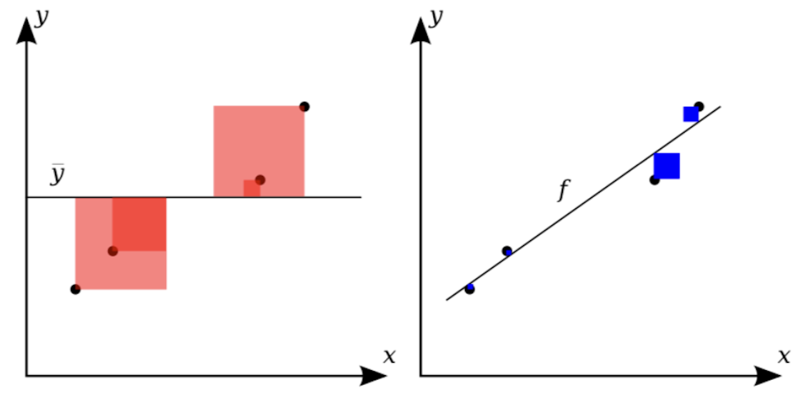
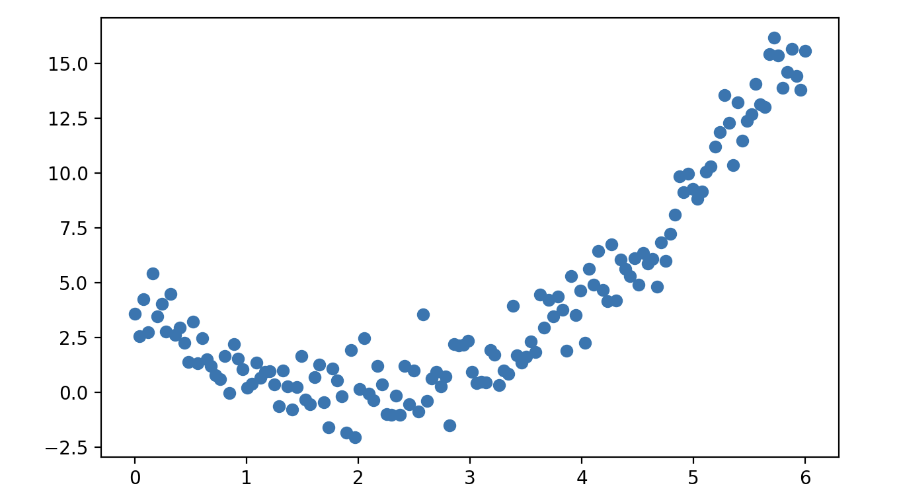
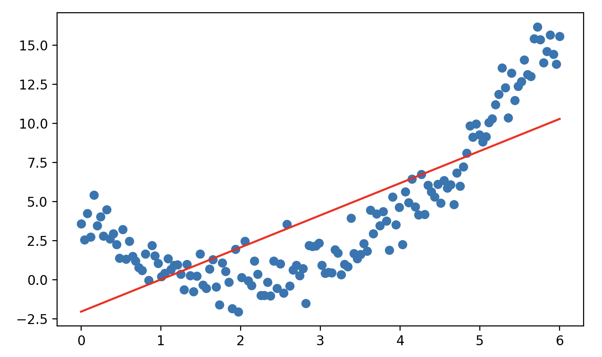
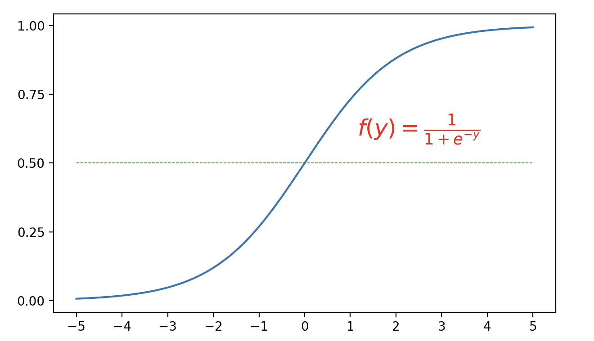

## Mô hình hồi quy

Mô hình hồi quy là một trong những mô hình cơ bản nhất trong học máy và thống kê học, được dùng để dự đoán các biến đầu ra liên tục. Nói một cách đơn giản, khi cho trước một tập hợp các biến đầu vào (biến độc lập) và biến đầu ra tương ứng (biến phụ thuộc), mô hình hồi quy hướng tới việc tìm ra mối quan hệ ánh xạ giữa các biến đầu vào và biến đầu ra. Dạng thức của mô hình hồi quy có thể tương đối đơn giản, nhưng nó lại chứa đựng những tư tưởng mô hình hóa cốt lõi nhất của học máy. Thông thường, chúng ta xây dựng mô hình hồi quy chủ yếu vì hai mục tiêu:

1. **Mô tả mối quan hệ giữa các dữ liệu**. Chúng ta đã đề cập trước đó rằng **mấu chốt của học máy là thông qua dữ liệu lịch sử để nắm bắt cách ánh xạ từ các đặc trưng sang giá trị mục tiêu**. Quá trình này không đòi hỏi chúng ta phải thiết lập trước bất kỳ quy tắc nào, mà để cỗ máy tự học hỏi từ dữ liệu lịch sử. Mô hình hồi quy có thể giúp chúng ta diễn đạt mối quan hệ giữa đầu vào và đầu ra thông qua mô hình toán học.
2. **Đưa ra dự đoán cho dữ liệu chưa biết**. Thông qua quan hệ ánh xạ đã học được, mô hình có thể dự đoán cho các dữ liệu đầu vào mới.

Ứng dụng của mô hình hồi quy rất rộng rãi, dưới đây là vài ví dụ cụ thể:

1. **Ngành bán lẻ**. Nền tảng thương mại điện tử lớn nhất thế giới Amazon dựa vào doanh số lịch sử, thuộc tính hàng hóa (giá, giảm giá, thương hiệu, danh mục,...), đặc trưng thời gian (mùa vụ, ngày làm việc, ngày lễ tết,...), các yếu tố bên ngoài (thời tiết, mạng xã hội,...) để xây dựng mô hình hồi quy dự đoán nhu cầu của các mặt hàng khác nhau trong một khoảng thời gian tương lai. Trong các đợt khuyến mãi, họ sử dụng hồi quy đa biến kết hợp số hạng tương tác để phân tích ảnh hưởng của khuyến mãi đến doanh số.
2. **Ngành ô tô**. Để tối ưu hóa chiến lược sạc pin, kéo dài tuổi thọ của pin và cảnh báo dung lượng pin chính xác hơn cho người dùng xe điện, Tesla sử dụng mô hình hồi quy dựa trên số lần sạc/xả pin, nhiệt độ môi trường, độ sâu xả sạc, các thông số vật lý của pin,... để dự đoán tuổi thọ còn lại của pin.
3. **Ngành bất động sản**. Nền tảng bất động sản trực tuyến lớn nhất nước Mỹ Zillow từng sử dụng mô hình hồi quy để giúp người dùng định giá nhà ở, dựa trên diện tích, tuổi thọ ngôi nhà, vị trí địa lý, loại hình nhà ở, mức độ an toàn của khu dân cư, điểm đánh giá trường học,... để đưa ra dự đoán về giá thị trường của ngôi nhà.

### Phân loại mô hình hồi quy

Tùy theo mức độ phức tạp và các giả định của mô hình, mô hình hồi quy có thể được chia thành các loại sau:

1. **Hồi quy tuyến tính** (Linear Regression): Giả định giữa biến đầu vào và biến đầu ra có mối quan hệ tuyến tính.

Hồi quy tuyến tính đơn biến: Xây dựng mô hình quan hệ tuyến tính giữa một biến phụ thuộc và một biến độc lập duy nhất.

$$
y = \beta_0 + \beta_1 x + \varepsilon
$$

Trong đó, $\small{y}$ là biến mục tiêu (biến phụ thuộc), $\small{x}$ là biến đầu vào (biến độc lập), $\small{\beta_{0}}$ là hệ số chặn (intercept), biểu thị giá trị dự đoán khi $\small{x=0}$, $\small{\beta_{1}}$ là hệ số hồi quy (độ dốc), biểu thị mức độ ảnh hưởng của biến đầu vào lên biến đầu ra, $\small{\varepsilon}$ là số hạng sai số, dùng để biểu thị nhiễu ngẫu nhiên hoặc phần không thể giải thích được trong dữ liệu.

Hồi quy tuyến tính đa biến: Xây dựng mô hình quan hệ tuyến tính giữa một biến phụ thuộc và nhiều biến độc lập.

$$
y = \beta_{0} + \beta_{1} x_{1} + \beta_{2} x_{2} + \cdots + \beta_{n} x_{n} + \varepsilon
$$

Công thức trên cũng có thể được biểu diễn rút gọn dưới dạng vector:

$$
y = \mathbf{x}^{T} \mathbf{\beta} + \varepsilon
$$

Trong đó, $\small{\mathbf{x} = [1, x_{1}, x_{2}, \dots, x_{n}]^{T}}$ là vector đầu vào chứa hệ số chặn, $\small{\mathbf{\beta} = [\beta_{0}, \beta_{1}, \beta_{2}, \dots, \beta_{n}]^{T}}$ là tham số mô hình (bao gồm hệ số chặn $\small{\beta_{0}}$ và các hệ số hồi quy $\small{\beta_{1}, \beta_{2}, \cdots, \beta_{n}}$), $\small{\varepsilon}$ là số hạng sai số.

2. **Hồi quy đa thức** (Polynomial Regression): Đưa vào các đặc trưng bậc cao hơn, giúp mô hình khớp được các mối quan hệ phi tuyến tính phức tạp hơn. Đây là một dạng mở rộng của mô hình tuyến tính, vì việc giải các tham số $\small{\beta}$ vẫn ở dạng tuyến tính, ví dụ như quan hệ bậc hai dưới đây:

$$
y = \beta_{0} + \beta_{1} x + \beta_{2} x^{2} + \varepsilon
$$

3. **Hồi quy phi tuyến** (Nonlinear Regression): Hồi quy phi tuyến hoàn toàn từ bỏ giả định tuyến tính, dạng mô hình có thể là bất kỳ hàm phi tuyến nào.

4. **Hồi quy Ridge** (Ridge Regression), **Hồi quy Lasso** (Lasso Regression), **Hồi quy Elastic Net** (Elastic Net Regression): Thêm các số hạng điều chuẩn (regularization) vào hồi quy tuyến tính, dùng để xử lý các vấn đề quá khớp (overfitting), đa cộng tuyến (multicollinearity) và sàng lọc đặc trưng.

5. **Hồi quy logistic** (Logistic Regression): Mặc dù mang tên "hồi quy", nhưng thực chất đây lại là mô hình dùng cho bài toán phân loại. Nó sử dụng hàm Sigmoid để ánh xạ tổ hợp tuyến tính của các giá trị đầu vào về khoảng $\small{(0, 1)}$, biểu thị xác suất phân loại, phù hợp cho bài toán phân loại nhị phân; nó cũng có thể mở rộng thành hồi quy Softmax để giải quyết bài toán phân loại đa lớp.

$$
P(y=1 \vert x) = \frac{1}{1 + e^{-(\beta_{0} + \beta_{1} x_{1} + \cdots + \beta_{n} x_{n})}}
$$

### Tính toán hệ số hồi quy

Mấu chốt của việc xây dựng mô hình hồi quy là tìm ra các hệ số hồi quy tối ưu $\small{\mathbf{\beta}}$. Cái gọi là hệ số hồi quy tối ưu là tham số mô hình giúp mô hình đạt được hiệu quả khớp dữ liệu tốt nhất, tức là tham số có thể cực tiểu hóa chênh lệch giữa giá trị dự đoán $\small{\hat{y_{i}}}$ của mô hình và giá trị quan sát thực tế $\small{y_{i}}$. Vì vậy, trước tiên chúng ta định nghĩa hàm mất mát như sau:

$$
L(\mathbf{\beta}) = \sum_{i=1}^{m}(y_{i} - \hat{y_{i}})^{2}
$$

Trong đó, $\small{m}$ biểu thị kích thước mẫu. Thay mô hình hồi quy vào, ta có:

$$
L(\mathbf{\beta}) = \sum_{i=1}^{m}(y_{i} - \mathbf{x}_{i}^{T}\mathbf{\beta})^{2}
$$

Nếu biểu diễn dưới dạng ma trận, ta có:

$$
L(\mathbf{\beta}) = (\mathbf{y} - \mathbf{X\beta})^{T}(\mathbf{y} - \mathbf{X\beta})
$$

Trong đó, $\mathbf{y}$ là vector các giá trị mục tiêu, kích thước $\small{m \times 1}$; $\mathbf{X}$ là ma trận đặc trưng, kích thước $\small{m \times n}$; $\small{\mathbf{\beta}}$ là vector các hệ số hồi quy, kích thước $\small{n \times 1}$.

Bằng cách cực tiểu hóa hàm mất mát $\small{L(\mathbf{\beta})}$, chúng ta có thể thu được nghiệm giải tích (analytical solution) của mô hình hồi quy tuyến tính. Lấy đạo hàm của $\small{L(\mathbf{\beta})}$ theo $\small{\mathbf{\beta}}$ và cho bằng 0, ta có:

$$
\frac{\partial{L(\mathbf{\beta})}}{\partial{\mathbf{\beta}}} = -2\mathbf{X}^{T}(\mathbf{y} - \mathbf{X\beta}) = 0
$$

Sau khi biến đổi rút gọn, ta được:

$$
\mathbf{\beta} = (\mathbf{X}^{T}\mathbf{X})^{-1}\mathbf{X}^{T}\mathbf{y}
$$

Đối với trường hợp ma trận $\small{\mathbf{X}^{T}\mathbf{X}}$ không khả nghịch (không đủ hạng), có thể thêm số hạng điều chuẩn để làm cho ma trận khả nghịch như dưới đây, đây chính là nghiệm giải tích của hồi quy tuyến tính:

$$
\mathbf{\beta} = (\mathbf{X}^{T}\mathbf{X} + \mathbf{\lambda \mit{I}})^{-1}\mathbf{X}^{T}\mathbf{y}
$$

> **Giải thích**: Nếu bạn chưa hiểu rõ về kỹ thuật điều chuẩn được đề cập ở đây thì có thể tạm gác lại, chúng ta sẽ thảo luận vấn đề này ở phần sau.

Phương pháp trên phù hợp với các tập dữ liệu quy mô nhỏ; khi khối lượng dữ liệu không lớn (số lượng mẫu và đặc trưng tương đối ít), hiệu quả tính toán hoàn toàn đáp ứng tốt. Đối với các tập dữ liệu quy mô lớn hoặc các bài toán tối ưu phức tạp hơn, chúng ta có thể sử dụng **phương pháp hạ độ dốc** (Gradient Descent), thông qua việc cập nhật tham số qua từng vòng lặp để tiệm cận dần nghiệm tối ưu. Mục tiêu của hạ độ dốc cũng là cực tiểu hóa hàm mất mát, phương pháp này cập nhật tham số bằng cách tính hướng của gradient. Gradient là một vector chứa các đạo hàm riêng của hàm mục tiêu theo hướng của từng tham số. Đối với hàm mất mát $\small{L(\mathbf{\beta})}$ ở trên, gradient có thể biểu diễn như sau:

$$
\nabla L(\mathbf{\beta}) = \left[ \frac{\partial{L}}{\partial{\beta_{1}}},  \frac{\partial{L}}{\partial{\beta_{2}}}, \cdots,  \frac{\partial{L}}{\partial{\beta_{n}}} \right]
$$

Phương pháp hạ độ dốc cập nhật tham số $\small{\mathbf{\beta}}$ thông qua quy tắc cập nhật sau:

$$
\mathbf{\beta}^{\prime} = \mathbf{\beta} - \alpha \nabla L(\mathbf{\beta}) \\\\
\mathbf{\beta} = \mathbf{\beta^{\prime}}
$$

Trong đó, $\small{\alpha}$ là tốc độ học (learning rate hay step size), thường là một số dương nhỏ, dùng để kiểm soát biên độ của mỗi lần cập nhật. Nếu tốc độ học $\small{\alpha}$ được chọn thích hợp, hạ độ dốc sẽ hội tụ về cực tiểu cục bộ của hàm mục tiêu. Nếu tốc độ học quá lớn, có thể dẫn đến dao động không hội tụ; nếu tốc độ học quá nhỏ, tốc độ hội tụ sẽ rất chậm và đòi hỏi nhiều vòng lặp hơn.

### Giới thiệu tập dữ liệu mới

Tập dữ liệu hoa Iris đã giới thiệu trước đây không phù hợp để minh họa mô hình hồi quy, vì vậy chúng ta giới thiệu một tập dữ liệu kinh điển khác là tập dữ liệu MPG của ô tô. Tập dữ liệu MPG ô tô ban đầu do Hiệp hội Ô tô Hoa Kỳ cung cấp, chúng ta có thể dùng tập dữ liệu này để dự đoán hiệu quả sử dụng nhiên liệu của xe, tức là số dặm đi được trên mỗi gallon nhiên liệu (Miles Per Gallon, MPG). Cần lưu ý rằng thư viện scikit-learn không tích hợp sẵn tập dữ liệu này, chúng ta có thể tải trực tiếp từ trang web [UCI Machine Learning Repository](https://archive.ics.uci.edu/dataset/9/auto+mpg), hoặc tải dữ liệu qua mạng bằng cách chạy đoạn mã dưới đây.

```python
import ssl
import pandas as pd

ssl._create_default_https_context = ssl._create_unverified_context
df = pd.read_csv('https://archive.ics.uci.edu/static/public/9/data.csv')
df.info()
```

Đầu ra:

```
<class 'pandas.core.frame.DataFrame'>
RangeIndex: 398 entries, 0 to 397
Data columns (total 9 columns):
 #   Column        Non-Null Count  Dtype  
---  ------        --------------  -----  
 0   car_name      398 non-null    object 
 1   cylinders     398 non-null    int64  
 2   displacement  398 non-null    float64
 3   horsepower    392 non-null    float64
 4   weight        398 non-null    int64  
 5   acceleration  398 non-null    float64
 6   model_year    398 non-null    int64  
 7   origin        398 non-null    int64  
 8   mpg           398 non-null    float64
dtypes: float64(4), int64(4), object(1)
memory usage: 28.1+ KB
```

Dựa vào đầu ra ở trên, chúng ta giới thiệu sơ lược về 9 thuộc tính của tập dữ liệu, 8 thuộc tính đầu đều là biến đầu vào (thuộc tính đầu tiên tạm thời chưa dùng), thuộc tính cuối cùng là biến đầu ra, cụ thể như bảng dưới đây.

| Tên thuộc tính | Mô tả |
| -------------- | ------------------------------------------------------------ |
| *car_name*     | Tên xe ô tô, dạng chuỗi, thuộc tính này tạm thời không giúp ích cho việc xây dựng mô hình |
| *cylinders*    | Số lượng xi-lanh, số nguyên |
| *displacement* | Dung tích động cơ (cubic inches - inch khối), số thực |
| *horsepower*   | Mã lực, số thực, có giá trị rỗng cần xử lý trước |
| *weight*       | Trọng lượng xe (pounds - pound), số nguyên |
| *acceleration* | Khả năng tăng tốc (thời gian cần thiết từ 0 - 60 mph), số thực |
| *model_year*   | Năm sản xuất mẫu xe (1970 - 1982), ở đây dùng hai chữ số cuối của năm |
| *origin*       | Xuất xứ xe (1 = Mỹ, 2 = Châu Âu, 3 = Nhật Bản), các giá trị `1`, `2`, `3` ở đây nên được coi là 3 phân loại thay vì số nguyên |
| *mpg*          | Hiệu quả nhiên liệu của xe, số dặm đi được trên mỗi gallon (biến mục tiêu) |

Trước tiên chúng ta xóa thuộc tính `car_name` tạm thời chưa dùng tới, sau đó sử dụng phương thức `corr` của đối tượng `DataFrame` để kiểm tra xem giữa các biến đầu vào (đặc trưng) và biến đầu ra (giá trị mục tiêu) có tồn tại mối tương quan hay không. Thông qua phân tích tương quan, chúng ta có thể chọn các đặc trưng có mối tương quan mạnh và loại bỏ những đặc trưng có tương quan yếu với giá trị mục tiêu, điều này giúp giảm độ phức tạp của mô hình và nguy cơ quá khớp. Trong hồi quy đa biến, hiện tượng đa cộng tuyến (tức là các biến đầu vào có tương quan cao với nhau) có thể ảnh hưởng đến việc ước lượng hệ số hồi quy, khiến mô hình không ổn định. Có thể phát hiện vấn đề cộng tuyến bằng cách tính hệ số tương quan giữa các đặc trưng và hệ số phóng đại phương sai (VIF).

```python
# Xóa cột được chỉ định
df.drop(columns=['car_name'], inplace=True)
# Tính ma trận hệ số tương quan
df.corr()
```

> **Giải thích**: Phương thức `corr` của đối tượng `DataFrame` mặc định tính hệ số tương quan Pearson, hệ số tương quan Pearson thích hợp cho các giá trị liên tục xuất phát từ tổng thể phân phối chuẩn. Đối với việc xác định tương quan giữa dữ liệu thứ bậc, có thể sửa tham số `method` thành `spearman` hoặc `kendall` để tính tương quan thứ hạng Spearman hoặc hệ số Kendall. Tất nhiên, các giá trị liên tục cũng có thể được xử lý thành dữ liệu thứ bậc thông qua thao tác chia khoảng (binning), rồi sau đó mới xác định tương quan.

Trước khi sử dụng tập dữ liệu này để xây dựng mô hình, chúng ta cần làm một số công việc chuẩn bị: đầu tiên là xử lý các giá trị rỗng của trường `horsepower`, sau đó chuyển trường `origin` thành **mã hóa one-hot** (One-Hot Encoding). Mã hóa one-hot là phương pháp mã hóa phổ biến dùng để xử lý các biến phân loại. Thông thường, dữ liệu phân loại (như giới tính, màu sắc, mùa trong năm,...) không thể đưa trực tiếp vào mô hình học máy để huấn luyện, vì hầu hết các thuật toán chỉ có thể xử lý dữ liệu dạng số. Mã hóa one-hot biểu diễn mỗi biến phân loại bằng cách chuyển đổi nó thành nhiều đặc trưng nhị phân mới (`0` hoặc `1`), nhờ đó các biến này có thể được đưa vào mô hình học máy. Giả sử chúng ta có một cột đặc trưng tên là "Màu sắc", với các giá trị có thể có là `Đỏ`, `Xanh lá` và `Xanh dương`, chúng ta có thể dùng mã hóa one-hot chuyển nó thành ba đặc trưng nhị phân như bảng dưới đây:

| Đỏ | Xanh lá | Xanh dương |
| :--: | :--: | :--: |
| 1    | 0    | 0    |
| 0    | 1    | 0    |
| 0    | 0    | 1    |
| 0    | 1    | 0    |
| 1    | 0    | 0    |

> **Giải thích**: Chúng ta cũng có thể chỉ giữ lại hai cột Xanh lá và Xanh dương. Nếu giá trị của cả hai cột đều là `0`, thì điều đó có nghĩa màu sắc là Đỏ.

Phương pháp mã hóa one-hot đơn giản, trực quan, dễ hiểu và dễ thực hiện. Đối với các danh mục không có thứ tự, mã hóa one-hot rất hiệu quả vì nó không tạo ra bất kỳ mối quan hệ thứ tự giả tạo nào; kiểu dữ liệu sau khi xử lý là kiểu số nên nhiều thuật toán học máy có thể xử lý rất tốt. Tuy nhiên, nếu đặc trưng danh mục có quá nhiều giá trị khác nhau, mã hóa one-hot sẽ sinh ra một lượng lớn đặc trưng mới, có thể làm số chiều của dữ liệu tăng vọt, từ đó ảnh hưởng đến hiệu năng tính toán và hiệu quả lưu trữ, đặc biệt là khi dữ liệu có nhiều danh mục thưa thớt (sparse categories).

Đoạn mã dưới đây thực hiện tiền xử lý dữ liệu.

```python
# Xóa các mẫu có giá trị bị thiếu
df.dropna(inplace=True)
# Xử lý trường origin thành kiểu category
df['origin'] = df['origin'].astype('category') 
# Xử lý trường origin thành mã hóa one-hot
df = pd.get_dummies(df, columns=['origin'], drop_first=True)
df
```

Đầu ra:

```
     cylinders  displacement  horsepower  weight  ...  model_year   mpg  origin_2  origin_3
0            8         307.0       130.0    3504  ...          70  18.0     False     False
1            8         350.0       165.0    3693  ...          70  15.0     False     False
2            8         318.0       150.0    3436  ...          70  18.0     False     False
3            8         304.0       150.0    3433  ...          70  16.0     False     False
4            8         302.0       140.0    3449  ...          70  17.0     False     False
..         ...           ...         ...     ...  ...         ...   ...       ...       ...
393          4         140.0        86.0    2790  ...          82  27.0     False     False
394          4          97.0        52.0    2130  ...          82  44.0      True     False
395          4         135.0        84.0    2295  ...          82  32.0     False     False
396          4         120.0        79.0    2625  ...          82  28.0     False     False
397          4         119.0        82.0    2720  ...          82  31.0     False     False

[392 rows x 9 columns]
```

> **Giải thích**: Đoạn mã trên gọi hàm `get_dummies` của pandas để chuyển cột `origin` thành mã hóa one-hot. Do thiết lập tham số `drop_first` thành `True`, nên từ 3 giá trị ban đầu `1`, `2`, `3` chỉ còn giữ lại hai cột mang tên `origin_2` và `origin_3`. Lớp `OneHotEncoder` trong module `preprocessing` của thư viện Scikit-learn cũng hỗ trợ chuyển các đặc trưng danh mục thành mã hóa one-hot.

Tiếp theo, chúng ta chia tập dữ liệu thành tập huấn luyện và tập kiểm tra, đoạn mã như sau.

```python
from sklearn.model_selection import train_test_split

X, y = df.drop(columns='mpg').values, df['mpg'].values
X_train, X_test, y_train, y_test = train_test_split(X, y, train_size=0.8, random_state=3)
```

### Triển khai hồi quy tuyến tính bằng mã nguồn

Đầu tiên, chúng ta sử dụng `LinearRegression` từ module `linear_model` của thư viện scikit-learn để tạo mô hình hồi quy tuyến tính. `LinearRegression` sử dụng phương pháp bình phương tối thiểu để tính toán các tham số của mô hình hồi quy, đoạn mã như sau.

```python
from sklearn.linear_model import LinearRegression

model = LinearRegression()
model.fit(X_train, y_train)
y_pred = model.predict(X_test)
```

Nếu muốn xem các tham số của mô hình hồi quy tuyến tính (hệ số hồi quy và hệ số chặn), có thể thực hiện thông qua đoạn mã dưới đây.

```python
print('Hệ số hồi quy:', model.coef_)
print('Hệ số chặn:', model.intercept_)
```

Đầu ra:

```
Hệ số hồi quy: [-0.70865621  0.03138774 -0.03034065 -0.0064137   0.06224274  0.82866534
  3.20888265  3.68252848]
Hệ số chặn: -21.685482718950933
```

### Đánh giá mô hình hồi quy

Hiệu quả dự đoán của mô hình hồi quy rốt cuộc ra sao, chúng ta có thể đánh giá thông qua các chỉ số dưới đây.

1. Sai số bình phương trung bình (Mean Squared Error, MSE). MSE là một trong những chỉ số đánh giá được sử dụng phổ biến nhất cho mô hình hồi quy, được định nghĩa là giá trị trung bình của bình phương sai số giữa giá trị dự đoán và giá trị thực tế.

$$
\text{MSE} = \frac{1}{m} \sum_{i=1}^{m}(y_{i} - \hat{y_{i}})^{2}
$$

2. Căn bậc hai của sai số bình phương trung bình (Root Mean Squared Error, RMSE). RMSE là dạng căn bậc hai của MSE, dùng để đo lường độ lớn thực tế của sai số một cách trực quan hơn (đơn vị đo giống với đơn vị của biến mục tiêu).

$$
\text{RMSE} = \sqrt{\text{MSE}} = \sqrt{\frac{1}{m} \sum_{i=1}^{m}(y_{i} - \hat{y_{i}})^{2}}
$$

3. Sai số tuyệt đối trung bình (Mean Absolute Error, MAE). MAE là một chỉ số đo lường sai số thông dụng khác, được định nghĩa là giá trị trung bình của độ lệch tuyệt đối giữa giá trị dự đoán và giá trị thực tế.

$$
\text{MAE} = \frac{1}{m} \sum_{i=1}^{m} \lvert y_{i} - \hat{y_{i}} \rvert
$$

4. Hệ số xác định (R-Squared, $\small{R^{2}}$). $\small{R^{2}}$ là một chỉ số tương đối, dùng để đo lường mức độ khớp của mô hình đối với dữ liệu, giá trị của nó càng gần 1 thì càng tốt. Công thức tính $\small{R^{2}}$ là:

$$
R^{2} = 1 - \frac{SS_{res}}{{SS}_{tot}}
$$

Trong đó, $\small{SS_{res} = \sum_{i=1}^{m}(y_{i} - \hat{y_{i}})^{2}}$ là tổng bình phương phần dư; $\small{SS_{tot} = \sum_{i=1}^{m} (y_{i} - \bar{y})^{2}}$ là tổng bình phương tổng thể, như hình dưới đây.



Tổng diện tích các hình vuông màu đỏ bên trái hình trên chính là tổng bình phương tổng thể, còn tổng diện tích các hình vuông màu xanh lam bên phải chính là tổng bình phương phần dư. Rõ ràng, mô hình khớp càng tốt thì tỷ số giữa tổng bình phương phần dư chia cho tổng bình phương tổng thể càng gần 0, và giá trị $\small{R^{2}}$ càng gần 1. Thông thường khi $\small{R^{2} \ge 0.8}$, chúng ta coi mức độ khớp của mô hình là đã rất tốt.

Có thể sử dụng các hàm được đóng gói sẵn trong scikit-learn để tính các giá trị sai số bình phương trung bình, sai số tuyệt đối trung bình và $\small{R^{2}}$, đoạn mã như sau.

```python
from sklearn.metrics import mean_absolute_error, mean_squared_error, r2_score

mse = mean_squared_error(y_test, y_pred)
mae = mean_absolute_error(y_test, y_pred)
r2 = r2_score(y_test, y_pred)

print(f'Sai số bình phương trung bình: {mse:.4f}')
print(f'Sai số tuyệt đối trung bình: {mae:.4f}')
print(f'Hệ số xác định: {r2:.4f}')
```

Đầu ra:

```
Sai số bình phương trung bình: 13.1215
Sai số tuyệt đối trung bình: 2.8571
Hệ số xác định: 0.7848
```

### Đưa vào số hạng điều chuẩn

Hồi quy Ridge đưa thêm số hạng điều chuẩn $\small{L2}$ vào hồi quy tuyến tính, nhằm mục đích ngăn ngừa hiện tượng quá khớp của mô hình, đặc biệt là khi số lượng đặc trưng nhiều hoặc giữa các đặc trưng có hiện tượng cộng tuyến. Hàm mất mát của hồi quy Ridge như sau:

$$
L(\beta) = \sum_{i=1}^{m}{(y_{i} - \hat{y_{i}})^{2}} + \lambda \cdot \sum_{j=1}^{n}{\beta_{j}^{2}}
$$

Trong đó, số hạng điều chuẩn $\small{L2}$ là $\small{\lambda \sum_{j=1}^{n} \beta_{j}^{2}}$ sẽ phạt các hệ số hồi quy lớn, tương đương với việc thu nhỏ độ lớn của hệ số hồi quy, nhưng không làm cho hệ số triệt tiêu về 0 (tức là không thực hiện lựa chọn đặc trưng). Có thể triển khai hồi quy Ridge thông qua lớp `Ridge` của module `linear_model` trong thư viện scikit-learn, đoạn mã như sau.

```python
from sklearn.linear_model import Ridge

model = Ridge()
model.fit(X_train, y_train)
y_pred = model.predict(X_test)
print('Hệ số hồi quy:', model.coef_)
print('Hệ số chặn:', model.intercept_)
mse = mean_squared_error(y_test, y_pred)
r2 = r2_score(y_test, y_pred)
print(f'Sai số bình phương trung bình: {mse:.4f}')
print(f'Hệ số xác định: {r2:.4f}')
```

Đầu ra:

```
Hệ số hồi quy: [-0.68868217  0.03023126 -0.0291811  -0.00642523  0.06312298  0.82583962
  3.04105754  3.49988826]
Hệ số chặn: -21.390402697674855
Sai số bình phương trung bình: 12.9604
Hệ số xác định: 0.7874
```

Hồi quy Lasso đưa vào số hạng điều chuẩn $\small{L1}$, không chỉ ngăn ngừa quá khớp mà còn có chức năng lựa chọn đặc trưng, đặc biệt thích hợp cho dữ liệu nhiều chiều. Hàm mất mát của hồi quy Lasso như sau:

$$
L(\mathbf{\beta}) = \sum_{i=1}^{m}{(y_{i} - \hat{y_i})^{2}} + \lambda \cdot \sum_{j=1}^{n}{\lvert \beta_{j} \rvert}
$$

Trong đó, số hạng điều chuẩn $\small{L1}$ là $\small{\lambda \sum_{j=1}^{n} \lvert \beta_{j} \rvert}$ sẽ thu hẹp một số hệ số hồi quy không quan trọng về đúng bằng 0, từ đó thực hiện việc lựa chọn đặc trưng. Có thể triển khai hồi quy Lasso thông qua lớp `Lasso` của module `linear_model` trong thư viện scikit-learn, đoạn mã như sau.

```python
from sklearn.linear_model import Lasso

model = Lasso()
model.fit(X_train, y_train)
y_pred = model.predict(X_test)
print('Hệ số hồi quy:', model.coef_)
print('Hệ số chặn:', model.intercept_)
mse = mean_squared_error(y_test, y_pred)
r2 = r2_score(y_test, y_pred)
print(f'Sai số bình phương trung bình: {mse:.4f}')
print(f'Hệ số xác định: {r2:.4f}')
```

Đầu ra:

```
Hệ số hồi quy: [-0.00000000e+00  4.46821248e-04 -1.22830326e-02 -6.29725191e-03
  0.00000000e+00  6.91590631e-01  0.00000000e+00  0.00000000e+00]
Hệ số chặn: -9.109888229245005
Sai số bình phương trung bình: 11.1035
Hệ số xác định: 0.8179
```

> **Lưu ý**: Trong kết quả chạy mã ở trên, các hệ số hồi quy của 4 đặc trưng đã bị gán bằng 0, tương đương với việc từ 8 đặc trưng ban đầu đã chọn ra 4 đặc trưng quan trọng. Mức độ khớp của mô hình vượt trội hơn so với các mô hình hồi quy trước đó, điều này có thể thấy rõ qua sai số bình phương trung bình và hệ số xác định.

Hồi quy Elastic Net kết hợp các ưu điểm của cả hồi quy Ridge và hồi quy Lasso, bằng cách đưa vào đồng thời cả hai số hạng điều chuẩn $\small{L1}$ và $\small{L2}$, phù hợp cho dữ liệu nhiều chiều và giữa các đặc trưng có mối tương quan với nhau. Hàm mất mát của nó như sau:

$$
L(\mathbf{\beta}) = \sum_{i=1}^{m}{(y_{i} - \hat{y_i})^{2}} + \alpha \cdot \lambda \sum_{j=1}^{n}{\lvert \beta_{j} \rvert} + (1 - \alpha) \cdot \lambda \cdot \sum_{j=1}^{n}{\beta_{j}^{2}}
$$

Trong đó, $\small{\alpha}$ là tỷ lệ trọng số điều khiển mức độ điều chuẩn giữa $\small{L1}$ và $\small{L2}$.

### Một cách triển khai khác của hồi quy tuyến tính

Ở phần trước chúng ta đã đề cập rằng ngoài phương pháp bình phương tối thiểu, chúng ta còn có thể sử dụng phương pháp hạ độ dốc để giải các tham số của mô hình hồi quy. Lớp `SGDRegressor` trong module `linear_model` của thư viện scikit-learn chính là sử dụng phương pháp này, SGD là viết tắt của Stochastic Gradient Descent (Hạ độ dốc ngẫu nhiên). Hạ độ dốc ngẫu nhiên ở mỗi vòng lặp chỉ sử dụng một mẫu ngẫu nhiên để tính toán gradient, tốc độ tính toán nhanh, phù hợp với tập dữ liệu quy mô lớn và có thể thoát khỏi các điểm cực tiểu cục bộ. Cần lưu ý đến tốc độ học của nó: nếu thiết lập tốc độ học không hợp lý, khả năng hội tụ có thể bị dao động mạnh, thông thường cần sử dụng chiến lược suy giảm tốc độ học (learning rate decay) để thúc đẩy sự hội tụ. Ngoài ra, hạ độ dốc ngẫu nhiên rất nhạy cảm với thang đo của đặc trưng, thông thường trước khi huấn luyện cần tiến hành chuẩn hóa (standardization) hoặc quy chuẩn hóa (normalization) các đặc trưng. Toàn bộ mã nguồn như sau.

```python
from sklearn.linear_model import SGDRegressor
from sklearn.preprocessing import StandardScaler

# Lựa chọn và chuẩn hóa các đặc trưng
scaler = StandardScaler()
scaled_X = scaler.fit_transform(X[:, [1, 2, 3, 5]])
# Chia lại tập huấn luyện và tập kiểm tra
X_train, X_test, y_train, y_test = train_test_split(scaled_X, y, train_size=0.8, random_state=3)

# Tạo, huấn luyện và dự đoán mô hình
model = SGDRegressor()
model.fit(X_train, y_train)
y_pred = model.predict(X_test)
print('Hệ số hồi quy:', model.coef_)
print('Hệ số chặn:', model.intercept_)

# Đánh giá mô hình
mse = mean_squared_error(y_test, y_pred)
r2 = r2_score(y_test, y_pred)
print(f'Sai số bình phương trung bình: {mse:.4f}')
print(f'Hệ số xác định: {r2:.4f}')
```

Đầu ra:

```
Hệ số hồi quy: [-0.25027084 -0.41349219 -4.9559786   2.83009217]
Hệ số chặn: [23.48707219]
Sai số bình phương trung bình: 11.3853
Hệ số xác định: 0.8133
```

Ở đây, chúng ta cũng cần nhấn mạnh một số tham số quan trọng của hàm khởi tạo `SGDRegressor`, đây cũng là các siêu tham số tương đối quan trọng của mô hình hồi quy:

1. `loss`: Chỉ định mục tiêu tối ưu hóa (hàm mất mát), giá trị mặc định là `'squared_error'` (bình phương tối thiểu), các giá trị khác có thể chọn gồm: `'huber'`, `'epsilon_insensitive'` và `'squared_epsilon_insensitive'`, trong đó `'huber'` phù hợp cho mô hình hồi quy kháng nhiễu tốt hơn với các giá trị ngoại lai (outliers).
2. `penalty`: Chỉ định phương pháp điều chuẩn để ngăn ngừa quá khớp, mặc định là `'l2'` (điều chuẩn L2), các giá trị khác có thể chọn: `'l1'` (điều chuẩn L1), `'elasticnet'` (mạng đàn hồi, kết hợp L1 và L2), `None` (không dùng điều chuẩn).
3. `alpha`: Hệ số cường độ điều chuẩn, kiểm soát trọng số của số hạng điều chuẩn, giá trị mặc định là `0.0001`. Giá trị `alpha` lớn hơn sẽ gia tăng tác động của điều chuẩn, qua đó giới hạn độ phức tạp của mô hình; giá trị nhỏ hơn sẽ khiến mô hình chú trọng hơn vào việc khớp dữ liệu huấn luyện.
4. `l1_ratio`: Khi `penalty='elasticnet'`, kiểm soát trọng số giữa điều chuẩn L1 và L2, giá trị mặc định là `0.15`, phạm vi giá trị trong khoảng `[0, 1]` (`0` biểu thị hoàn toàn dùng L2, `1` biểu thị hoàn toàn dùng L1).
5. `tol`: Dung sai sai số của thuật toán tối ưu, tức là ngưỡng để xác định hội tụ, giá trị mặc định là `1e-3`. Khi độ biến thiên của hàm mục tiêu nhỏ hơn `tol`, quá trình huấn luyện sẽ dừng sớm; nếu muốn huấn luyện chính xác hơn, có thể giảm `tol` một cách thích hợp.
6. `learning_rate`: Chỉ định chiến lược điều chỉnh tốc độ học, giá trị mặc định là `'constant'`, biểu thị dùng tốc độ học cố định, giá trị cụ thể do `eta0` chỉ định; các tùy chọn khác bao gồm:
    - `'optimal'`: Tự động điều chỉnh dựa trên công thức `eta = 1.0 / (alpha * (t + t0))`.
    - `'invscaling'`: Co giãn tốc độ học theo `eta = eta0 / pow(t, power_t)`.
    - `'adaptive'`: Điều chỉnh động, giữ nguyên tốc độ học hiện tại khi sai số giảm, ngược lại thì giảm tốc độ học.
7. `eta0`: Tốc độ học ban đầu, giá trị mặc định là `0.01`. Khi `learning_rate='constant'` hoặc dùng các chiến lược khác, `eta0` quyết định độ dài bước cập nhật ban đầu.
8. `power_t`: Khi `learning_rate='invscaling'`, kiểm soát tốc độ suy giảm của tốc độ học, giá trị mặc định là `0.25`. Giá trị nhỏ hơn sẽ làm tốc độ học giảm chậm hơn, nhờ đó tập trung tối ưu hóa toàn cục trong thời gian dài hơn.
9. `early_stopping`: Có bật cơ chế dừng sớm hay không, mặc định là `False`. Nếu đặt thành `True`, mô hình sẽ tự động dừng huấn luyện dựa trên hiệu năng của tập kiểm định (validation set), giúp chống quá khớp.
10. `validation_fraction`: Chỉ định tỷ lệ dữ liệu huấn luyện được dùng làm tập kiểm định, giá trị mặc định là `0.1`. Khi `early_stopping=True`, tham số này sẽ phát huy tác dụng.
11. `max_iter`: Số vòng lặp huấn luyện tối đa, giá trị mặc định là `1000`. Khi dữ liệu lớn hoặc tốc độ học nhỏ, có thể cần tăng số vòng lặp để đảm bảo hội tụ.
12. `shuffle`: Có xáo trộn dữ liệu huấn luyện khi bắt đầu mỗi epoch hay không, mặc định là `True`, biểu thị có xáo trộn. Xáo trộn dữ liệu giúp nâng cao khả năng khái quát hóa của mô hình.
13. `warm_start`: Có sử dụng tham số của lần huấn luyện trước để tiếp tục huấn luyện hay không, mặc định là `False`. Khi đặt thành `True`, có thể tối ưu tiếp trên nền tảng mô hình hiện có.
14. `verbose`: Kiểm soát mức độ chi tiết của nhật ký đầu ra trong quá trình huấn luyện, mặc định là `0`, có thể đặt thành giá trị cao hơn để quan sát tiến trình huấn luyện.

### Hồi quy đa thức

Đôi khi, mối quan hệ giữa biến độc lập và biến phụ thuộc mà chúng ta quan tâm không phải là quan hệ tuyến tính đơn giản, chẳng hạn như mối quan hệ giữa chi phí quảng cáo và mức tăng trưởng doanh số, hay quan hệ giữa thời gian sử dụng thiết bị và tỷ lệ hỏng hóc,... Ngoài ra, nếu trong dữ liệu xuất hiện các điểm uốn rõ rệt hoặc cần xấp xỉ một hiện tượng phức tạp nào đó bằng một công thức toán học đơn giản, mô hình hồi quy tuyến tính có thể sẽ không đáp ứng được yêu cầu, khi đó chúng ta cần xây dựng mô hình hồi quy đa thức.

Dưới đây, chúng ta dùng một ví dụ đơn giản để minh họa cho hồi quy đa thức. Trước tiên, chúng ta tạo một tập hợp các điểm dữ liệu và vẽ biểu đồ phân tán tương ứng, đoạn mã như sau.

```python
import numpy as np
import matplotlib.pyplot as plt

x = np.linspace(0, 6, 150)
y = x ** 2 - 4 * x + 3 + np.random.normal(1, 1, 150)
plt.scatter(x, y)
plt.show()
```

Đầu ra:



Rõ ràng, một tập hợp các điểm dữ liệu như thế này rất khó khớp bằng mô hình tuyến tính, đoạn mã dưới đây có thể chứng minh điều này.

```python
x_ = x.reshape(-1, 1)

model = LinearRegression()
model.fit(x_, y)
a, b = model.coef_[0], model.intercept_
y_pred = a * x + b
plt.scatter(x, y)
plt.plot(x, y_pred, color='r')
plt.show()
```

Đầu ra:



Rõ ràng, đây là kết quả của việc chưa khớp (underfitting). Chúng ta cùng xem tiếp giá trị của $\small{R^{2}}$:

```python
r2 = r2_score(y, y_pred)
print(f'Hệ số xác định: {r2:.4f}')
```

Đầu ra:

```
Hệ số xác định: 0.5933
```

Lớp `PolynomialFeatures` trong module `preprocessing` của thư viện Scikit-learn có thể mở rộng các đặc trưng ban đầu thành các đặc trưng đa thức, nhờ đó biến đổi mô hình tuyến tính thành mô hình chứa các số hạng bậc cao. Khi tạo đối tượng `PolynomialFeatures`, có một vài tham số quan trọng:

1. `degree`: Thiết lập bậc cao nhất của đa thức. Ví dụ, `degree=3` sẽ tạo ra các đặc trưng chứa số hạng bậc một, bậc hai và bậc ba.
2. `interaction_only`: Giá trị mặc định là `False`, nếu đặt thành `True` thì chỉ tạo ra các số hạng tương tác (như $\small{x_{1}x_{2}}$), không tạo ra các số hạng bậc cao riêng lẻ (như $\small{x_{1}^{2}}$, $\small{x_{2}^{2}}$).
3. `include_bias`: Giá trị mặc định là `True`, biểu thị có bao gồm số hạng hằng số (thường là 1) hay không, đặt thành `False` thì không bao gồm số hạng hằng số.

Dưới đây chúng ta sử dụng mã nguồn để minh họa cách thực hiện tiền xử lý đặc trưng bằng lớp `PolynomialFeatures` nhằm thực hiện hồi quy đa thức.

```python
from sklearn.preprocessing import PolynomialFeatures

poly = PolynomialFeatures(degree=2)
x_ = poly.fit_transform(x_)

model = LinearRegression()
model.fit(x_, y)
y_pred = model.predict(x_)
r2 = r2_score(y, y_pred)
print(f'Hệ số xác định: {r2:.4f}')
```

Đầu ra:

```
Hệ số xác định: 0.9497
```

Sau khi đưa vào các số hạng bậc cao thông qua tiền xử lý đặc trưng, hiệu quả khớp của mô hình đã được cải thiện rõ rệt. Nếu muốn chỉ thêm số hạng bậc cao cho một phần đặc trưng, bạn có thể sử dụng `ColumnTransformer` trong module `compose` của thư viện scikit-learn để định nghĩa các quy tắc xử lý, bạn đọc quan tâm có thể tự tìm hiểu thêm. Cần lưu ý rằng trong hồi quy đa thức, khi các số hạng bậc cao được đưa vào, nguy cơ xảy ra quá khớp của mô hình sẽ tăng lên rất nhiều, đặc biệt là khi lượng dữ liệu nhỏ; mặt khác, giá trị của các số hạng bậc cao có thể khiến phạm vi giá trị của đặc trưng trở nên rất lớn, cần cân nhắc chuẩn hóa đặc trưng.

### Hồi quy logistic

Mặc dù trong tên gọi có chứa từ "hồi quy", nhưng hồi quy logistic trên thực tế lại là một thuật toán phân loại, dùng để xử lý các bài toán phân loại nhị phân, chẳng hạn như email có phải là thư rác hay không, người dùng có bấm vào quảng cáo hay không, khách hàng thẻ tín dụng có rủi ro vỡ nợ hay không,... Ý tưởng cốt lõi của hồi quy logistic là thông qua hàm Sigmoid để ánh xạ đầu ra của hồi quy tuyến tính vào khoảng $\small{(0, 1)}$, đóng vai trò là dự đoán xác suất phân loại. Đường cong của hàm Sigmoid như hình dưới đây.



Dưới đây, chúng ta dùng hàm `make_classification` do module `datasets` của thư viện scikit-learn cung cấp để tạo một tập dữ liệu mô phỏng, sau đó dùng hồi quy logistic để xây dựng mô hình dự đoán phân loại, đoạn mã như sau.

```python
from sklearn.datasets import make_classification
from sklearn.linear_model import LogisticRegression
from sklearn.metrics import classification_report

# Tạo 1000 mẫu dữ liệu, mỗi mẫu gồm 6 đặc trưng
X, y = make_classification(n_samples=1000, n_features=6, random_state=3)
# Chia 1000 mẫu dữ liệu thành tập huấn luyện và tập kiểm tra
X_train, X_test, y_train, y_test = train_test_split(X, y, train_size=0.8, random_state=3)

# Tạo và huấn luyện mô hình hồi quy logistic
model = LogisticRegression()
model.fit(X_train, y_train)

# Dự đoán trên tập kiểm tra và đánh giá
y_pred = model.predict(X_test)
print(classification_report(y_test, y_pred))
```

Đầu ra:

```
              precision    recall  f1-score   support

           0       0.95      0.93      0.94       104
           1       0.93      0.95      0.94        96

    accuracy                           0.94       200
   macro avg       0.94      0.94      0.94       200
weighted avg       0.94      0.94      0.94       200
```

Ở đây, chúng ta tiếp tục nhấn mạnh một số tham số quan trọng trong hàm khởi tạo `LogisticRegression`, đây cũng là các siêu tham số tương đối quan trọng của mô hình hồi quy logistic:

1. `penalty`: Chỉ định kiểu điều chuẩn, dùng để kiểm soát độ phức tạp của mô hình và chống quá khớp, mặc định là `'l2'`.
2. `C`: Nghịch đảo của cường độ điều chuẩn, giá trị mặc định là `1.0`. Giá trị `C` nhỏ hơn sẽ tăng cường điều chuẩn (giới hạn độ phức tạp của mô hình nhiều hơn), giá trị `C` lớn hơn sẽ làm yếu đi điều chuẩn (chú trọng hơn vào việc khớp dữ liệu huấn luyện).
3. `solver`: Chỉ định thuật toán tối ưu hóa, mặc định là `'lbfgs'`, các giá trị có thể chọn bao gồm:
    - `'newton-cg'`, `'lbfgs'`, `'sag'`, `'saga'`: Hỗ trợ L2 và không điều chuẩn.
    - `'liblinear'`: Hỗ trợ điều chuẩn L1 và L2, thích hợp cho tập dữ liệu quy mô nhỏ.
    - `'saga'`: Hỗ trợ L1, L2 và ElasticNet, thích hợp cho dữ liệu quy mô lớn.
4. `multi_class`: Chỉ định cách xử lý bài toán phân loại đa lớp, giá trị mặc định là `'auto'`, tự động chọn `'ovr'` hoặc `'multinomial'` tùy theo dữ liệu. `'ovr'` biểu thị chiến lược One-vs-Rest, phù hợp cho phân loại nhị phân hoặc trường hợp đa lớp cơ bản; `'multinomial'` biểu thị chiến lược hồi quy đa thức (Multinomial Logistic Regression), thích hợp cho bài toán phân loại đa lớp và cần phối hợp sử dụng với `'lbfgs'`, `'sag'` hoặc `'saga'`.
5. `fit_intercept`: Có tính toán hệ số chặn (bias) hay không, mặc định là `True`.
6. `class_weight`: Trọng số của các lớp, dùng để xử lý bài toán mất cân bằng lớp, mặc định là `None`, đặt thành `'balanced'` có thể tự động điều chỉnh trọng số dựa trên tần suất xuất hiện của các lớp.

> **Giải thích**: Một số siêu tham số của hồi quy logistic tương tự như `SGDRegressor` đã nói ở trên, nên chúng tôi sẽ không nhắc lại ở đây.

### Tổng kết

Mô hình hồi quy là một phương pháp phân tích thống kê dùng để thiết lập mối quan hệ giữa biến độc lập và biến phụ thuộc. Nó dự đoán giá trị của biến mục tiêu thông qua việc khớp dữ liệu, và được ứng dụng rộng rãi trong các lĩnh vực kinh tế, kỹ thuật, y học,... giúp người ra quyết định đưa ra các dự đoán và phân tích dựa trên dữ liệu.
