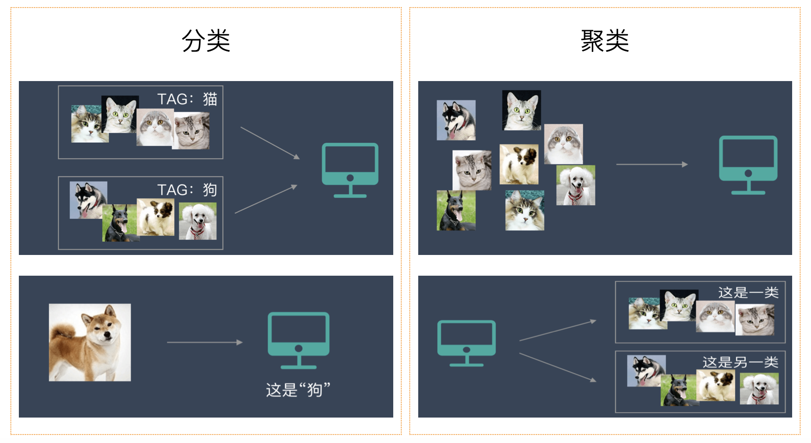
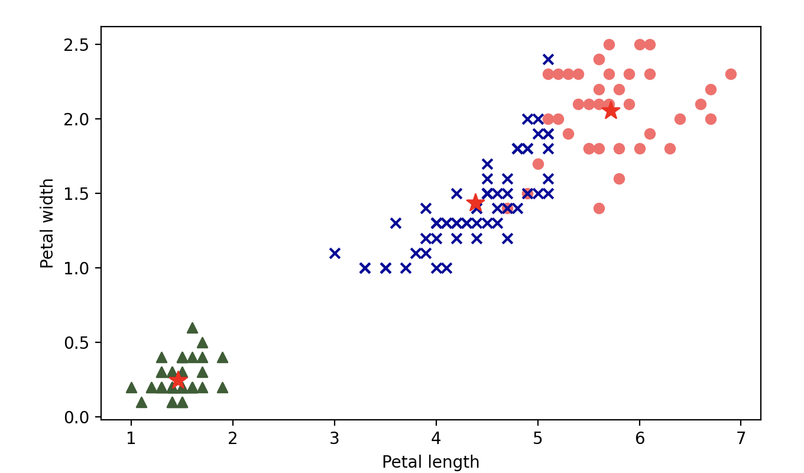
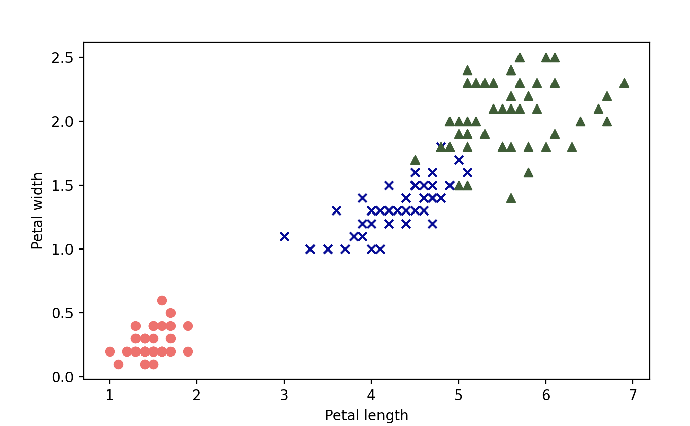
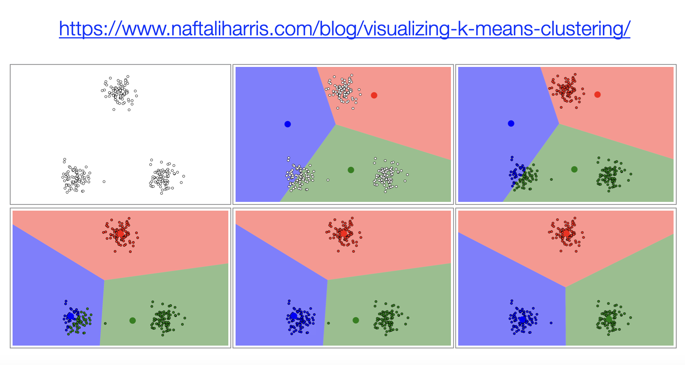
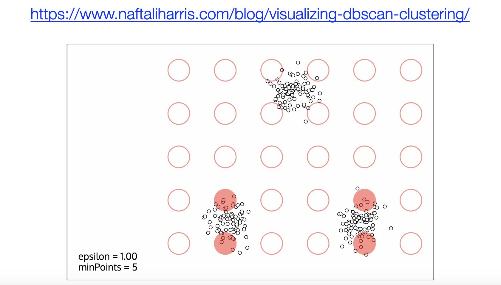

## Thuật toán phân cụm K-Means

Phân cụm (Clustering) là một kỹ thuật quan trọng trong khai phá dữ liệu và học máy, được dùng để chia các mẫu trong tập dữ liệu thành nhiều nhóm hoặc danh mục tương đồng nhau. Phương pháp này được ứng dụng rộng rãi trong nhiều lĩnh vực, ví dụ:

- **Ngành thương mại điện tử**: Dựa trên dữ liệu hành vi của người dùng, phân chia người tiêu dùng thành các nhóm khác nhau (người dùng chi tiêu cao, người dùng hoạt động tích cực, người dùng có nguy cơ rời bỏ, người dùng nhạy cảm về giá,...) để xây dựng các chiến lược vận hành có mục tiêu, thực hiện phân phối quảng cáo chính xác hơn; các doanh nghiệp tiêu biểu bao gồm Alibaba, Amazon,...
- **Ngành tài chính**: Các ngân hàng lớn sử dụng thuật toán phân cụm để phân tích lịch sử tín dụng, mức thu nhập, hành vi chi tiêu của người dùng, từ đó chia người dùng thành các nhóm rủi ro khác nhau. Đối với nhóm rủi ro cao cần thẩm định tín dụng chặt chẽ hơn, trong khi nhóm rủi ro thấp có thể được hưởng lãi suất vay ưu đãi hoặc hạn mức tín dụng cao hơn.
- **Ngành y tế**: Bằng cách phân tích dữ liệu sức khỏe của bệnh nhân (như tiền sử bệnh, dữ liệu gen, thói quen sinh hoạt,...), phân loại bệnh nhân thành các nhóm rủi ro sức khỏe khác nhau, nâng cao độ chính xác của dự đoán bệnh tật, thúc đẩy sự phát triển của y học chính xác; các công ty tiêu biểu như Johnson & Johnson, Pfizer,...
- **Mạng xã hội**: Bằng cách phân tích mối quan hệ bạn bè, sở thích, tương tác xã hội của người dùng, chia người dùng thành các vòng tròn xã hội khác nhau, dùng để gợi ý bạn bè, tùy biến nội dung cá nhân hóa và tối ưu hóa hệ thống gợi ý bảng tin trên nền tảng.

Phân cụm là một dạng **học không giám sát** (unsupervised learning), bởi vì nó không cần các nhãn được định nghĩa trước, mà chỉ học dựa trên các đặc trưng của dữ liệu. Bằng cách đo lường độ tương đồng của đặc trưng hoặc khoảng cách, nó chia tập dữ liệu đã biết thành một số cụm khác nhau. Khác với bài toán phân loại, mục tiêu của nhiệm vụ phân cụm là khám phá cấu trúc nội tại của dữ liệu. Các thuật toán phân cụm nhìn chung có thể chia thành: **phân cụm dựa trên khoảng cách**, **phân cụm dựa trên mật độ**, **phân cụm phân cấp**, **phân cụm phổ**, v.v. Nếu bạn vẫn chưa phân biệt rõ sự khác nhau giữa phân cụm và phân loại, hình ảnh dưới đây chắc chắn sẽ giúp ích cho bạn.



### Nguyên lý thuật toán

Dưới đây chúng ta tập trung giới thiệu thuật toán phân cụm mang tên K-Means. K-Means là một phương pháp phân cụm phân vùng dựa trên nguyên mẫu, mục tiêu của nó là chia tập dữ liệu thành K cụm sao cho các điểm dữ liệu trong cùng một cụm có độ tương đồng cao nhất có thể. Các bước thực hiện của thuật toán K-Means như sau:

1. **Khởi tạo tâm cụm**: Chọn ngẫu nhiên K mẫu làm tâm cụm ban đầu, tâm cụm thường được gọi là trọng tâm (centroid).
2. **Gán mẫu vào trọng tâm gần nhất**: Tính khoảng cách giữa mỗi mẫu và tất cả các trọng tâm, gán mẫu vào cụm gần nhất.
3. **Cập nhật trọng tâm**: Tính giá trị trung bình của tất cả các mẫu trong mỗi cụm và lấy đó làm trọng tâm mới.
4. **Lặp lại bước 2 và bước 3** cho đến khi các trọng tâm hội tụ hoặc đạt đến số lần lặp tối đa được thiết lập trước.

### Mô tả toán học

Chúng ta sẽ mô tả nguyên lý thuật toán ở trên bằng ngôn ngữ toán học. Đối với một tập dữ liệu cho trước, mục tiêu của thuật toán K-Means là cực tiểu hóa hàm mục tiêu (tổng bình phương sai số). Hàm mục tiêu như sau:

$$
J = \sum_{i=1}^{K} \sum_{x \in C_{i}} {\lVert x - \mu_{i} \rVert}^{2}
$$

Trong đó, $\small{K}$ là số lượng cụm, $\small{C_{i}}$ biểu thị tập hợp các mẫu trong cụm thứ $\small{i}$, $\small{\mu_{i}}$ là trọng tâm của cụm thứ $\small{i}$, $\small{x}$ là điểm dữ liệu. Vì bài toán này thuộc loại bài toán tối ưu tổ hợp NP-khó (NP-hard), nên trong thực tế chúng ta áp dụng phương pháp lặp để tìm nghiệm thỏa mãn.

Đầu tiên, chọn ngẫu nhiên $\small{K}$ điểm làm các trọng tâm ban đầu $\small{\mu_{1}, \mu_{2}, \cdots, \mu_{K}}$. Đối với mỗi điểm dữ liệu $\small{x_{j}}$, tính khoảng cách đến từng trọng tâm và chọn trọng tâm gần nhất, tức là:

$$
C_{i} = \lbrace {x_{j} \ \vert \ {\lVert x_{j} - \mu_{i} \rVert}^{2} \le {\lVert x_{j} - \mu_{k} \rVert}^{2} \ \text{cho mọi} \ k \ne i} \rbrace
$$

Cập nhật trọng tâm bằng giá trị trung bình của tất cả các điểm trong cụm, tức là:

$$
\mu_{i} = \frac{1}{\lvert C_{i} \rvert}\sum_{x \in C_{i}} x
$$

Lặp lại hai thao tác trên cho đến khi trọng tâm không còn thay đổi hoặc sự thay đổi nhỏ hơn một ngưỡng nhất định, điều này đảm bảo tính hội tụ của thuật toán.

### Triển khai bằng mã nguồn

Dưới đây chúng ta sử dụng mã nguồn Python để triển khai phân cụm K-Means. Tạm thời chúng ta chưa dùng thư viện scikit-learn nhằm giúp các bạn hiểu rõ nguyên lý hoạt động của thuật toán.

```python
import numpy as np


def distance(u, v, p=2):
    """Tính khoảng cách giữa hai vector"""
    return np.sum(np.abs(u - v) ** p) ** (1 / p)


def init_centroids(X, k):
    """Chọn ngẫu nhiên k trọng tâm"""
    index = np.random.choice(np.arange(len(X)), k, replace=False)
    return X[index]


def closest_centroid(sample, centroids):
    """Tìm trọng tâm gần mẫu nhất"""
    distances = [distance(sample, centroid) for i, centroid in enumerate(centroids)]
    return np.argmin(distances)


def build_clusters(X, centroids):
    """Chia dữ liệu thành các cụm dựa trên trọng tâm"""
    clusters = [[] for _ in range(len(centroids))]
    for i, sample in enumerate(X):
        centroid_index = closest_centroid(sample, centroids)
        clusters[centroid_index].append(i)
    return clusters


def update_centroids(X, clusters):
    """Cập nhật vị trí trọng tâm"""
    return np.array([np.mean(X[cluster], axis=0) for cluster in clusters])


def make_label(X, clusters):
    """Tạo nhãn"""
    labels = np.zeros(len(X))
    for i, cluster in enumerate(clusters):
        for j in cluster:
            labels[j] = i
    return labels


def kmeans(X, *, k, max_iter=1000, tol=1e-4):
    """Phân cụm KMeans"""
    # Chọn ngẫu nhiên k trọng tâm
    centroids = init_centroids(X, k)
    # Phân chia dữ liệu thông qua lặp liên tục
    for _ in range(max_iter):
        # Phân chia dữ liệu vào các cụm khác nhau thông qua trọng tâm
        clusters = build_clusters(X, centroids)
        # Tính toán lại vị trí trọng tâm mới
        new_centroids = update_centroids(X, clusters)
        # Nếu trọng tâm hầu như không thay đổi thì dừng lặp sớm
        if np.allclose(new_centroids, centroids, rtol=tol):
            break
        # Ghi nhận vị trí trọng tâm mới
        centroids = new_centroids
    # Tạo nhãn cho dữ liệu
    return make_label(X, clusters), centroids
```

Chúng ta tiếp tục lấy tập dữ liệu hoa Iris làm ví dụ, xem hàm `kmeans` tự viết của chúng ta có thể chia ba loài hoa Iris thành ba nhóm khác nhau hay không. Vì là học không giám sát, ở đây chúng ta đưa trực tiếp toàn bộ tập dữ liệu vào hàm `kmeans`, đoạn mã như sau.

```python
from sklearn.datasets import load_iris

iris = load_iris()
X, y = iris.data, iris.target
labels, centers = kmeans(X, k=3)
```

Ở đây, tuyệt đối không so sánh trực tiếp `y_pred` với `y`. Như chúng ta đã nói trước đó, thuật toán phân cụm không biết nhãn tương ứng của dữ liệu, nó chỉ phân chia dữ liệu thành các nhóm khác nhau dựa trên các đặc trưng. Các nhãn `0`, `1`, `2` xuất ra ở đây không tương ứng trực tiếp với Iris setosa, Iris versicolor và Iris virginica. Chúng ta có thể dùng phương pháp trực quan hóa để xem kết quả dự đoán, đoạn mã như sau:

```python
import matplotlib.pyplot as plt

colors = ['#FF6969', '#050C9C', '#365E32']
markers = ['o', 'x', '^']

plt.figure(dpi=200)
for i in range(len(centers)):
    samples = X[labels == i]
    print(markers[i])
    plt.scatter(samples[:, 2], samples[:, 3], marker=markers[i], color=colors[i])
    plt.scatter(centers[i, 2], centers[i, 3], marker='*', color='r', s=120)

plt.xlabel('Petal length')
plt.ylabel('Petal width')
plt.show()
```

Đầu ra:



Chúng ta xuất lại biểu đồ bằng dữ liệu ban đầu để so sánh với biểu đồ trên, đoạn mã như sau.

```python
import matplotlib.pyplot as plt

colors = ['#FF6969', '#050C9C', '#365E32']
markers = ['o', 'x', '^']

plt.figure(dpi=200)
for i in range(len(centers)):
    samples = X[y == i]
    plt.scatter(samples[:, 2], samples[:, 3], marker=markers[i], color=colors[i])

plt.xlabel('Petal length')
plt.ylabel('Petal width')
plt.show()
```

Đầu ra:



Sử dụng trực tiếp lớp `KMeans` trong module `cluster` của thư viện scikit-learn để thực hiện phân cụm K-Means là một lựa chọn tốt hơn, đoạn mã như sau.

```python
from sklearn.cluster import KMeans

# Tạo đối tượng KMeans
km_cluster = KMeans(
    n_clusters=3,       # Giá trị k (số lượng cụm)
    max_iter=30,        # Số lần lặp tối đa
    n_init=10,          # Số lần thử chọn trọng tâm ban đầu
    init='k-means++',   # Thuật toán chọn trọng tâm ban đầu
    algorithm='elkan',  # Có sử dụng tối ưu hóa bất đẳng thức tam giác hay không
    tol=1e-4,           # Dung sai thay đổi trọng tâm
    random_state=3      # Seed tạo số ngẫu nhiên
)
# Huấn luyện mô hình
km_cluster.fit(X)
print(km_cluster.labels_)           # Nhãn của các cụm
print(km_cluster.cluster_centers_)  # Vị trí của từng trọng tâm
print(km_cluster.inertia_)          # Tổng bình phương khoảng cách từ các mẫu đến trọng tâm
```

Dưới đây chúng tôi giải thích một số siêu tham số của lớp `KMeans`:

1. `n_clusters`: Chỉ định số lượng cụm phân cụm, tức là giá trị $\small{K}$, mặc định là `8`.
2. `max_iter`: Số lần lặp tối đa, mặc định là `300`, kiểm soát số bước lặp K-Means tối đa trong mỗi lần khởi tạo.
3. `init`: Phương pháp khởi tạo trọng tâm, mặc định là `'k-means++'`, có nghĩa là chọn ngẫu nhiên K trọng tâm từ dữ liệu nhiều lần, mỗi lần tính toán khoảng cách giữa các điểm trung tâm đã chọn rồi lấy nhóm có khoảng cách lớn nhất làm điểm trung tâm khởi tạo, khuyến khích các bạn dùng giá trị này; nếu đặt thành `'random'` thì sẽ chọn ngẫu nhiên trọng tâm ban đầu.
4. `n_init`: Phối hợp với tham số trên, chỉ định số lần thuật toán chạy khởi tạo, mặc định là `10`.
5. `algorithm`: Thuật toán tính toán của K-Means, mặc định là `'lloyd'`. Một giá trị tùy chọn khác là `'elkan'`, biểu thị thuật toán tối ưu hóa dựa trên bất đẳng thức tam giác, thích hợp cho trường hợp giá trị K lớn và có hiệu quả tính toán cao hơn.
6. `tol`: Dung sai, kiểm soát độ chính xác hội tụ của thuật toán, mặc định là `1e-4`. Nếu tập dữ liệu lớn, có thể tăng giá trị này lên một cách thích hợp để tăng tốc độ hội tụ.

### Tổng kết

K-Means là một thuật toán phân cụm kinh điển, ưu điểm của nó bao gồm dễ triển khai, tốc độ hội tụ của thuật toán nhanh; nhược điểm là kết quả không ổn định (phụ thuộc vào thiết lập giá trị ban đầu), không giải quyết được bài toán mất cân bằng mẫu, dễ hội tụ vào cực tiểu cục bộ và chịu ảnh hưởng lớn bởi dữ liệu nhiễu. Nếu bạn muốn hiểu quá trình phân cụm thông qua cách trực quan hóa, chúng tôi gợi ý cho các bạn blog của một tác giả tên là Naftali, trang web này cung cấp cách thức trực quan để hiển thị phân cụm K-Means và DBSCAN (một thuật toán phân cụm dựa trên mật độ), như các hình dưới đây.




