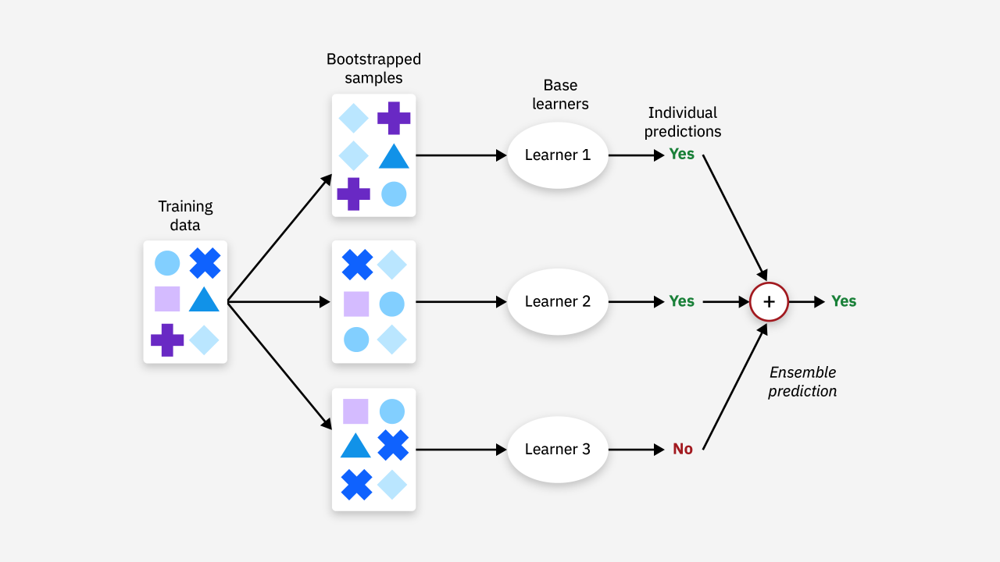
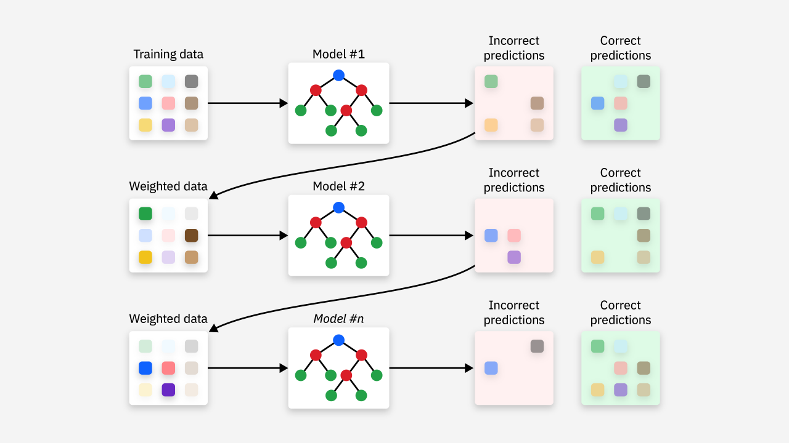
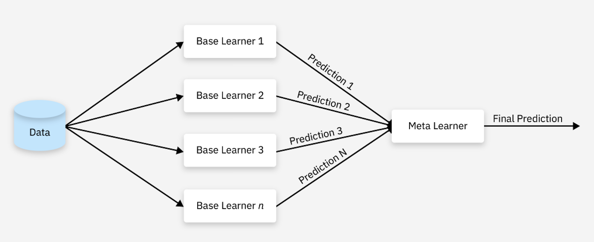
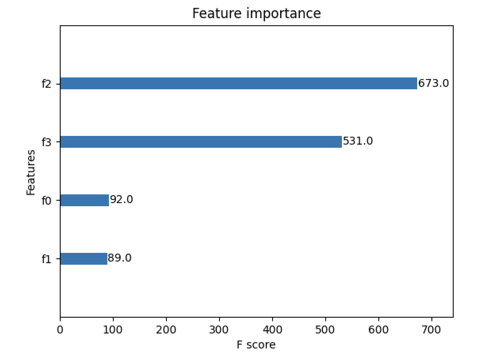

## Thuật toán học kết hợp

Trong các chương trước, chúng ta chủ yếu giới thiệu về các mô hình đơn lẻ trong học máy. Trên thực tế, việc kết hợp nhiều mô hình đơn lẻ thành một mô hình tổng hợp từ lâu đã trở thành phương pháp chủ đạo được áp dụng trong các mô hình học máy hiện đại, phương pháp này được gọi là **học kết hợp** (ensemble learning). Mục tiêu của học kết hợp là thông qua sự kết hợp của nhiều bộ học yếu (mô hình có hiệu quả phân loại tốt hơn một chút so với đoán ngẫu nhiên; nếu quá mạnh sẽ dễ dẫn đến quá khớp) để xây dựng nên một bộ học mạnh, qua đó khắc phục những hạn chế tiềm ẩn của một mô hình đơn lẻ và đạt được **khả năng khái quát hóa tốt hơn**, thường được sử dụng trong các **tình huống đòi hỏi dự đoán độ chính xác cao**.

### Phân loại thuật toán

Các thuật toán học kết hợp chủ yếu được chia thành các loại sau:

1. **Bagging**: Tạo ra nhiều tập dữ liệu con thông qua việc lấy mẫu ngẫu nhiên từ dữ liệu huấn luyện, huấn luyện nhiều mô hình trên các tập con này và kết hợp kết quả của chúng lại. Nguyên lý của phương pháp học kết hợp này như hình dưới đây, ví dụ điển hình nhất chính là Rừng ngẫu nhiên (Random Forest) mà chúng ta đã tìm hiểu trước đó.

    

2. **Boosting**: Huấn luyện tuần tự nhiều mô hình qua các vòng lặp, ở mỗi vòng huấn luyện sẽ tập trung vào các mẫu bị dự đoán sai ở vòng trước. Mục tiêu huấn luyện của mỗi mô hình mới là bù đắp cho những thiếu sót của mô hình ở vòng trước. Nguyên lý của phương pháp học kết hợp này như hình dưới đây, các thuật toán kinh điển bao gồm AdaBoost, Gradient Boosting và XGBoost.

    

    Nguyên lý cơ bản của Boosting là: ban đầu gán trọng số như nhau cho tất cả các mẫu; khi huấn luyện mô hình đầu tiên, trọng số của các mẫu bị phân loại sai sẽ tăng lên; khi huấn luyện mô hình tiếp theo, tập trung vào các mẫu bị mô hình trước phân loại sai; cuối cùng kết hợp có trọng số kết quả của tất cả các mô hình (mô hình thể hiện tốt hơn sẽ có trọng số cao hơn) để thu được đầu ra cuối cùng. Nói một cách đơn giản, Boosting là quá trình huấn luyện tuần tự một chuỗi các bộ phân loại yếu, giúp các mẫu bị phân loại sai bởi bộ phân loại yếu trước đó nhận được nhiều sự chú ý hơn ở các bước tiếp theo, và cuối cùng kết hợp các bộ phân loại này thành một bộ phân loại mạnh tối ưu.

3. **Stacking**: Huấn luyện nhiều mô hình, lấy kết quả dự đoán của chúng làm đặc trưng mới đưa vào một mô hình khác (thường gọi là "mô hình cấp hai" hay meta-model), và dùng "mô hình cấp hai" này để đưa ra dự đoán cuối cùng, nguyên lý như hình dưới đây.

    

### AdaBoost

AdaBoost (Adaptive Boosting) do Yoav Freund và Robert Schapire đề xuất vào năm 1996, là một thuật toán học kết hợp kinh điển, thường được dịch là thuật toán tăng cường thích ứng. Cách làm của AdaBoost rất mộc mạc: một là **tăng trọng số của các mẫu bị phân loại sai bởi bộ phân loại yếu ở vòng trước**, hai là tổ hợp tuyến tính nhiều bộ phân loại yếu lại với nhau và **tăng trọng số của các bộ phân loại yếu có hiệu quả phân loại tốt**; tính "thích ứng" của nó thể hiện ở việc tự động điều chỉnh trọng số mẫu dựa trên lỗi của mô hình ở vòng trước.

Quá trình huấn luyện của thuật toán AdaBoost diễn ra lặp đi lặp lại từng bước, các bước then chốt như sau:

1. **Khởi tạo trọng số mẫu**: Gán cho mỗi mẫu huấn luyện một trọng số ban đầu bằng nhau. Đối với $\small{N}$ mẫu, trọng số ban đầu là:

$$
w_{i}^{(1)} = \frac{1}{N}, \ i = 1, 2, \cdots, N
$$

Ở đây, $\small{w_{i}^{(1)}}$ biểu thị trọng số của mẫu thứ $\small{i}$, ban đầu các trọng số đều bằng nhau.

2. **Huấn luyện bộ học yếu**: Trong mỗi vòng lặp, AdaBoost sẽ căn cứ vào trọng số hiện tại của các mẫu để huấn luyện một bộ phân loại yếu (ví dụ như decision stump - gốc cây quyết định, tức cây quyết định có độ sâu bằng 1). Mục tiêu của bộ phân loại yếu là cực tiểu hóa sai số có trọng số. Đối với mô hình phân loại (bộ học yếu) $\small{h_t}$ thu được sau vòng huấn luyện thứ $\small{t}$, tính sai số có trọng số của nó:

$$
\varepsilon_{t} = \sum_{i=1}^{N} w_{i}^{(t)} \cdot I(y_{i} \neq h_{t}(x_{i}))
$$

Trong đó, $\small{y_{i}}$ là nhãn thực tế của mẫu thứ $\small{i}$, $\small{h_{t}(x_{i})}$ là kết quả dự đoán (nhận giá trị 1 hoặc -1) của mô hình $\small{h_{t}}$ ở vòng thứ $\small{t}$ đối với mẫu thứ $\small{i}$ là $\small{x_{i}}$, $\small{I(y_{i} \neq h_{t}(x_{i}))}$ là hàm chỉ thị, nhận giá trị 1 khi mẫu $\small{x_{i}}$ bị phân loại sai, ngược lại nhận giá trị 0.

3. **Cập nhật trọng số của bộ phân loại**: Tính trọng số $\small{\alpha_{t}}$ của mô hình phân loại ở vòng thứ $\small{t}$, và dùng nó để cập nhật trọng số của từng mẫu. Công thức tính trọng số bộ phân loại $\small{\alpha_{t}}$ là:

$$
\alpha_{t} = \frac{1}{2} ln \left( \frac{1 - \varepsilon_{t}}{\varepsilon_{t}} \right)
$$

Khi sai số của bộ phân loại càng thấp, giá trị $\small{\alpha_{t}}$ càng lớn, cho thấy trọng số của bộ phân loại này càng cao.

4. **Cập nhật trọng số mẫu**: Căn cứ vào hiệu quả của bộ phân loại hiện tại để cập nhật trọng số của các mẫu. Trọng số của các mẫu bị phân loại sai sẽ tăng lên, còn trọng số của các mẫu được phân loại đúng sẽ giảm đi. Công thức cập nhật trọng số mẫu là:

$$
w_{i}^{(t + 1)} = w_{i}^{(t)} \cdot e^{-\alpha_{t} y_{i} h_{t}(x_{i})}
$$

5. **Chuẩn hóa trọng số**: Chuẩn hóa trọng số của tất cả các mẫu để tổng trọng số của tất cả các mẫu bằng 1.

6. **Bộ phân loại cuối cùng**: Bộ phân loại cuối cùng của AdaBoost là tổ hợp có trọng số của tất cả các bộ học yếu. Khi dự đoán, nó quyết định lớp cuối cùng thông qua cơ chế bỏ phiếu có trọng số:

$$
H(x) = \text{sign} \left( \sum_{t=1}^{T} \alpha_{t} h_{t}(x) \right)
$$

Trong đó, $\small{\text{sign}}$ là hàm dấu, được định nghĩa như sau:

$$
\text{sign}(z) = \begin{cases} +1 \ (z \ge 0) \\\\ -1 \ (z \lt 0) \end{cases}
$$

Ví dụ: có 3 bộ học yếu $\small{h_{1}(x)}$, $\small{h_{2}(x)}$, $\small{h_{3}(x)}$, đầu ra của chúng lần lượt là `+1`, `-1` và `+1`, các trọng số tương ứng là $\small{\alpha_{1} = 0.5}$, $\small{\alpha_{2} = 0.3}$, $\small{\alpha_{3} = 0.2}$, khi đó tổng có trọng số là:

$$
\sum_{t=1}^{3} \alpha_{t} h_{t}(x) = 0.5 \times 1 + 0.3 \times -1 + 0.2 \times 1 = 0.4
$$

Vì tổng có trọng số `0.4` mang dấu dương, nên hàm dấu sẽ xuất ra `+1`, biểu thị lớp dự đoán cuối cùng là lớp dương.

Chúng ta tiếp tục lấy tập dữ liệu hoa Iris làm ví dụ, áp dụng thuật toán học kết hợp AdaBoost để xây dựng mô hình phân loại, toàn bộ mã nguồn như sau.

```python
from sklearn.datasets import load_iris
from sklearn.model_selection import train_test_split
from sklearn.tree import DecisionTreeClassifier
from sklearn.ensemble import AdaBoostClassifier
from sklearn.metrics import classification_report

# Tải và chia tập dữ liệu
iris = load_iris()
X, y = iris.data, iris.target
X_train, X_test, y_train, y_test = train_test_split(X, y, train_size=0.8, random_state=3)

# Khởi tạo bộ phân loại yếu (decision stump)
base_estimator = DecisionTreeClassifier(max_depth=1)
# Khởi tạo bộ phân loại AdaBoost
model = AdaBoostClassifier(base_estimator, n_estimators=50)
# Huấn luyện mô hình
model.fit(X_train, y_train)
# Dự đoán kết quả
y_pred = model.predict(X_test)

# Xuất báo cáo đánh giá
print(classification_report(y_test, y_pred))
```

Đầu ra:

```
              precision    recall  f1-score   support

           0       1.00      1.00      1.00        10
           1       0.90      0.90      0.90        10
           2       0.90      0.90      0.90        10

    accuracy                           0.93        30
   macro avg       0.93      0.93      0.93        30
weighted avg       0.93      0.93      0.93        30
```

Ở đây cần chú ý thiết lập một số siêu tham số:

1. `n_estimators`: Chỉ định số lượng bộ học cơ sở (bộ phân loại yếu) cần huấn luyện, mặc định là 50.
2. `learning_rate`: Kiểm soát mức độ đóng góp của từng bộ học cơ sở vào mô hình cuối cùng, tức tốc độ học, mặc định là 1.0.
3. `algorithm`: Quyết định thuật toán huấn luyện của AdaBoost. AdaBoost chủ yếu có hai chế độ huấn luyện:
    - `'SAMME'`: Thuật toán dùng cho bài toán phân loại đa lớp, sử dụng mô hình cộng (additive model).
    - `'SAMME.R'`: Thuật toán dựa trên Real AdaBoost, dùng cho bài toán phân loại nhị phân và đa lớp có trọng số, sử dụng chiến lược lấy mẫu lại có trọng số.
4. `base_estimator`: Bộ học cơ sở, mặc định là `None`, biểu thị sử dụng `DecisionTreeClassifier` với `max_depth=1` làm bộ học cơ sở. Vì vậy, hai tham số khi tạo đối tượng `AdaBoostClassifier` trong đoạn mã trên đều có thể lược bỏ, bởi chúng trùng khớp với giá trị mặc định.

Tăng `n_estimators` có thể nâng cao hiệu năng của mô hình, nhưng có thể dẫn đến quá khớp; tăng `learning_rate` có thể đẩy nhanh tốc độ huấn luyện, nhưng có thể khiến mô hình không ổn định. Thông thường cần thông qua kiểm định chéo để tìm tổ hợp `n_estimators` và `learning_rate` tối ưu. Đối với hầu hết các bài toán, `DecisionTreeClassifier(max_depth=1)` là lựa chọn phổ biến, nhưng nếu dữ liệu phức tạp hơn, bạn có thể cân nhắc các bộ học cơ sở khác như `SVC`, `LogisticRegression`,...

### GBDT

GBDT (Gradient Boosting Decision Trees) cũng là một thuật toán học kết hợp mạnh mẽ, so với AdaBoost thì dòng mô hình GBDT được ứng dụng rộng rãi hơn nhiều. GBDT dựa trên tư tưởng **tăng cường độ dốc** (Gradient Boosting), kết hợp các ưu thế của cây quyết định, từng bước cải thiện mô hình thông qua một chuỗi các bộ phân loại yếu (cây quyết định), ở mỗi lần huấn luyện sẽ nâng cao hiệu năng dự đoán của mô hình bằng cách giảm sai số của mô hình trước đó (khớp phần dư).

GBDT sử dụng phương pháp hạ độ dốc để cực tiểu hóa hàm mất mát. Đối với nhiệm vụ hồi quy, hàm mất mát thường là sai số bình phương trung bình (MSE); đối với nhiệm vụ phân loại, hàm mất mát thường dùng là mất mát logarit (Log Loss). Dưới đây chúng ta lấy nhiệm vụ phân loại nhị phân làm ví dụ để giải thích nguyên lý thuật toán.

1. Hàm mất mát. Trong bài toán phân loại, thường sử dụng hàm mất mát log-likelihood (hợp lý logarit), đối với bài toán phân loại nhị phân, hàm mất mát như sau:

$$
L(y, F(x)) = -y\log(p(x)) - (1 - y)\log(1 - p(x))
$$

Trong đó, $\small{y}$ là nhãn thực tế ($\small{y \in \lbrace 0, 1 \rbrace}$, biểu thị lớp 0 hoặc 1), $\small{p(x)}$ là xác suất mẫu $\small{x}$ thuộc về lớp 1 do mô hình dự đoán. Vì GBDT dựa trên thuật toán tăng cường độ dốc, nên trong mỗi vòng cập nhật, chúng ta sẽ tối ưu hóa hàm mất mát này thông qua phương pháp hạ độ dốc.

2. Tính toán gradient. Để sử dụng tăng cường độ dốc, chúng ta cần tính gradient của hàm mất mát theo dự đoán của mô hình hiện tại. Giả sử đầu ra của mô hình hiện tại là $\small{F(x)}$, tức hàm dự đoán. Dựa theo hàm mất mát logarit, $\small{p(x)}$ là xác suất thu được qua việc chuyển đổi đầu ra mô hình $\small{F(x)}$, thường sử dụng hàm Sigmoid:

$$
p(x) = \frac{1}{1 + e^{-F(x)}}
$$

Khi tính gradient của hàm mất mát đối với $\small{F(x)}$, ta được:

$$
\frac{\partial{L(y, F(x))}}{\partial{F(x)}} = p(x) - y
$$

Tức gradient là $\small{p(x) - y}$, giá trị này cho chúng ta biết khoảng cách giữa dự đoán $\small{F(x)}$ của mô hình hiện tại và nhãn thực tế $\small{y}$.

3. Cập nhật mô hình. Mỗi vòng cập nhật đều bao gồm hai bước:

    - Tính phần dư: Trong mỗi vòng lặp, chúng ta tính phần dư của mô hình hiện tại, tức $\small{\delta_i = p(x_i) - y_i}$, biểu thị sai số của mỗi mẫu.
    - Khớp phần dư: Sử dụng bộ học cơ sở mới (thường là cây quyết định) để khớp các phần dư này. Trong nhiệm vụ phân loại, cây quyết định mà chúng ta huấn luyện không phải là khớp nhãn thực tế, mà là khớp phần dư, tức khớp sai số dự đoán của mô hình hiện tại.

Quy tắc cập nhật là:

$$
F_{m + 1}(x) = F_{m}(x) + \eta h_{m}(x)
$$

Trong đó, $\small{F_{m}(x)}$ là đầu ra của mô hình ở vòng thứ $\small{m}$; $\small{h_{m}(x)}$ là bộ học yếu (thường là cây quyết định) được huấn luyện ở vòng thứ $\small{m}$, nó dự đoán phần dư của mô hình hiện tại; $\small{\eta}$ là tốc độ học, kiểm soát độ đóng góp của mỗi cây. Bằng cách từng bước khớp phần dư như vậy, mô hình $\small{F(x)}$ cuối cùng tạo ra sẽ là một bộ học mạnh bao gồm nhiều cây quyết định.

Đối với nhiệm vụ phân loại đa lớp, chúng ta cần mở rộng tương ứng hàm mất mát và phép tính gradient. Hàm mất mát phân loại đa lớp thường dùng là mất mát logarit đa thức (multinomial log loss), đối với mỗi lớp $\small{k}$, hàm mất mát có thể biểu diễn như sau:

$$
L(y, F(x)) = -\sum_{k=1}^{K} y_{k} \log(p_{k}(x))
$$

Trong đó, $\small{K}$ là tổng số lớp, $\small{y_{k}}$ là hàm chỉ thị của lớp mục tiêu $\small{k}$, $\small{p_k(x)}$ là xác suất dự đoán mẫu $\small{x}$ thuộc về lớp $\small{k}$.

Chúng ta tiếp tục lấy tập dữ liệu hoa Iris làm ví dụ, áp dụng thuật toán học kết hợp GBDT để xây dựng mô hình phân loại, toàn bộ mã nguồn như sau.

```python
from sklearn.datasets import load_iris
from sklearn.model_selection import train_test_split
from sklearn.ensemble import GradientBoostingClassifier
from sklearn.metrics import classification_report

# Tải và chia tập dữ liệu
iris = load_iris()
X, y = iris.data, iris.target
X_train, X_test, y_train, y_test = train_test_split(X, y, train_size=0.8, random_state=3)

# Khởi tạo bộ phân loại GBDT
model = GradientBoostingClassifier(n_estimators=32)
# Huấn luyện mô hình
model.fit(X_train, y_train)
# Dự đoán kết quả
y_pred = model.predict(X_test)

# Xuất báo cáo đánh giá
print(classification_report(y_test, y_pred))
```

Đầu ra:

```
              precision    recall  f1-score   support

           0       1.00      1.00      1.00        10
           1       1.00      1.00      1.00        10
           2       1.00      1.00      1.00        10

    accuracy                           1.00        30
   macro avg       1.00      1.00      1.00        30
weighted avg       1.00      1.00      1.00        30
```

Chúng ta hãy cùng điểm qua một số siêu tham số quan trọng của `GradientBoostingClassifier`:

1. `loss`: Chỉ định hàm mất mát dùng cho nhiệm vụ phân loại, mặc định là `'deviance'`, biểu thị sử dụng hàm mất mát logarit. Cũng có thể chọn `'exponential'`, biểu thị sử dụng hàm mất mát hàm mũ (hàm mất mát của AdaBoost).
2. `learning_rate`: Kiểm soát mức độ ảnh hưởng của mỗi cây đối với kết quả dự đoán cuối cùng, mặc định là 0.1. Tốc độ học nhỏ hơn thường mang lại khả năng khái quát hóa tốt hơn, nhưng cần nhiều bộ phân loại yếu hơn (tức nhiều cây hơn) để khớp dữ liệu huấn luyện; nếu tốc độ học thiết lập quá lớn có thể dẫn đến mô hình bị chưa khớp (underfitting).
3. `n_estimators`: Chỉ định số lượng bộ học cơ sở (thường là cây quyết định) cần huấn luyện, mặc định là 100.
4. `subsample`: Kiểm soát tỷ lệ dữ liệu sử dụng khi huấn luyện mỗi cây, mặc định là 1.0 (tức sử dụng toàn bộ dữ liệu). Bằng cách thiết lập giá trị nhỏ hơn 1, có thể chọn ngẫu nhiên một phần mẫu khi huấn luyện mỗi cây, nhờ đó tăng tính ngẫu nhiên của mô hình và giảm quá khớp. Thông thường, 0.8 hoặc 0.9 là lựa chọn tốt.
5. `criterion`: Dùng để kiểm soát tiêu chí phân nhánh, mặc định là `'friedman_mse'`. Tham số này quyết định cách chọn phép phân chia tối ưu cho mỗi nút, các giá trị có thể chọn:
    - `'friedman_mse'`: Tiêu chuẩn này là một phiên bản cải tiến dựa trên sai số bình phương trung bình (MSE), nhằm giảm tính nhạy cảm với dữ liệu mất cân bằng và trong một số nhiệm vụ thực tế có thể mang lại kết quả tốt hơn so với MSE truyền thống.
    - `'mse'`: Sử dụng sai số bình phương trung bình (MSE) truyền thống để đánh giá chất lượng của từng điểm phân nhánh, MSE càng nhỏ chứng tỏ phép phân nhánh tại nút hiện tại càng tốt. Trong các bài toán phân loại, việc sử dụng `'friedman_mse'` thường đem lại hiệu quả tốt hơn.
    - `'mae'`: Sử dụng sai số tuyệt đối trung bình (MAE) để đánh giá chất lượng phân nhánh, MAE ít nhạy cảm hơn với các giá trị ngoại lai, nhưng ít khi được sử dụng trong thực tế.
6. `validation_fraction`: Dùng để chỉ định tỷ lệ tập kiểm định trong quá trình huấn luyện, dùng cho việc dừng sớm (early stopping) nhằm tránh quá khớp. Tham số này có thể phối hợp với `n_iter_no_change` để đánh giá hiệu năng trên tập kiểm định, khi liên tục nhiều vòng không có sự cải thiện thì dừng huấn luyện sớm.

Ngoài các siêu tham số nêu trên, còn có một số siêu tham số tương tự như cây quyết định, ở đây chúng tôi không nhắc lại nữa. Cần lưu ý rằng khi tăng `n_estimators` (số lượng cây), thông thường cần giảm `learning_rate` để tránh quá khớp; điều chỉnh `max_depth` và `min_samples_split` của cây quyết định cũng có thể giảm độ phức tạp của cây để chống quá khớp; sử dụng tốt các tham số `subsample` và `early_stopping` cũng có thể đạt được hiệu quả tương tự. Khuyến khích các bạn thông qua tìm kiếm dạng lưới kết hợp kiểm định chéo (Grid Search Cross Validation), kết hợp sai số huấn luyện và sai số kiểm định của mô hình để tìm ra tổ hợp tham số tối ưu.

### XGBoost

Xét trên các chỉ số hiệu năng như độ chính xác thuật toán, tốc độ và khả năng khái quát hóa, GBDT vẫn còn dư địa tối ưu hóa rất lớn. XGBoost (eXtreme Gradient Boosting) chính là một mô hình tăng cường độ dốc đỉnh cao dựa trên GBDT, do Trần Thiên Kỳ (Chen Tianqi) đề xuất trong bài báo khoa học [《*XGBoost: A Scalable Tree Boosting System*》](https://arxiv.org/pdf/1603.02754). So với GBDT, về mặt độ chính xác thuật toán, XGBoost khai triển hàm mất mát đến đạo hàm bậc hai, giúp mô hình cây tăng cường độ dốc tiệm cận sát hơn với tổn thất thực tế; về mặt tốc độ thuật toán, XGBoost sử dụng hai kỹ thuật là weighted quantile sketch và thuật toán nhận biết độ thưa (sparsity-aware), thông qua tối ưu hóa bộ nhớ đệm cache và tính toán mô hình song song để tăng tốc độ thuật toán; về mặt khả năng khái quát hóa, thuật toán bổ sung số hạng điều chuẩn vào hàm mất mát, thiết lập tỷ lệ co ngót (shrinkage rate) trong mô hình cộng và lấy mẫu theo cột để ngăn ngừa quá khớp. Vì những lý do trên, XGBoost rất được ưa chuộng và ứng dụng rộng rãi trong giới học thuật, công nghiệp cũng như các cuộc thi khoa học dữ liệu. Về các chi tiết của XGBoost, bạn đọc quan tâm có thể đọc bài báo của Trần Thiên Kỳ, ở đây chúng tôi không đi sâu chi tiết.

Chúng ta có thể sử dụng XGBoost theo cách dưới đây, trước tiên cài đặt thư viện phụ thuộc:

```bash
pip install xgboost
```

Đoạn mã dưới đây minh họa cách sử dụng XGBoost:

```python
import matplotlib.pyplot as plt
import xgboost as xgb
from sklearn.datasets import load_iris
from sklearn.model_selection import train_test_split
from sklearn.metrics import classification_report

# Tải và chia tập dữ liệu
iris = load_iris()
X, y = iris.data, iris.target
X_train, X_test, y_train, y_test = train_test_split(X, y, train_size=0.8, random_state=3)

# Xử lý dữ liệu thành định dạng DMatrix
dm_train = xgb.DMatrix(X_train, y_train)
dm_test = xgb.DMatrix(X_test)

# Thiết lập tham số mô hình
params = {
    'booster': 'gbtree',           # Kiểu bộ học cơ sở dùng để huấn luyện
    'objective': 'multi:softmax',  # Chỉ định hàm mất mát của mô hình
    'num_class': 3,                # Số lượng lớp
    'gamma': 0.1,                  # Kiểm soát mức giảm hàm mất mát tối thiểu cho mỗi lần phân nhánh
    'max_depth': 6,                # Độ sâu tối đa của cây quyết định
    'lambda': 2,                   # Trọng số điều chuẩn L2
    'subsample': 0.8,              # Tỷ lệ mẫu được chọn ngẫu nhiên khi huấn luyện mỗi cây
    'colsample_bytree': 0.8,       # Tỷ lệ đặc trưng được chọn cho mỗi cây
    'eta': 0.001,                  # Tốc độ học
    'seed': 10,                    # Thiết lập seed cho bộ sinh số ngẫu nhiên
    'nthread': 16,                 # Số luồng song song sử dụng khi huấn luyện
}

# Huấn luyện mô hình
model = xgb.train(params, dm_train, num_boost_round=200)
# Dự đoán kết quả
y_pred = model.predict(dm_test)

# Xuất báo cáo đánh giá mô hình
print(classification_report(y_test, y_pred))

# Vẽ biểu đồ điểm số tầm quan trọng của đặc trưng
xgb.plot_importance(model)
plt.grid(False)
plt.show()
```

Đặc trưng quan trọng xuất ra như hình dưới đây:



Chúng ta nói thêm về các tham số mô hình của XGBoost, trước tiên hãy nhìn vào từ điển `params` trong đoạn mã trên, có vài tham số cần giải thích chi tiết:

1. `booster`: Chỉ định kiểu bộ học cơ sở dùng cho huấn luyện, mặc định là `'gbtree'`, biểu thị sử dụng cây quyết định truyền thống làm bộ học cơ sở; các tùy chọn khác bao gồm `'gblinear'` và `'dart'`, phương án đầu dùng hồi quy tuyến tính hoặc hồi quy logistic, phương án sau cũng dựa trên mô hình cây quyết định nhưng có cơ chế bỏ rơi cây (dropout trees) để giảm nguy cơ quá khớp. Thông thường `'gbtree'` phù hợp với hầu hết các bài toán, đặc biệt là khi có quan hệ phi tuyến; `'dart'` thích hợp cho các tập dữ liệu phức tạp, nhất là khi xuất hiện quá khớp. Nếu tập dữ liệu nhỏ hoặc quan hệ tuyến tính mạnh, có thể thử dùng `'gblinear'`.
2. `objective`: Chỉ định hàm mất mát (mục tiêu tối ưu hóa) của mô hình, các tùy chọn phổ biến gồm:
    - `'reg:squarederror'`: Sai số bình phương trung bình (MSE) trong nhiệm vụ hồi quy.
    - `'reg:logistic'`: Hồi quy logistic trong nhiệm vụ hồi quy, thường dùng cho phân loại nhị phân.
    - `'binary:logistic'`: Hồi quy logistic cho nhiệm vụ phân loại nhị phân, xuất ra giá trị xác suất.
    - `'binary:logitraw'`: Hồi quy logistic cho nhiệm vụ phân loại nhị phân, xuất ra giá trị thô chưa qua xử lý Sigmoid.
    - `'multi:softmax'`: Nhiệm vụ phân loại đa lớp, xuất ra lớp có xác suất lớn nhất.
    - `'multi:softprob'`: Nhiệm vụ phân loại đa lớp, xuất ra phân phối xác suất cho từng lớp.
3. `eta`/`learning_rate`: Tốc độ học trong XGBoost, mặc định là 0.3, khuyến khích đặt giá trị ban đầu từ 0.01 đến 0.1.
4. `alpha` và `lambda`: Tham số đầu kiểm soát cường độ điều chuẩn L1 (Lasso), mặc định là `0`; tham số sau kiểm soát cường độ điều chuẩn L2 (Ridge), mặc định là `1`.
5. `scale_pos_weight`: Dùng để xử lý bài toán mất cân bằng lớp, đặc biệt là bài toán phân loại nhị phân. Trong trường hợp dữ liệu mất cân bằng nghiêm trọng, thông qua điều chỉnh tham số này để tăng trọng số cho lớp thiểu số, giúp mô hình quan tâm nhiều hơn đến mẫu thuộc lớp thiểu số, mặc định là 1.
6. `gamma`: Dùng để kiểm soát mức giảm hàm mất mát tối thiểu cho mỗi lần phân nhánh, tham số này kiểm soát sự phát triển của cây; `gamma` càng lớn sẽ làm cây càng nhỏ lại, giảm nguy cơ quá khớp; mặc định là 0, nghĩa là mô hình không bị hạn chế phân nhánh, cây sẽ phát triển sâu nhất có thể cho đến khi nút không còn đủ mẫu.
7. `num_class`: Tham số dùng cho bài toán phân loại đa lớp, biểu thị số lượng lớp. Đối với bài toán phân loại nhị phân không cần thiết lập tham số này.
8. `colsample_bytree` / `colsample_bylevel` / `colsample_bynode`: Kiểm soát tỷ lệ lấy mẫu đặc trưng trên mỗi cây, mỗi tầng và mỗi nút. Các tham số này dùng để kiểm soát độ phức tạp của mô hình. Giá trị nhỏ hơn sẽ tăng tính ngẫu nhiên của mô hình, từ đó chống quá khớp; giá trị lớn hơn đồng nghĩa với việc mỗi cây sử dụng nhiều đặc trưng hơn, có thể dẫn đến quá khớp.
    - `colsample_bytree`: Tỷ lệ đặc trưng sử dụng cho mỗi cây (mặc định là 1.0).
    - `colsample_bylevel`: Tỷ lệ đặc trưng sử dụng cho mỗi tầng (mặc định là 1.0).
    - `colsample_bynode`: Tỷ lệ đặc trưng sử dụng cho mỗi nút (mặc định là 1.0).

Ngoài các tham số mô hình do từ điển `params` cung cấp, hàm `train` còn có một vài tham số đáng chú ý, chúng cũng là các siêu tham số của mô hình:

1. `num_boost_round`: Số vòng huấn luyện cây, việc đặt `learning_rate` nhỏ hơn kết hợp với tăng số vòng huấn luyện có thể nâng cao tính ổn định của mô hình.
2. `early_stopping_rounds`: Dùng để kích hoạt cơ chế dừng sớm. Khi trong số vòng chỉ định mà hàm mất mát trên tập kiểm định không còn giảm nữa, quá trình huấn luyện sẽ tự động dừng lại để tránh quá khớp.
3. `feval`: Thiết lập hàm đánh giá do người dùng tự định nghĩa. Cách này cho phép người dùng linh hoạt sử dụng bất kỳ chỉ số đánh giá nào phù hợp với bài toán cụ thể. Cần lưu ý hàm đánh giá có hai tham số: một biểu thị giá trị dự đoán của mô hình (đối tượng `ndarray` của NumPy), một là dữ liệu huấn luyện (đối tượng `DMatrix` của XGBoost); hàm trả về một bộ gồm hai phần tử `(name, value)`, trong đó `name` là tên chỉ số đánh giá, `value` là giá trị của chỉ số.
4. `obj`: Thiết lập hàm mục tiêu do người dùng tự định nghĩa, dùng để tính toán gradient và đạo hàm bậc hai ở mỗi bước nhằm định hướng quá trình tối ưu của mô hình, bạn đọc quan tâm có thể tự tìm hiểu thêm.
5. `evals`: Dùng để chỉ định một hoặc nhiều tập kiểm định, giá trị là một danh sách chứa một hoặc nhiều tuple `(data, label)`, mỗi tuple đại diện cho một tập dữ liệu đánh giá dạng `DMatrix`. Trong quá trình huấn luyện, XGBoost sẽ đánh giá hiệu năng trên tập kiểm định sau mỗi vòng lặp, thường dùng để theo dõi hiện tượng quá khớp hoặc tinh chỉnh siêu tham số.
6. `eval_results`: Lưu trữ tất cả kết quả đánh giá được tính toán trong quá trình huấn luyện, thường truyền vào một từ điển.
7. `verbose_eval`: Kiểm soát tần suất xuất kết quả đánh giá trong quá trình huấn luyện, có thể đặt thành một số nguyên biểu thị bao nhiêu vòng lặp thì xuất kết quả một lần, hoặc đặt thành `True` hay `False` biểu thị xuất kết quả ở mỗi vòng hoặc không xuất kết quả đánh giá nào.
8. `xgb_model`: Dùng để tải mô hình đã huấn luyện trước đó nhằm tiếp tục huấn luyện từ điểm dừng. Bạn có thể chỉ định một đường dẫn tệp `xgb_model` hoặc truyền vào một đối tượng `Booster`.
9. `callbacks`: Thêm các hàm callback tự định nghĩa trong quá trình huấn luyện, hàm callback có thể cung cấp thêm các kiểm soát bổ sung ở mỗi vòng lặp như tự động dừng huấn luyện, điều chỉnh tốc độ học.

### LightGBM

LightGBM (Light Gradient Boosting Machine) là một framework thuật toán Boosting hàng đầu do Microsoft mở mã nguồn vào năm 2017. Mặc dù bản chất vẫn là thuật toán GBDT, nhưng nó được thiết kế để xử lý các tập dữ liệu quy mô lớn, đặc biệt là trong các tình huống đòi hỏi hiệu suất cao và mức tiêu thụ bộ nhớ thấp. Xét về hiệu năng thuật toán dòng GBDT, XGBoost vốn đã rất hiệu quả, nhưng không phải là không có nhược điểm. LightGBM chính là phiên bản cải tiến nhắm vào các hạn chế của XGBoost, thông qua 4 phương pháp: thuật toán biểu đồ tần số histogram (chia các đặc trưng liên tục thành các bin), lấy mẫu độ dốc một phía (GOSS - Gradient-based One-Side Sampling, giữ lại các mẫu có gradient lớn hơn trong quá trình huấn luyện để giảm khối lượng tính toán), gộp đặc trưng loại trừ lẫn nhau (EFB - Exclusive Feature Bundling, kết hợp một số đặc trưng loại trừ lẫn nhau để giảm số chiều không gian đặc trưng) và chiến lược phát triển theo lá (leaf-wise growth, ưu tiên phân nhánh nút lá hiện tại để mở rộng độ sâu của cây), giúp hệ thống thuật toán GBDT nhẹ hơn, hiệu quả hơn, đạt được cả tốc độ nhanh lẫn độ chính xác cao. Tất nhiên, trên các tập dữ liệu nhỏ, ưu thế của LightGBM không quá rõ rệt; ngoài ra, dù là XGBoost hay LightGBM thì khả năng giải thích của mô hình vẫn là một vấn đề, và độ khó trong việc tinh chỉnh siêu tham số cũng tương đối lớn.

Ở đây, chúng tôi không dành thêm dung lượng để giải thích chi tiết về LightGBM, các bạn quan tâm có thể truy cập trực tiếp vào [tài liệu chính thức](https://lightgbm.readthedocs.io/en/stable/index.html) của LightGBM. Chúng ta hãy cùng cảm nhận cách sử dụng LightGBM thông qua đoạn mã đơn giản dưới đây, trước tiên vẫn cần cài đặt bằng lệnh sau:

```bash
pip install lightgbm
```

Chúng ta tiếp tục sử dụng tập dữ liệu hoa Iris để huấn luyện mô hình, đoạn mã như sau.

```python
import lightgbm as lgb
import numpy as np
from sklearn.datasets import load_iris
from sklearn.model_selection import train_test_split
from sklearn.metrics import classification_report

# Tải và chia tập dữ liệu
iris = load_iris()
X, y = iris.data, iris.target
X_train, X_test, y_train, y_test = train_test_split(X, y, train_size=0.8, random_state=3)

# Chuyển dữ liệu sang định dạng của LightGBM
train_data = lgb.Dataset(X_train, label=y_train)
test_data = lgb.Dataset(X_test, label=y_test, reference=train_data)

# Thiết lập tham số mô hình
params = {
    'objective': 'multiclass',   # Bài toán phân loại đa lớp
    'num_class': 3,              # Số lượng lớp
    'metric': 'multi_logloss',   # Hàm mất mát logarit phân loại đa lớp
    'boosting_type': 'gbdt',     # Sử dụng thuật toán cây tăng cường độ dốc
    'num_leaves': 31,            # Số lượng nút lá
    'learning_rate': 0.05,       # Tốc độ học
    'feature_fraction': 0.75,    # Tỷ lệ đặc trưng được chọn ngẫu nhiên mỗi lần huấn luyện
    'early_stopping_rounds': 10  # Dừng lặp nếu không cải thiện hiệu năng sau số vòng nhất định
}
# Huấn luyện mô hình
model = lgb.train(params=params, train_set=train_data, num_boost_round=200, valid_sets=[test_data])
# Dự đoán mô hình
y_pred = model.predict(X_test, num_iteration=model.best_iteration)
# Xử lý kết quả dự đoán thành nhãn
y_pred_max = np.argmax(y_pred, axis=1)

# Xem báo cáo đánh giá mô hình
print(classification_report(y_test, y_pred_max))
```

Dưới đây chúng tôi tóm tắt sơ lược về các siêu tham số của mô hình, bạn đọc có thể tham khảo tài liệu chính thức để biết thêm chi tiết:

1. `objective`: Thiết lập hàm mục tiêu tối ưu (hàm mất mát), các giá trị có thể chọn:
    - `'regression'`: Nhiệm vụ hồi quy.
    - `'binary'`: Nhiệm vụ phân loại nhị phân.
    - `'multiclass'`: Nhiệm vụ phân loại đa lớp.
    - `'multiclassova'`: Nhiệm vụ phân loại đa lớp theo chiến lược One-vs-All.
    - `'rank_xendcg'`, `'lambdarank'`: Nhiệm vụ xếp hạng.
2. `metric`: Chỉ số đánh giá hiệu năng mô hình, các giá trị có thể chọn:
    - `'l2'`, `'mean_squared_error'`: Sai số bình phương trung bình trong nhiệm vụ hồi quy.
    - `'binary_error'`: Tỷ lệ lỗi phân loại nhị phân.
    - `'multi_logloss'`: Mất mát logarit phân loại đa lớp.
    - `'auc'`: AUC trong nhiệm vụ phân loại nhị phân.
    - `'precision'`, `'recall'`, `'f1'`: Độ chuẩn xác (precision), độ thu hồi (recall), điểm F1.
3. `boosting_type`: Thiết lập kiểu tăng cường, các giá trị có thể chọn:
    - `'gbdt'`: Cây tăng cường độ dốc truyền thống.
    - `'dart'`: Cây quyết định có cơ chế loại bỏ cây ngẫu nhiên để chống quá khớp.
    - `'goss'`: Tăng tốc huấn luyện thông qua lấy mẫu độ dốc một phía.
    - `'rf'`: Rừng ngẫu nhiên (Random Forest).
4. `num_leaves`/`max_depth`: Số nút lá của cây quyết định / Độ sâu tối đa của cây quyết định, dùng để kiểm soát độ phức tạp của cây.
5. `lambda_l1`/`lambda_l2`: Tham số điều chuẩn L1 và L2, dùng để kiểm soát độ phức tạp của mô hình và chống quá khớp.
6. `max_bin`: Số lượng bin tối đa dùng để phân chia đặc trưng liên tục (chia bin dữ liệu).
7. `feature_fraction`: Tỷ lệ đặc trưng được chọn ngẫu nhiên trong mỗi lần huấn luyện.
8. `early_stopping_rounds`: Thiết lập dừng huấn luyện sớm khi chỉ số đánh giá không có sự cải thiện trong số vòng lặp nhất định liên tiếp.

### Tổng kết

Học kết hợp thông qua việc phối hợp nhiều mô hình để giảm độ chệch (bias) và phương sai (variance) của mô hình, thường đem lại hiệu quả dự đoán tốt hơn so với một mô hình đơn lẻ. Do học kết hợp thường kết hợp nhiều mô hình cơ sở, nó có thể làm giảm hiệu quả vấn đề quá khớp tiềm ẩn của mô hình đơn lẻ, đồng thời xử lý tốt dữ liệu bất thường và dữ liệu nhiễu, hoạt động ổn định hơn mô hình đơn lẻ. Tất nhiên, học kết hợp cũng tồn tại các vấn đề như chi phí tính toán lớn, tính diễn giải của mô hình kém, việc tinh chỉnh siêu tham số phức tạp,... Ngoài XGBoost và LightGBM, còn có một thuật toán Boosting nổi tiếng về khả năng xử lý các đặc trưng dạng phân loại tên là CatBoost; cả ba đều là những đại diện xuất sắc nhất của dòng thuật toán GBDT. Mặc dù học sâu với triết lý "quy mô lớn tạo nên phép màu" đang rất thịnh hành, nhưng các thuật toán Boosting đại diện bởi XGBoost, LightGBM và CatBoost vẫn có không gian ứng dụng vô cùng rộng lớn, thậm chí vẫn rất hữu dụng khi mô hình hóa dữ liệu phi cấu trúc (văn bản, giọng nói, hình ảnh, video).
