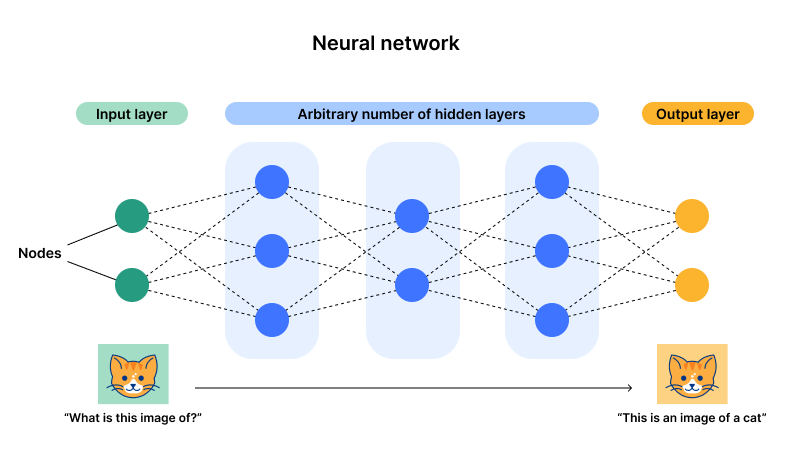
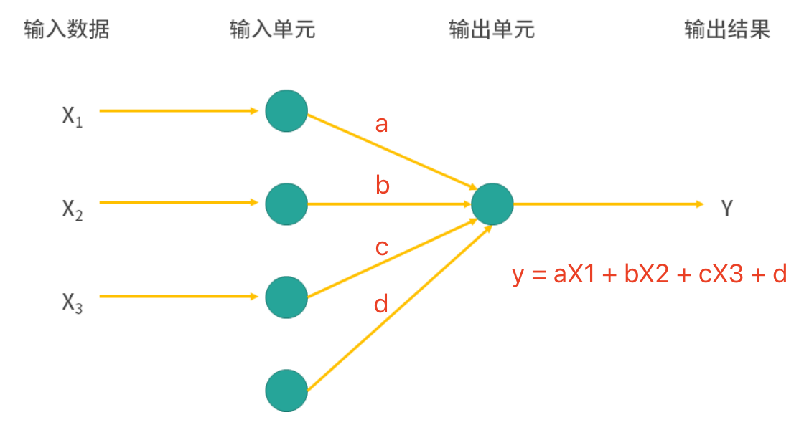
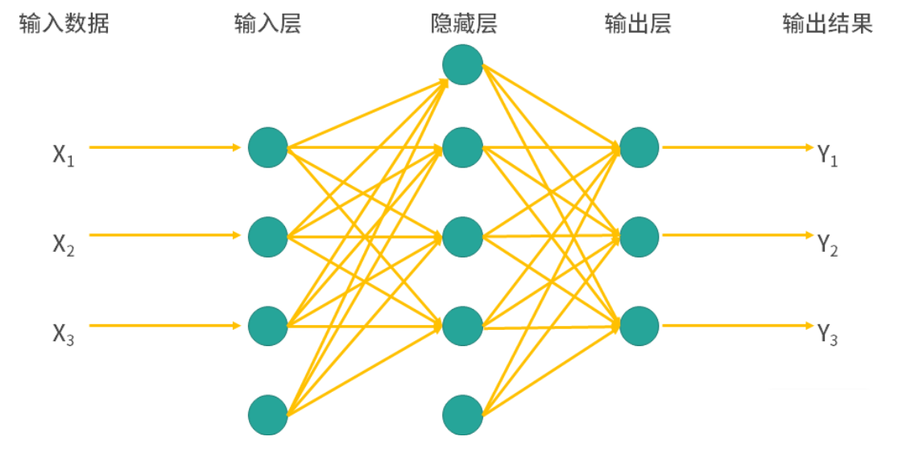
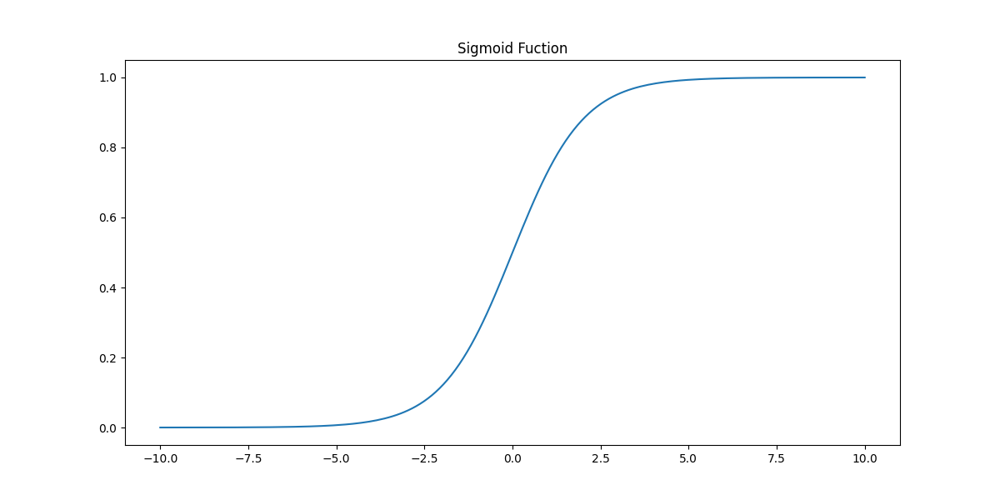
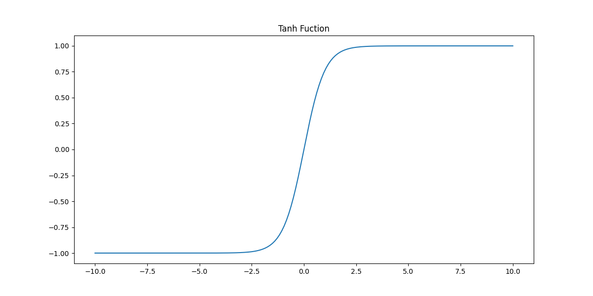

## Mô hình mạng nơ-ron

Trong bộ não con người, nơ-ron (neuron - tế bào thần kinh) là đơn vị chịu trách nhiệm truyền dẫn và xử lý thông tin. Các nơ-ron giao tiếp với nhau thông qua tín hiệu hóa học và tín hiệu điện, đây chính là nền tảng cho trí nhớ, cảm giác, vận động và các chức năng khác của con người. Nơ-ron bao gồm sợi trục (axon) và sợi nhánh (dendrite); sợi nhánh chịu trách nhiệm tiếp nhận tín hiệu, sợi trục chịu trách nhiệm phát tín hiệu, ngoài ra thân tế bào cũng là bộ phận quan trọng của nơ-ron, đóng vai trò tích hợp và truyền đạt thông tin. Sự liên kết giữa các nơ-ron được thực hiện thông qua synap (synapse) để truyền tín hiệu hóa học hoặc tín hiệu điện; một nơ-ron có thể kết nối với hàng nghìn, hàng vạn nơ-ron khác, tạo nên một mạng lưới nơ-ron chằng chịt và phức tạp. Khi con người mới sinh ra, trong não có khoảng 86 tỷ nơ-ron, phần lớn các nơ-ron không thể tái sinh, do đó con số này sẽ giảm dần theo tuổi tác. Não bộ của trẻ sơ sinh sở hữu số lượng kết nối synap vô cùng khổng lồ, đặt nền móng cho việc học hỏi và thích nghi trong tương lai.

Nhiều bài viết phổ biến khoa học thường quảng bá rằng mô hình mạng nơ-ron nhân tạo là mô hình tính toán mô phỏng các nơ-ron não người, hoàn thành các ánh xạ phi tuyến phức tạp thông qua việc kết nối nhiều tầng nơ-ron; tuy nhiên không có bằng chứng nào cho thấy cơ chế học tập của não bộ giống với cơ chế của mô hình mạng nơ-ron. Mặc dù thuật ngữ mạng nơ-ron bắt nguồn từ sinh học thần kinh, và một số khái niệm trong học sâu cũng lấy cảm hứng từ sự hiểu biết của con người về bộ não, nhưng đối với người mới bắt đầu, nếu cứ nghĩ rằng mạng nơ-ron có mối liên hệ mật thiết nào đó với sinh học thần kinh thì chỉ khiến bạn thêm bối rối mà thôi.

### Cấu tạo cơ bản

Mạng nơ-ron thường bao gồm nhiều tầng (layer), thông thường có tầng đầu vào (input layer), tầng ẩn (hidden layer) và tầng đầu ra (output layer). Các nơ-ron ở mỗi tầng được kết nối với các nơ-ron ở tầng trước đó; thông qua việc điều chỉnh trọng số (weight) và tác động của hàm kích hoạt (activation function), dữ liệu được truyền và xử lý qua từng tầng, cuối cùng hoàn thành việc trích xuất đặc trưng và học hỏi từ các dữ liệu phức tạp.

1. **Tầng đầu vào**: Các nơ-ron tầng đầu vào tiếp nhận dữ liệu đầu vào, mỗi nơ-ron thường tương ứng với một đặc trưng đầu vào. Nhiệm vụ của tầng đầu vào là chuyển tiếp dữ liệu đầu vào cho các nơ-ron ở tầng tiếp theo.
2. **Tầng ẩn**: Tầng ẩn là phần cốt lõi của mạng, chịu trách nhiệm trích xuất đặc trưng và xử lý dữ liệu. Tầng ẩn có thể có một hoặc nhiều tầng; nơ-ron ở mỗi tầng thực hiện xử lý dữ liệu thông qua trọng số và hàm kích hoạt. Mạng nơ-ron sâu thường chứa nhiều tầng ẩn, nhờ đó có thể trích xuất các đặc trưng bậc cao trong dữ liệu.
3. **Tầng đầu ra**: Tầng đầu ra chịu trách nhiệm chuyển đổi kết quả từ tầng ẩn thành đầu ra cuối cùng. Hàm kích hoạt của tầng đầu ra thường liên quan đến loại bài toán, ví dụ bài toán phân loại nhị phân có thể dùng hàm Sigmoid để thu được xác suất, trong khi bài toán hồi quy có thể xuất trực tiếp giá trị số.
4. **Nơ-ron**: Mỗi nơ-ron đều nhận đầu vào từ các nơ-ron của tầng trước đó, thực hiện tính tổng có trọng số, rồi sau đó tính toán đầu ra thông qua hàm kích hoạt.



Quá trình huấn luyện của mạng nơ-ron thường thông qua thuật toán lan truyền ngược (Backpropagation) và phương pháp hạ độ dốc để tối ưu hóa trọng số nhằm giảm thiểu sai số dự đoán. Mạng nơ-ron sâu thông qua nhiều tầng biến đổi phi tuyến có thể học được các biểu diễn đặc trưng phức tạp hơn, vì vậy nó thể hiện rất xuất sắc trong nhiều nhiệm vụ.

### Nguyên lý hoạt động

Trước tiên, chúng ta thiết kế một mô hình mạng nơ-ron đơn giản nhất, nó chỉ có một tầng đầu vào và một tầng đầu ra. Mô hình này sẽ dựa vào đầu vào ($\small{X}$) để dự đoán đầu ra ($\small{y}$), và đầu ra thỏa mãn công thức dưới đây:

$$
y = aX_{1} + bX_{2} + cX_{3} + d
$$

Trong đó, $\small{a, b, c, d}$ đều là các tham số của mô hình (trọng số và độ lệch/bias), khi đó mô hình mạng nơ-ron của chúng ta sẽ có cấu trúc như hình bên dưới.



Có thể bạn đã nhận ra, mô hình mạng nơ-ron đơn giản nhất này thực chất không khác gì hồi quy tuyến tính. Nhưng điều gì sẽ xảy ra nếu chúng ta thêm một tầng ẩn vào giữa tầng đầu vào và tầng đầu ra? Hãy nhìn vào hình bên dưới, nó đã bắt đầu mang dáng dấp của một "mạng lưới" rồi đúng không? Tầng ẩn được thêm vào có thể xử lý các mối quan hệ phi tuyến, hơn nữa tầng ẩn có thể có nhiều tầng; phương thức kết nối giữa các tầng có thể là kết nối đầy đủ (fully connected) hoặc kết nối một phần, thậm chí có thể xuất hiện cấu trúc vòng. Như chúng ta đã nói ở trên, việc đưa vào tính phi tuyến giúp mô hình học được các biểu diễn đặc trưng phức tạp hơn, đó cũng là lý do mô hình mạng nơ-ron thể hiện vượt trội trong nhiều bài toán.



Tiếp theo, chúng ta hãy xem xét nguyên lý hoạt động của mạng nơ-ron. Quá trình tính toán của mỗi nơ-ron có thể biểu diễn như sau:

$$
y = f \left( \sum_{i=1}^{n}w_{i}x_{i} + b \right)
$$

Trong đó, $\small{x_{1}, x_{2}, \dots, x_{n}}$ là các đặc trưng đầu vào, $\small{w_1, w_2, \dots, w_n}$ là các trọng số tương ứng với đầu vào; $\small{b}$ là số hạng độ lệch (bias); $\small{f}$ là hàm kích hoạt, thường là các hàm phi tuyến như Sigmoid, ReLU, Tanh,... Hàm kích hoạt một mặt đưa vào biến đổi phi tuyến, làm tăng khả năng biểu diễn của mạng nơ-ron, giúp nó có thể mô phỏng bất kỳ mối quan hệ hàm phức tạp nào; mặt khác, khi huấn luyện mạng nơ-ron sẽ sử dụng lan truyền ngược để cập nhật trọng số, tính chất phi tuyến của hàm kích hoạt giúp việc truyền gradient hiệu quả hơn, làm cho mạng nơ-ron hội tụ nhanh hơn và nâng cao hiệu suất huấn luyện. Dưới đây chúng tôi giới thiệu sơ lược về các hàm kích hoạt thường dùng.

1. Hàm Sigmoid
  
$$
f(x) = \frac{1}{1 + e^{-x}}
$$


    
- **Đặc điểm**: Hàm Sigmoid ánh xạ các giá trị đầu vào vào phạm vi $\small{(0, 1)}$, thể hiện dưới dạng đường cong hình chữ S mượt mà.
- **Ưu điểm**: Đặc biệt phù hợp cho việc dự đoán xác suất, vì đầu ra nằm trong khoảng $\small{(0, 1)}$, có thể hiểu là giá trị xác suất.
- **Nhược điểm**: Đối với các giá trị dương hoặc âm lớn, gradient sẽ trở nên rất nhỏ, dẫn đến vấn đề triệt tiêu gradient (vanishing gradient), gây ảnh hưởng đến việc huấn luyện các mạng sâu. Ngoài ra, do đầu ra không có trung tâm bằng 0 (non-zero-centered), điều này dẫn đến việc cập nhật gradient không đối xứng, có thể khiến tốc độ hội tụ chậm lại.

2. Hàm Tanh (hàm tang hyperbolic)

$$
f(x) = tanh(x) = \frac{e^{x} - e^{-x}}{e^{x} + e^{-x}}
$$


    
- **Đặc điểm**: Hàm Tanh ánh xạ đầu vào vào khoảng $\small{(-1, 1)}$, cũng có dạng đường cong chữ S, nhưng đối xứng qua gốc tọa độ.
- **Ưu điểm**: Tương tự như Sigmoid, nhưng đầu ra nằm trong khoảng $\small{(-1, 1)}$, đầu ra có trung tâm bằng 0 này giúp việc cập nhật gradient đối xứng hơn, phù hợp hơn cho các mạng sâu.
- **Nhược điểm**: Ở gần các giá trị cực trị, gradient vẫn có xu hướng tiến về 0, dẫn đến hiện tượng triệt tiêu gradient.

3. Hàm ReLU (Rectified Linear Unit)

$$
f(x) = max(0, x)
$$

- **Đặc điểm**: ReLU gán các giá trị đầu vào nhỏ hơn 0 thành 0, còn các phần lớn hơn 0 giữ nguyên, do đó phạm vi đầu ra của nó là $\small{[0, +\infty]}$.
- **Ưu điểm**: Tính toán đơn giản, tránh hiệu quả vấn đề triệt tiêu gradient, vì vậy được sử dụng rộng rãi trong các mạng sâu. Có khả năng duy trì tính thưa (sparsity), đầu ra của nhiều nơ-ron bằng 0 giúp mạng đơn giản hóa tính toán.
- **Nhược điểm**: Khi đầu vào là số âm, gradient của ReLU bằng 0. Nếu đầu vào liên tục là số âm trong thời gian dài, nơ-ron có thể bị "chết" (dying ReLU) và ngừng cập nhật.

4. Hàm Leaky ReLU

$$
f(x) = \begin{cases} x & (x \gt 0) \\\\ {\alpha}x & (x \le 0)\end{cases}
$$

- **Đặc điểm**: Leaky ReLU là một cải tiến của ReLU, nó đưa vào một độ dốc âm nhỏ cho phần đầu vào nhỏ hơn 0 (thường lấy giá trị $\small{\alpha = 0.01}$), giúp gradient không bị triệt tiêu về 0.
- **Ưu điểm**: Bằng cách cho phép đầu ra mang giá trị âm, nó tránh được vấn đề nơ-ron chết, giúp mạng hoạt động mạnh mẽ hơn.
- **Nhược điểm**: Mặc dù Leaky ReLU có thể giảm bớt vấn đề nơ-ron chết, nhưng việc lựa chọn độ dốc cho giá trị âm sẽ có ảnh hưởng nhất định đến hiệu năng của mạng, và không cải thiện đáng kể khả năng biểu diễn phi tuyến của mô hình.

Trong một mạng nơ-ron chứa nhiều tầng, thông tin sẽ được truyền đi qua từng tầng. Giả sử đầu ra của tầng thứ $\small{l}$ là $\small{\mathbf{a}^{[l]}}$, theo công thức tính toán nơ-ron ở trên, ta có:

$$
\mathbf{a}^{[l]} = f \left( \mathbf{W}^{[l]} \mathbf{a}^{[l-1]} + \mathbf{b}^{[l]} \right)
$$

Trong đó, $\small{\mathbf{W}^{[l]}}$ là ma trận trọng số của tầng thứ $\small{l}$, $\small{\mathbf{a}^{[l-1]}}$ là đầu ra của tầng thứ $\small{l - 1}$, $\small{\mathbf{b}^{[l]}}$ là số hạng độ lệch của tầng thứ $\small{l}$, $\small{f}$ là hàm kích hoạt. Đầu ra cuối cùng của mạng nơ-ron thu được thông qua hàm kích hoạt của tầng cuối cùng, quá trình này được gọi là lan truyền tiến (forward propagation).

Đối với mô hình mạng nơ-ron, còn có một thao tác cực kỳ quan trọng khác là cập nhật các tham số của mạng nơ-ron (trọng số và độ lệch) bằng cách tính gradient của hàm mất mát đối với từng trọng số và độ lệch; quá trình này thường được gọi là lan truyền ngược (backpropagation). Lan truyền ngược có hai điểm mấu chốt: một là hàm mất mát, hai là phương pháp hạ độ dốc. Hàm mất mát dùng để đo lường khoảng cách giữa giá trị dự đoán và giá trị thực tế, các hàm mất mát thường dùng gồm sai số bình phương trung bình (cho bài toán hồi quy) và hàm mất mát cross-entropy (cho bài toán phân loại); phương pháp hạ độ dốc thông qua việc cập nhật tham số $\small{\theta}$ (trọng số và độ lệch) để cực tiểu hóa hàm mất mát, tức là:

$$
\theta^{\prime} = \theta - \eta \nabla L(\theta) \\\\
\theta = \theta^{\prime}
$$

Trong đó, $\small{\eta}$ là tốc độ học, $\small{\nabla L(\theta)}$ là gradient của hàm mất mát đối với tham số, hoàn toàn nhất quán với phương pháp chúng ta đã dùng khi giải thích mô hình hồi quy.

### Triển khai bằng mã nguồn

Dựa trên nguyên lý của mô hình mạng nơ-ron đã trình bày ở trên, việc tự viết một mô hình mạng nơ-ron đơn giản cũng không hề khó khăn. Tất nhiên, chúng ta cũng có thể sử dụng module `neural_network` của thư viện scikit-learn để xây dựng mô hình mạng nơ-ron. Dưới đây, chúng ta tiếp tục lấy tập dữ liệu hoa Iris làm ví dụ để minh họa việc xây dựng mô hình mạng nơ-ron và hiệu quả dự đoán.

```python
from sklearn.datasets import load_iris
from sklearn.model_selection import train_test_split
from sklearn.neural_network import MLPClassifier
from sklearn.metrics import classification_report

# Tải và chia tập dữ liệu
iris = load_iris()
X, y = iris.data, iris.target
X_train, X_test, y_train, y_test = train_test_split(X, y, train_size=0.8, random_state=3)

# Tạo mô hình phân loại Perceptron đa tầng (MLP)
model = MLPClassifier(
    solver='lbfgs',            # Trình tối ưu hóa tham số mô hình
    learning_rate='adaptive',  # Cơ chế điều chỉnh tốc độ học là tự thích ứng
    activation='relu',         # Hàm kích hoạt của nơ-ron trong tầng ẩn
    hidden_layer_sizes=(1, )   # Số lượng nơ-ron của mỗi tầng
)
# Huấn luyện và dự đoán
model.fit(X_train, y_train)
y_pred = model.predict(X_test)

# Xem báo cáo đánh giá mô hình
print(classification_report(y_test, y_pred))
```

Đầu ra:

```
              precision    recall  f1-score   support

           0       1.00      0.10      0.18        10
           1       0.00      0.00      0.00        10
           2       0.34      1.00      0.51        10

    accuracy                           0.37        30
   macro avg       0.45      0.37      0.23        30
weighted avg       0.45      0.37      0.23        30
```

> **Lưu ý**: Do khi tạo `MLPClassifier` không chỉ định tham số `random_state`, nên kết quả mỗi lần chạy mã có thể sẽ khác nhau.

Độ chính xác dự đoán của mô hình chỉ đạt `0.37`, mọi người có cảm thấy rất thất vọng với kết quả này không, một mô hình cất công xây dựng mà hiệu quả dự đoán lại kém cỏi đến thế! Đừng vội lo lắng, trong đoạn mã trên khi tạo mô hình mạng nơ-ron, tham số `hidden_layer_sizes` được thiết lập là `(1, )`, nghĩa là mạng của chúng ta chỉ có đúng 1 tầng ẩn, và tầng ẩn đó chỉ có đúng 1 nơ-ron duy nhất, nơ-ron này đã phải gánh vác quá nhiều (nó thực sự gánh còng cả lưng). Tiếp theo, chúng ta cần tăng số tầng ẩn và số lượng nơ-ron lên, để mô hình có thể học tốt hơn quan hệ ánh xạ giữa các đặc trưng và mục tiêu, khi đó hiệu quả dự đoán sẽ tốt lên. Dưới đây, chúng ta điều chỉnh tham số `hidden_layer_sizes` thành `(32, 32, 32)`, tức mô hình có ba tầng ẩn, mỗi tầng có 32 nơ-ron, hãy xem lại kết quả chạy mã.

```python
from sklearn.datasets import load_iris
from sklearn.model_selection import train_test_split
from sklearn.neural_network import MLPClassifier
from sklearn.metrics import classification_report

# Tải và chia tập dữ liệu
iris = load_iris()
X, y = iris.data, iris.target
X_train, X_test, y_train, y_test = train_test_split(X, y, train_size=0.8, random_state=3)

# Tạo mô hình phân loại Perceptron đa tầng (MLP)
model = MLPClassifier(
    solver='lbfgs',                  # Trình tối ưu hóa tham số mô hình
    learning_rate='adaptive',        # Cơ chế điều chỉnh tốc độ học là tự thích ứng
    activation='relu',               # Hàm kích hoạt của nơ-ron trong tầng ẩn
    hidden_layer_sizes=(32, 32, 32)  # Số lượng nơ-ron của mỗi tầng
)
# Huấn luyện và dự đoán
model.fit(X_train, y_train)
y_pred = model.predict(X_test)

# Xem báo cáo đánh giá mô hình
print(classification_report(y_test, y_pred))
```

> **Giải thích**: Các bạn có thể thử chạy đoạn mã trên xem có thu được kết quả tốt hơn không. Tất nhiên, độ chính xác của mô hình bằng 1 chưa chắc đã là điều đáng mừng, bởi vì bạn có thể đã huấn luyện ra một mô hình bị quá khớp. Dù sao đi nữa, mọi người có thể thử thiết lập lại tham số `hidden_layer_sizes` để xem sẽ nhận được kết quả như thế nào.

Dưới đây, chúng tôi giải thích thêm một số siêu tham số quan trọng của `MLPClassifier`:

1. `hidden_layer_sizes`: Chỉ định số lượng nơ-ron trong mỗi tầng của mạng nơ-ron, kiểu tuple, mặc định là `(100, )`, biểu thị chỉ có một tầng ẩn gồm 100 nơ-ron. Siêu tham số này có thể thay đổi cấu trúc và dung lượng của mạng; số tầng càng nhiều, số nơ-ron càng đông thì khả năng biểu diễn của mô hình càng mạnh, nhưng cũng đối mặt với nguy cơ quá khớp.
2. `activation`: Hàm kích hoạt của các nơ-ron trong tầng ẩn, mặc định là `relu`, biểu thị sử dụng hàm kích hoạt ReLU. Hàm kích hoạt quyết định dạng đầu ra của mỗi tầng trong mạng; nhìn chung `'relu'` là lựa chọn ưu tiên hàng đầu khi huấn luyện mạng sâu vì nó làm giảm bớt vấn đề triệt tiêu gradient và có tốc độ huấn luyện nhanh; các giá trị có thể chọn gồm:
    - `'identity'`: Hàm kích hoạt tuyến tính, tức $\small{f(x) = x}$, thường không khuyến khích sử dụng.
    - `'logistic'` / `'tanh'` / `'relu'`: Các hàm kích hoạt Sigmoid / Tanh / ReLU.
3. `solver`: Trình giải quyết (thuật toán tối ưu hóa) dùng để tối ưu tham số mô hình. Các thuật toán tối ưu thường dùng gồm:
    - `'lbfgs'`: Phương pháp quasi-Newton (Limited-memory Broyden-Fletcher-Goldfarb-Shanno), phương pháp này có độ phức tạp tính toán cao hơn, nhưng thể hiện tốt trên các tập dữ liệu nhỏ.
    - `'sgd'`: Hạ độ dốc ngẫu nhiên (Stochastic Gradient Descent), thích hợp cho tập dữ liệu quy mô lớn, khi huấn luyện sẽ chọn ngẫu nhiên các mini-batch dữ liệu để cập nhật.
    - `'adam'`: Ước lượng mô-men thích ứng (Adaptive Moment Estimation), giá trị mặc định, phù hợp với hầu hết các trường hợp và có hiệu suất tính toán cao.
4. `alpha`: Số hạng điều chuẩn L2 (còn gọi là suy giảm trọng số - weight decay), kiểm soát độ phức tạp của mạng nơ-ron, mặc định là `0.0001`.
5. `batch_size`: Kích thước lô (batch size) mẫu dùng cho mỗi lần lặp, mặc định là `'auto'`, tự động quyết định kích thước lô dựa trên số lượng mẫu. Kích thước lô nhỏ hơn sẽ làm việc huấn luyện kém ổn định hơn nhưng giúp tránh rơi vào cực tiểu cục bộ; kích thước lô lớn hơn có thể đẩy nhanh tốc độ huấn luyện nhưng có thể dẫn đến thiếu hụt bộ nhớ.
6. `learning_rate`: Cách thức điều chỉnh tốc độ học, ảnh hưởng đến độ dài bước điều chỉnh trọng số ở mỗi vòng lặp của mô hình, mặc định là `'constant'`, biểu thị tốc độ học không đổi. Các giá trị khác có thể chọn là `'invscaling'` và `'adaptive'`, trong đó giá trị trước biểu thị tốc độ học giảm dần khi số vòng lặp tăng lên, giá trị sau biểu thị tốc độ học sẽ tự động điều chỉnh theo sự biến thiên của gradient hiện tại: khi bước cập nhật gradient nhỏ thì tốc độ học tăng lên, khi gradient lớn thì tốc độ học giảm đi.
7. `learning_rate_init`: Tốc độ học ban đầu, mặc định là `0.001`.
8. `max_iter`: Số vòng lặp tối đa, kiểm soát số vòng lặp tối đa của thuật toán tối ưu trong quá trình huấn luyện, mặc định là `200`. Nếu sau khi đạt số vòng lặp tối đa mà mô hình vẫn chưa hội tụ, quá trình huấn luyện sẽ dừng lại. Điều này hữu ích để ngăn việc huấn luyện kéo dài quá lâu, nhưng giá trị quá nhỏ có thể khiến huấn luyện dừng quá sớm dẫn đến chưa khớp.
9. `tol`: Dung sai tối ưu trong quá trình huấn luyện, quyết định việc dừng huấn luyện khi mức biến thiên của hàm mục tiêu nhỏ hơn giá trị này, mặc định là `0.0001`. Giá trị `tol` nhỏ hơn sẽ kéo dài thời gian huấn luyện, giá trị `tol` lớn hơn có thể khiến việc huấn luyện dừng sớm.

Ngoài thư viện scikit-learn, chúng ta còn có thể sử dụng các thư viện bên thứ ba như TensorFlow, PyTorch, MXNet,... để triển khai mô hình mạng nơ-ron. Rất nhiều thư viện trong số này hỗ trợ tăng tốc bằng GPU (bộ xử lý đồ họa) hoặc TPU (bộ xử lý tensor), đồng thời tích hợp sẵn nhiều mô hình mạng sâu (như mạng nơ-ron tích chập - CNN, mạng nơ-ron hồi quy - RNN, mạng đối nghịch tạo sinh - GAN,...) cùng các trình tối ưu hóa tương ứng; so với scikit-learn, các thư viện này có thể là sự lựa chọn tốt hơn nhiều. Các bạn quan tâm có thể tham khảo đoạn mã dưới đây, chúng tôi sử dụng PyTorch để xây dựng mô hình mạng nơ-ron giải quyết bài toán phân loại hoa Iris.

```python
import torch
import torch.nn as nn
import torch.optim as optim
from sklearn import datasets
from sklearn.model_selection import train_test_split
from sklearn.preprocessing import StandardScaler
from sklearn.metrics import accuracy_score, classification_report

# Tải tập dữ liệu hoa Iris
iris = datasets.load_iris()
X, y = iris.data, iris.target

# Tiền xử lý dữ liệu (chuẩn hóa)
scaler = StandardScaler()
X_scaled = scaler.fit_transform(X)

# Chia tập huấn luyện và tập kiểm tra
X_train, X_test, y_train, y_test = train_test_split(X_scaled, y, train_size=0.8, random_state=3)
# Chuyển mảng thành tensor PyTorch
X_train_tensor, X_test_tensor, y_train_tensor, y_test_tensor = (
    torch.tensor(X_train, dtype=torch.float32),
    torch.tensor(X_test, dtype=torch.float32),
    torch.tensor(y_train, dtype=torch.long),
    torch.tensor(y_test, dtype=torch.long)
)


class IrisNN(nn.Module):
    """Mô hình mạng nơ-ron cho hoa Iris"""

    def __init__(self):
        """Phương thức khởi tạo"""
        # Gọi hàm khởi tạo của lớp cha
        super(IrisNN, self).__init__()
        # Tầng đầu vào đến tầng ẩn (kết nối đầy đủ 4 đặc trưng đến 32 nơ-ron)
        self.fc1 = nn.Linear(4, 32)
        # Tầng ẩn đến tầng đầu ra (kết nối đầy đủ 32 nơ-ron đến 3 đầu ra)
        self.fc2 = nn.Linear(32, 3)

    def forward(self, x):
        """Lan truyền tiến"""
        # Tầng ẩn sử dụng hàm kích hoạt ReLU
        x = torch.relu(self.fc1(x))
        x = self.fc2(x)
        return x


# Tạo thể hiện của mô hình
model = IrisNN()
# Định nghĩa hàm mất mát (hàm mất mát cross-entropy)
loss_function = nn.CrossEntropyLoss()
# Sử dụng trình tối ưu hóa Adam (thể hiện tốt trong hầu hết nhiệm vụ)
optimizer = optim.Adam(model.parameters(), lr=0.001)

# Huấn luyện mô hình (lặp 256 epoch)
for _ in range(256):
    model.train()
    # Xóa gradient của lượt trước
    optimizer.zero_grad()
    # Tính đầu ra
    output = model(X_train_tensor)
    # Tính mất mát
    loss = loss_function(output, y_train_tensor)
    # Lan truyền ngược
    loss.backward()
    # Cập nhật trọng số
    optimizer.step()

# Đánh giá mô hình
model.eval()
with torch.no_grad():
    output = model(X_test_tensor)
    # Lấy chỉ mục của điểm dự đoán lớn nhất (nhãn dự đoán)
    _, y_pred_tensor = torch.max(output, 1)
    # Tính và in độ chính xác dự đoán
    print(f'Accuracy: {accuracy_score(y_test_tensor, y_pred_tensor):.2%}')
    # Xuất báo cáo đánh giá mô hình phân loại
    print(classification_report(y_test_tensor, y_pred_tensor))
```

> **Giải thích**: Nếu bạn chưa cài đặt thư viện PyTorch, có thể dùng lệnh `pip install torch` để cài đặt.

Chúng ta cũng có thể sử dụng mô hình mạng nơ-ron để xử lý các bài toán hồi quy. Ở đây, chúng ta tiếp tục lấy "tập dữ liệu MPG ô tô" từng dùng khi tìm hiểu mô hình hồi quy để minh họa cách xây dựng mô hình mạng nơ-ron giải quyết bài toán hồi quy, toàn bộ mã nguồn như sau.

```python
import ssl

import pandas as pd
import torch
import torch.nn as nn
import torch.optim as optim
from sklearn.metrics import mean_squared_error, r2_score
from sklearn.model_selection import train_test_split
from sklearn.preprocessing import StandardScaler

ssl._create_default_https_context = ssl._create_unverified_context


def load_prep_data():
    """Tải và chuẩn bị dữ liệu"""
    df = pd.read_csv('https://archive.ics.uci.edu/static/public/9/data.csv')
    # Làm sạch các đặc trưng
    df.drop(columns=['car_name'], inplace=True)
    df.dropna(inplace=True)
    df['origin'] = df['origin'].astype('category')
    df = pd.get_dummies(df, columns=['origin'], drop_first=True).astype('f8')
    # Co giãn các đặc trưng
    scaler = StandardScaler()
    return scaler.fit_transform(df.drop(columns='mpg').values), df['mpg'].values


class MLPRegressor(nn.Module):
    """Mô hình mạng nơ-ron"""

    def __init__(self, n):
        super(MLPRegressor, self).__init__()
        self.fc1 = nn.Linear(n, 64)
        self.fc2 = nn.Linear(64, 64)
        self.fc3 = nn.Linear(64, 1)

    def forward(self, x):
        x = torch.relu(self.fc1(x))
        x = torch.relu(self.fc2(x))
        x = self.fc3(x)
        return x


def main():
    # Tải và chuẩn bị tập dữ liệu
    X, y = load_prep_data()
    # Chia tập huấn luyện và tập kiểm tra
    X_train, X_test, y_train, y_test = train_test_split(X, y, train_size=0.8, random_state=3)
    # Chuyển dữ liệu thành Tensor của PyTorch
    X_train_tensor, X_test_tensor, y_train_tensor, y_test_tensor = (
        torch.tensor(X_train, dtype=torch.float32),
        torch.tensor(X_test, dtype=torch.float32),
        torch.tensor(y_train, dtype=torch.float32).view(-1, 1),
        torch.tensor(y_test, dtype=torch.float32).view(-1, 1)
    )

    # Khởi tạo mô hình mạng nơ-ron
    model = MLPRegressor(X_train.shape[1])
    # Chỉ định hàm mất mát (sai số bình phương trung bình)
    criterion = nn.MSELoss()
    # Chỉ định trình tối ưu hóa (Adam)
    optimizer = optim.Adam(model.parameters(), lr=0.001)

    # Huấn luyện mô hình
    epochs = 256
    for epoch in range(epochs):
        # Lan truyền tiến
        y_pred_tensor = model(X_train_tensor)
        loss = criterion(y_pred_tensor, y_train_tensor)
        # Lan truyền ngược
        optimizer.zero_grad()
        loss.backward()
        optimizer.step()

        if (epoch + 1) % 16 == 0:
            print(f'Epoch [{epoch + 1} / {epochs}], Loss: {loss.item():.4f}')

    # Đánh giá mô hình
    model.eval()
    with torch.no_grad():
        y_pred = model(X_test_tensor)
        test_loss = mean_squared_error(y_test, y_pred.numpy())
        r2 = r2_score(y_test, y_pred.numpy())
    print(f'Test MSE: {test_loss:.4f}')
    print(f'Test R2: {r2:.4f}')


if __name__ == '__main__':
    main()
```

Đầu ra:

```
Epoch [16 / 256], Loss: 588.2971
Epoch [32 / 256], Loss: 530.0340
Epoch [48 / 256], Loss: 429.9081
Epoch [64 / 256], Loss: 286.5121
Epoch [80 / 256], Loss: 133.6717
Epoch [96 / 256], Loss: 44.3843
Epoch [112 / 256], Loss: 30.3168
Epoch [128 / 256], Loss: 24.0182
Epoch [144 / 256], Loss: 19.5326
Epoch [160 / 256], Loss: 16.4941
Epoch [176 / 256], Loss: 14.2642
Epoch [192 / 256], Loss: 12.5515
Epoch [208 / 256], Loss: 11.2248
Epoch [224 / 256], Loss: 10.1825
Epoch [240 / 256], Loss: 9.3600
Epoch [256 / 256], Loss: 8.7116
Test MSE: 8.7226
Test R2: 0.8569
```

Thông qua đầu ra ở trên có thể thấy, cùng với việc mạng nơ-ron liên tục lan truyền tiến và lan truyền ngược, tổn thất ngày càng nhỏ đi và khả năng khớp của mô hình ngày càng tốt hơn. Khi dự đoán, chúng ta sử dụng các tham số mô hình đã được huấn luyện để thực hiện một lần lan truyền tiến, là đã hoàn thành việc ánh xạ từ đặc trưng sang giá trị mục tiêu; hai chỉ số MSE và $\small{R^{2}}$ đánh giá mô hình hồi quy trông khá ổn áp đấy chứ. Hiện nay, mạng nơ-ron được ứng dụng rộng rãi trong nhận dạng mẫu, xử lý ảnh, nhận dạng giọng nói,... và là công nghệ cốt lõi nhất trong học sâu. Bạn đọc quan tâm đến học sâu có thể theo dõi một dự án khác của tôi mang tên ["Học sâu chính là quy mô lớn tạo nên phép màu"](https://github.com/jackfrued/Deep-Learning-Is-Nothing), hiện dự án này vẫn đang trong quá trình sáng tác và cập nhật.

### Ưu nhược điểm của mô hình

Điểm đáng yêu nhất của mô hình mạng nơ-ron là có thể liên tục mở rộng ranh giới mô hình như xếp hình lego, mà không cần can thiệp quá nhiều vào hoạt động cụ thể bên trong mô hình. Mạng nơ-ron có thể học và khớp các mối quan hệ ánh xạ vô cùng phức tạp, tự động điều chỉnh cấu trúc và tham số theo dữ liệu đầu vào, do đó sở hữu khả năng thích ứng rất mạnh. Khi đối mặt với các dạng dữ liệu hoặc nhiệm vụ khác nhau, mạng nơ-ron có thể điều chỉnh cấu trúc mạng (số tầng, số nút,...) để thích nghi với các nhu cầu khác nhau. Chỉ cần lượng dữ liệu đủ lớn và năng lực tính toán đủ mạnh, cuối cùng đều sẽ nhận được một kết quả khả quan, hiệu năng thường vượt trội so với các thuật toán học máy truyền thống, đây chính là điều chúng ta hay nói "quy mô lớn tạo nên phép màu". Ngoài ra, từ "sâu" trong thuật ngữ học sâu quen thuộc chính là muốn nói các tầng của mô hình mạng nơ-ron sở hữu độ sâu đầy đủ, chúng ta cũng thường gọi các mạng nơ-ron như vậy là mạng nơ-ron sâu (DNN).

Mô hình mạng nơ-ron giống như một chiếc hộp đen, bạn đưa dữ liệu vào và nó cho bạn kết quả, còn tại sao lại xuất hiện kết quả như vậy thì lại thiếu khả năng giải thích. Vì vậy, trong rất nhiều tình huống yêu cầu tính giải thích của mô hình rất cao (như xếp hạng tín dụng, kiểm soát rủi ro tài chính,...), chúng ta khó có thể sử dụng mô hình mạng nơ-ron. Hơn nữa, mạng nơ-ron, đặc biệt là mạng nơ-ron sâu, đòi hỏi lượng tài nguyên tính toán khổng lồ để huấn luyện, nhất là khi xử lý dữ liệu nhiều chiều; thời gian huấn luyện và tài nguyên tính toán cần thiết có thể rất lớn, cần sự hỗ trợ phần cứng mạnh mẽ như bộ xử lý đồ họa hiệu năng cao (GPU) hoặc phần cứng chuyên dụng (TPU). Cuối cùng, và cũng là điểm mà cá nhân tôi thấy "khoai" nhất ở mô hình mạng nơ-ron, là việc tinh chỉnh siêu tham số quá khó khăn: số tầng mạng, số lượng nơ-ron mỗi tầng, tốc độ học, việc lựa chọn hàm kích hoạt,... đều có thể ảnh hưởng đến hiệu năng mô hình. Nếu không có nguồn tài nguyên tính toán mạnh mẽ làm chỗ dựa, rất khó để hoàn thành việc tinh chỉnh siêu tham số, khiến các cá nhân và công ty nhỏ cơ bản đều phải chùn bước.

### Tổng kết

Mô hình mạng nơ-ron sử dụng phương thức khác biệt với các thuật toán học máy truyền thống để học tri thức từ lượng dữ liệu khổng lồ. Mặc dù mô hình thiếu tính diễn giải, nhưng không thể phủ nhận rằng nó đã đạt được những thành tựu vượt bậc trong nhiều lĩnh vực như hình ảnh, giọng nói và xử lý ngôn ngữ tự nhiên. Tất nhiên, việc huấn luyện mô hình mạng nơ-ron tiêu tốn rất nhiều tài nguyên; khi áp dụng mô hình mạng nơ-ron, bạn nên cân nhắc kỹ ưu nhược điểm của nó và lựa chọn mô hình cũng như phương pháp huấn luyện phù hợp tùy theo nhu cầu nhiệm vụ cụ thể. Đối với các tình huống có lượng dữ liệu nhỏ, đòi hỏi tính diễn giải cao hoặc tài nguyên tính toán hạn chế, chúng tôi khuyên bạn nên cân nhắc sử dụng các thuật toán học máy truyền thống hoặc các mô hình nhẹ hơn khác.
