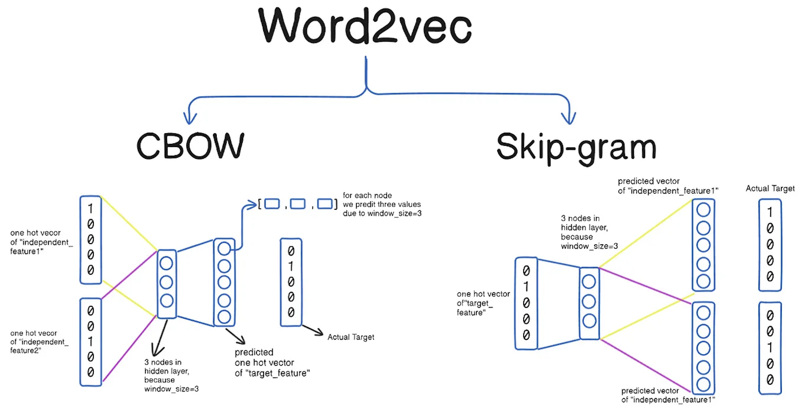
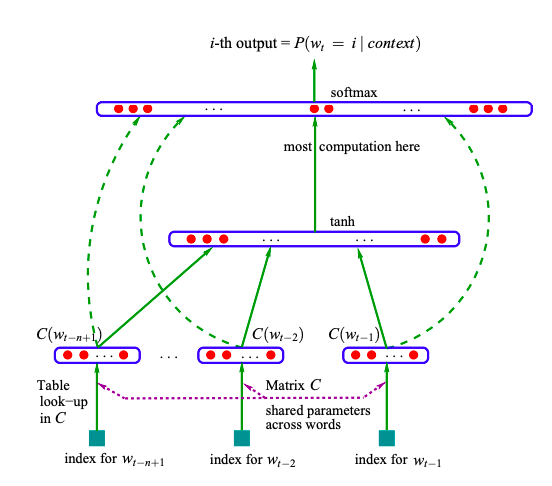
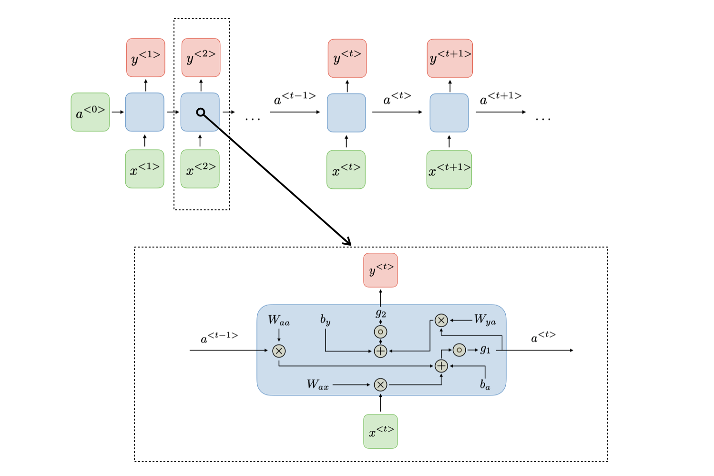
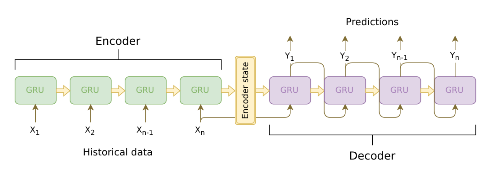
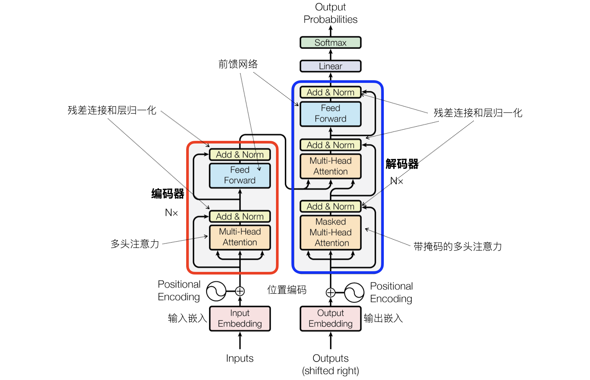

## Nhập môn xử lý ngôn ngữ tự nhiên

Xử lý ngôn ngữ tự nhiên (Natural Language Processing, NLP) là một nhánh quan trọng trong lĩnh vực khoa học máy tính và trí tuệ nhân tạo, nhằm mục đích giúp máy tính có thể hiểu, tạo lập và tương tác bằng ngôn ngữ của con người. Các kịch bản ứng dụng của NLP rất rộng rãi, bao gồm phân loại văn bản, phân tích cảm xúc, dịch máy, nhận dạng giọng nói, chatbot, v.v. Cùng với sự phát triển nhanh chóng của học sâu, nghiên cứu NLP cũng dần chuyển dịch từ các phương pháp học máy truyền thống sang các phương pháp học sâu. Các phương pháp NLP kinh điển dựa vào kỹ nghệ đặc trưng và thiết kế mô hình, trong khi các phương pháp học sâu hiện đại phụ thuộc nhiều hơn vào hướng tiếp cận dựa trên dữ liệu và tự động học đặc trưng.

### Mô hình túi từ

Mô hình túi từ (Bag of Words) là một trong những phương pháp biểu diễn văn bản đơn giản nhất trong NLP, nó xem mỗi từ trong văn bản như một "túi từ", bỏ qua thứ tự và ngữ pháp của từ, chỉ xem xét tần suất xuất hiện của từng từ. Nói một cách đơn giản, mô hình túi từ biểu diễn văn bản bằng cách chuyển đổi văn bản thành vector tần suất từ (TF). Việc xây dựng mô hình túi từ có hai bước rất đơn giản:

1. **Xây dựng bộ từ vựng**: Đầu tiên quét qua tất cả các tài liệu, liệt kê tất cả các từ trong văn bản (các từ lặp lại chỉ giữ lại một mục), tạo thành một bộ từ vựng.
2. **Vector hóa văn bản**: Ánh xạ các từ trong mỗi tài liệu vào bộ từ vựng và đếm số lần xuất hiện của từng từ, tạo thành biểu diễn vector của tài liệu.

Ví dụ, có ba tài liệu lần lượt là:

1. `I love programming.`
2. `I love machine learning.`
3. `I love apple.`

Như vậy, khi xây dựng bộ từ vựng chúng ta thu được: `['I', 'love', 'programming', 'machine', 'learning', 'apple']`. Sau đó, chuyển đổi mỗi tài liệu thành vector tần suất từ, lần lượt là:

1. `[1, 1, 1, 0, 0, 0]`
2. `[1, 1, 0, 1, 1, 0]`
3. `[1, 1, 0, 0, 0, 1]`

Thư viện Scikit-learn cung cấp lớp `CountVectorizer` để xây dựng mô hình túi từ, cách sử dụng như sau:

```python
from sklearn.feature_extraction.text import CountVectorizer

# Danh sách tài liệu
documents = [
    'I love programming.',
    'I love machine learning.',
    'I love apple.'
]

# Tạo mô hình túi từ
cv = CountVectorizer()
X = cv.fit_transform(documents)

# Xuất từ vựng và vector tần suất từ
print('Từ vựng:\n', cv.get_feature_names_out())
print('Vector tần suất từ:\n', X.toarray())
```

Kết quả:

```
Từ vựng:  ['apple' 'learning' 'love' 'machine' 'programming']
Vector tần suất từ:
[[0 0 1 0 1]
 [0 1 1 1 0]
 [1 0 1 0 0]]
```

> **Lưu ý**: Trong bộ từ vựng ở trên không có từ `'I'`, vì từ này được coi là từ dừng (stop word) nên bị bỏ qua. Cái gọi là từ dừng thường chỉ các từ xuất hiện với tần suất cao trong một ngôn ngữ cụ thể nhưng ít đóng góp cho nhiệm vụ phân tích văn bản.

Đối với tài liệu tiếng Trung, cần sử dụng thư viện bên thứ ba `jieba` để phân đoạn từ tiếng Trung, trước tiên chia câu thành các từ rồi mới xây dựng vector tần suất từ, đoạn code như sau:

> **Ghi chú của người dịch**: Thư viện `jieba` là công cụ phân đoạn từ chuyên dụng cho tiếng Trung. Dữ liệu thử nghiệm và kết quả phân đoạn dưới đây được giữ nguyên tiếng Trung để code có thể chạy chính xác.

```python
import jieba
from sklearn.feature_extraction.text import CountVectorizer

# Danh sách tài liệu
documents = [
    '我在四川大学读书',
    '四川大学是四川最好的大学',
    '大学校园里面有很多学生',
]

# Tạo mô hình túi từ và chỉ định hàm phân đoạn từ
cv = CountVectorizer(
    tokenizer=lambda x: jieba.cut(x),
    token_pattern=None
)
X = cv.fit_transform(documents)

# Xuất từ vựng và vector tần suất từ
print('Từ vựng:\n', cv.get_feature_names_out())
print('Vector tần suất từ:\n', X.toarray())
```

> **Giải thích**: Nếu chưa cài đặt thư viện phân đoạn từ tiếng Trung, bạn có thể cài đặt thông qua lệnh `pip install jieba`.

Kết quả:

```
Từ vựng:
 ['四川' '四川大学' '在' '大学' '大学校园' '学生' '很多' '我' '是' '最好' '有' '的' '读书' '里面']
Vector tần suất từ:
 [[0 1 1 0 0 0 0 1 0 0 0 0 1 0]
  [1 1 0 1 0 0 0 0 1 1 0 1 0 0]
  [0 0 0 0 1 1 1 0 0 0 1 0 0 1]]
```

Nếu muốn loại bỏ các từ dừng phổ biến trong tiếng Trung, bạn có thể chỉ định tham số `stop_words` khi tạo đối tượng `CountVectorizer`. Chúng ta có thể nạp danh sách từ dừng từ tệp từ dừng tiếng Trung, đoạn code như sau:

```python
import jieba
from sklearn.feature_extraction.text import CountVectorizer

with open('哈工大停用词表.txt') as file_obj:
    stop_words_list = file_obj.read().split('\n')

# Danh sách tài liệu
documents = [
    '我在四川大学读书',
    '四川大学是四川最好的大学',
    '大学校园里面有很多学生',
]

# Tạo mô hình túi từ và chỉ định hàm phân đoạn từ
cv = CountVectorizer(
    tokenizer=lambda x: jieba.lcut(x),
    token_pattern=None,
    stop_words=stop_words_list
)
X = cv.fit_transform(documents)

# Xuất từ vựng và vector tần suất từ
print('Từ vựng:\n', cv.get_feature_names_out())
print('Vector tần suất từ:\n', X.toarray())
```

> **Giải thích**: Tệp từ dừng tiếng Trung được sử dụng ở trên có thể tải về bằng cách nhấn vào [đây](https://github.com/goto456/stopwords).

Kết quả:

```
Từ vựng:
 ['四川' '四川大学' '大学' '大学校园' '学生' '很多' '最好' '读书' '里面']
Vector tần suất từ:
 [[0 1 0 0 0 0 0 1 0]
  [1 1 1 0 0 0 1 0 0]
  [0 0 0 1 1 1 0 0 1]]
```

### Vector từ

Khác với mô hình túi từ, vector từ (Word Embedding) ánh xạ mỗi từ vào một không gian vector dày đặc, nhờ đó cho phép máy tính hiểu và xử lý dữ liệu văn bản. Bằng cách nắm bắt các mối quan hệ ngữ nghĩa và ngữ cảnh giữa các từ, những vector này giúp mô hình so khớp ngữ nghĩa và phân tích ngữ nghĩa tốt hơn. Ví dụ, mối quan hệ giữa từ `'king'` và `'queen'`, hay mối quan hệ giữa từ `'cat'` và `'dog'` đều cần được phản ánh trong không gian vector.

Các mô hình vector từ phổ biến bao gồm:

1. **Word2Vec**: Học các vector từ thông qua việc huấn luyện mạng nơ-ron nông, được chia thành hai kiến trúc: CBOW (Continuous Bag Of Words) và Skip-Gram.
    - Tư tưởng cốt lõi của mô hình CBOW là: cho trước các từ ngữ cảnh, dự đoán từ trung tâm, tức là dự đoán từ mục tiêu thông qua các từ trong ngữ cảnh. Thứ tự ngữ cảnh không quan trọng, bởi vì túi từ là một tập hợp, mà tập hợp thì không có khái niệm về thứ tự. Giả sử bạn có một câu "The cat sits on the mat.", nếu mục tiêu là dự đoán từ "sits", thì CBOW sẽ sử dụng các từ ngữ cảnh "The", "cat", "on", "the", "mat" để dự đoán "sits". Trong quá trình huấn luyện, CBOW sẽ điều chỉnh vector từ của "sits" dựa trên các từ trong ngữ cảnh, giúp từ này biểu diễn ngữ nghĩa chính xác hơn trong môi trường ngữ cảnh đó. Thông qua cách này, CBOW học được biểu diễn liên quan đến ngữ cảnh của một từ.
    - Ngược lại với CBOW, tư tưởng cốt lõi của mô hình Skip-Gram là: cho trước một từ mục tiêu, dự đoán các từ ngữ cảnh của từ đó. Tức là dự đoán các từ xung quanh thông qua một từ trung tâm. Giả sử chúng ta vẫn lấy câu "The cat sits on the mat." làm ví dụ, từ mục tiêu là "sits". Trong mô hình Skip-Gram, hệ thống sẽ dùng "sits" để dự đoán các từ ngữ cảnh của nó, tức là "The", "cat", "on", "the", "mat". Mô hình Skip-Gram sẽ thông qua huấn luyện để tối đa hóa mức độ liên kết giữa vector từ của "sits" với các từ ngữ cảnh trong dữ liệu huấn luyện.
2. **GloVe**: Dựa trên phép phân rã ma trận tần suất từ, có khả năng nắm bắt thông tin thống kê toàn cục của từ vựng, do nhóm nghiên cứu của Đại học Stanford đề xuất vào năm 2014. Vector từ của GloVe có thể được sử dụng cho nhiều nhiệm vụ xử lý ngôn ngữ tự nhiên như phân loại văn bản, phân tích cảm xúc, dịch máy, v.v. Nó cung cấp các đặc trưng đầu vào hiệu quả cho các mô hình học sâu tiếp theo.

Dưới đây, chúng ta sẽ nói ngắn gọn về ý tưởng cơ bản của việc học vector từ, chủ yếu có ba yếu tố cốt lõi:

1. **Đầu vào và mục tiêu**: Giả sử chúng ta sử dụng mô hình Word2Vec (CBOW hoặc Skip-Gram), mục tiêu là học vector từ thông qua một từ (từ trung tâm) hoặc các từ ngữ cảnh. Trong Skip-Gram, cho trước một từ, mục tiêu là dự đoán các từ trong ngữ cảnh của nó; trong CBOW, cho trước các từ ngữ cảnh, mục tiêu là dự đoán từ trung tâm.

2. **Mô hình mạng nơ-ron**: Word2Vec học vector từ thông qua một mạng nơ-ron đơn giản, tầng đầu vào là mã hóa one-hot tương ứng với mỗi từ; tầng ẩn là một vector dày đặc số chiều thấp (chính là vector từ), nó được tối ưu hóa dần dần thông qua lan truyền ngược trong quá trình huấn luyện; tầng đầu ra là phân phối xác suất của từ mục tiêu, như hình dưới đây:

    

3. **Quá trình huấn luyện**: Thông qua thông tin đồng xuất hiện của ngữ cảnh và từ mục tiêu, mô hình điều chỉnh vector từ theo ngữ cảnh của từng từ, làm cho các vector của những từ có ngữ nghĩa tương tự nhau nằm gần nhau hơn về mặt khoảng cách. Trong quá trình huấn luyện, mạng nơ-ron điều chỉnh các vector từ bằng cách giảm thiểu sai số (tức là khoảng cách giữa từ được dự đoán và từ thực tế), giúp dự đoán chính xác mối liên hệ giữa các từ.

Số chiều của vector từ thường là một siêu tham số, cần được lựa chọn dựa trên tình hình thực tế. Thông thường, phạm vi số chiều phổ biến là từ 50 đến 300, nhưng đôi khi có thể cao hơn hoặc thấp hơn. Số chiều thấp hơn có thể không nắm bắt được thông tin ngữ nghĩa phong phú của từ vựng, nhưng sẽ giảm độ phức tạp tính toán, thích hợp cho các tình huống dữ liệu huấn luyện ít hoặc yêu cầu độ chính xác không cao; số chiều cao hơn có thể nắm bắt nhiều đặc trưng ngữ nghĩa hơn, thích hợp cho các tập dữ liệu quy mô lớn, nhưng chi phí tính toán cũng sẽ tăng theo.

Một khi các vector từ đã được huấn luyện xong, chúng có thể nắm bắt được nhiều mối quan hệ giữa các từ. Cách phổ biến nhất là hiểu mối quan hệ của chúng bằng cách tính khoảng cách hoặc độ tương đồng giữa các vector từ. Tính toán độ tương đồng cosine giữa hai vector từ là phương pháp thường dùng nhất, công thức độ tương đồng cosine chúng ta đã đề cập trước đó, như sau:

$$
\text{Cosine Similarity}(\mathbf{A}, \mathbf{B}) = \frac{\mathbf{A} \cdot \mathbf{B}}{\lVert \mathbf{A} \rVert \lVert \mathbf{B} \rVert}
$$

Trong đó, $\small{\mathbf{A}}$ và $\small{\mathbf{B}}$ là vector từ của hai từ, $\small{\cdot}$ là phép tích vô hướng của vector, $\small{\lVert \mathbf{A} \rVert}$ và $\small{\lVert \mathbf{B} \rVert}$ là độ dài của chúng. Giá trị độ tương đồng cosine nằm trong khoảng từ -1 đến 1, giá trị càng lớn biểu thị hai từ càng tương đồng, giá trị càng nhỏ biểu thị càng ít tương đồng.

Mặt khác, chúng ta có thể nghiên cứu các mối quan hệ không gian của vector từ và thực hiện một số phép toán thú vị. Ví dụ, nếu chúng ta muốn biết mối quan hệ giữa `'king'` (vua) và `'queen'` (hoàng hậu), chúng ta có thể khám phá theo cách này:

$$
\text{king} − \text{man} + \text{woman} \approx \text{queen}
$$

Biểu thức này chỉ ra rằng, `'king'` trừ đi phần `'man'` (đàn ông), rồi cộng thêm phần `'woman'` (phụ nữ), kết quả thu được xấp xỉ bằng `'queen'`. Phép toán này có thể nắm bắt sự tương đồng về giới tính. Ngoài ra, sử dụng vector từ chúng ta còn có thể tiến hành phân cụm, khử nhập nhằng từ nghĩa (xác định nghĩa của từ trong ngữ cảnh cụ thể dựa trên ngữ cảnh và độ tương đồng), phân loại văn bản, phân tích cảm xúc, v.v.

Chúng ta sử dụng đoạn code dưới đây để minh họa việc xây dựng vector từ cũng như đo lường độ tương đồng giữa các từ, ở đây cần cài đặt một thư viện bên thứ ba có tên là `gensim`:

```bash
pip install gensim
```

Ngoài ra, chúng ta cũng cần nạp trước tập ngữ liệu để huấn luyện mô hình, ở đây tôi sử dụng thư viện `datasets` do Hugging Face cung cấp, thông qua đó có thể nạp nhiều tập dữ liệu công khai, bao gồm một số tập ngữ liệu thông dụng. Tất nhiên, bạn cũng có thể chọn bộ công cụ chuyên dụng cho xử lý ngôn ngữ tự nhiên như `nltk` để tải tập ngữ liệu. Nếu chưa cài đặt thư viện `datasets`, bạn cần sử dụng lệnh sau để cài đặt:

```bash
pip install datasets
```

Trước tiên chúng ta nạp tập dữ liệu IMDB, đây là một tập dữ liệu phân loại văn bản được sử dụng rộng rãi, đặc biệt là trong lĩnh vực phân tích cảm xúc và xử lý ngôn ngữ tự nhiên. Tập dữ liệu IMDB chứa một số lượng lớn các bài đánh giá phim, được gắn nhãn xu hướng cảm xúc của từng bài đánh giá (ở đây tạm thời chúng ta chưa dùng đến). Tập dữ liệu IMDB thường chứa 50.000 bài đánh giá, trong đó 25.000 bài dùng để huấn luyện và 25.000 bài dùng để kiểm tra. Mỗi bài đánh giá là nhận xét của khán giả về một bộ phim, nội dung dài ngắn khác nhau, chúng ta sẽ dùng nó làm tập ngữ liệu để huấn luyện mô hình:

```python
import re

from datasets import load_dataset
from gensim.models import Word2Vec
from sklearn.metrics.pairwise import cosine_similarity

# Tải tập dữ liệu IMDB
imdb = load_dataset('imdb')
# Sử dụng trực tiếp 50.000 bài đánh giá làm ngữ liệu
temp = [imdb['unsupervised'][i]['text'] for i in range(50000)]
# Dùng biểu thức chính quy để xử lý đơn giản văn bản đánh giá
corpus = [re.sub(r'[^\w\s]', '', x) for x in temp]

# Tiền xử lý ngữ liệu (tách từ tiếng Anh)
sentences = [sentence.lower().split() for sentence in corpus]
# Huấn luyện mô hình Word2Vec
# sentences - ngữ liệu đầu vào (danh sách gồm các câu, mỗi câu là danh sách gồm một hoặc nhiều từ)
# vector_size - số chiều của vector từ (số chiều càng cao càng có thể biểu diễn nhiều thông tin)
# windows - kích thước cửa sổ ngữ cảnh (phạm vi các từ ngữ cảnh mà mô hình sử dụng khi huấn luyện)
# min_count - bỏ qua các từ có tần suất thấp hơn giá trị này (lọc bỏ các từ xuất hiện ít lần trong ngữ liệu)
# workers - số lượng nhân CPU sử dụng khi huấn luyện
# seed - seed ngẫu nhiên (dùng để khởi tạo trọng số của mô hình)
model = Word2Vec(sentences, vector_size=100, window=10, min_count=2, workers=4, seed=3)

# Lấy vector từ của king và queen thông qua mô hình
king_vec, queen_vec = model.wv['king'], model.wv['queen']

# Tính độ tương đồng cosine của hai vector từ
cos_similarity = cosine_similarity([king_vec], [queen_vec])
print(f'Độ tương đồng cosine của king và queen: {cos_similarity[0, 0]:.2f}')

# Suy luận thông qua vector từ (king - man + woman ≈ queen)
man_vec, woman_vec = model.wv['man'], model.wv['woman']
result_vec = king_vec - man_vec + woman_vec
# Tìm 3 từ tương đồng nhất với kết quả tính toán
similar_words = model.wv.similar_by_vector(result_vec, topn=3)
print(f'Các từ tương đồng nhất với king - man + woman:\n {similar_words}')

# Tìm 5 từ tương đồng nhất với dog
dog_similar_words = model.wv.most_similar('dog', topn=5)
print(f'Các từ tương đồng nhất với dog:\n {dog_similar_words}')
```

Kết quả:

```
Độ tương đồng cosine của king và queen: 0.43
Các từ tương đồng nhất với king - man + woman:
 [('queen', 0.7126370668411255), ('princess', 0.6760246753692627), ('mary', 0.5891180038452148)]
Các từ tương đồng nhất với dog:
 [('cat', 0.7801533937454224), ('sheep', 0.6783771514892578), ('pet', 0.6658452749252319), 
  ('doll', 0.655034065246582), ('dude', 0.6548768877983093)]
```

Từ kết quả xuất ra của đoạn code có thể thấy, các từ tương đồng nhất với `'king' - 'man' + 'woman'` chính là `'queen'` và `'princess'` (công chúa, vương phi), một từ khác là tên của một cô gái. Các từ tương đồng nhất với `'dog'` (chó) bao gồm: `'cat'` (mèo), `'sheep'` (cừu), `'pet'` (thú cưng), `'doll'` (búp bê) và `'dude'` (anh chàng/gã).

### NPLM và RNN

Mặc dù Word2Vec đã giúp chúng ta nắm bắt được mối liên hệ giữa các từ, nhưng do không thể nắm bắt các phụ thuộc xa (các từ vượt ra ngoài cửa sổ ngữ cảnh) và không thể xử lý các từ chưa biết (các từ không xuất hiện trong quá trình huấn luyện), nên NLP vẫn chưa thể tạo ra những đột phá và ứng dụng thực tế sâu rộng trong các tác vụ hạ nguồn cụ thể. Cùng với việc nhận thức được những hạn chế của Word2Vec, các nhà nghiên cứu đã đề xuất **NPLM** (mô hình ngôn ngữ mạng nơ-ron), áp dụng cấu trúc mạng nơ-ron để dự đoán từ tiếp theo trong chuỗi từ. Khác với các mô hình ngôn ngữ truyền thống, NPLM xử lý toàn bộ chuỗi từ thông qua mạng nơ-ron (thường là mạng nơ-ron truyền thẳng), thay vì chỉ dựa vào thông tin ngữ cảnh cục bộ, từ đó có thể mô hình hóa các cấu trúc ngôn ngữ phức tạp hơn, cấu trúc của nó như hình dưới đây:



Tất nhiên, mô hình NPLM cũng tồn tại vấn đề không thể nắm bắt hiệu quả các mối quan hệ phụ thuộc dài hạn. Vì lý do này, các nhà nghiên cứu lại tiếp tục đề xuất mô hình **RNN** (mạng nơ-ron hồi quy). RNN là một loại mạng nơ-ron có khả năng xử lý dữ liệu dạng chuỗi, đặc tính then chốt của nó là có thể truyền trạng thái ẩn từ thời điểm trước sang thời điểm tiếp theo, qua đó thiết lập mối liên hệ theo chiều thời gian. Khi huấn luyện, RNN có thể nắm bắt các phụ thuộc tuần tự theo thời gian trong văn bản và không bị giới hạn trong một cửa sổ ngữ cảnh có độ dài cố định. Tại mỗi bước thời gian, RNN phụ thuộc vào đầu vào hiện tại và trạng thái ẩn ở thời điểm trước, có khả năng nắm bắt hiệu quả tính phụ thuộc theo thời gian trong dữ liệu chuỗi, đồng thời cập nhật trọng số thông qua thuật toán lan truyền ngược, như hình dưới đây:



Để giải quyết vấn đề biến mất gradient và bùng nổ gradient trong RNN truyền thống, các nhà nghiên cứu đã đề xuất các thuật toán cải tiến như **Bộ nhớ ngắn-dài hạn** (LSTM) và **Đơn vị hồi quy có cổng** (GRU). Cả LSTM và GRU đều đưa vào cơ chế cổng, cho phép mô hình kiểm soát luồng thông tin và việc lãng quên, từ đó ngăn chặn hiệu quả vấn đề biến mất gradient và có thể nắm bắt các mối quan hệ phụ thuộc trong chuỗi thời gian dài. Tuy nhiên, LSTM và GRU vẫn tồn tại vấn đề hiệu suất tính toán thấp, tốc độ huấn luyện chậm và không thể tiến hành huấn luyện song song.

### Seq2Seq

Ban đầu, các nhà nghiên cứu đã cố gắng sử dụng một mạng RNN độc lập để giải quyết các tác vụ NLP như dịch máy, tóm tắt văn bản, nhận dạng giọng nói, nhưng nhận thấy hiệu quả không lý tưởng. Nguyên nhân chủ yếu là do khi RNN xử lý đồng thời chuỗi đầu vào và chuỗi đầu ra, nó vừa phải chịu trách nhiệm mã hóa vừa phải chịu trách nhiệm giải mã, vì vậy rất dễ xảy ra tình trạng mất mát thông tin. Sau đó, Google đã đề xuất mô hình Seq2Seq, với tư tưởng cốt lõi là học mối quan hệ ánh xạ giữa chuỗi đầu vào và chuỗi đầu ra, từ đó thực hiện việc chuyển đổi từ chuỗi sang chuỗi. Mô hình Seq2Seq thường bao gồm một **bộ mã hóa** và một **bộ giải mã**. Bộ mã hóa thường được tạo thành từ RNN hoặc các biến thể của nó (LSTM, GRU, v.v.), nhiệm vụ chính của nó là đọc chuỗi đầu vào và chuyển đổi nó thành một vector ngữ cảnh, vector ngữ cảnh này chứa thông tin ngữ nghĩa của toàn bộ chuỗi đầu vào và đóng vai trò làm cơ sở để bộ giải mã tạo ra đầu ra; bộ giải mã cũng thường được tạo thành từ RNN hoặc các biến thể của nó, nhiệm vụ chính của nó là tạo ra chuỗi mục tiêu dựa trên vector ngữ cảnh. Cấu trúc của mô hình Seq2Seq như hình dưới đây:



Mô hình Seq2Seq đơn giản nén toàn bộ thông tin của chuỗi đầu vào vào một vector ngữ cảnh có kích thước cố định, điều này có thể dẫn đến mất mát thông tin, đặc biệt là khi xử lý các chuỗi dài. **Cơ chế chú ý** là một phần mở rộng quan trọng của mô hình Seq2Seq, bằng cách tính tổng có trọng số một cách linh hoạt trên các phần khác nhau của đầu ra từ bộ mã hóa ở mỗi bước giải mã, nó cho phép bộ giải mã tập trung vào các phần liên quan trong chuỗi đầu vào khi tạo ra từng từ. Nhờ đó, mô hình có thể tự động "tập trung" vào một phần con nhất định của đầu vào dựa trên nhu cầu giải mã hiện tại, thay vì phụ thuộc vào một vector ngữ cảnh có kích thước cố định.

### Transformer

Để khắc phục hơn nữa những hạn chế của các mô hình như LSTM và GRU trong việc mô hình hóa chuỗi dài, vào năm 2017, nhóm nghiên cứu Vaswani và các cộng sự tại Google Brain trong bài báo [*Attention Is All You Need*](https://arxiv.org/pdf/1706.03762) đã đề xuất kiến trúc **Transformer**. Kiến trúc này nhanh chóng trở thành phương pháp chủ lưu trong lĩnh vực NLP, làm thay đổi hoàn toàn cục diện của lĩnh vực này; các mô hình nổi tiếng như GPT và BERT đều được xây dựng dựa trên kiến trúc Transformer. Cốt lõi của Transformer là **cơ chế tự chú ý** (Self-Attention), nó có thể gán các trọng số khác nhau cho từng phần tử trong chuỗi đầu vào, từ đó nắm bắt tốt hơn các mối quan hệ phụ thuộc nội tại của chuỗi. Ngoài ra, Transformer đã loại bỏ hoàn toàn cấu trúc tuần hoàn có trong RNN và LSTM, áp dụng kiến trúc bộ mã hóa - bộ giải mã hoàn toàn mới. Thiết kế này giúp mô hình có thể xử lý song song dữ liệu đầu vào, thúc đẩy nhanh hơn quá trình huấn luyện. Bên cạnh lĩnh vực NLP, Transformer cũng đạt được những thành tựu nổi bật trong thị giác máy tính, nhận dạng giọng nói và các lĩnh vực khác.



Kiến trúc Transformer như hình trên, nó cũng là một cấu trúc bộ mã hóa - bộ giải mã. Phần khung màu đỏ bên trái hình là N nhóm bộ mã hóa xếp chồng lên nhau, phần khung màu xanh bên phải là N nhóm bộ giải mã xếp chồng lên nhau. Bộ mã hóa chịu trách nhiệm xử lý chuỗi đầu vào và chuyển đổi nó thành một biểu diễn liên quan đến ngữ cảnh, còn bộ giải mã tạo ra chuỗi mục tiêu dựa trên đầu ra của bộ mã hóa (ví dụ: ngôn ngữ mục tiêu trong tác vụ dịch thuật). Dưới đây, trước tiên chúng ta nói ngắn gọn về cấu tạo của bộ mã hóa và bộ giải mã:

1. Bộ mã hóa: Mỗi bộ mã hóa bao gồm cơ chế chú ý nhiều đầu, mạng nơ-ron truyền thẳng, kết nối phần dư và chuẩn hóa tầng.
2. Bộ giải mã: Cấu trúc của bộ giải mã tương tự bộ mã hóa, nhưng đưa thêm một tầng bổ sung vào giữa tầng tự chú ý và tầng chú ý bộ mã hóa - bộ giải mã, nhằm xử lý thông tin ngữ cảnh đầu ra từ bộ mã hóa.

Chúng ta hãy đi sâu hơn vào các thành phần cốt lõi của Transformer như sau:

1. Tầng nhúng (nhúng đầu vào và nhúng đầu ra): Tương tự như các phương pháp vector từ truyền thống (như Word2Vec hoặc GloVe), đầu vào của Transformer trước tiên cần thông qua tầng nhúng từ để ánh xạ các từ rời rạc thành các vector dày đặc.

2. Mã hóa vị trí: Vì Transformer không xử lý thông tin thời gian trong chuỗi theo cách tuần tự như RNN hoặc LSTM, nên cần đưa thông tin thứ tự của từ vào thông qua mã hóa vị trí (Positional Encoding). Mã hóa vị trí thường có dạng một vector có cùng kích thước với nhúng từ, mỗi chiều mã hóa thông tin vị trí của từ đó trong chuỗi. Cách làm phổ biến là sử dụng các hàm sin và cos để xây dựng các mã hóa vị trí này.

3. Cơ chế tự chú ý: Cho phép mô hình tính toán biểu diễn của mỗi từ dựa trên tất cả các từ khác trong chuỗi đầu vào tại mỗi bước thời gian. Nhờ đó, mỗi từ đều có thể chú ý đến thông tin ở các vị trí khác trong chuỗi mà không phụ thuộc vào thứ tự đầu vào. Nguyên lý của cơ chế tự chú ý là: đối với mỗi từ đầu vào, thông qua tầng nhúng tính toán ba vector, lần lượt là: **vector truy vấn** (Q), **vector khóa** (K), **vector giá trị** (V).

- Vector truy vấn: Dùng để truy vấn thông tin của các từ khác, đại diện cho nội dung chúng ta quan tâm, mỗi từ đầu vào sẽ có một vector truy vấn tương ứng.

- Vector khóa: Một vector được tạo ra dựa trên mỗi phần tử trong chuỗi đầu vào, nó được so sánh với vector truy vấn để tính toán điểm số chú ý của mỗi từ với các từ khác. Điểm số này quyết định mức độ liên quan giữa từ hiện tại và các từ khác, công thức tính toán như sau, trong đó $\small{d_{k}}$ là số chiều của vector khóa, thao tác chia cho $\small{\sqrt{d_k}}$ ở đây nhằm ngăn chặn giá trị tích vô hướng quá lớn:

$$
\text{Attention Score}(Q, K) = \frac{Q \cdot K^{T}}{\sqrt{d_{k}}}
$$

- Vector giá trị: Thực thể mang thông tin thực tế. Sau khi tính toán được điểm số chú ý, thông qua phép tính tổng có trọng số thu được biểu diễn cuối cùng của mỗi từ. Biểu diễn cuối cùng này là vector liên quan đến ngữ cảnh của từ đó, phản ánh tầm quan trọng của từ đó trong ngữ cảnh:

$$
\text{Output} = \sum_{i} \text{softmax} \left( \frac{Q \cdot K^{T}}{\sqrt{d_{k}}} \right) \cdot V_{i}
$$

Ở đây, biểu diễn cuối cùng mà chúng ta thu được của một từ không chỉ là ngữ nghĩa của chính nó, mà còn bao gồm mối quan hệ của nó với các từ khác và thông tin ngữ cảnh.

4. Chú ý nhiều đầu: Trong cơ chế tự chú ý chuẩn, các vector Q, K, V đều thu được thông qua cùng một phép biến đổi tuyến tính, nhưng điều này có thể hạn chế việc thu thập thông tin. Chú ý nhiều đầu giải quyết vấn đề này bằng cách sử dụng nhiều đầu chú ý song song, mỗi đầu sử dụng một phép biến đổi tuyến tính khác nhau để nắm bắt các đặc trưng hoặc mối quan hệ khác nhau.

5. Mạng nơ-ron truyền thẳng: Cung cấp phép biến đổi phi tuyến tính cho mỗi từ, trích xuất các đặc trưng ở cấp độ cao hơn và nâng cao năng lực của mô hình.

6. Kết nối phần dư và chuẩn hóa tầng: Kết nối phần dư (cộng trực tiếp đầu vào vào đầu ra) và chuẩn hóa tầng (chuẩn hóa từng đặc trưng của mỗi mẫu) được sử dụng rộng rãi trong Transformer. Các kỹ thuật này giúp tránh vấn đề biến mất gradient trong quá trình huấn luyện và tăng tốc độ huấn luyện.

### Tổng kết

Từ các phương pháp dựa trên luật lệ, dựa trên thống kê truyền thống cho đến học sâu và kiến trúc Transformer, các nhà nghiên cứu chưa bao giờ dừng bước trên con đường khám phá NLP, ngay cả khi đã trải qua nhiều "mùa đông trí tuệ nhân tạo". Cùng với sự xuất hiện của GPT và BERT, cho đến ngày nay khi các mô hình lớn được ứng dụng rộng rãi trong nhiều lĩnh vực khác nhau, máy tính đã có thể hiểu và tạo ra tinh hoa của hầu hết mọi ngôn ngữ và vượt qua bài kiểm tra Turing một cách thuận lợi. Tất cả những điều này không chỉ thay đổi cách chúng ta tương tác với máy móc, mà còn mở ra một chân trời hoàn toàn mới cho việc tiếp nhận, hiểu và giao tiếp thông tin. Sức mạnh của ngôn ngữ sẽ không bao giờ ngừng lại!
