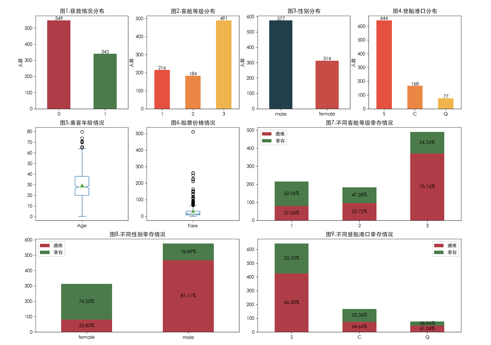
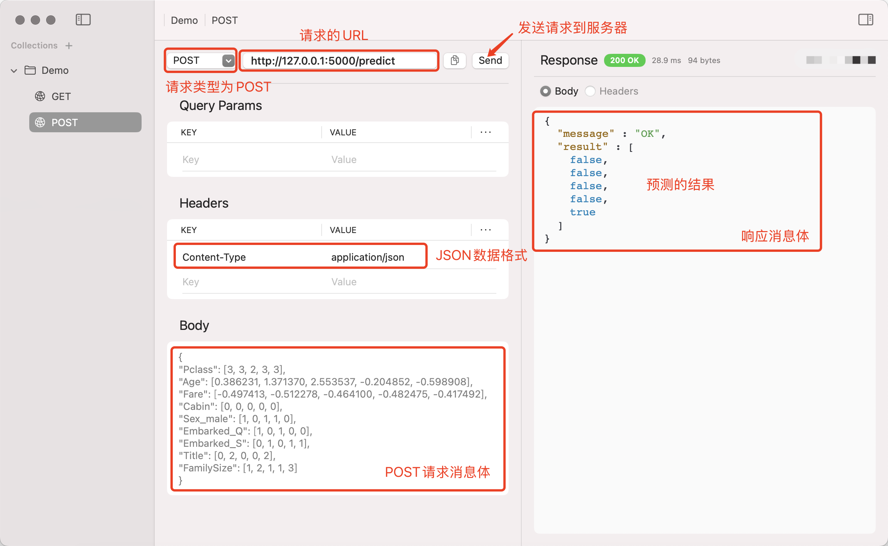

## Thực hành học máy

Trong chương này, chúng ta sẽ thông qua dự án kinh điển "Dự đoán sống sót trên tàu Titanic" để cùng tìm hiểu ứng dụng hoàn chỉnh của học máy. Dự án này đến từ nền tảng thi đấu khoa học dữ liệu nổi tiếng toàn cầu [Kaggle](https://www.kaggle.com/). Nền tảng này là một trong những cộng đồng quan trọng trong lĩnh vực khoa học dữ liệu, học máy và trí tuệ nhân tạo, mang đến không gian thực hành, chia sẻ và tranh tài cho các nhà khoa học dữ liệu cũng như kỹ sư thuật toán. Cho dù bạn là người mới bắt đầu hay chuyên gia dày dạn kinh nghiệm, Kaggle đều cung cấp nguồn tài nguyên phong phú và các thử thách đa dạng. Thông qua các tập dữ liệu, cuộc thi, khóa học và tài nguyên khác mà nền tảng cung cấp, người dùng có thể nâng cao các kỹ năng khoa học dữ liệu liên quan dựa trên nhu cầu của bản thân và tương tác với các nhà khoa học dữ liệu trên toàn thế giới.

Dự án dự đoán sống sót trên tàu Titanic là một trong những dự án học máy nhập môn nổi tiếng nhất trên Kaggle. Dự án này yêu cầu bạn dự đoán liệu hành khách có sống sót sau vụ đắm tàu Titanic hay không dựa trên thông tin cơ bản của họ (chẳng hạn như tuổi tác, giới tính, hạng vé, cảng lên tàu, v.v.), đây là một nhiệm vụ phân loại điển hình. Chúng ta có thể tìm kiếm dự án có tên "[*Titanic - Machine Learning from Disaster*](https://www.kaggle.com/competitions/titanic/)" trong mục Competitions trên trang web Kaggle. Nhấp vào đó, bạn sẽ thấy phần giới thiệu bối cảnh dự án và tìm thấy các liên kết tải xuống tệp dữ liệu `train.csv` và `test.csv`. Rõ ràng, tệp đầu tiên là tập huấn luyện (chứa cả đặc trưng và nhãn) còn tệp thứ hai là tập kiểm tra (chỉ có đặc trưng). Chúng ta có thể tải các tệp dữ liệu về máy cục bộ và huấn luyện mô hình, sau đó nộp kết quả dự đoán của mình; tất nhiên, nếu muốn, bạn cũng có thể tạo tệp Notebook trực tuyến để viết và chạy mã nguồn.

### Khám phá dữ liệu

Đầu tiên, chúng ta tải dữ liệu dùng để huấn luyện mô hình, giả sử tệp dữ liệu được lưu trong thư mục `data` thuộc đường dẫn hiện tại, đoạn code như sau:

```python
import numpy as np
import pandas as pd

df = pd.read_csv('data/train.csv', index_col='PassengerId')
df.head(5)
```

Kết quả:

```
			Survived Pclass	Name			Sex		Age		SibSp	Parch	Ticket		Fare	Cabin	Embarked
PassengerId											
1			0		 3		Braund, ...	    male	22.0	1		0		A/5 ...		7.2500	NaN		S
2			1		 1		Cumings, ...	female	38.0	1		0		PC ...		71.2833	C85		C
3			1		 3		Heikkinen, ...  female	26.0	0		0		STON/O2 ...	7.9250	NaN		S
4			1		 1		Futrelle, ...   female	35.0	1		0		113803 ...	53.1000	C123	S
5			0		 3		Allen, ...	    male	35.0	0		0		373450 ...	8.0500	NaN		S
```

> **Lưu ý**: Khi nạp dữ liệu, chúng ta trực tiếp xử lý cột `PassengerId` (mã số hành khách) thành chỉ mục dòng.

Từ điển dữ liệu dưới đây giải thích ý nghĩa của từng cột trong `DataFrame`:

| Tên cột | Ý nghĩa | Giải thích |
| ---------- | ---------------- | --------------------------------------------------- |
| `Survived` | Sống sót hay không | Nhãn mục tiêu (`1` là sống sót, `0` là thiệt mạng) |
| `Pclass` | Hạng vé | Số nguyên, nhận giá trị `1`, `2`, `3`, biểu thị 3 hạng khác nhau |
| `Name` | Tên hành khách | Chuỗi |
| `Sex` | Giới tính | Chuỗi, `male` là nam, `female` là nữ |
| `Age` | Tuổi | Số thực |
| `SibSp` | Số anh chị em / vợ chồng cùng lên tàu | Số nguyên, bao gồm tổng số anh chị em, vợ/chồng cùng lên tàu |
| `Parch` | Số cha mẹ / con cái cùng lên tàu | Số nguyên |
| `Ticket` | Số vé tàu | Chuỗi |
| `Fare` | Giá vé | Số thực |
| `Cabin` | Số phòng khách | Chuỗi |
| `Embarked` | Cảng lên tàu | Chuỗi, `C` là Cherbourg, `Q` là Queenstown, `S` là Southampton |

Chúng ta trực quan hóa dữ liệu để bước đầu khám phá dữ liệu thông qua các biểu đồ thống kê, đoạn code như sau:

```python
import matplotlib.pyplot as plt

# Sửa cấu hình phông chữ
plt.rcParams['font.sans-serif'].insert(0, 'SimHei')
plt.rcParams['axes.unicode_minus'] = False

# Tùy chỉnh khung vẽ
plt.figure(figsize=(16, 12), dpi=200)

# Phân bố số người thiệt mạng và sống sót
plt.subplot(3, 4, 1)
ser = df.Survived.value_counts()
ser.plot(kind='bar', color=['#BE3144', '#3A7D44'])
plt.xticks(rotation=0)
plt.title('Hình 1. Tình trạng sống sót')
plt.ylabel('Số người')
plt.xlabel('')
for i, v in enumerate(ser):
    plt.text(i, v, v, ha='center')

# Phân bố số người theo hạng vé
plt.subplot(3, 4, 2)
ser = df.Pclass.value_counts().sort_index()
ser.plot(kind='bar', color=['#FA4032', '#FA812F', '#FAB12F'])
plt.xticks(rotation=0)
plt.ylabel('Số người')
plt.xlabel('')
plt.title('Hình 2. Phân bố hạng vé')
for i, v in enumerate(ser):
    plt.text(i, v, v, ha='center')

# Phân bố số người theo giới tính
plt.subplot(3, 4, 3)
ser = df.Sex.value_counts()
ser.plot(kind='bar', color=['#16404D', '#D84040'])
plt.xticks(rotation=0)
plt.ylabel('Số người')
plt.xlabel('')
plt.title('Hình 3. Phân bố giới tính')
for i, v in enumerate(ser):
    plt.text(i, v, v, ha='center')

# Phân bố số người theo cảng lên tàu
plt.subplot(3, 4, 4)
ser = df.Embarked.value_counts()
ser.plot(kind='bar', color=['#FA4032', '#FA812F', '#FAB12F'])
plt.xticks(rotation=0)
plt.ylabel('Số người')
plt.xlabel('')
plt.title('Hình 4. Phân bố cảng lên tàu')
for i, v in enumerate(ser):
    plt.text(i, v, v, ha='center')

# Biểu đồ hộp độ tuổi hành khách
plt.subplot(3, 4, 5)
df.Age.plot(kind='box', showmeans=True, notch=True)
plt.title('Hình 5. Độ tuổi hành khách')

# Biểu đồ hộp giá vé
plt.subplot(3, 4, 6)
df.Fare.plot(kind='box', showmeans=True, notch=True)
plt.title('Hình 6. Giá vé tàu')

# Phân bố số người thiệt mạng và sống sót theo các hạng vé khác nhau
plt.subplot(3, 4, (7, 8))
s0 = df[df.Survived == 0].Pclass.value_counts()
s1 = df[df.Survived == 1].Pclass.value_counts()
temp = pd.DataFrame({'Thiệt mạng': s0, 'Sống sót': s1})
pcts = temp.div(temp.sum(axis=1), axis=0)
temp.plot(ax=plt.gca(), kind='bar', stacked=True, color=['#BE3144', '#3A7D44'])
for i, idx in enumerate(temp.index):
    plt.text(i, temp.at[idx, 'Thiệt mạng'] // 2, f'{pcts.at[idx, "Thiệt mạng"]:.2%}', ha='center', va='center')
    plt.text(i, temp.at[idx, 'Thiệt mạng'] + temp.at[idx, 'Sống sót'] // 2, f'{pcts.at[idx, "Sống sót"]:.2%}', ha='center', va='center')
plt.xticks(rotation=0)
plt.xlabel('')
plt.title('Hình 7. Tình trạng sống sót theo hạng vé')

# Phân bố số người thiệt mạng và sống sót theo giới tính
plt.subplot(3, 4, (9, 10))
s0 = df[df.Survived == 0].Sex.value_counts()
s1 = df[df.Survived == 1].Sex.value_counts()
temp = pd.DataFrame({'Thiệt mạng': s0, 'Sống sót': s1})
pcts = temp.div(temp.sum(axis=1), axis=0)
temp.plot(ax=plt.gca(), kind='bar', stacked=True, color=['#BE3144', '#3A7D44'])
for i, idx in enumerate(temp.index):
    plt.text(i, temp.at[idx, 'Thiệt mạng'] // 2, f'{pcts.at[idx, "Thiệt mạng"]:.2%}', ha='center', va='center')
    plt.text(i, temp.at[idx, 'Thiệt mạng'] + temp.at[idx, 'Sống sót'] // 2, f'{pcts.at[idx, "Sống sót"]:.2%}', ha='center', va='center')
plt.xticks(rotation=0)
plt.xlabel('')
plt.title('Hình 8. Tình trạng sống sót theo giới tính')

# Phân bố số người thiệt mạng và sống sót theo cảng lên tàu
plt.subplot(3, 4, (11, 12))
s0 = df[df.Survived == 0].Embarked.value_counts()
s1 = df[df.Survived == 1].Embarked.value_counts()
temp = pd.DataFrame({'Thiệt mạng': s0, 'Sống sót': s1})
pcts = temp.div(temp.sum(axis=1), axis=0)
temp.plot(ax=plt.gca(), kind='bar', stacked=True, color=['#BE3144', '#3A7D44'])
for i, idx in enumerate(temp.index):
    plt.text(i, temp.at[idx, 'Thiệt mạng'] // 2, f'{pcts.at[idx, "Thiệt mạng"]:.2%}', ha='center', va='center')
    plt.text(i, temp.at[idx, 'Thiệt mạng'] + temp.at[idx, 'Sống sót'] // 2, f'{pcts.at[idx, "Sống sót"]:.2%}', ha='center', va='center')
plt.xticks(rotation=0)
plt.xlabel('')
plt.title('Hình 9. Tình trạng sống sót theo cảng lên tàu')

plt.show()
```

Kết quả:



Từ các biểu đồ thống kê ở trên có thể thấy, hành khách khoang hạng nhất có tỷ lệ sống sót cao hơn, hành khách nữ có tỷ lệ sống sót cao hơn nhiều so với hành khách nam, và những người lên tàu tại Cherbourg có tỷ lệ sống sót cao hơn hai nơi còn lại. Nếu muốn, chúng ta cũng có thể thử kết hợp đan xen giữa các chiều như giới tính, hạng vé, độ tuổi và vẽ các biểu đồ thống kê tương ứng, thậm chí có thể khám phá xem danh xưng trong tên hành khách (`Mr`, `Miss`, `Mrs`, `Dr`, `Master`, `Major`, v.v.) có mối liên hệ nào với việc hành khách có sống sót hay không; bạn đọc quan tâm có thể tự mình nghiên cứu thêm.

Chúng ta tiếp tục xem xét thông tin liên quan của đối tượng `DataFrame`:

```python
df.info()
```

Kết quả:

```
<class 'pandas.core.frame.DataFrame'>
Index: 891 entries, 1 to 891
Data columns (total 11 columns):
 #   Column    Non-Null Count  Dtype  
---  ------    --------------  -----  
 0   Survived  891 non-null    int64  
 1   Pclass    891 non-null    int64  
 2   Name      891 non-null    object 
 3   Sex       891 non-null    object 
 4   Age       714 non-null    float64
 5   SibSp     891 non-null    int64  
 6   Parch     891 non-null    int64  
 7   Ticket    891 non-null    object 
 8   Fare      891 non-null    float64
 9   Cabin     204 non-null    object 
 10  Embarked  889 non-null    object 
dtypes: float64(2), int64(4), object(5)
memory usage: 83.5+ KB
```

Có thể thấy tập huấn luyện có tổng cộng `891` bản ghi dữ liệu, trong đó các cột như tuổi, số phòng khách, cảng lên tàu có các giá trị bị khuyết thiếu; tên hành khách, cảng lên tàu là kiểu chuỗi nên không thể dùng trực tiếp để huấn luyện mô hình, vì vậy chúng ta cần thực hiện một số bước chuẩn bị.

### Kỹ nghệ đặc trưng

Kỹ nghệ đặc trưng (Feature Engineering) là một khâu quan trọng trong học máy. Thông qua việc xử lý, chuyển đổi và lựa chọn dữ liệu ban đầu, chúng ta trích xuất các đặc trưng có thể giúp mô hình hiểu dữ liệu tốt hơn, cuối cùng nâng cao hiệu năng dự đoán của mô hình. Các bước chính của kỹ nghệ đặc trưng bao gồm:

1. **Làm sạch dữ liệu**: Xử lý các giá trị bị khuyết thiếu, giá trị trùng lặp, giá trị ngoại lai trong dữ liệu.

2. **Chuyển đổi đặc trưng**: Chuyển đổi dữ liệu gốc thành dạng phù hợp hơn cho đầu vào của mô hình. Các phương pháp chuyển đổi đặc trưng phổ biến gồm:

    - Chuẩn hóa và co giãn: Chuẩn hóa đưa dữ liệu về phân phối có giá trị trung bình bằng `0` và độ lệch chuẩn bằng `1`; co giãn đưa dữ liệu về một phạm vi cụ thể (chẳng hạn: $\small{[0, 1]}$) nhằm đảm bảo các đặc trưng ở cùng một thang đo, các công thức tương ứng như sau:
        $$
        X^{\prime} = \frac{X - \mu}{\sigma}
        $$

        $$
        X^{\prime} = \frac{X - X_{min}}{X_{max} - X_{min}}
        $$

        Trong đó, $\small{\mu}$ biểu thị giá trị trung bình của dữ liệu, $\small{\sigma}$ biểu thị độ lệch chuẩn của dữ liệu, $\small{X_{min}}$ biểu thị giá trị nhỏ nhất trong dữ liệu, $\small{X_{max}}$ biểu thị giá trị lớn nhất trong dữ liệu. `StandardScaler` và `MinMaxScaler` trong module `preprocessing` của thư viện Scikit-learn có thể thực hiện chuẩn hóa và co giãn dữ liệu.

    - Mã hóa biến phân loại: Đối với các biến phân loại (như: giới tính, nghề nghiệp, khu vực, v.v.), các phương pháp mã hóa thường dùng là mã hóa one-hot (One-Hot Encoding) và mã hóa nhãn (Label Encoding). `OneHotEncoder` và `LabelEncoder` trong module `preprocessing` của thư viện Scikit-learn có thể thực hiện mã hóa one-hot và mã hóa nhãn, hoặc cũng có thể xử lý các biến phân loại trong `DataFrame` thông qua hàm `get_dummies` của thư viện pandas.

    - Biến đổi logarit: Biến đổi logarit có thể giúp xử lý các đặc trưng có phân phối lệch, đưa chúng về gần hơn với phân phối chuẩn.

3. **Lựa chọn đặc trưng**: Sàng lọc từ lượng lớn đặc trưng để lấy ra các đặc trưng hữu ích cho việc dự đoán của mô hình, loại bỏ các đặc trưng dư thừa hoặc không liên quan, giảm số chiều và nâng cao hiệu năng của mô hình. Các phương pháp thường dùng gồm:

    - **Phương pháp lọc**: Dựa trên các phương pháp kiểm định thống kê (như: kiểm định Chi bình phương, hệ số tương quan Pearson, v.v.) để chọn ra các đặc trưng có tính phân biệt cao nhất.
    - **Phương pháp bọc**: Đánh giá hiệu quả của tập hợp con đặc trưng thông qua hiệu năng của mô hình (như: loại bỏ đặc trưng đệ quy).
    - **Phương pháp nhúng**: Thông qua việc huấn luyện mô hình và trích xuất tầm quan trọng của đặc trưng từ mô hình (như: cây quyết định, điều chuẩn L1, v.v.) để tiến hành lựa chọn đặc trưng.

4. **Giảm chiều đặc trưng**: Thông qua một phép biến đổi toán học nào đó để ánh xạ dữ liệu từ không gian nhiều chiều sang không gian ít chiều hơn, nhằm giữ lại thông tin chính của dữ liệu, đơn giản hóa mô hình, các đặc trưng mới sau khi giảm chiều là sự kết hợp nào đó của các đặc trưng ban đầu. Giảm chiều có thể giảm bớt khối lượng tính toán khi huấn luyện mô hình, giảm nhiễu không cần thiết và các đặc trưng dư thừa để giảm độ phức tạp, từ đó nâng cao khả năng khái quát hóa của mô hình. Các phương pháp giảm chiều đặc trưng phổ biến gồm:

    - **PCA** (Phân tích thành phần chính): Mục tiêu của PCA là tìm ra các đặc trưng quan trọng nhất (các thành phần chính) trong dữ liệu, những thành phần chính này có thể giữ lại phần lớn phương sai của dữ liệu. PCA chiếu dữ liệu lên các trục tọa độ mới thông qua phép biến đổi tuyến tính, sao cho phương sai của dữ liệu sau khi chiếu là lớn nhất. Nói cách khác, PCA "xoay" các đặc trưng của dữ liệu để chuyển nó sang một hệ tọa độ mới, mỗi trục của hệ tọa độ mới (tức là thành phần chính) được sắp xếp theo độ lớn phương sai của dữ liệu, và vài thành phần chính đầu tiên thường đã có thể giải thích phần lớn biến thiên của dữ liệu. Lớp `PCA` trong module `decomposition` của thư viện Scikit-learn có thể giúp chúng ta hoàn thành phân tích thành phần chính.
    - **LDA** (Phân tích phân biệt tuyến tính): Mục tiêu chính của LDA là tìm ra hướng chiếu tốt nhất để tối đa hóa khả năng phân tách giữa các lớp khác nhau, đồng thời tối thiểu hóa độ phân tán của các điểm dữ liệu trong cùng một lớp. LDA tìm thấy một không gian số chiều thấp trong không gian đặc trưng sao cho sự khác biệt giữa các lớp là lớn nhất có thể, trong khi dữ liệu trong cùng một lớp được gom cụm chặt chẽ nhất có thể. Nói một cách đơn giản, tư tưởng cốt lõi của LDA là **tối đa hóa độ phân tán giữa các lớp, tối thiểu hóa độ phân tán trong cùng lớp**. Lớp `LinearDiscriminantAnalysis` trong module `discriminant_analysis` của thư viện Scikit-learn có thể giúp chúng ta hoàn thành phân tích phân biệt tuyến tính.
    - **t-SNE** (Nhúng láng giềng ngẫu nhiên phân phối t): t-SNE là một phương pháp giảm chiều phi tuyến tính, chủ yếu được sử dụng để trực quan hóa dữ liệu, đặc biệt thích hợp cho việc giảm chiều dữ liệu nhiều chiều (như hình ảnh, văn bản, v.v.). Mục tiêu của t-SNE là ánh xạ các điểm tương tự (điểm lân cận) trong không gian nhiều chiều vào các vị trí gần nhau trong không gian ít chiều, đồng thời cố gắng tránh sự chồng chéo giữa các lớp khác nhau. Lớp `TSNE` trong module `manifold` của thư viện Scikit-learn có thể giúp chúng ta hoàn thành việc này.

5. **Tạo đặc trưng mới**: Kết hợp, biến đổi hoặc suy biến từ các đặc trưng ban đầu để tạo ra các đặc trưng mới.

Kỹ nghệ đặc trưng không chỉ là yếu tố then chốt để nâng cao độ chính xác của mô hình, mà còn là một quá trình cần được tối ưu hóa liên tục trong học máy. Thông qua việc làm sạch, chuyển đổi, lựa chọn và xây dựng dữ liệu một cách cẩn thận, chúng ta có thể cung cấp thông tin có giá trị hơn cho mô hình, từ đó nâng cao hiệu quả của mô hình. Mặc dù kỹ nghệ đặc trưng có vẻ phức tạp, nhưng trong nhiều trường hợp hiệu quả của nó vượt xa việc chỉ cải tiến bản thân mô hình, vì vậy trong ứng dụng thực tế, chúng ta nên đầu tư đủ thời gian và công sức để tối ưu hóa kỹ nghệ đặc trưng.

Đối với tập dữ liệu chúng ta đã tải, chúng ta có thể xử lý các giá trị khuyết thiếu của trường tuổi bằng giá trị trung vị, xử lý các giá trị khuyết thiếu của cảng lên tàu bằng giá trị xuất hiện nhiều nhất (mode). Cột số phòng khách có khá nhiều giá trị khuyết thiếu, một cách xử lý là xóa trực tiếp cột này, cách khác là nhị phân hóa: có số phòng khách thì ghi là `1`, không có thì ghi là `0`, đoạn code như sau:

```python
df['Age'] = df.Age.fillna(df.Age.median())
df['Embarked'] = df.Embarked.fillna(df.Embarked.mode()[0])
df['Cabin'] = df.Cabin.replace(r'.+', '1', regex=True).replace(np.nan, 0).astype('i8')
```

Sau khi xử lý các giá trị khuyết thiếu, chúng ta tiến hành co giãn đặc trưng cho hai trường tuổi và giá vé, thực hiện chuẩn hóa thông qua `StandardScaler`, đoạn code như sau:

```python
from sklearn.preprocessing import StandardScaler

scaler = StandardScaler()
df[['Fare', 'Age']] = scaler.fit_transform(df[['Fare', 'Age']])
```

Tiếp theo, chúng ta cần tiến hành mã hóa one-hot cho hai trường giới tính và cảng lên tàu, có thể sử dụng hàm `get_dummies` trong thư viện pandas hoặc `OneHotEncoder` của thư viện scikit-learn, kết quả xử lý của cả hai là tương tự nhau, đoạn code như sau:

```python
df = pd.get_dummies(df, columns=['Sex', 'Embarked'], drop_first=True)
```

Chúng ta tiếp tục xử lý trường tên hành khách, suy biến ra một đặc trưng mới dựa trên danh xưng trong tên; ngoài ra, đối với hai trường `SibSp` và `Parch`, chúng ta có thể suy biến chúng thành đặc trưng mới là số lượng thành viên trong gia đình, đoạn code như sau:

```python
title_mapping = {
    'Mr': 0, 'Miss': 1, 'Mrs': 2, 'Master': 3, 'Dr': 4, 'Rev': 5, 'Col': 6, 'Major': 7, 
    'Mlle': 8, 'Ms': 9, 'Lady': 10, 'Sir': 11, 'Jonkheer': 12, 'Don': 13, 'Dona': 14, 'Countess': 15
}
df['Title'] = df['Name'].map(
    lambda x: x.split(',')[1].split('.')[0].strip()
).map(title_mapping).fillna(-1)
df['FamilySize'] = df['SibSp'] + df['Parch'] + 1
```

> **Giải thích**: Chúng ta ánh xạ mỗi danh xưng thành một con số, ở đây không cần quá bận tâm về mối quan hệ tương ứng giữa danh xưng và con số, hơn nữa một số danh xưng không hề xuất hiện trong tập huấn luyện của chúng ta. Đối với những danh xưng chưa biết đó, chúng ta quy ước xử lý chung thành `-1`.

Sau khi hoàn thành các thao tác trên, chúng ta có thể xóa bỏ tất cả các trường không cần thiết, công việc chuẩn bị dữ liệu về cơ bản đã hoàn tất:

```python
df.drop(columns=['Name', 'SibSp', 'Parch', 'Ticket'], inplace=True)
```

### Huấn luyện mô hình

Đầu tiên, chúng ta chia tập dữ liệu thành tập huấn luyện và tập kiểm định, lưu ý ở đây không phải chia thành tập huấn luyện và tập kiểm tra, vì tập kiểm tra cuối cùng của chúng ta là tệp `test.csv` do Kaggle chính thức cung cấp. Ở đây chúng ta lấy 90% dữ liệu trong `train.csv` để huấn luyện mô hình, dùng 10% còn lại để kiểm định mô hình. Trong đoạn code dưới đây, chúng ta lần lượt đặt tên cho đặc trưng và nhãn của tập kiểm định là `X_valid` và `y_valid`:

```python
from sklearn.model_selection import train_test_split

X, y = df.drop(columns='Survived'), df.Survived
X_train, X_valid, y_train, y_valid = train_test_split(X, y, train_size=0.9, random_state=3)
```

Trước tiên chúng ta thử mô hình hồi quy logistic, đoạn code như sau:

```python
from sklearn.linear_model import LogisticRegression
from sklearn.metrics import classification_report

model = LogisticRegression(penalty='l1', tol=1e-6, solver='liblinear')
model.fit(X_train, y_train)
y_pred = model.predict(X_valid)
print(classification_report(y_valid, y_pred))
```

Kết quả:

```
              precision    recall  f1-score   support

           0       0.88      0.80      0.84        56
           1       0.72      0.82      0.77        34

    accuracy                           0.81        90
   macro avg       0.80      0.81      0.80        90
weighted avg       0.82      0.81      0.81        90
```

Chúng ta lại thử với công cụ mạnh mẽ XGBoost, đoạn code như sau:

```python
import xgboost as xgb

# Chuyển đổi dữ liệu sang định dạng DMatrix
dm_train = xgb.DMatrix(X_train, y_train)
dm_valid = xgb.DMatrix(X_valid)

# Thiết lập các tham số cho mô hình
params = {
    'booster': 'gbtree',             # Loại bộ học cơ sở dùng để huấn luyện
    'objective': 'binary:logistic',  # Chỉ định hàm mất mát của mô hình
    'gamma': 0.1,                    # Kiểm soát lượng giảm hàm mất mát tối thiểu cho mỗi lần phân nhánh
    'max_depth': 10,                 # Độ sâu tối đa của cây quyết định
    'lambda': 0.5,                   # Trọng số điều chuẩn L2
    'subsample': 0.8,                # Tỷ lệ mẫu được chọn ngẫu nhiên khi huấn luyện mỗi cây
    'colsample_bytree': 0.8,         # Tỷ lệ chọn đặc trưng cho mỗi cây hoặc mỗi nút
    'eta': 0.05,                     # Tốc độ học
    'seed': 3,                       # Seed cho bộ sinh số ngẫu nhiên
    'nthread': 16,                   # Số lượng luồng chạy song song khi huấn luyện
}

model = xgb.train(params, dm_train, num_boost_round=200)
y_pred = model.predict(dm_valid)
# Chuyển đổi xác suất dự đoán thành nhãn lớp
y_pred_label = (y_pred > 0.5).astype('i8')
print(classification_report(y_valid, y_pred_label))
```

Kết quả:

```
              precision    recall  f1-score   support

           0       0.89      0.91      0.90        56
           1       0.85      0.82      0.84        34

    accuracy                           0.88        90
   macro avg       0.87      0.87      0.87        90
weighted avg       0.88      0.88      0.88        90
```

Tất nhiên, trong điều kiện cho phép, **rất khuyến khích** bạn tinh chỉnh các siêu tham số của mô hình thông qua tìm kiếm lưới kết hợp kiểm định chéo, đồng thời chúng ta cũng có thể vẽ **đường cong học tập** (learning curve) để hỗ trợ xác định xem có tồn tại vấn đề quá khớp hay chưa khớp hay không. Đường cong học tập gồm hai đường, một đường phản ánh sai số huấn luyện và một đường phản ánh sai số kiểm định. Chưa khớp thường biểu hiện ở việc sai số của mô hình trên cả tập huấn luyện và tập kiểm định đều lớn, và khi dữ liệu huấn luyện tăng lên, khoảng cách giữa sai số huấn luyện và sai số kiểm định khá nhỏ, cho thấy mô hình của chúng ta quá đơn giản, không thể nắm bắt được quy luật trong dữ liệu. Quá khớp thường biểu hiện ở việc mô hình thể hiện rất tốt trên tập huấn luyện (sai số huấn luyện thấp), nhưng lại kém trên tập kiểm định (sai số kiểm định cao), và khi dữ liệu huấn luyện tăng lên, sai số huấn luyện tiếp tục giảm trong khi sai số kiểm định bắt đầu tăng lên, cho thấy mô hình của chúng ta quá phức tạp. Hàm `learning_curve` trong module `model_selection` của thư viện Scikit-learn có thể giúp chúng ta vẽ đường cong học tập, bạn đọc quan tâm có thể tự mình tìm hiểu thêm.

### Đánh giá mô hình

Tiếp theo, chúng ta nạp dữ liệu kiểm tra thực sự từ tệp `test.csv`, đưa ra dự đoán thông qua mô hình đã được huấn luyện trước đó. Chúng ta có thể lưu kết quả dự đoán thành một tệp CSV, tệp này có tổng cộng hai cột: một cột là PassengerId và cột còn lại là kết quả dự đoán của chúng ta. Chúng ta nộp tệp này lên nền tảng Kaggle để nhận điểm số đánh giá độ chính xác cuối cùng của mô hình.

```python
test = pd.read_csv('data/test.csv', index_col='PassengerId')
# Xử lý giá trị khuyết thiếu
test['Age'] = test.Age.fillna(test.Age.median())
test['Fare'] = test.Fare.fillna(test.Fare.median())
test['Embarked'] = test.Embarked.fillna(test.Embarked.mode()[0])
test['Cabin'] = test.Cabin.replace(r'.+', '1', regex=True).replace(np.nan, 0).astype('i8')
# Co giãn đặc trưng
test[['Fare', 'Age']] = scaler.fit_transform(test[['Fare', 'Age']])
# Xử lý biến phân loại
test = pd.get_dummies(test, columns=['Sex', 'Embarked'], drop_first=True)
# Tạo đặc trưng mới
test['Title'] = test['Name'].apply(lambda x: x.split(',')[1].split('.')[0].strip()).map(title_mapping).fillna(-1)
test['FamilySize'] = test['SibSp'] + test['Parch'] + 1
# Xóa các đặc trưng dư thừa
test.drop(columns=['Name', 'Ticket', 'SibSp', 'Parch'], inplace=True)

# Sử dụng mô hình hồi quy logistic
passenger_id, X_test = test.index, test
# Sử dụng mô hình XGBoost
# passenger_id, X_test = test.index, xgb.DMatrix(test)

y_test_pred = model.predict(X_test)
# Mô hình XGBoost - chuyển đổi xác suất dự đoán thành nhãn lớp
# y_test_pred = (model.predict(X_test) > 0.5).astype('i8')

# Tạo tệp nộp bài
result = pd.DataFrame({
    'PassengerId': passenger_id,
    'Survived': y_test_pred
})
result.to_csv('submission.csv', index=False)
```

Bạn có thể thử xem liệu kết quả dự đoán giữa các mô hình khác nhau có sự chênh lệch lớn hay không, đâu là mô hình lý tưởng nhất trong mắt bạn. Sau đó bạn có thể kiểm chứng quan điểm chúng ta đã đề cập trước đó thông qua thực nghiệm, xem liệu kỹ nghệ đặc trưng có ảnh hưởng quan trọng đến kết quả dự đoán hay không. Dưới đây là một số gợi ý nhỏ của tôi về kỹ nghệ đặc trưng (chỉ mang tính tham khảo), bạn có thể tự mình thực hành để xem liệu những thao tác này có giúp nâng cao hiệu năng của mô hình hay không:

1. Rời rạc hóa (chia nhóm) trường tuổi (Age), xử lý riêng những người có độ tuổi rất nhỏ (trẻ em) (chẳng hạn như thêm một trường boolean).
2. Xử lý chi tiết hơn đối với trường số phòng khách (Cabin), trích xuất chữ cái tiền tố và các con số phía sau làm đặc trưng, thay vì chỉ nhị phân hóa đơn giản.
3. Kết hợp hai đặc trưng tương đối quan trọng là hạng vé (Pclass) và giới tính (Sex).
4. Xử lý riêng những hành khách có tên (Name) chứa Mrs và số cha mẹ/con cái cùng lên tàu lớn hơn 1 (có thể là một người mẹ) (chẳng hạn như thêm một trường boolean).
5. Xóa bỏ trường cảng lên tàu (Embarked).

### Triển khai mô hình

Chúng ta có thể triển khai mô hình đã huấn luyện vào các dự án phần mềm kỹ thuật, trước tiên cần tiến hành tuần tự hóa mô hình, đoạn code như sau:

```python
import joblib

joblib.dump(model, 'model.pkl')
```

> **Giải thích**: Ở đây chúng ta mặc định đối tượng `model` trong đoạn code trên là mô hình đã được huấn luyện bằng XGBoost trước đó.

Hàm `dump` của module `joblib` thực hiện tuần tự hóa Pickle cho mô hình (giao thức tuần tự hóa riêng của Python). Ở những nơi cần sử dụng mô hình, chúng ta có thể thực hiện giải tuần tự hóa thông qua hàm `load`, như vậy có thể nạp mô hình vào ứng dụng và hoàn thành việc dự đoán, đoạn code như sau:

```python
import joblib

model = joblib.load('model.pkl')
model.predict(X_test)
```

> **Giải thích**: Ở đây chúng ta mặc định `X_test` trong đoạn code trên đã được xử lý thành đối tượng `DMatrix` trong XGBoost.

Nếu chúng ta muốn triển khai mô hình thành một dịch vụ Web, chúng ta có thể tận dụng các web framework như Flask hoặc FastAPI để tạo giao diện API. Dưới đây, chúng ta lấy Flask framework làm ví dụ để minh họa quá trình này bằng đoạn code đơn giản:

```python
from flask import Flask
from flask import jsonify
from flask import request

import joblib
import pandas as pd
import xgboost as xgb

app = Flask(__name__)


@app.route('/predict', methods=['POST'])
def predict():
    query_df = pd.DataFrame(request.json)
    model = joblib.load('model.pkl')
    y_pred = (model.predict(xgb.DMatrix(query_df)) > 0.5).tolist()
    return jsonify({'message': 'OK', 'result': y_pred})


if __name__ == '__main__':
    app.run(debug=True)
```

> **Giải thích**: Là một dự án thực tế trong kỹ thuật phần mềm, chắc chắn không thể đợi đến khi có yêu cầu gửi đến mới tải mô hình, vì làm như vậy sẽ ảnh hưởng nghiêm trọng đến hiệu năng của dịch vụ Web. Bạn có thể nạp trước các mô hình cần thiết vào thời điểm thích hợp sau khi khởi động dự án, đồng thời cần giám sát chặt chẽ việc chiếm dụng tài nguyên của mô hình dựa trên nhu cầu thực tế.

Chạy đoạn code trên, mặc định sẽ khởi chạy một Web server tại cổng 5000 trên máy cục bộ. Dưới đây, chúng ta mô phỏng gửi một HTTP request đến máy chủ thông qua công cụ kiểm thử API để xem mô hình của chúng ta có thể vận hành và đưa ra kết quả dự đoán hay không:



Ngoài việc triển khai mô hình thành dịch vụ Web, chúng ta còn có thể triển khai mô hình vào các tác vụ định kỳ, tự động kích hoạt lời gọi mô hình theo thời gian. Ngoài ra, một số thiết bị biên cũng hỗ trợ chúng ta nhúng mô hình đã huấn luyện vào dưới một định dạng đặc biệt nào đó, bạn đọc quan tâm có thể tự mình tìm hiểu thêm.
