## Các vấn đề và giải pháp trong phát triển dự án nhóm

Hai khái niệm phát triển cá nhân và phát triển theo nhóm chắc hẳn không còn xa lạ với mọi người. Phát triển cá nhân là khi một người tự mình kiểm soát toàn bộ nội dung của sản phẩm; trong khi phát triển theo nhóm là nhiều người cùng lập thành một nhóm để hoàn thành việc phát triển sản phẩm. Để triển khai phát triển nhóm, những điểm sau đây là không thể thiếu:

1. Quản lý và chia sẻ các sự kiện khác nhau trong quá trình phát triển (ví dụ: ai đã hoàn thành việc gì vào thời điểm nào).
2. Chia sẻ các thành quả công việc cũng như kiến thức, kỹ năng mới trong nội bộ nhóm.
3. Quản lý sự thay đổi của thành quả công việc, vừa phải ngăn chặn thành quả bị phá hỏng, vừa phải đảm bảo các thành viên có thể tận dụng thành quả hiện có để làm việc song song.
4. Đảm bảo phần mềm do nhóm phát triển có thể vận hành bình thường ở mọi thời điểm.
5. Sử dụng quy trình làm việc tự động hóa để các thành viên trong nhóm có thể tiến hành phát triển, kiểm thử và triển khai một cách chính xác.

### Các vấn đề thường gặp trong phát triển dự án nhóm

So với phát triển cá nhân, phát triển nhóm rất dễ gặp phải các vấn đề ở các khía cạnh sau:

#### Vấn đề 1: Phương thức giao tiếp truyền thống không thể xác định mức độ ưu tiên xử lý

Ví dụ: Sử dụng email để giao tiếp có thể dẫn đến việc số lượng thư quá nhiều khiến các thư quan trọng bị trôi mất, không thể quản lý trạng thái, không biết vấn đề nào đã được giải quyết, vấn đề nào chưa được xử lý; nếu dùng cách tìm kiếm toàn văn trong email để tra cứu các vấn đề liên quan thì hiệu suất quá thấp.

Giải pháp: Sử dụng công cụ quản lý lỗi.

#### Vấn đề 2: Không có môi trường dùng để kiểm chứng

Ví dụ: Sau khi nhận được báo cáo sự cố xảy ra trên môi trường chính thức, việc tái hiện lại môi trường chính thức đòi hỏi rất nhiều thời gian.

Giải pháp: Triển khai phân phối liên tục.

#### Vấn đề 3: Sử dụng thư mục có tên bí danh để quản lý nhánh dự án

Giải pháp: Triển khai kiểm soát phiên bản.

#### Vấn đề 4: Tái tạo lại cơ sở dữ liệu vô cùng khó khăn

Ví dụ: Cấu trúc bảng cơ sở dữ liệu giữa môi trường chính thức và môi trường phát triển không nhất quán, hoặc thứ tự các cột của một bảng nào đó không khớp nhau.

Giải pháp: Triển khai kiểm soát phiên bản.

#### Vấn đề 5: Không chạy hệ thống thì không phát hiện được vấn đề

Ví dụ: Giải quyết một bug có thể dẫn đến các bug khác hoặc gây ra sự thoái lui của hệ thống; việc sử dụng hệ thống phiên bản không đúng cách đã ghi đè lên các sửa đổi của người khác, các nội dung chỉnh sửa gây xung đột lẫn nhau. Nếu vấn đề không được phát hiện sớm thì vài tháng sau muốn truy vết lại sẽ vô cùng rắc rối.

Giải pháp: Triển khai tích hợp liên tục, thường xuyên và liên tục build cũng như kiểm thử thành quả công việc của các thành viên trong nhóm.

#### Vấn đề 6: Ghi đè lên mã nguồn do thành viên khác sửa đổi

Giải pháp: Triển khai kiểm soát phiên bản.

#### Vấn đề 7: Không thể tiến hành tái cấu trúc mã nguồn

Ví dụ: Khi tiến hành tái cấu trúc mã nguồn (điều chỉnh cấu trúc bên trong của mã nguồn mà không làm ảnh hưởng đến kết quả đầu ra của code) có thể gây ra lỗi thoái lui.

Giải pháp: Xây dựng lượng lớn các bài kiểm thử có thể tái sử dụng và triển khai tích hợp liên tục.

#### Vấn đề 8: Không biết ngày sửa bug, không thể truy vết lỗi thoái lui

Giải pháp: Hệ thống kiểm soát phiên bản, hệ thống quản lý lỗi và tích hợp liên tục cần có sự tương tác với nhau, tốt nhất là có thể tích hợp cùng với các công cụ triển khai tự động hóa.

#### Vấn đề 9: Quy trình phát hành quá phức tạp

Giải pháp: Triển khai phân phối liên tục.

Dựa trên việc trình bày và phân tích các vấn đề nêu trên, chúng ta về cơ bản có thể rút ra kết luận rằng: trong phát triển nhóm, kiểm soát phiên bản, quản lý lỗi và tích hợp liên tục đều là những yếu tố vô cùng quan trọng và không thể thiếu.

### Kiểm soát phiên bản

Đối với hàng loạt vấn đề nêu trên, chúng ta có thể rút ra một kết luận đơn giản: kiểm soát phiên bản là tiền đề hàng đầu để triển khai phát triển nhóm, bắt buộc phải thông qua kiểm soát phiên bản để quản lý mọi thông tin phát sinh trong quá trình nghiên cứu và phát triển sản phẩm, các nội dung này bao gồm:

1. Mã nguồn.
2. Các tài liệu liên quan đến yêu cầu và thiết kế.
3. Lược đồ cơ sở dữ liệu và dữ liệu khởi tạo.
4. Tệp cấu hình.
5. Định nghĩa quan hệ phụ thuộc của các thư viện.

#### Giới thiệu về Git

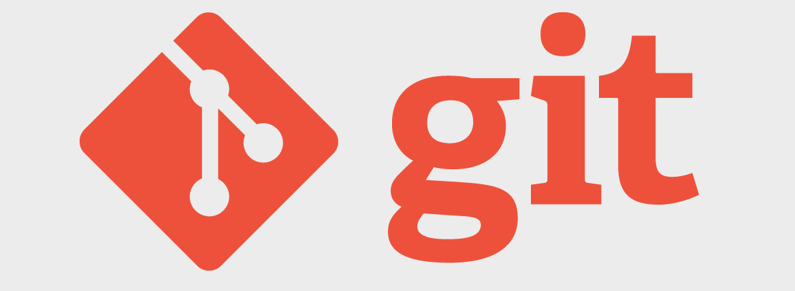

Git là một hệ thống kiểm soát phiên bản phân tán mã nguồn mở ra đời vào năm 2005, ban đầu do Linus Torvalds (cha đẻ của Linux) phát triển nhằm hỗ trợ quản lý việc phát triển nhân Linux. Khác với các công cụ kiểm soát phiên bản thường dùng như Subversion, Git áp dụng phương thức kiểm soát phiên bản phân tán, có thể thực hiện kiểm soát phiên bản ngay cả trong môi trường không có máy chủ trung tâm.

Đối với những người đã có kinh nghiệm sử dụng Subversion (dưới đây gọi tắt là SVN), điểm chung giữa Git và SVN là đã từ bỏ mô hình kiểm soát phiên bản dựa trên cơ chế khóa truyền thống (CVS và VSS thời kỳ đầu sử dụng chế độ khóa: khi một nhà phát triển chỉnh sửa tệp thì tệp đó sẽ bị khóa, các nhà phát triển khác trong thời gian này không thể chỉnh sửa tệp), thay vào đó áp dụng mô hình kiểm soát phiên bản dựa trên việc hợp nhất hiệu quả hơn. Còn sự khác biệt giữa hai bên bao gồm:

1. Git là phân tán, SVN là tập trung; SVN cần sự hỗ trợ của máy chủ trung tâm mới có thể làm việc.
2. Git lưu trữ nội dung dưới dạng siêu dữ liệu, trong khi SVN lưu trữ theo từng tệp, tức là ẩn thông tin siêu dữ liệu của tệp trong thư mục `.svn`.
3. Nhánh của Git và nhánh của SVN khác nhau; cách SVN xử lý nhánh khá cồng kềnh và phức tạp.
4. Git không có số phiên bản toàn cục, nhưng có thể tự duy trì một thẻ phiên bản.
5. Tính toàn vẹn nội dung của Git vượt trội hơn SVN; việc lưu trữ nội dung của Git sử dụng thuật toán băm SHA-1. Điều này đảm bảo tính toàn vẹn của nội dung code, đảm bảo giảm thiểu sự hư hại đối với kho lưu trữ khi gặp sự cố đĩa cứng hoặc vấn đề mạng.

Tóm lại, **Git thực sự vô cùng tuyệt vời!!!**

#### Cài đặt Git

Bạn có thể tìm thấy liên kết tải Git phù hợp với hệ điều hành của mình trên [trang web chính thức của Git](http://git-scm.com/) và tiến hành cài đặt; việc cài đặt Git trên nền tảng macOS và Windows đều rất đơn giản.

#### Các thao tác Git cục bộ

Có thể sử dụng lệnh sau để biến một thư mục thành kho Git:

```Shell
git init 
```

Sau khi hoàn thành thao tác trên, thư mục cục bộ sẽ có cấu trúc như hình dưới đây. Phía bên trái hình là khu vực làm việc của bạn (thư mục làm việc đang thao tác), phía bên phải là kho lưu trữ cục bộ, ở giữa là khu vực chờ (còn gọi là vùng đệm) nằm giữa khu vực làm việc và kho lưu trữ cục bộ.

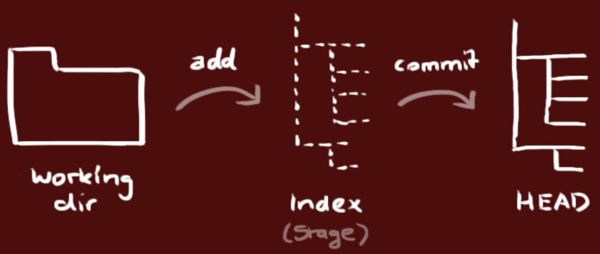

> **Gợi ý**: Sử dụng lệnh `ls -la` để xem tất cả các tệp, bạn sẽ thấy sau khi thực thi lệnh trên, trong thư mục xuất hiện thêm một thư mục ẩn có tên là `.git`, đây chính là kho phiên bản Git cục bộ.

Thông qua lệnh `git add`, bạn có thể thêm tệp được chỉ định hoặc tất cả các tệp vào khu vực chờ:

```Shell
git add <file>
git add .
```

Lúc này, sử dụng lệnh sau có thể xem trạng thái của khu vực làm việc, khu vực chờ và kho lưu trữ cục bộ:

```Shell
git status
```

> **Gợi ý**: Nếu không muốn thêm tệp vào khu vực chờ, bạn có thể làm theo hướng dẫn, sử dụng lệnh `git rm --cached <file>` để đưa tệp từ khu vực chờ trở lại khu vực làm việc.

Nếu lúc này bạn lại sửa đổi các tệp trong khu vực làm việc khiến nội dung của khu vực làm việc và khu vực chờ không còn giống nhau, thực thi lại `git status` bạn sẽ thấy tệp nào đã bị sửa đổi. Nếu muốn dùng nội dung trong khu vực chờ để khôi phục khu vực làm việc, có thể sử dụng lệnh sau:

```Shell
git restore <file>
git restore .
```

> **Lưu ý**: Lệnh trên hiện vẫn đang trong giai đoạn thử nghiệm; trong các phiên bản Git cũ hơn, lệnh tương ứng là `git checkout -- <file>`. Do lệnh `git checkout` còn được dùng để chuyển đổi nhánh nên rất dễ gây nhầm lẫn, vì vậy trong phiên bản Git mới nhất, hai chức năng của lệnh này đã được tách thành hai lệnh mới: một là lệnh `git restore` ở trên, hai là `git switch`.

Nếu sử dụng Git lần đầu tiên, bạn cần cấu hình tên người dùng và email thì mới có thể commit code vào kho:

```Shell
git config --global user.name "jackfrued"
git config --global user.email "jackfrued@126.com"
```

> **Gợi ý**: Có thể dùng lệnh `git config --list` để xem thông tin cấu hình của Git.

Thông qua lệnh sau, bạn có thể đưa nội dung từ khu vực chờ vào kho lưu trữ cục bộ:

```Shell
git commit -m 'Mô tả của lần commit này'
```

Có thể xem nhật ký tương ứng với mỗi lần commit bằng lệnh `git log`:

```Shell
git log
git log --graph --oneline --abbrev-commit
```

#### Tổng quan về Git Server

Git không giống như SVN ở chỗ không nhất thiết phải có máy chủ trung tâm mới có thể làm việc. Các thao tác kiểm soát phiên bản mà chúng ta minh họa ở trên đều được thực thi cục bộ. Tuy nhiên, đối với kịch bản phát triển doanh nghiệp với sự phối hợp của nhiều người, vẫn cần có sự hỗ trợ của máy chủ trung tâm. Thông thường, doanh nghiệp có thể chọn sử dụng nền tảng lưu trữ mã nguồn (chẳng hạn như [GitHub](https://github.com)) hoặc tự dựng máy chủ Git riêng để thiết lập máy chủ trung tâm (kho phiên bản), tất nhiên đa số doanh nghiệp nghiêng về lựa chọn thứ hai hơn. GitHub được thành lập vào tháng 4 năm 2008, hiện là nền tảng lưu trữ mã nguồn lớn nhất thế giới, hỗ trợ người dùng doanh nghiệp (có thể tạo kho riêng tư, nội dung kho không công khai ra bên ngoài) và người dùng thông thường (sử dụng có giới hạn kho riêng tư, không giới hạn kho công khai, nội dung kho công khai hiển thị cho người khác). Tốc độ phát triển đáng kinh ngạc của các kho mã nguồn trên GitHub đã chứng minh sự thành công rực rỡ của nó; vào tháng 6 năm 2018, GitHub đã được Microsoft mua lại với mức giá kỷ lục 7,5 tỷ USD.

Tại Trung Quốc cũng có khá nhiều nền tảng lưu trữ mã nguồn tương tự GitHub (ví dụ: [Gitee](https://gitee.com/) và [CODING](https://coding.net/)). Hiện nay Gitee và CODING đều cung cấp chức năng sử dụng kho riêng tư có giới hạn cho người dùng đăng ký, hỗ trợ **Pull Request** (một cơ chế trao đổi, cho phép khi bạn nộp thành quả công việc của mình thì những người hoặc nhóm liên quan sẽ chú ý đến điều này), đồng thời cung cấp hỗ trợ các tính năng như **quản lý lỗi**, **Webhook**, v.v. Những điều này giúp hệ thống kiểm soát phiên bản có thêm năng lực quản lý lỗi và tích hợp liên tục. Tất nhiên, nhiều công ty không muốn lưu trữ mã nguồn thương mại của mình trên nền tảng của người khác, những công ty như vậy có thể sử dụng [GitLab](https://about.gitlab.com/) để tự dựng máy chủ Git nội bộ cho công ty, cách làm cụ thể sẽ được giới thiệu trong chương tiếp theo.

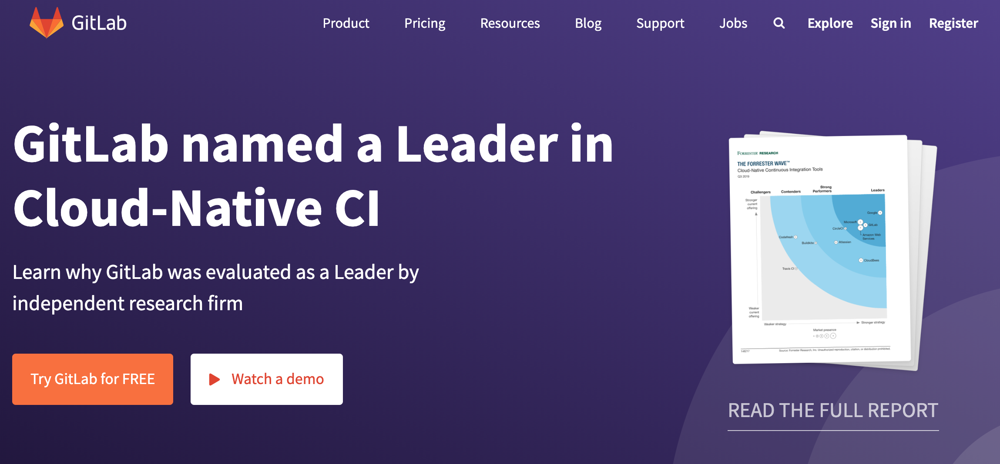

Ở đây chúng ta trực tiếp lấy Gitee làm ví dụ để giải thích một số lưu ý khi sử dụng Git Server. Đầu tiên cần đăng ký tài khoản trên Gitee, tất nhiên cũng có thể sử dụng đăng nhập bên thứ ba (tài khoản GitHub, WeChat, Sina Weibo, CSDN, v.v.). Sau khi đăng nhập thành công là có thể tạo dự án. Việc tạo dự án gần như chỉ cần làm theo từng bước đơn giản, không cần giải thích dài dòng, chúng ta chỉ làm rõ vài điểm sau:

1. Khi tạo dự án, không khuyến khích tích chọn các tùy chọn như trong hình dưới đây; ngôn ngữ lập trình có thể tạm thời chưa chọn, còn template `.gitignore` có thể tự viết sau hoặc tự động tạo thông qua công cụ chuyên nghiệp hơn (như trang web: <http://gitignore.io/>).

   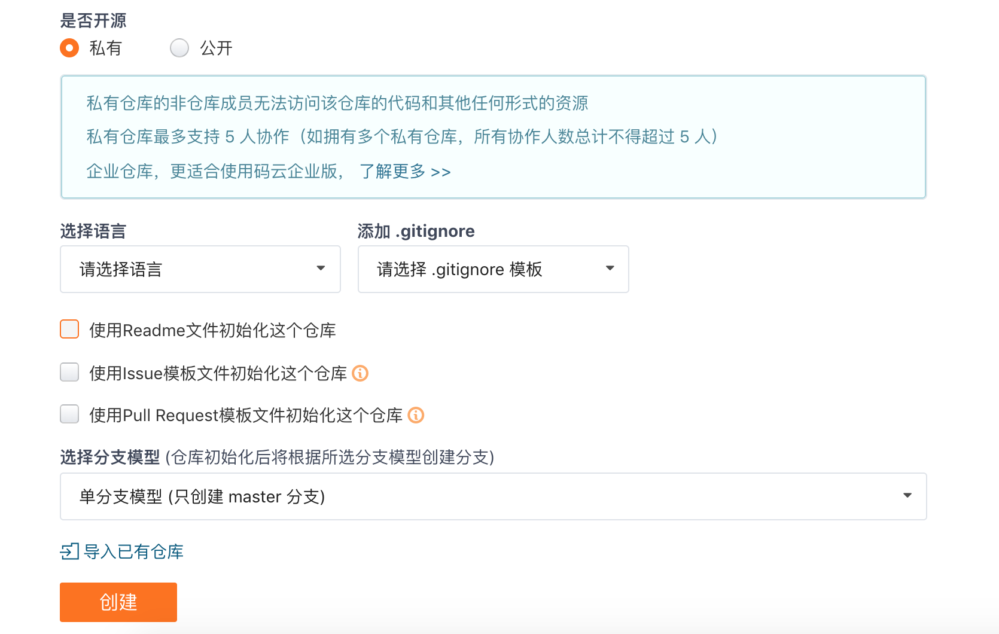

2. Thêm thành viên dự án. Sau khi tạo dự án, bạn có thể tìm thấy tính năng "Quản lý thành viên" trong phần "Cài đặt" hoặc "Quản lý" của dự án, như vậy bạn có thể thêm các nhà phát triển khác làm thành viên của nhóm dự án. Thành viên dự án thường được chia thành các vai trò: "Chủ sở hữu", "Quản trị viên", "Thành viên thông thường" và "Thành viên bị hạn chế".

   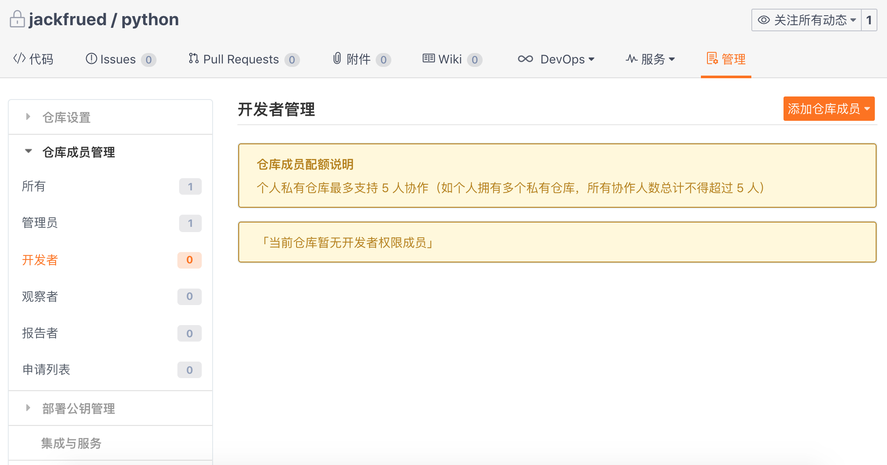

3. Nhánh của dự án. Sau khi tạo dự án, dự án chỉ có một nhánh mặc định duy nhất là **master**. Nên thiết lập nhánh này thành "nhánh được bảo vệ" để tránh các thành viên ngoài ban quản lý dự án sửa đổi nhánh này (không thể commit trực tiếp). Tất nhiên, nếu cần thiết, chúng ta cũng có thể tạo các nhánh code mới trực tuyến.

4. Thiết lập khóa công khai để truy cập không cần mật khẩu. Trong phần "Cài đặt" hoặc "Quản lý" của dự án, chúng ta còn có thể tìm thấy tùy chọn "Quản lý khóa công khai triển khai". Bằng cách thêm khóa công khai triển khai, chúng ta có thể truy cập máy chủ thông qua SSH (kết nối từ xa an toàn) mà không cần phải nhập tên người dùng và mật khẩu mỗi lần. Có thể sử dụng lệnh `ssh-keygen` để tạo cặp khóa:

   ```Shell
   ssh-keygen -t rsa -b 2048 -C "your_email@example.com"
   ```

   > **Giải thích**: Cặp khóa do lệnh trên tạo ra nằm trong thư mục `~/.ssh`, tệp khóa công khai có tên mặc định là `id_rsa.pub`, có thể xem khóa công khai của mình thông qua lệnh `cat id_rsa.pub`. Người dùng Windows sau khi cài đặt công cụ Git có thể nhập lệnh trên thông qua **Git Bash**.

#### Các thao tác Git từ xa

Sau khi có Git Server, chúng ta có thể thông qua các thao tác từ xa của Git để đẩy thành quả công việc của mình lên kho trên máy chủ, cũng như cập nhật thành quả công việc của người khác từ kho trên máy chủ về máy cục bộ. Chúng ta lấy kho vừa tạo trên Gitee (tên kho là `python`) làm ví dụ để minh họa cách thực hiện các thao tác từ xa. Bạn có thể tìm thấy địa chỉ (URL) của kho trên trang hiển thị như dưới đây. Nếu đã cấu hình **SSH Key** thì sử dụng phương thức SSH để truy cập kho, nếu không thì dùng phương thức HTTPS; phương thức HTTPS yêu cầu cung cấp tên người dùng và mật khẩu khi thực hiện các thao tác từ xa.

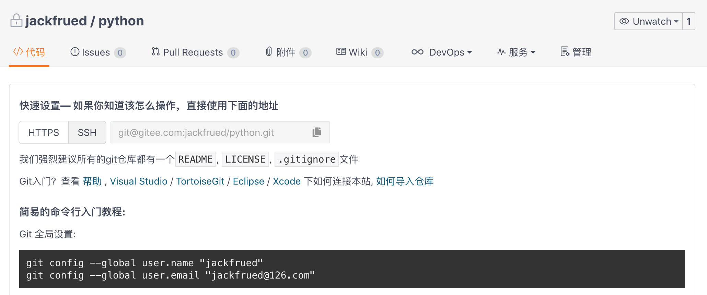

1. Thêm kho từ xa (Git Server):

   ```Shell
   git remote add origin git@gitee.com:jackfrued/python.git
   ```

   Trong đó `git@gitee.com:jackfrued/python.git` là URL của kho hiển thị trong hình trên, còn `origin` phía trước là chuỗi thay thế cho URL dài dòng này; nói một cách đơn giản, `origin` là bí danh của kho trên máy chủ (nếu có nhiều Git Server, tên ngắn gọn này cũng sẽ có nhiều tên khác nhau). Có thể dùng lệnh `git remote -v` để xem các Git Server đã được chỉ định, hoặc dùng `git remote remove` để xóa Git Server đã chỉ định.

2. Đẩy mã nguồn cục bộ (thành quả công việc) lên kho từ xa:

   ```Shell
   git push -u origin master:master
   ```

   Trong đó, `-u` là viết tắt của `--set-upstream`, dùng để chỉ định kho máy chủ được đẩy lên, `origin` phía sau chính là bí danh ngắn gọn vừa đặt cho kho, `master` trước dấu hai chấm là tên nhánh cục bộ, `master` sau dấu hai chấm là tên nhánh từ xa. Nếu nhánh cục bộ `master` đã thiết lập liên kết với nhánh từ xa `master`, thì dấu hai chấm và phần phía sau có thể lược bỏ.

3. Kéo mã nguồn từ kho từ xa về:

   ```Shell
   git pull origin master
   ```

#### Các thao tác với nhánh trong Git

1. **Tạo** và **chuyển đổi** nhánh. Các lệnh sau tạo nhánh có tên là `dev` và chuyển sang nhánh đó:

   ```Shell
   git branch <branch-name>
   git switch <branch-name>
   ```

   hoặc

   ```Shell
   git switch -c <branch-name>
   ```

   > **Lưu ý**: Trong các phiên bản Git trước đây, việc chuyển nhánh sử dụng lệnh `git checkout <branch-name>`, hoặc có thể tạo và chuyển nhánh thông qua `git checkout -b <branch-name>`. Lệnh `git switch` hiện vẫn đang trong giai đoạn thử nghiệm, nhưng rõ ràng lệnh này thể hiện công việc nó cần làm một cách rõ ràng hơn.

2. **Liên kết nhánh từ xa**. Ví dụ: nếu nhánh hiện tại chưa được liên kết với nhánh từ xa, có thể sử dụng lệnh sau để thiết lập liên kết giữa chúng:

   ```Shell
   git branch --set-upstream-to origin/develop
   ```

   Nếu cần liên kết nhánh từ xa cho một nhánh cụ thể, có thể thao tác như sau:

   ```Shell
   git branch --set-upstream-to origin/develop <branch-name>
   ```

   > **Gợi ý**: Thao tác trên giả định rằng trên Git Server đã tồn tại nhánh có tên là `develop`, `--set-upstream-to` có thể viết tắt thành `-u`.

   Tất nhiên, khi tạo nhánh, nếu sử dụng tham số `--track`, bạn cũng có thể trực tiếp chỉ định nhánh từ xa liên kết với nhánh cục bộ, như sau:

   ```Shell
   git branch --track <branch-name> origin/develop
   ```

   Nếu cần hủy liên kết giữa nhánh cục bộ và nhánh từ xa, có thể sử dụng lệnh sau:

   ```Shell
   git branch --unset-upstream <branch-name>
   ```

3. **Hợp nhất** nhánh. Ví dụ sau khi hoàn thành nhiệm vụ phát triển trên nhánh `dev`, nếu muốn hợp nhất thành quả trên nhánh `dev` vào `master`, trước tiên có thể chuyển về nhánh `master` rồi sử dụng `git merge` để thực hiện hợp nhất nhánh, kết quả hợp nhất như hiển thị ở góc trên bên phải hình dưới đây:

   ```Shell
   git switch master
   git merge --no-ff dev
   ```

   Khi sử dụng `git merge` để hợp nhất nhánh, mặc định sẽ dùng kiểu hợp nhất `Fast Forward`. Điều này đồng nghĩa với việc nếu xóa nhánh thì thông tin trên nhánh đó sẽ bị mất hoàn toàn; nếu muốn giữ lại lịch sử các phiên bản trên nhánh, bạn có thể sử dụng tham số `--no-ff` để vô hiệu hóa `Fast Forward`.

   Khi hợp nhất nhánh, phần không có xung đột sẽ được Git tự động hợp nhất. Nếu xảy ra xung đột (chẳng hạn cả nhánh `dev` và nhánh `master` đều sửa đổi cùng một tệp), bạn sẽ thấy thông báo `CONFLICT (content): Merge conflict in <filename>. Automatic merge failed; fix conflicts and then commit the result` (Hợp nhất tự động thất bại, hãy khắc phục xung đột rồi commit lại kết quả). Lúc này chúng ta có thể dùng lệnh `git diff` để xem nội dung phát sinh xung đột. Việc giải quyết xung đột thường đòi hỏi các bên liên quan phải trao đổi trực tiếp để quyết định giữ lại phiên bản của ai, sau khi giải quyết xung đột thì cần commit lại mã nguồn.

4. **Tái lập nhánh** (Rebase). Thao tác hợp nhất nhánh có thể gom thành quả công việc trên nhiều nhánh cuối cùng về một nhánh, nhưng sau nhiều lần thao tác hợp nhất, các nhánh có thể trở nên vô cùng lộn xộn và phức tạp. Để giải quyết vấn đề này, có thể sử dụng thao tác `git rebase` để tái lập nhánh. Như hình dưới đây, khi chúng ta muốn thống nhất thành quả công việc trên `master` và `dev` lại với nhau, cũng có thể sử dụng thao tác rebase:

   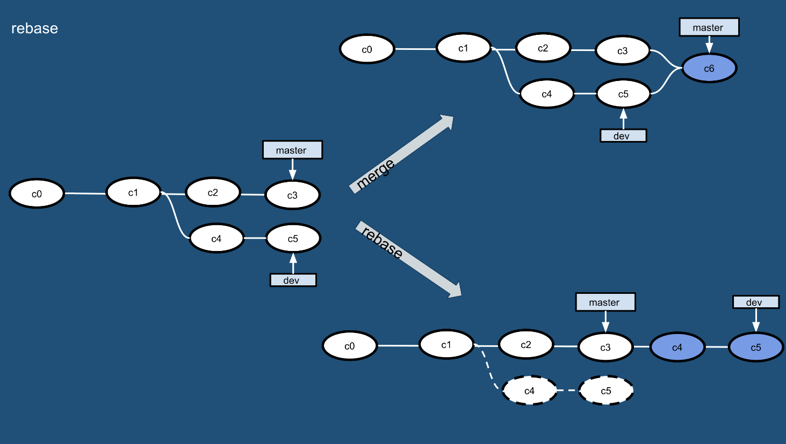

   ```Shell
   git rebase master
   git switch master
   git merge dev
   ```

   Khi chúng ta thực thi lệnh `git rebase` trên nhánh `dev`, trước tiên Git sẽ tính toán hiệu số giữa nhánh `dev` và nhánh `master`, sau đó áp dụng hiệu số đó vào nhánh `dev`, cuối cùng chúng ta chuyển về nhánh `master` và thực thi thao tác hợp nhất, nhờ đó chúng ta sẽ thấy nhánh gọn gàng, sạch sẽ như hiển thị ở góc dưới bên phải hình trên.

5. **Xóa** nhánh. Để xóa nhánh có thể sử dụng `git branch` kèm theo tham số `-d`. Nếu thành quả công việc trên nhánh chưa được hợp nhất, khi xóa nhánh bạn sẽ thấy thông báo lỗi dạng: `error: The branch '<branch-name>' is not fully merged.`. Nếu muốn buộc xóa nhánh, bạn có thể sử dụng tham số `-D`. Thao tác xóa nhánh như sau:

   ```Shell
   git branch -d <branch-name>
   error: The branch '<branch-name>' is not fully merged.
   If you are sure you want to delete it, run 'git branch -D <branch-name>'.
   git branch -D <branch-name>
   ```

   Nếu muốn xóa nhánh từ xa, có thể sử dụng lệnh sau, nhưng hãy thao tác thật cẩn trọng:

   ```Shell
   git branch -r -d origin/develop
   git push origin :develop
   ```

   hoặc

   ```Shell
   git push origin --delete develop
   ```

#### Các thao tác khác trong Git

1. `git fetch`: Tải xuống tất cả các thay đổi từ kho từ xa, có thể tải kho từ xa về một nhánh tạm thời, sau đó tiến hành thao tác hợp nhất theo nhu cầu; lệnh `git fetch` và `git merge` có thể xem như các bước tách rời của lệnh `git pull` đã nói ở trên.

   ```Shell
   git fetch origin master:temp
   git merge temp
   ```

2. `git diff`: Thường dùng để so sánh sự khác biệt giữa khu vực làm việc và kho lưu trữ, giữa khu vực chờ và kho lưu trữ, hoặc giữa hai nhánh.

3. `git stash`: Đưa các thay đổi hiện tại trong khu vực làm việc và khu vực chờ vào một vùng lưu trữ tạm thời, giúp khu vực làm việc trở nên sạch sẽ. Lệnh này thích hợp cho trường hợp công việc đang làm dở chưa kịp commit nhưng đột nhiên có nhiệm vụ khẩn cấp hơn (như cần sửa lỗi gấp trên production) cần phải xử lý ngay.

   ```Shell
   git stash
   git stash list
   git stash pop
   ```

4. `git reset`: Quay lui về một phiên bản được chỉ định. Lệnh này chủ yếu có ba tham số, như hình dưới đây:

   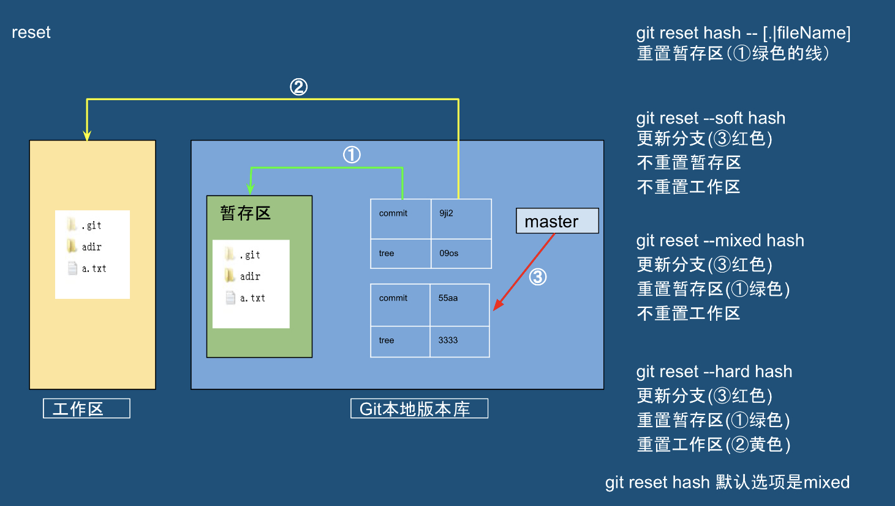

5. `git cherry-pick`: Chọn một lần commit đơn lẻ từ một nhánh nào đó và đưa vào nhánh hiện tại của bạn dưới dạng một commit mới.

6. `git revert`: Thu hồi thông tin commit.

7. `git tag`: Thường dùng để xem hoặc tạo thêm một thẻ.

#### Quy trình làm việc của Git (Chiến lược quản lý nhánh)

Vì Git là công cụ bắt buộc phải có trong phát triển nhóm, nên khi phối hợp nhóm bắt buộc phải có một quy trình làm việc chuẩn mực, có như vậy mới giúp nhóm làm việc hiệu quả và dự án tiến triển thuận lợi. Nếu không, dù công cụ có mạnh mẽ đến đâu nhưng các thành viên trong nhóm mạnh ai nấy làm thì xung đột sẽ xuất hiện khắp nơi, sự phối hợp càng không thể nói tới. Chúng ta vẫn lấy dự án `python` vừa tạo trên Gitee làm ví dụ để giải thích chiến lược quản lý nhánh của Git.

##### GitHub-flow

1. Sao chép mã nguồn trên máy chủ về máy cục bộ:

   ```Shell
   git clone git@gitee.com:jackfrued/python.git
   ```

2. Tạo và chuyển sang nhánh riêng của mình:

   ```Shell
   git switch -c <branch-name>
   ```

   hoặc

   ```Shell
   git checkout -b <branch-name>
   ```

3. Phát triển trên nhánh riêng của mình và thực hiện kiểm soát phiên bản tại máy cục bộ.

4. Đẩy nhánh riêng của mình (thành quả công việc) lên máy chủ:

   ```Shell
   git push origin <branch-name>
   ```

5. Khởi tạo yêu cầu hợp nhất trực tuyến (thường gọi là **Pull Request**, một số nơi gọi là **Merge Request**), yêu cầu hợp nhất thành quả công việc của mình vào nhánh `master`, sau khi hợp nhất có thể xóa nhánh này:

   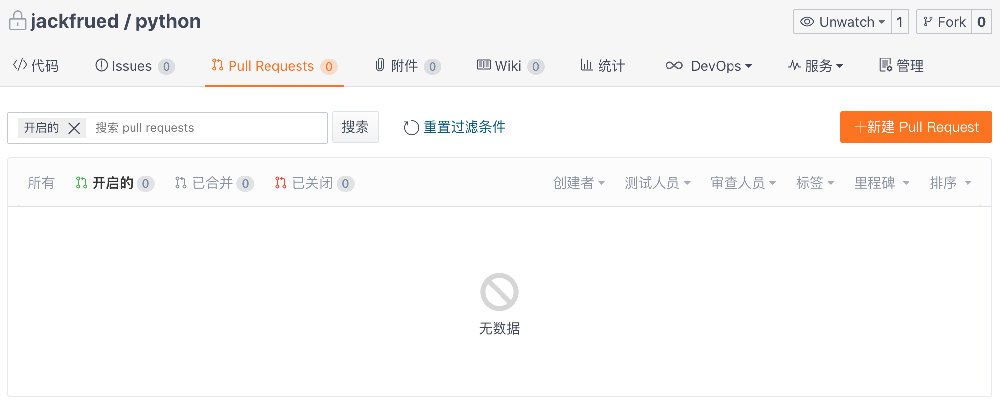

Chiến lược quản lý nhánh ở trên được gọi là quy trình **GitHub-flow** hoặc **PR**, nó rất đơn giản và dễ hiểu, chỉ cần chú ý những điểm sau:

1. Nội dung trên `master` đều là nội dung có thể phát hành (không được sửa đổi trực tiếp trên `master`).
2. Khi phát triển nên lấy `master` làm cơ sở để tạo nhánh mới (nhiệm vụ phát triển hàng ngày được tiến hành trên nhánh riêng của mình).
3. Nhánh trước tiên thực hiện kiểm soát phiên bản tại máy cục bộ, sau đó định kỳ thực hiện thao tác push lên máy chủ với nhánh cùng tên.
4. Sau khi hoàn thành nhiệm vụ phát triển, gửi yêu cầu hợp nhất tới `master`.
5. Yêu cầu hợp nhất sau khi được xem xét phê duyệt sẽ được hợp nhất vào `master`, và phát hành lên môi trường chính thức từ `master`.

Tất nhiên, nhược điểm của GitHub-flow cũng rất rõ ràng: nhánh `master` mặc định chính là code đang chạy thực tế trên hệ thống, nhưng đôi khi thành quả công việc được hợp nhất vào nhánh `master` không có nghĩa là nó có thể phát hành ngay lập tức, điều này sẽ khiến phiên bản online bị tụt lại phía sau nhánh `master`.

##### Git-flow

Bên cạnh chiến lược quản lý nhánh GitHub-flow kể trên, còn có một chiến lược quản lý nhánh khác mang tên Git-flow, đây cũng là bộ quy trình mà đa số các công ty ưa chuộng sử dụng. Git-flow tiếp thu thế mạnh của hệ thống kiểm soát phiên bản tập trung, thống nhất phương pháp tạo, hợp nhất và đóng nhánh trong nội bộ nhóm, như hình dưới đây:

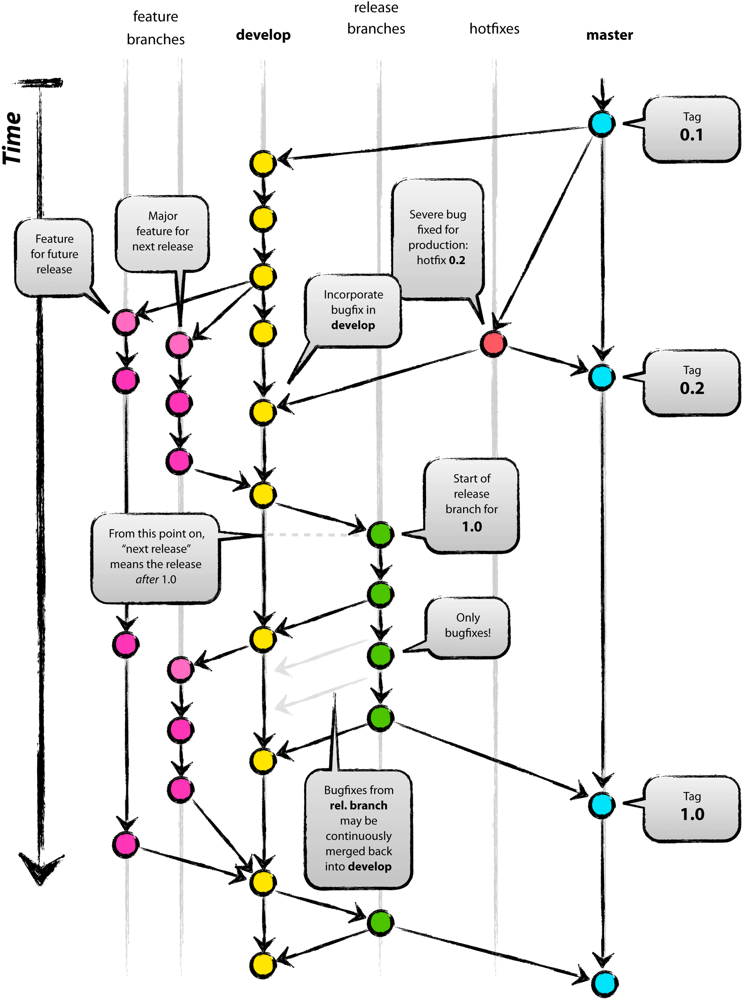

Trong mô hình này, dự án có hai nhánh dài hạn là `master` và `develop`, các nhánh khác đều là nhánh phụ trợ tạm thời, bao gồm `feature` (nhánh phát triển tính năng cụ thể, sau khi phát triển xong sẽ hợp nhất vào `develop`), `release` (nhánh tách ra từ `develop` để chuẩn bị cho việc phát hành, sau khi phát hành xong sẽ hợp nhất vào `master` và `develop`) và `hotfix` (nhánh được tạo khẩn cấp khi phát sinh sự cố sau khi phát hành sản phẩm, tách trực tiếp từ `master`, sau khi sửa xong sẽ hợp nhất vào `master` và gắn thẻ, đồng thời phải hợp nhất vào `develop` để tránh các phiên bản tương lai bỏ sót phần sửa lỗi này; nếu lúc đó có nhánh `release` đang trong quá trình phát hành thì cũng phải hợp nhất vào nhánh `release`). Quá trình thực hiện cụ thể như sau:

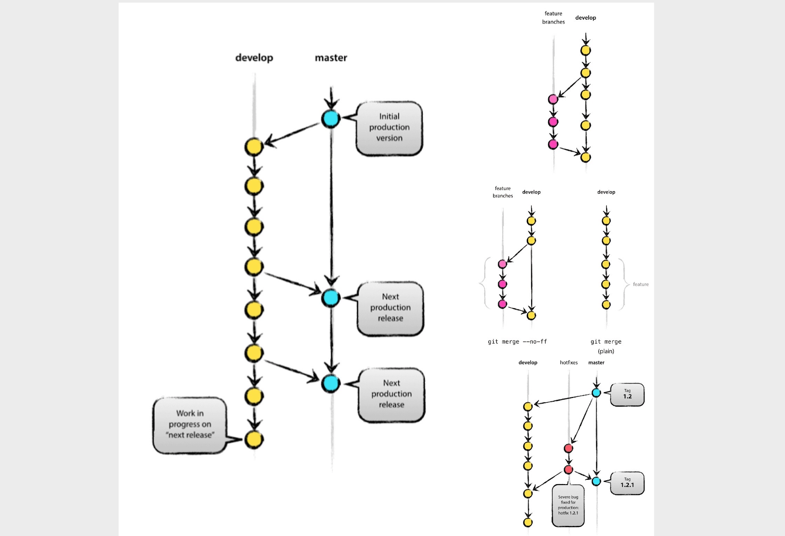

1. Ban đầu chỉ có hai nhánh `master` và `develop`, như hiển thị ở phía bên trái hình trên.

2. Tạo nhánh `feature` từ nhánh `develop` (góc trên bên phải hình trên), sau khi hoàn thành công việc thì hợp nhất thành quả vào nhánh `develop` (phần giữa bên phải hình trên).

   Tạo nhánh `feature`:

   ```Shell
   git switch -c feature/user develop
   ```

   hoặc

   ```Shell
   git checkout -b feature/user develop
   ```

   Tiếp theo là tiến hành phát triển và thực hiện kiểm soát phiên bản trên nhánh `feature`, phần này thao tác như thế nào thì chúng ta không nhắc lại nữa. Sau khi hoàn thành công việc, hợp nhất nhánh `feature` vào nhánh `develop`:

   ```Shell
   git checkout develop
   git merge --no-ff feature/user
   git branch -d feature/user
   git push origin develop
   ```

3. Tạo nhánh `release` từ nhánh `develop`, sau khi phát hành kết thúc thì hợp nhất trở lại nhánh `master` và `develop`.

   Tạo nhánh `release`:

   ```Shell
   git checkout -b release-0.1 develop
   git push -u origin release-0.1
   ... ... ...
   git pull
   git commit -a -m "............"
   ```

   Hợp nhất nhánh `release` trở lại nhánh `master` và `develop`:

   ```Shell
   git checkout master
   git merge --no-ff release-0.1
   git push
   
   git checkout develop
   git merge --no-ff release-0.1
   git push
   
   git branch -d release-0.1
   git push --delete release-0.1
   git tag v0.1 master
   git push --tags
   ```

4. Tạo nhánh `hotfix` từ nhánh `master`, sau khi sửa lỗi xong thì hợp nhất vào nhánh `develop` và `master` (góc dưới bên phải hình trên).

   Tạo nhánh `hotfix`:

   ```Shell
   git checkout -b hotfix-0.1.1 master
   git push -u origin hotfix-0.1.1
   ... ... ...
   git pull
   git commit -a -m "............"
   ```

   Hợp nhất nhánh `hotfix` trở lại nhánh `develop` và `master`:

   ```Shell
   git checkout master
   git merge --no-ff hotfix-0.1.1
   git push
   
   git checkout develop
   git merge --no-ff hotfix-0.1.1
   git push
   
   git branch -d hotfix-0.1.1
   git push --delete hotfix-0.1.1
   git tag v0.1.1 master
   git push --tags
   ```

Quy trình Git-flow tương đối dễ kiểm soát trạng thái của từng nhánh, nhưng về mặt vận hành thì phức tạp hơn nhiều so với GitHub-flow. Do đó, trong thực tế người ta thường cài đặt công cụ dòng lệnh có tên là `gitflow` (Git trên môi trường Windows đã tích hợp sẵn công cụ này) hoặc sử dụng các công cụ Git có giao diện đồ họa (như: SmartGit, SourceTree, v.v.) để đơn giản hóa thao tác. Chi tiết cụ thể có thể tham khảo bài viết [*Quy trình làm việc của git-flow*](https://www.git-tower.com/learn/git/ebook/cn/command-line/advanced-topics/git-flow), bài viết này đã viết rất chi tiết nên bài viết này sẽ không đi sâu thêm nữa.

### Quản lý lỗi

Không có công cụ quản lý nhóm tốt chắc chắn sẽ dẫn đến việc dự án tiến triển không thuận lợi, quản lý nhiệm vụ gặp khó khăn; việc áp dụng hệ thống quản lý lỗi chính là giải pháp hữu hiệu cho những vấn đề này. Thông thường một hệ thống quản lý lỗi đều bao gồm các chức năng sau:

1. Quản lý nhiệm vụ (bao gồm phải làm gì, ai làm, khi nào hoàn thành, hiện đang ở trạng thái nào, v.v.).
2. Trực quan và có thể truy xuất lại các vấn đề từng xảy ra trong quá khứ.
3. Có khả năng quản lý thống nhất và chia sẻ thông tin.
4. Có thể tạo các loại báo cáo.
5. Có thể liên kết với các hệ thống khác, có khả năng mở rộng tốt.

#### ZenTao

[ZenTao](https://www.zentao.net/) là phần mềm quản lý dự án chuyên nghiệp của Trung Quốc, nó không chỉ là công cụ quản lý lỗi mà còn cung cấp đầy đủ các chức năng quản lý vòng đời phần mềm, hỗ trợ [phát triển linh hoạt Scrum](http://www.scrumcn.com/agile/scrum-knowledge-library/scrum.html), có thể thực hiện một chuỗi các chức năng như quản lý yêu cầu, quản lý lỗi, quản lý nhiệm vụ, v.v., đồng thời sở hữu cơ chế mở rộng mạnh mẽ và kho plugin phong phú. Bạn có thể tải ZenTao từ [liên kết tải xuống](https://www.zentao.net/download.html) được cung cấp trên trang web chính thức của ZenTao, khuyến khích sử dụng gói cài đặt một chạm.

Dưới đây chúng ta tiếp tục lấy CentOS Linux làm ví dụ để giải thích cách tận dụng gói cài đặt một chạm do trang web chính thức cung cấp để cài đặt ZenTao:

```Shell
cd /opt
wget http://dl.cnezsoft.com/zentao/pro8.5.2/ZenTaoPMS.pro8.5.2.zbox_64.tar.gz
gunzip ZenTaoPMS.pro8.5.2.zbox_64.tar.gz
tar -xvf ZenTaoPMS.pro8.5.2.zbox_64.tar
```

Chúng ta đã tải tệp nén lưu trữ của ZenTao trong thư mục `/opt` (trang web chính thức khuyến khích sử dụng thư mục này), đồng thời thực hiện thao tác giải nén và giải lưu trữ. Sau khi hoàn thành các bước trên, bạn sẽ thấy một thư mục có tên là `zbox`. Trong gói cài đặt một chạm đã tích hợp sẵn các ứng dụng như Apache, MySQL, PHP, v.v., nghĩa là những thứ này đều không cần phải cài đặt và triển khai riêng biệt nữa. Tiếp theo chúng ta khởi động ZenTao thông qua các lệnh sau:

```Shell
/opt/zbox/zbox -ap 8080 -mp 3307
/opt/zbox/zbox start
```

> **Giải thích**: Ở trên sử dụng lệnh `zbox` trong thư mục `zbox`, trong đó `-ap` dùng để chỉ định cổng mà máy chủ Apache sử dụng, `-mp` dùng để chỉ định cổng mà cơ sở dữ liệu MySQL sử dụng, ở đây dùng cổng 3307 để tránh xung đột với cổng 3306 của dịch vụ MySQL có thể đã tồn tại sẵn trên máy chủ; `start` biểu thị khởi động dịch vụ, `stop` có thể dùng để dừng dịch vụ. Ngoài ra, cần mở cổng tường lửa 8080 để có thể truy cập ZenTao, lưu ý **cổng của cơ sở dữ liệu tuyệt đối không được để lộ ra mạng công cộng**.

Mở trình duyệt, nhập địa chỉ IP công cộng của máy chủ là có thể truy cập ZenTao; nếu muốn, bạn cũng có thể liên kết một tên miền thông qua phân giải DNS để truy cập. Trang chủ của ZenTao như hình dưới đây, tài khoản quản trị viên mặc định là `admin`, mật khẩu là `123456`.

Khi sử dụng ZenTao lần đầu tiên, khuyến khích nhấp vào tên người dùng, sau đó vào menu "Trợ giúp" chọn "Hướng dẫn cho người mới bắt đầu" để nhanh chóng làm quen với ZenTao. Trong liên kết tài liệu trên trang web chính thức cũng có sẵn [video hướng dẫn](https://www.zentao.net/video/c1454.html), người mới bắt đầu cũng có thể làm quen thông qua video hướng dẫn.

Những ai chưa hiểu rõ về phát triển linh hoạt cũng như các công cụ khép kín quy trình Agile có thể tham khảo bài viết [*Quản lý dự án phát triển linh hoạt Scrum dựa trên JIRA*](https://blog.51cto.com/newthink/1775427).

#### GitLab

Các nền tảng lưu trữ mã nguồn thông dụng và máy chủ Git nội bộ GitLab đã đề cập trước đó đều cung cấp chức năng quản lý lỗi. Khi muốn báo cáo một bug, chúng ta có thể tạo một phiếu sự cố (issue ticket) mới trên giao diện như hình dưới đây. Nội dung cần điền bao gồm:

1. **[Bắt buộc]** Số phiên bản phần mềm xuất hiện vấn đề, môi trường sử dụng cụ thể (như hệ điều hành) và các thông tin liên quan khác.
2. **[Bắt buộc]** Các bước cụ thể để có thể tái hiện vấn đề một cách ổn định.
3. **[Bắt buộc]** Mô tả hành vi kỳ vọng và hành vi thực tế xảy ra tại đây.
4. **[Tùy chọn]** Quan điểm của bạn về bug này (nguyên nhân gây ra bug là gì).

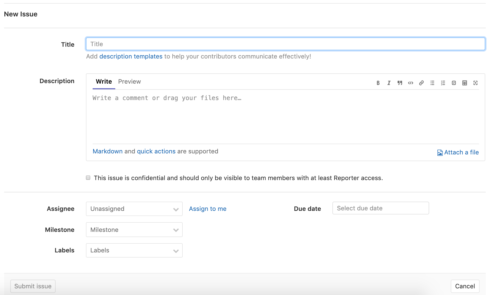

Như hình trên, khi tạo phiếu sự cố, chúng ta còn cần chỉ định người xử lý vấn đề; nếu không rõ ai sẽ sửa bug này thì chỉ định cho người quản lý dự án. Ngoài ra còn phải chỉ định mức độ ưu tiên của vấn đề (vô cùng khẩn cấp, khẩn cấp, bình thường, không khẩn cấp, v.v.), nhãn của vấn đề (lỗi chức năng, tính năng mới, cải tiến nâng cao, nghiên cứu định hướng, v.v.), mốc quan trọng (thông qua mốc quan trọng có thể liên kết vấn đề với các mốc thời gian cụ thể của dự án, sau đó có thể xem tiến độ của từng mốc, có thể tạo mốc dựa trên số phiên bản phần mềm hoặc dựa trên chu kỳ lặp) cũng như thông tin về thời điểm cần phải sửa chữa trước hạn nào.

Một số nhóm Agile sử dụng phiếu sự cố để quản lý yêu cầu sản phẩm, gọi là "Phát triển hướng sự cố" (TiDD), nghĩa là việc phát triển các tính năng mới được thúc đẩy thông qua việc tạo phiếu sự cố. Các bước cụ thể bao gồm: tạo phiếu sự cố, chỉ định người chịu trách nhiệm, phát triển, commit, push lên kho code. Nếu muốn tạo một phiếu sự cố liên quan đến yêu cầu nghiệp vụ, cần điền các nội dung sau:

1. **[Bắt buộc]** Mô tả ngắn gọn yêu cầu và dùng nó làm tiêu đề.
2. **[Bắt buộc]** Yêu cầu này nhằm giải quyết vấn đề gì.
3. **[Bắt buộc]** Yêu cầu này sẽ gây ra ảnh hưởng gì đối với các chức năng hiện có của phần mềm.
4. **[Bắt buộc]** Yêu cầu này cần phải thực hiện được chức năng như thế nào.
5. **[Bắt buộc]** Yêu cầu này có phụ thuộc vào sự hỗ trợ của các module khác hay không.
6. **[Tùy chọn]** Yêu cầu này có những phương án hiện thực nào.
7. **[Tùy chọn]** Các phương án hiện thực tùy chọn này có ưu nhược điểm ra sao.

#### Các sản phẩm khác

Ngoài ZenTao và GitLab, [JIRA](https://www.atlassian.com/zh/software/jira), [Redmine](https://www.redmine.org/), Backlog, v.v. cũng là những hệ thống quản lý lỗi rất tốt. Hiện nay, hầu hết các hệ thống này không chỉ cung cấp chức năng quản lý lỗi đơn thuần, mà nhiều khi chúng còn được sử dụng như các công cụ quản lý vòng lặp Agile hoàn chỉnh. Về chủ đề công cụ Agile khép kín này, mời bạn tham khảo bài viết [*Quản lý dự án phát triển linh hoạt Scrum dựa trên JIRA*](https://blog.51cto.com/newthink/1775427).

### Tích hợp liên tục

Để nhanh chóng tạo ra phần mềm chất lượng cao, tích hợp liên tục (CI) là một khâu vô cùng quan trọng trong phát triển nhóm. Cái gọi là CI là một phương pháp cho phép máy tính tự động lặp lại các công việc biên dịch, kiểm thử, báo cáo, v.v. với số lần tùy ý. Thông qua CI có thể giúp các nhà phát triển phát hiện vấn đề từ sớm, giảm bớt những rủi ro do sai sót chủ quan của con người mang lại cho dự án. Theo mô hình quy trình phần mềm kinh điển (mô hình thác nước), công việc tích hợp thường phải đợi đến khi tất cả công việc phát triển kết thúc mới có thể bắt đầu, nhưng lúc này nếu phát hiện ra vấn đề thì cái giá phải trả để sửa lỗi là rất lớn. Về cơ bản, việc tích hợp triển khai càng muộn, lượng code càng lớn thì việc giải quyết vấn đề càng khó khăn. Tích hợp liên tục kết hợp kiểm soát phiên bản, tự động hóa đóng gói, kiểm thử mã nguồn lại với nhau, làm cho các công việc này trở nên tự động và có thể phối hợp được. Do nó lặp lại thường xuyên toàn bộ quy trình phát triển (kéo mã nguồn về nhiều lần trong khoảng thời gian xác định và chạy mã kiểm thử), nên nó có thể giúp các nhà phát triển phát hiện vấn đề từ rất sớm.

Trong tất cả các công cụ CI, Jenkins và [TravisCI](https://www.travis-ci.org/) là hai đại diện tiêu biểu nhất. Jenkins là công cụ CI mã nguồn mở dựa trên Java, còn TravisCI là công cụ CI trực tuyến nổi bật, hình dưới đây là bảng điều khiển làm việc của Jenkins:

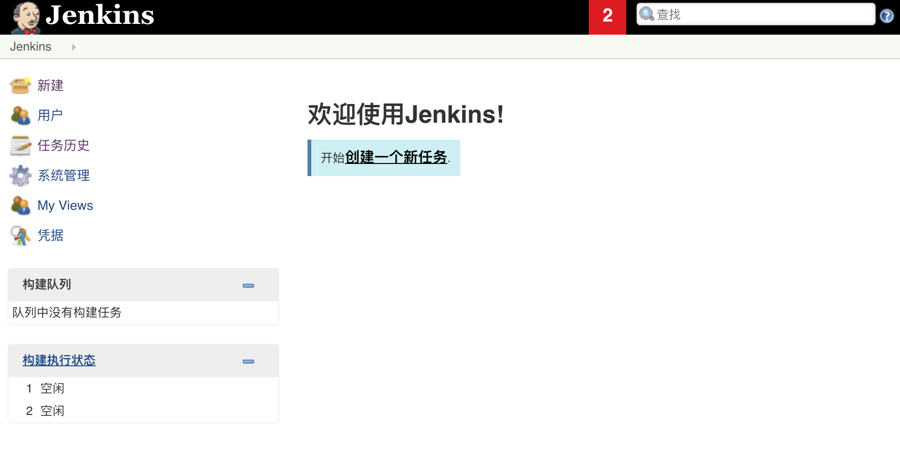

Tích hợp liên tục có ý nghĩa lớn hơn đối với các ngôn ngữ biên dịch. Đối với các ngôn ngữ thông dịch như Python, phần lớn thời gian nó được sử dụng để kết nối với hệ thống kiểm soát phiên bản nhằm kích hoạt kiểm thử tự động và tạo báo cáo tương ứng, chức năng tương tự cũng có thể hoàn thành thông qua việc cấu hình **Webhook**. Nếu muốn đóng gói và triển khai dự án thông qua các container ảo hóa như Docker hoặc quản lý container thông qua K8S, bạn có thể cài đặt các plugin tương ứng trên nền tảng tích hợp liên tục để hỗ trợ các chức năng này. Gitee thậm chí có thể kết nối trực tiếp với [nền tảng mở DingTalk](https://ding-doc.dingtalk.com/) để sử dụng bot DingTalk gửi tin nhắn tức thời tới những người liên quan trong dự án. GitLab cũng cung cấp hỗ trợ cho CI và CD (phân phối liên tục), chi tiết cụ thể mời các bạn tham khảo bài viết [*Hướng dẫn cơ bản về GitLab CI/CD*](https://blog.stdioa.com/2018/06/gitlab-cicd-fundmental/).

> **Giải thích**:
>
> 1. Về các nội dung liên quan đến phát triển linh hoạt, bạn đọc quan tâm có thể đọc bài viết [*Đây mới là phát triển linh hoạt*](https://zhuanlan.zhihu.com/p/33472102) trên Zhihu.
>
> 2. Một số hình minh họa trong chương này được trích từ khóa học [*Ai cũng biết dùng Git*](https://study.163.com/course/introduction/1003268008.htm) của NetEase Cloud Classroom (miễn phí), xin chân thành cảm ơn tác giả.
