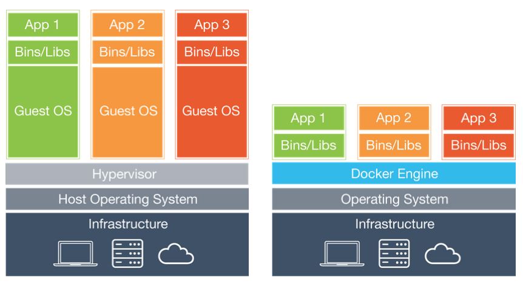
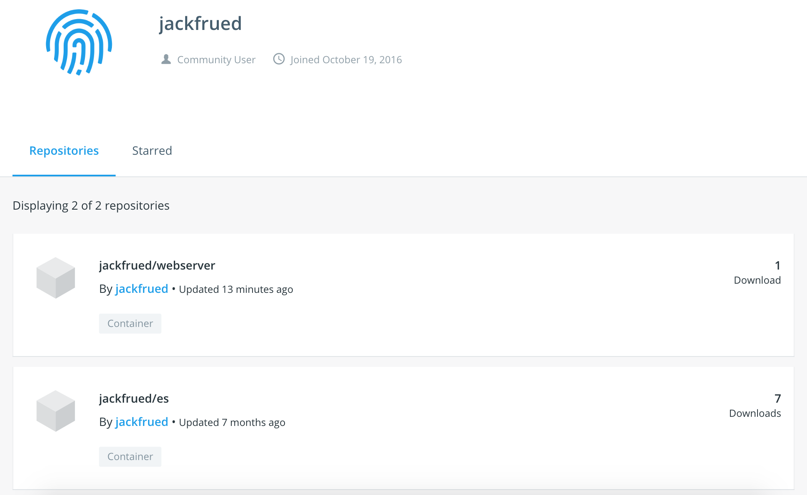

## Chi tiết công nghệ container Docker

Docker là một engine container ứng dụng mã nguồn mở được phát triển dựa trên ngôn ngữ Go, tuân theo giấy phép Apache License 2.0. Nó cho phép các nhà phát triển đóng gói ứng dụng cùng các gói phụ thuộc (dependencies) của ứng dụng vào một container có tính khả chuyển cao, sau đó phát hành lên các bản phân phối Linux khác nhau.

### Giới thiệu Docker

Điều phiền toái nhất trong phát triển phần mềm có lẽ chính là cấu hình môi trường. Do tính đa dạng của hệ điều hành mà người dùng sử dụng, ngay cả khi sử dụng các ngôn ngữ lập trình đa nền tảng (như Java và Python) cũng không thể đảm bảo mã nguồn có thể vận hành bình thường trên mọi nền tảng, hơn nữa trong các môi trường khác nhau, các gói phần mềm phụ thuộc mà chúng ta cài đặt cũng không giống nhau.

Vậy câu hỏi đặt ra là: khi cài đặt phần mềm, chúng ta có thể cài đặt luôn cả môi trường chạy của phần mềm đó không? Liệu chúng ta có thể sao chép y nguyên môi trường gốc sang một nơi khác không?

Máy ảo (virtual machine) chính là một giải pháp cài đặt kèm môi trường. Nó có thể chạy một hệ điều hành bên trong một hệ điều hành khác, ví dụ như chạy hệ điều hành Linux trong Windows, hay chạy Windows trên macOS mà ứng dụng bên trong hoàn toàn không hề hay biết. Những ai từng sử dụng máy ảo đều biết rằng máy ảo hoạt động hệt như một hệ thống thật, còn đối với hệ điều hành máy chủ (host) của máy ảo, máy ảo chỉ là một file thông thường, khi không cần nữa thì xóa đi mà không gây ảnh hưởng gì tới hệ điều hành máy chủ hay các chương trình khác. Tuy nhiên, máy ảo thường chiếm dụng khá nhiều tài nguyên hệ thống, việc khởi động và tắt máy cũng rất chậm chạp, tóm lại trải nghiệm người dùng không tốt như tưởng tượng.

Docker là một dạng đóng gói của công nghệ Linux container (LXC) (tận dụng công nghệ namespace và cgroup của Linux). Nó cung cấp giao diện sử dụng container đơn giản, dễ dùng và hiện là giải pháp Linux container phổ biến nhất. Docker đóng gói ứng dụng và các gói phụ thuộc của chương trình đó vào trong một file; khi chạy file này, một virtual container sẽ được tạo ra. Chương trình chạy bên trong virtual container này hệt như đang chạy trên một máy vật lý thực sự. Hình dưới đây là sự so sánh giữa máy ảo và container: bên trái là máy ảo truyền thống, bên phải là Docker.



Hiện tại, Docker chủ yếu được sử dụng trong các khía cạnh sau:

1. Cung cấp môi trường dùng một lần (disposable environment).
2. Cung cấp dịch vụ đám mây linh hoạt (dễ dàng mở rộng scale out và thu hẹp scale in nhờ Docker).
3. Thực hành kiến trúc microservices (cô lập môi trường thực tế, chạy nhiều dịch vụ trong các container).

### Cài đặt Docker

Dưới đây lấy CentOS làm ví dụ để hướng dẫn cách cài đặt Docker. Người dùng [Ubuntu](https://docs.docker.com/install/linux/docker-ce/ubuntu/), [macOS](https://docs.docker.com/docker-for-mac/install/) hoặc [Windows](https://docs.docker.com/docker-for-windows/install/) có thể bấm vào các liên kết tương ứng để tìm hiểu cách cài đặt trên các nền tảng đó.

1. Xác định phiên bản kernel của hệ điều hành (CentOS 7 yêu cầu bản 64-bit, kernel 3.10+; CentOS 6 yêu cầu bản 64-bit, kernel 2.6+).

   ```Bash
   uname -r
   ```

2. Cập nhật các thư viện tầng dưới của hệ thống (rất khuyến nghị thực hiện, nếu không có thể gặp phải những lỗi khó hiểu khi dùng Docker).

   ```Bash
   yum update
   ```

3. Gỡ bỏ các phiên bản Docker cũ nếu có.

   ```Bash
   yum list installed | grep docker
   yum erase -y docker docker-common docker-engine
   ```

4. Cài đặt bộ công cụ yum và các dependency.

   ```Bash
   yum install -y yum-utils device-mapper-persistent-data lvm2
   ```

5. Thêm kho phần mềm (yum repo) thông qua yum-utils (repo để cài đặt Docker-ce).

   ```Bash
   yum-config-manager --add-repo https://download.docker.com/linux/centos/docker-ce.repo
   ```

6. Cài đặt Docker-ce bằng yum trên CentOS và khởi động dịch vụ.

   ```Bash
   yum -y install docker-ce
   systemctl start docker
   ```

7. Kiểm tra thông tin và phiên bản của Docker.

   ```Shell
   docker version
   docker info
   ```

Tiếp theo, bạn có thể kiểm tra xem Docker đã hoạt động bình thường chưa bằng cách tải image và tạo container. Có thể sử dụng lệnh sau để tải file image có tên hello-world từ kho lưu trữ image của Docker:

```Shell
docker pull hello-world
```

Xem tất cả các file image:

```Shell
docker images
```

```
REPOSITORY               TAG        IMAGE ID            CREATED             SIZE
docker.io/hello-world    latest     fce289e99eb9        7 months ago        1.84 kB
```

Tạo và chạy container từ file image:

```Shell
docker container run --name mycontainer hello-world
```

> **Giải thích**: Trong đó `mycontainer` là tên chúng ta đặt cho container, đi sau tham số `--name`; `hello-world` chính là file image chúng ta vừa tải về.

```
Hello from Docker!
This message shows that your installation appears to be working correctly.

To generate this message, Docker took the following steps:
 1. The Docker client contacted the Docker daemon.
 2. The Docker daemon pulled the "hello-world" image from the Docker Hub.
    (amd64)
 3. The Docker daemon created a new container from that image which runs the
    executable that produces the output you are currently reading.
 4. The Docker daemon streamed that output to the Docker client, which sent it
    to your terminal.

To try something more ambitious, you can run an Ubuntu container with:
 $ docker run -it ubuntu bash

Share images, automate workflows, and more with a free Docker ID:
 https://hub.docker.com/

For more examples and ideas, visit:
 https://docs.docker.com/get-started/
```

Nếu muốn xóa container này, có thể sử dụng lệnh sau:

```Shell
docker container rm mycontainer
```

Sau khi xóa container, chúng ta còn có thể xóa file image vừa tải về:

```Shell
docker rmi hello-world
```

> **Giải thích**: Nếu muốn cài đặt và khởi động Docker trên Ubuntu (kernel phiên bản 3.10+), bạn có thể thực hiện theo các bước sau:
>
> ```Shell
> apt update
> apt install docker-ce
> service docker start
> ```
>
> Người dùng tại Trung Quốc có thể đổi nguồn tải phần mềm Ubuntu để tăng tốc độ tải, cụ thể vui lòng tham khảo [Hướng dẫn sử dụng mirror Ubuntu](https://mirrors.tuna.tsinghua.edu.cn/help/ubuntu/) trên trang mirror phần mềm nguồn mở của Đại học Thanh Hoa.

Sau khi cài đặt Docker, do việc truy cập trực tiếp vào [dockerhub](https://hub.docker.com/) để tải image có thể khá chậm ở một số khu vực, bạn nên chuyển server sang mirror nội địa bằng cách chỉnh sửa file `/etc/docker/daemon.json`. Các cloud server thông thường sẽ có mirror riêng nên không cần chỉnh sửa thủ công.

```JavaScript
{
	"registry-mirrors": [
        "http://hub-mirror.c.163.com",
        "https://registry.docker-cn.com"
    ]
}
```

### Sử dụng Docker

Muốn thành thạo Docker, cách đơn giản nhất là bắt tay ngay vào việc dùng Docker để tạo một số container phục vụ cho việc học tập và công việc. Dưới đây chúng ta sẽ cùng nhau tạo các container này.

#### Chạy Nginx

Nginx là một web server hiệu năng cao, đồng thời cũng là lựa chọn tuyệt vời để làm reverse proxy server. Dùng Docker có thể tạo một container chạy Nginx rất đơn giản bằng lệnh sau:

```Shell
docker container run -d -p 80:80 --rm --name mynginx nginx
```

> **Giải thích**: Tham số `-d` ở trên biểu thị container chạy dưới nền (không xuất output ra shell) và hiển thị ID của container; `-p` dùng để ánh xạ cổng của container với cổng của máy chủ (host), phía trước dấu hai chấm là cổng trên máy chủ, phía sau là cổng bên trong container; `--rm` biểu thị tự động xóa container sau khi dừng, ví dụ sau khi thực thi lệnh `docker container stop mynginx`, container sẽ không còn tồn tại nữa; `mynginx` sau `--name` là tên container tùy chỉnh; trong quá trình tạo container cần dùng file image nginx, việc tải file image được thực hiện tự động, nếu không chỉ định phiên bản thì mặc định sẽ là phiên bản mới nhất (latest).

Nếu cần triển khai dự án web (trang web) của mình lên Nginx, bạn có thể dùng lệnh sao chép của container để sao chép tất cả file và thư mục từ đường dẫn chỉ định vào thư mục chỉ định trong container.

```Shell
docker container cp /root/web/index.html mynginx:/usr/share/nginx/html
```

Nếu không muốn sao chép file, khi tạo container bạn cũng có thể dùng thao tác data volume `--volume` để ánh xạ thư mục chỉ định vào một thư mục trong container, ví dụ ánh xạ trực tiếp thư mục dự án Web vào thư mục `/usr/share/nginx/html`. Đầu tiên chúng ta dừng container vừa tạo bằng lệnh sau:

```Shell
docker container stop mynginx
```

Sau đó tạo lại container bằng lệnh dưới đây:

```Shell
docker container run -d -p 80:80 --rm --name mynginx --volume /root/docker/nginx/html:/usr/share/nginx/html nginx
```

> **Giải thích**: Trong các lệnh tạo container và sao chép file ở trên, từ khóa `container` có thể lược bỏ, tức là `docker container run` tương đương với `docker run`, còn `docker container cp` tương đương với `docker cp`. Ngoài ra, `--volume` trong lệnh cũng có thể viết tắt thành `-v`, tương tự như `-d` là viết tắt của `--detach`, `-p` là viết tắt của `--publish`. `$PWD` đại diện cho thư mục hiện tại của hệ điều hành máy chủ, điều này rất dễ hiểu với những ai đã từng dùng hệ điều hành Unix hoặc Linux.

Để xem các container đang chạy, có thể sử dụng lệnh sau:

```Shell
docker ps
```

```
CONTAINER ID    IMAGE    COMMAND                  CREATED            STATUS             PORTS                 NAMES
3c38d2476384    nginx    "nginx -g 'daemon ..."   4 seconds ago      Up 4 seconds       0.0.0.0:80->80/tcp    mynginx
```

Để khởi động và dừng container, có thể sử dụng các lệnh sau:

```Shell
docker start mynginx
docker stop mynginx
```

Do khi tạo container đã dùng tùy chọn `--rm`, container sẽ bị xóa khi dừng. Khi chúng ta dùng lệnh sau để xem tất cả container, sẽ không còn thấy container `mynginx` vừa rồi nữa:

```Shell
docker container ls -a
```

Nếu khi tạo container không chỉ định tùy chọn `--rm`, bạn cũng có thể dùng lệnh sau để xóa container:

```Shell
docker rm mynginx
```

Để xóa container đang chạy, cần sử dụng tùy chọn `-f`:

```Shell
docker rm -f mynginx
```

#### Chạy MySQL

Chúng ta tiếp tục thử dùng Docker để cài đặt một máy chủ MySQL. Trước tiên có thể kiểm tra xem có image MySQL nào không:

```Shell
docker search mysql
```

```
INDEX        NAME            DESCRIPTION        STARS        OFFICIAL        AUTOMATED
docker.io    docker.io/mysql MySQL is a ...     8486         [OK]
...
```

> **Giải thích**: Các cột trong kết quả truy vấn ở trên lần lượt đại diện cho: index, tên image, mô tả image, đánh giá từ người dùng (stars), có phải image chính thức không, tự động build.

Tải image MySQL và chỉ định phiên bản của image:

```Shell
docker pull mysql:5.7
```

Nếu cần xem các file image đã tải về, có thể dùng lệnh sau:

```Shell
docker images
```

```
REPOSITORY          TAG                 IMAGE ID            CREATED             SIZE
docker.io/nginx     latest              e445ab08b2be        2 weeks ago         126 MB
docker.io/mysql     5.7                 f6509bac4980        3 weeks ago         373 MB
```

Tạo và chạy container MySQL:

```Shell
docker run -d -p 3306:3306 --name mysql57 -v /root/docker/mysql/conf:/etc/mysql/mysql.conf.d -v /root/docker/mysql/data:/var/lib/mysql -e MYSQL_ROOT_PASSWORD=123456 mysql:5.7
```

> **Lưu ý**: Khi tạo container ở trên, chúng ta lại sử dụng thao tác data volume một lần nữa, đó là vì thông thường container có thể tạo và xóa bất cứ lúc nào, nhưng dữ liệu trong cơ sở dữ liệu thì cần phải được lưu giữ lại lâu dài.

Hai thao tác data volume ở trên gồm một cái ánh xạ thư mục chứa file cấu hình MySQL, một cái ánh xạ thư mục chứa dữ liệu MySQL, hai thao tác data volume này vô cùng quan trọng. Chúng ta có thể đặt file cấu hình của MySQL vào thư mục `$PWD/mysql/conf`, nội dung cụ thể của file cấu hình như sau:

```INI
[mysqld]
pid-file=/var/run/mysqld/mysqld.pid
socket=/var/run/mysqld/mysqld.sock
datadir=/var/lib/mysql
log-error=/var/log/mysql/error.log
server-id=1
log-bin=/var/log/mysql/mysql-bin.log
expire_logs_days=30
max_binlog_size=256M
symbolic-links=0
```

Nếu cài đặt phiên bản MySQL 8.x (phiên bản mới nhất hiện nay), khi dùng công cụ client kết nối tới server bạn có thể gặp lỗi `error 2059: Authentication plugin 'caching_sha2_password' cannot be loaded`. Nguyên nhân là MySQL 8.x mặc định sử dụng cơ chế có tên "caching_sha2_password" để bảo vệ mật khẩu người dùng tốt hơn, nhưng nếu công cụ client không hỗ trợ phương thức xác thực mới này, kết nối sẽ thất bại. Có hai cách để giải quyết vấn đề này: một là nâng cấp công cụ client để hỗ trợ phương thức xác thực của MySQL 8.x; hai là vào trong container, sửa đổi phương thức xác thực mật khẩu người dùng của MySQL. Dưới đây là các bước cụ thể, đầu tiên chúng ta dùng lệnh `docker exec` để vào môi trường tương tác của container, giả sử container chạy MySQL 8.x có tên là `mysql8x`.

```Shell
docker exec -it mysql8x /bin/bash
```

Sau khi vào shell tương tác của container, trước tiên có thể dùng công cụ client của MySQL để kết nối tới MySQL server:

```Shell
mysql -u root -p
Enter password:
Your MySQL connection id is 16
Server version: 8.0.12 MySQL Community Server - GPL
Copyright (c) 2000, 2018, Oracle and/or its affiliates. All rights reserved.
Oracle is a registered trademark of Oracle Corporation and/or its
affiliates. Other names may be trademarks of their respective
owners.
Type 'help;' or '\h' for help. Type '\c' to clear the current input statement.
mysql>
```

Tiếp theo, chỉ cần dùng SQL để sửa đổi mật khẩu người dùng:

```SQL
alter user 'root'@'%' identified with mysql_native_password by '123456' password expire never;
```

Tất nhiên, nếu muốn bạn cũng có thể xem bảng user để kiểm tra xem đã sửa thành công chưa:

```SQL
use mysql;
select user, host, plugin, authentication_string from user where user='root';
+------+-----------+-----------------------+-------------------------------------------+
| user | host      | plugin                | authentication_string                     |
+------+-----------+-----------------------+-------------------------------------------+
| root | %         | mysql_native_password | *6BB4837EB74329105EE4568DDA7DC67ED2CA2AD9 |
| root | localhost | mysql_native_password | *6BB4837EB74329105EE4568DDA7DC67ED2CA2AD9 |
+------+-----------+-----------------------+-------------------------------------------+
2 rows in set (0.00 sec)
```

Sau khi hoàn thành các bước trên, giờ đây ngay cả khi không cập nhật công cụ client bạn cũng có thể kết nối tới MySQL 8.x rồi.

#### Chạy Redis

Tiếp theo, chúng ta thử chạy nhiều container và để các container giao tiếp với nhau qua mạng. Chúng ta tạo 4 container Redis để xây dựng cấu trúc sao chép master-slave gồm một master và ba slave.

```Shell
docker run -d -p 6379:6379 --name redis-master redis
docker run -d -p 6380:6379 --name redis-slave-1 --link redis-master:redis-master redis redis-server --replicaof redis-master 6379
docker run -d -p 6381:6379 --name redis-slave-2 --link redis-master:redis-master redis redis-server --replicaof redis-master 6379
docker run -d -p 6382:6379 --name redis-slave-3 --link redis-master:redis-master redis redis-server --replicaof redis-master 6379
```

Trong các lệnh trên, tham số `--link` dùng để tạo bí danh mạng cho container, vì ba máy slave cần kết nối qua mạng tới máy master của mình. Mặc dù chúng ta có thể xem địa chỉ IP của container bằng lệnh `docker inspect --format '{{ .NetworkSettings.IPAddress }}' <container-ID>`, nhưng do tính chất dùng xong bỏ của container, địa chỉ IP của container có thể thay đổi. Nếu sử dụng trực tiếp địa chỉ IP, sau khi container khởi động lại, sự thay đổi địa chỉ IP có thể khiến slave không thể kết nối tới master. Việc sử dụng tham số `--link` để tạo bí danh mạng chính là để khi khởi động Redis server, chúng ta có thể dùng bí danh này sau tham số `--replicaof` thay vì dùng địa chỉ IP.

Tiếp theo chúng ta vào container có tên `redis-master` để xem cấu hình sao chép master-slave đã thành công chưa:

```Shell
docker exec -it redis-master /bin/bash
```

Khởi động công cụ dòng lệnh bằng `redis-cli`:

```Shell
redis-cli
127.0.0.1:6379> info replication
# Replication
role:master
connected_slaves:3
slave0:ip=172.17.0.4,port=6379,state=online,offset=1988,lag=0
slave1:ip=172.17.0.5,port=6379,state=online,offset=1988,lag=1
slave2:ip=172.17.0.6,port=6379,state=online,offset=1988,lag=1
master_replid:94703cfa03c3ddc7decc74ca5b8dd13cb8b113ea
master_replid2:0000000000000000000000000000000000000000
master_repl_offset:1988
second_repl_offset:-1
repl_backlog_active:1
repl_backlog_size:1048576
repl_backlog_first_byte_offset:1
repl_backlog_histlen:1988
```

#### Chạy GitLab

GitLab là công cụ quản lý kho lưu trữ Git do GitLab Inc. phát triển, sở hữu hàng loạt tính năng như wiki, theo dõi vấn đề (issue tracking), tích hợp liên tục (CI), được chia thành phiên bản cộng đồng (Community Edition - CE) và phiên bản doanh nghiệp (Enterprise Edition - EE). Thông qua container ảo hóa của Docker, chúng ta có thể cài đặt Docker phiên bản cộng đồng của GitLab. Vì GitLab cần sử dụng giao thức SSH để kết nối an toàn, chúng ta cần mở cổng 22 của container, do đó trước tiên có thể đổi cổng kết nối SSH của máy chủ từ 22 sang cổng khác (chẳng hạn 12345), sau đó mới thực hiện các thao tác tiếp theo.

```Shell
vim /etc/ssh/sshd_config
```

Bỏ dấu chú thích ở dòng code định nghĩa cổng và sửa cổng thành 12345:

```
Port 12345
```

Khởi động lại dịch vụ `sshd`:

```Shell
systemctl restart sshd
```

> **Gợi ý**: Sau khi sửa cổng, bạn nên đảm bảo rằng tường lửa cũng đã mở cổng tương ứng, nếu không sẽ không thể dùng SSH để kết nối tới server Linux.

Tạo các thư mục cần dùng cho thao tác ánh xạ data volume:

```Shell
mkdir -p /root/gitlab/{config,logs,data}
```

Tạo container dựa trên image `gitlab/gitlab-ce`, đồng thời mở cổng 80 (kết nối HTTP) và cổng 22 (kết nối SSH):

```Shell
docker run -d -p 80:80 -p 22:22 --name gitlab -v /root/gitlab/config:/etc/gitlab -v /root/gitlab/logs:/var/log/gitlab -v /root/gitlab/data:/var/opt/gitlab gitlab/gitlab-ce
```

> **Giải thích**: Quá trình khởi động GitLab diễn ra khá chậm, sau khi tạo container có thể cần đợi một khoảng thời gian mới có thể truy cập qua trình duyệt.

Lần đầu truy cập giao diện GitLab, hệ thống sẽ nhắc chúng ta đổi mật khẩu quản trị viên. Sau khi thiết lập mật khẩu quản trị viên, bạn có thể nhập tên người dùng `root` và mật khẩu vừa đặt tại màn hình đăng nhập để vào bảng điều khiển quản trị, việc sử dụng rất đơn giản và thân thiện.

### Xây dựng image

Qua phần giải thích ở trên, chúng ta đã nắm được cách tạo container từ các image chính thức. Tất nhiên nếu muốn, chúng ta cũng có thể tạo image từ container đã được cấu hình. Tóm lại, **Docker image được xếp chồng từ nhiều tầng hệ thống file, tầng thấp nhất của hệ thống là bootfs, tương đương với hệ thống file khởi động của nhân Linux; tiếp theo tầng thứ hai là rootfs, tầng này có thể là một hoặc nhiều hệ điều hành (như hệ thống file Debian hoặc Ubuntu), rootfs trong Docker ở trạng thái chỉ đọc; Docker sử dụng công nghệ union mount để xếp chồng các tầng hệ thống file lại với nhau, hệ thống file cuối cùng sẽ chứa các file và thư mục ở tầng dưới, và một hệ thống file như vậy chính là một image**.

Trước đó chúng ta đã tìm hiểu cách tìm kiếm, liệt kê image và pull (tải) image, tiếp theo hãy xem hai cách xây dựng image:

1. Sử dụng lệnh `docker commit`. (Không khuyến nghị)
2. Sử dụng lệnh `docker build` và file Dockerfile.

#### Xây dựng image bằng lệnh commit

Để minh họa cách xây dựng image, trước tiên chúng ta dùng image Ubuntu để tùy biến một container, lệnh như sau:

```Shell
docker run --name myubuntu -it ubuntu /bin/bash
```

Trong container, thực thi các lệnh sau để cài đặt web server Apache và thoát khỏi container:

```Shell
apt -y upgrade
apt -y install apache2
exit
```

Chúng ta lưu container này lại như một web server tùy biến, khi cần một web server như vậy thì không cần phải tạo lại container và cài đặt Apache nữa.

Trước tiên chúng ta xem ID của container bằng lệnh sau:

```Shell
docker container ls -a
```

```
docker container ls -a
CONTAINER ID    IMAGE    COMMAND        CREATED        STATUS        PORTS    NAMES
014bdb321612    ubuntu   "/bin/bash"    5 minutes ago  Exited (0)             myubuntu
```

Commit container đã tùy biến:

```Shell
docker commit 014bdb321612 jackfrued/mywebserver
```

Xem file image:

```Shell
docker images
```

```
REPOSITORY              TAG       IMAGE ID        CREATED             SIZE
jackfrued/mywebserver   latest    795b294d265a    14 seconds ago      189 MB
```

Sau khi tạo file image, về sau có thể dùng file image vừa tạo để tạo container mới.

#### Xây dựng image bằng Dockerfile

Dockerfile sử dụng DSL (Domain Specific Language) để xây dựng một Docker image. Chỉ cần soạn thảo xong file Dockerfile là có thể dùng lệnh `docker build` để xây dựng một image mới.

Trước tiên chúng ta tạo một thư mục tên là myapp để lưu mã nguồn dự án và file Dockerfile như sau:

```Shell
[ECS-root temp]# tree myapp
myapp
├── api
│   ├── app.py
│   ├── requirements.txt
│   └── start.sh
└── Dockerfile
```

Trong đó api là thư mục của dự án Flask, bao gồm mã nguồn dự án, các dependency cũng như script khởi động, nội dung cụ thể như sau:

File `app.py`:

```Python
from flask import Flask
from flask_restful import Resource, Api
from flask_cors import CORS

app = Flask(__name__)
CORS(app, resources={r'/api/*': {'origins': '*'}})
api = Api(app)


class Product(Resource):

    def get(self):
        products = ['Ice Cream', 'Chocolate', 'Coca Cola', 'Hamburger']
        return {'products': products}


api.add_resource(Product, '/api/products')
```

File `requirements.txt`:

```INI
flask
flask-restful
flask-cors
gunicorn
```

File `start.sh`:

```Shell
#!/bin/bash
exec gunicorn -w 4 -b 0.0.0.0:8000 app:app
```

> **Gợi ý**: Cần cấp quyền thực thi cho file start.sh, bạn có thể dùng lệnh `chmod 755 start.sh` để thực hiện.

File Dockerfile:

```Dockerfile
# Chỉ định image cơ sở
FROM python:3.7
# Chỉ định người bảo trì image
MAINTAINER jackfrued "jackfrued@126.com"
# Thêm file chỉ định vào vị trí chỉ định trong container
ADD api/* /root/api/
# Thiết lập thư mục làm việc
WORKDIR /root/api
# Thực thi lệnh (cài đặt dependency cho dự án Flask)
RUN pip install -r requirements.txt -i https://pypi.doubanio.com/simple/
# Lệnh cần thực thi khi container khởi động
ENTRYPOINT ["./start.sh"]
# Mở cổng
EXPOSE 8000
```

Chúng ta cùng giải thích file Dockerfile ở trên. File Dockerfile thông qua các chỉ thị đặc biệt để chỉ định image cơ sở (chỉ thị FROM), lệnh cần thực thi sau khi tạo container (chỉ thị RUN) cũng như các cổng cần mở (chỉ thị EXPOSE), v.v. Lát nữa chúng ta sẽ giới thiệu cụ thể từng chỉ thị trong Dockerfile này.

Tiếp theo chúng ta có thể dùng lệnh `docker build` để tạo image như sau:

```Shell
docker build -t "jackfrued/myapp" .
```

> **Gợi ý**: Dấu chấm `.` ở cuối lệnh trên tuyệt đối đừng bỏ quên nhé, nó biểu thị tìm kiếm Dockerfile từ thư mục hiện tại.

Có thể xem image vừa tạo bằng lệnh sau:

```Shell
docker images
```

```
REPOSITORY                   TAG                 IMAGE ID            CREATED             SIZE
jackfrued/myapp              latest              6d6f026a7896        5 seconds ago       930 MB
```

Nếu muốn biết file image được tạo ra như thế nào, có thể dùng lệnh sau:

```Shell
docker history jackfrued/myapp
```

```
IMAGE               CREATED             CREATED BY                                      SIZE                COMMENT
6d6f026a7896        31 seconds ago      /bin/sh -c #(nop)  EXPOSE 8000/tcp              0 B                 
3f7739173a79        31 seconds ago      /bin/sh -c #(nop)  ENTRYPOINT ["./start.sh"]    0 B                 
321e6bf09bf1        32 seconds ago      /bin/sh -c pip install -r requirements.txt...   13 MB               
2f9bf2c89ac7        37 seconds ago      /bin/sh -c #(nop) WORKDIR /root/api             0 B                 
86119afbe1f8        37 seconds ago      /bin/sh -c #(nop) ADD multi:4b76f9c9dfaee8...   870 B               
08d465e90d4d        3 hours ago         /bin/sh -c #(nop)  MAINTAINER jackfrued "j...   0 B                 
fbf9f709ca9f        12 days ago         /bin/sh -c #(nop)  CMD ["python3"]              0 B 
```

Sử dụng image này để tạo container chạy web server:

```Shell
docker run -d -p 8000:8000 --name myapp jackfrued/myapp
```

Nếu muốn đưa file image vừa tạo lên kho lưu trữ dockerhub, bạn có thể thực hiện theo các bước sau.

Đăng nhập vào dockerhub bằng lệnh sau:

```Shell
docker login
```

Nhập tên người dùng và mật khẩu để đăng nhập:

```
Login with your Docker ID to push and pull images from Docker Hub. If you don't have a Docker ID, head over to https://hub.docker.com to create one.
Username: jackfrued
Password: 
Login Succeeded
```

Đẩy image lên kho lưu trữ bằng lệnh sau:

```Shell
docker push jackfrued/webserver
```



#### Các chỉ thị trong Dockerfile

Nếu muốn tìm hiểu các chỉ thị trong Dockerfile, bạn có thể xem [tài liệu tham khảo](https://docs.docker.com/engine/reference/builder/) do trang chính thức cung cấp. Dưới đây chúng ta sẽ cùng tìm hiểu một số chỉ thị thường dùng.

1. **FROM**: Thiết lập image cơ sở, bắt buộc phải là chỉ thị đầu tiên trong Dockerfile.

   ```Dockerfile
   FROM <tên_image> [AS <bí_danh>]
   ```

   hoặc

   ```Dockerfile
   FROM <tên_image>[:<tag>] [AS <bí_danh>]
   ```

2. **RUN**: Chỉ định lệnh cần thực thi khi xây dựng image.

   ```Dockerfile
   RUN <lệnh> [tham_số_1], [tham_số_2], ... 
   ```

   hoặc

   ```Dockerfile
   RUN ["file_thực_thi", "tham_số_1", "tham_số_2", ...]
   ```

3. **CMD**: Chỉ định lệnh cần thực thi sau khi xây dựng image.

   ```Dockerfile
   CMD <lệnh> [tham_số_1], [tham_số_2], ...
   ```

   hoặc

   ```Dockerfile
   CMD ["file_thực_thi", "tham_số_1", "tham_số_2", ...]
   ```

   > **Giải thích**: Docker khác với máy ảo, bản thân container chính là một tiến trình, ứng dụng trong container phải chạy ở foreground. Lệnh CMD tương đương với việc chỉ định tiến trình chính của container (chương trình chạy ở foreground sau khi container được tạo). Nếu tiến trình chính kết thúc, container cũng sẽ dừng hoạt động. Vì vậy, để khởi động Nginx trong container không thể dùng `service nginx start` hay `systemctl start nginx`, mà phải dùng `CMD ["nginx", "-g", "daemon off;"]` để nó chạy ở foreground.

4. **ENTRYPOINT**: Tương tự như CMD, cũng dùng để thực thi lệnh, nhưng bất kỳ tham số nào được chỉ định trong dòng lệnh `docker run` đều sẽ được truyền làm tham số cho lệnh trong chỉ thị ENTRYPOINT. Điều này giúp chúng ta xây dựng một image vừa có thể chạy một lệnh mặc định, vừa hỗ trợ truyền các tham số tùy chọn ghi đè cho lệnh đó thông qua dòng lệnh `docker run`.

   ```Dockerfile
   ENTRYPOINT <lệnh> [tham_số_1], [tham_số_2], ...
   ```

   hoặc

   ```Dockerfile
   ENTRYPOINT ["file_thực_thi", "tham_số_1", "tham_số_2", ...]
   ```

5. **WORKDIR**: Khi tạo container mới từ image, tạo một thư mục làm việc bên trong container. Chương trình được chỉ định bởi ENTRYPOINT và CMD sẽ được thực thi trong thư mục này. Khi dùng lệnh `docker run`, có thể dùng tham số `-w` để ghi đè thư mục làm việc do WORKDIR chỉ định. Ví dụ:

   ```Dockerfile
   WORKDIR /opt/webapp
   ```

   ```Shell
   docker run -w /usr/share/webapp ...
   ```

6. **ENV**: Thiết lập biến môi trường khi tạo image. Khi dùng lệnh `docker run`, có thể dùng tham số `-e` để sửa đổi thiết lập biến môi trường. Ví dụ:

   ```Dockerfile
   ENV DEFAULT_PORT=8080
   ```

   ```Shell
   docker run -e "DEFAULT_PORT=8000" ...
   ```

7. **USER**: Chỉ định danh tính người dùng (user) mà image sẽ chạy. Ví dụ:

   ```Dockerfile
   USER nginx
   ```

8. **VOLUME**: Thêm điểm gắn kết (mount point) cho data volume khi tạo container. Thông qua thao tác data volume có thể thực hiện chia sẻ và tái sử dụng dữ liệu giữa các container, các sửa đổi đối với volume có hiệu lực ngay lập tức mà không cần khởi động lại container. Trước đây chúng ta dùng tham số `--volume` khi tạo container chính là để thực hiện thao tác ánh xạ data volume.

   ```Dockerfile
   VOLUME ["/đường_dẫn_1", "/đường_dẫn_2/đường_dẫn_con_2.1/", ...]
   ```

9. **ADD**: Sao chép các file và thư mục trong thư mục build vào image. Nếu là file nén hoặc file lưu trữ, lệnh ADD sẽ thực hiện giải nén và giải lưu trữ các file này.

   ```Dockerfile
   ADD [--chown=<user>:<group>] <file_nguồn> <file_đích>
   ```

10. **COPY**: Rất giống ADD, nhưng sẽ không chủ động thực hiện giải nén file.

11. **LABEL**: Thêm metadata cho Docker image, khi dùng lệnh `docker inspect` sẽ thấy các metadata này.

    ```Dockerfile
    LABEL version="1.0.0" location="Chengdu"
    ```

12. **ONBUILD**: Thêm trigger cho image, khi image này được dùng làm image cơ sở cho image khác, trigger sẽ được thực thi. Ví dụ:

    ```Dockerfile
    ONBUILD ADD . /app/src
    ONBUILD RUN cd /app/src && make
    ```

### Quản lý nhiều container

Dự án của chúng ta có thể sử dụng nhiều container, khi số lượng container nhiều lên thì việc quản lý container sẽ trở nên phiền phức. Nếu muốn tự động cấu hình nhiều container để chúng có thể phối hợp với nhau, thậm chí thực hiện điều phối phức tạp, thì cần phải thực hiện điều phối container (container orchestration). Khả năng hỗ trợ điều phối container nguyên bản của Docker rất yếu, nhưng có thể sử dụng các công cụ do cộng đồng cung cấp để thực hiện điều phối container.

#### Docker Compose

Có thể cài đặt công cụ Docker Compose để thực hiện điều phối container dựa trên file YAML. File YAML sẽ định nghĩa một loạt container cùng các thuộc tính lúc chạy của chúng, Docker Compose sẽ dựa vào các cấu hình này để quản lý container.

1. Cài đặt Docker Compose.

   ```Shell
   curl -L "https://github.com/docker/compose/releases/download/1.25.4/docker-compose-$(uname -s)-$(uname -m)" -o /usr/local/bin/docker-compose
   chmod +x /usr/local/bin/docker-compose
   ```

   > **Giải thích**: Nếu không có công cụ curl, trên CentOS bạn có thể dùng trình quản lý gói yum để cài đặt curl trước rồi mới thực thi lệnh trên.

   Tất nhiên chúng ta cũng có thể dùng công cụ quản lý gói pip của Python để cài đặt Docker Compose bằng lệnh sau:

   ```Shell
   pip3 install -U docker-compose
   ```

2. Sử dụng Docker Compose.

   Chúng ta đưa cache vào dự án Flask lúc nãy, sau đó sử dụng giao diện dữ liệu do Flask cung cấp để cấp dữ liệu cho trang front-end, dùng Vue.js để render trang và triển khai trang tĩnh lên web server Nginx. Cấu trúc thư mục dự án như sau:

   ```Shell
   [ECS-root ~]# tree temp
   temp
   ├── docker-compose.yml
   ├── html
   │   └── index.html
   └── myapp
       ├── api
       │   ├── app.py
       │   ├── requirements.txt
       │   └── start.sh
       └── Dockerfile
   ```

   Mã nguồn file app.py sau khi sửa đổi như sau:

   ```Python
   from pickle import dumps, loads
   
   from flask import Flask
   from flask_restful import Resource, Api
   from flask_cors import CORS
   from redis import Redis
   
   app = Flask(__name__)
   CORS(app, resources={r'/api/*': {'origins': '*'}})
   api = Api(app)
   redis = Redis(host='redis-master', port=6379)
   
   
   class Product(Resource):
   
       def get(self):
           data = redis.get('products')
           if data:
               products = loads(data)
           else:
               products = ['Ice Cream', 'Chocolate', 'Coca Cola', 'Hamburger']
               redis.set('products', dumps(products))
           return {'products': products}
   
   
   api.add_resource(Product, '/api/products')
   ```

   Thư mục html dùng để lưu trang tĩnh, lát nữa chúng ta sẽ thông qua một container chạy Nginx để cung cấp trang tĩnh cho trình duyệt. Nội dung file index.html như sau:

   ```HTML
   <!DOCTYPE html>
   <html lang="en">
   <head>
       <meta charset="utf-8">
       <title>Trang chủ</title>
   </head>
   <body>
       <div id="app">
           <h2>Danh sách sản phẩm</h2>
           <ul>
               <li v-for="product in products">{{ product }}</li>
           </ul>
       </div>
       <script src="https://cdn.bootcss.com/vue/2.6.10/vue.min.js"></script>
       <script>
           new Vue({
               el: '#app', 
               data: {
                   products: []
               },
               created() {
                   fetch('http://1.2.3.4:8000/api/products')
                       .then(resp => resp.json())
                       .then(json => {this.products = json.products})
               }
           })
       </script>
   </body>
   </html>
   ```

   Tiếp theo, chúng ta sẽ thông qua file docker-compose.yml để tạo ba container và chỉ rõ mối quan hệ phụ thuộc giữa các container.

   ```YAML
   version: '3'
   services:
     api-server:
       build: ./myapp
       ports:
         - '8000:8000'
       links:
         - redis-master
     web-server:
       image: nginx
       ports:
         - '80:80'
       volumes:
         - ./html:/usr/share/nginx/html
     redis-master:
       image: redis
       expose:
         - '6379'
   ```

   Có file YAML này rồi, chúng ta có thể dùng lệnh `docker-compose` để tạo các container và chạy dự án, lệnh như sau:

   ```Shell
   [ECS-root temp]# docker-compose up
   Creating network "temp_default" with the default driver
   Creating temp_web-server_1   ... done
   Creating temp_redis-master_1 ... done
   Creating temp_api-server_1   ... done
   Attaching to temp_redis-master_1, temp_web-server_1, temp_api-server_1
   redis-master_1  | 1:C 05 Dec 2019 11:57:26.828 # oO0OoO0OoO0Oo Redis is starting oO0OoO0OoO0Oo
   redis-master_1  | 1:C 05 Dec 2019 11:57:26.828 # Redis version=5.0.6, bits=64, commit=00000000, modified=0, pid=1, just started
   redis-master_1  | 1:C 05 Dec 2019 11:57:26.828 # Warning: no config file specified, using the default config. In order to specify a config file use redis-server /path/to/redis.conf
   redis-master_1  | 1:M 05 Dec 2019 11:57:26.830 * Running mode=standalone, port=6379.
   redis-master_1  | 1:M 05 Dec 2019 11:57:26.831 # WARNING: The TCP backlog setting of 511 cannot be enforced because /proc/sys/net/core/somaxconn is set to the lower value of 128.
   redis-master_1  | 1:M 05 Dec 2019 11:57:26.831 # Server initialized
   redis-master_1  | 1:M 05 Dec 2019 11:57:26.831 # WARNING overcommit_memory is set to 0! Background save may fail under low memory condition. To fix this issue add 'vm.overcommit_memory = 1' to /etc/sysctl.conf and then reboot or run the command 'sysctl vm.overcommit_memory=1' for this to take effect.
   redis-master_1  | 1:M 05 Dec 2019 11:57:26.831 # WARNING you have Transparent Huge Pages (THP) support enabled in your kernel. This will create latency and memory usage issues with Redis. To fix this issue run the command 'echo never > /sys/kernel/mm/transparent_hugepage/enabled' as root, and add it to your /etc/rc.local in order to retain the setting after a reboot. Redis must be restarted after THP is disabled.
   redis-master_1  | 1:M 05 Dec 2019 11:57:26.831 * Ready to accept connections
   api-server_1    | [2019-12-05 11:57:27 +0000] [1] [INFO] Starting gunicorn 20.0.4
   api-server_1    | [2019-12-05 11:57:27 +0000] [1] [INFO] Listening at: http://0.0.0.0:8000 (1)
   api-server_1    | [2019-12-05 11:57:27 +0000] [1] [INFO] Using worker: sync
   api-server_1    | [2019-12-05 11:57:27 +0000] [8] [INFO] Booting worker with pid: 8
   api-server_1    | [2019-12-05 11:57:27 +0000] [9] [INFO] Booting worker with pid: 9
   api-server_1    | [2019-12-05 11:57:27 +0000] [10] [INFO] Booting worker with pid: 10
   api-server_1    | [2019-12-05 11:57:27 +0000] [11] [INFO] Booting worker with pid: 11
   ```

   Để dừng container đang chạy, có thể dùng lệnh sau:

   ```Shell
   docker-compose down
   ```

#### Kubernetes (K8S)

Trong môi trường production thực tế, thường cần triển khai và quản lý nhiều container cùng hoạt động với nhau. Docker Compose giải quyết vấn đề tạo và quản lý nhiều container, nhưng trong các dự án thực tế, chúng ta còn cần Kubernetes (dưới đây gọi tắt là K8S) để cung cấp một nền tảng điều phối container trên cụm máy chủ phân tán (cross-host cluster). K8S có thể tự động hóa việc triển khai, mở rộng và vận hành container, từ đó cung cấp một hạ tầng lấy container làm trung tâm. Dự án này được Google khởi xướng vào năm 2014, xây dựng trên nền tảng hơn mười năm kinh nghiệm vận hành hệ thống của Google, và chính các ứng dụng của Google cũng chạy trên các container.
