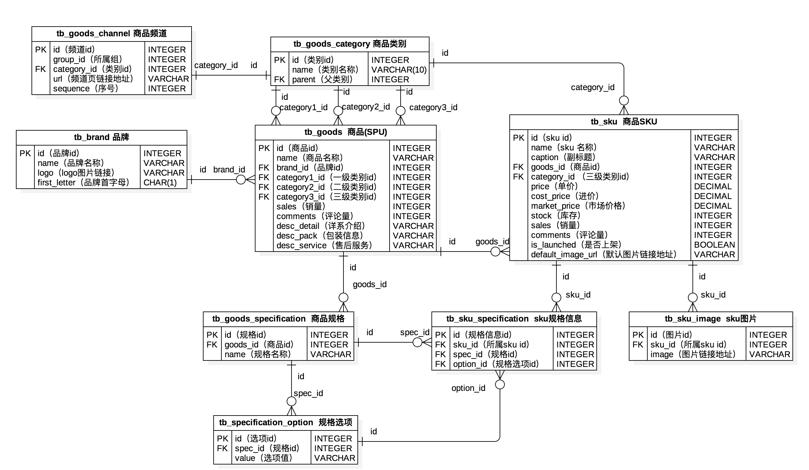
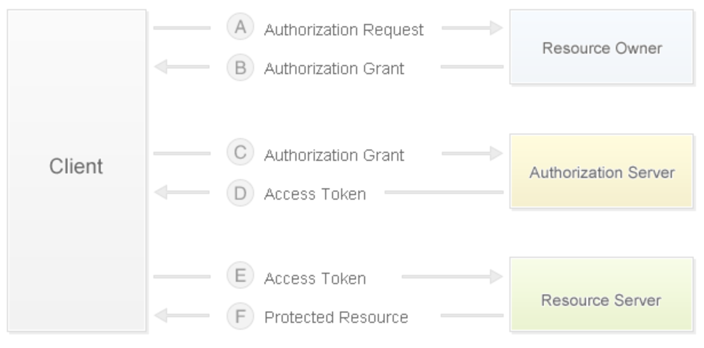
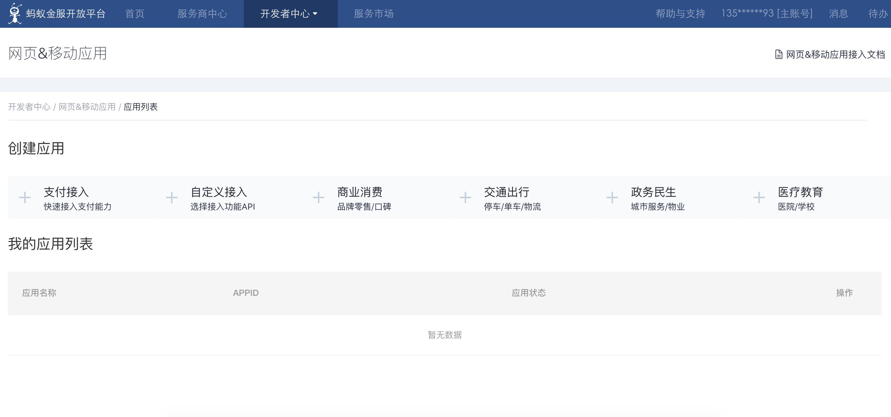

## Phân tích kỹ thuật website thương mại điện tử

### Mô hình kinh doanh

1. B2B - Doanh nghiệp với doanh nghiệp (Business to Business), cả hai bên giao dịch đều là doanh nghiệp, ví dụ điển hình nhất là Alibaba.
2. C2C - Cá nhân với cá nhân (Consumer to Consumer), ví dụ: Taobao, Renrenche.
3. B2C - Doanh nghiệp với cá nhân (Business to Consumer), ví dụ: Vipshop, Jumei.
4. C2B - Cá nhân với doanh nghiệp (Consumer to Business), người tiêu dùng đưa ra nhu cầu trước, sau đó doanh nghiệp tổ chức sản xuất theo nhu cầu, ví dụ: Shangpin Home Collection.
5. O2O - Trực tuyến kết hợp ngoại tuyến (Online to Offline), kết hợp các cơ hội kinh doanh ngoại tuyến với Internet, biến Internet thành nền tảng cho các giao dịch ngoại tuyến, ví dụ: Meituan Waimai, Ele.me.
6. B2B2C - Doanh nghiệp với doanh nghiệp với cá nhân (Business to Business to Consumer), ví dụ: Tmall, JD.com.

### Các điểm trọng yếu về yêu cầu

1. Phía người dùng
   - Trang chủ (phân loại hàng hóa, banner quảng cáo xoay vòng, tin nhanh cuộn tròn, tải dạng thác nước - waterfall, gợi ý sản phẩm, giảm giá, bán chạy,...)
   - Người dùng (đăng nhập (đăng nhập bên thứ ba), đăng ký, đăng xuất, tự phục vụ (thông tin cá nhân, lịch sử duyệt xem, địa chỉ nhận hàng,...))
   - Hàng hóa (danh mục, danh sách, chi tiết, tìm kiếm, tìm kiếm thịnh hành, lịch sử tìm kiếm, thêm vào giỏ hàng, mục yêu thích, theo dõi, đánh giá,...)
   - Giỏ hàng (xem, chỉnh sửa (thay đổi số lượng, xóa hàng hóa, dọn sạch giỏ))
   - Đơn hàng (gửi đơn hàng (thanh toán), lịch sử đơn hàng, chi tiết đơn hàng, đánh giá đơn hàng,...)
2. Phía quản trị
   - CRUD các thực thể nghiệp vụ cốt lõi
   - Tác vụ định kỳ (theo chu kỳ và không theo chu kỳ, như xử lý đơn hàng chưa thanh toán, thu thập dữ liệu để cảnh báo các sự kiện bất thường,...)
   - Chức năng báo cáo (nhập/xuất Excel, PDF,... cũng như hiển thị biểu đồ thống kê bằng ECharts phía front-end)
   - Kiểm soát quyền hạn (RBAC, whitelist, blacklist,...)
   - Luồng luân chuyển nghiệp vụ (như khởi tạo quy trình hoàn tiền, các engine quy trình thường dùng gồm: Activiti, Airflow, Spiff,...)
   - Dịch vụ bên thứ ba (kết nối bản đồ, SMS, vận chuyển logistics, thanh toán, xác thực danh tính thực, thời tiết, giám sát, lưu trữ đám mây,...)

### Thiết kế mô hình vật lý

Trước hết cần nắm rõ hai khái niệm: SPU (Standard Product Unit) và SKU (Stock Keeping Unit).

- SPU: iPhone 6s
- SKU: iPhone 6s 64GB Vàng sâm-panh (Champagne Gold)



### Đăng nhập bằng bên thứ ba

Đăng nhập bằng bên thứ ba là việc sử dụng tài khoản của một trang web bên thứ ba (thường là mạng xã hội nổi tiếng) để thực hiện xác thực đăng nhập (chủ yếu là thông qua trang web bên thứ ba nổi tiếng để lấy thông tin liên quan của người dùng), chẳng hạn như QQ, Weibo ở Trung Quốc, hay Google, Facebook ở quốc tế. Hầu hết đăng nhập bên thứ ba đều sử dụng giao thức [OAuth](https://en.wikipedia.org/wiki/OAuth). Đây là một tiêu chuẩn mạng mở về ủy quyền (**chủ sở hữu dữ liệu nói với hệ thống rằng họ đồng ý ủy quyền cho ứng dụng bên thứ ba truy cập vào hệ thống để lấy dữ liệu đó. Hệ thống từ đó tạo ra một token truy cập ngắn hạn để thay thế mật khẩu, cung cấp cho ứng dụng bên thứ ba sử dụng**). Giao thức này đã được áp dụng rộng rãi, hiện nay phiên bản 2.0 thường được sử dụng. Về kiến thức cơ bản của OAuth, bạn có thể đọc bài viết của tác giả Ruan Yifeng: [《Hiểu về OAuth 2.0》](http://www.ruanyifeng.com/blog/2014/05/oauth_2_0.html). Về sự khác biệt giữa **token** và **mật khẩu**, chúng ta có thể tóm tắt đơn giản thành 3 điểm khác nhau sau:

1. Token có thời hạn ngắn, hết hạn sẽ tự động vô hiệu, người dùng không thể tự mình chỉnh sửa. Mật khẩu nhìn chung có hiệu lực lâu dài, nếu người dùng không sửa thì nó sẽ không thay đổi.
2. Token có thể bị chủ sở hữu dữ liệu thu hồi và sẽ mất hiệu lực ngay lập tức. Giống như ví dụ trên, chủ nhà có thể hủy token của người giao hàng bất cứ lúc nào. Mật khẩu thông thường không cho phép người khác thu hồi.
3. Token có phạm vi quyền hạn (scope), ví dụ chỉ được vào cổng số 2 của khu dân cư. Đối với các dịch vụ mạng, token chỉ đọc sẽ an toàn hơn token đọc-ghi. Mật khẩu thông thường có toàn quyền truy cập.

Do đó, thông qua token, ứng dụng bên thứ ba vừa có được quyền hạn cần thiết, lại vừa có thể kiểm soát bất cứ lúc nào mà không gây nguy hiểm cho tính an toàn của hệ thống. Đây chính là ưu thế của giao thức OAuth.

#### Quy trình ủy quyền OAuth 2.0

1. Sau khi người dùng mở client, client yêu cầu người dùng (chủ sở hữu tài nguyên) cấp quyền ủy quyền.
2. Người dùng (chủ sở hữu tài nguyên) đồng ý cấp quyền ủy quyền cho client.
3. Client sử dụng ủy quyền đã nhận ở bước trước để xin cấp token truy cập (access token) từ máy chủ xác thực (authorization server).
4. Máy chủ xác thực sau khi xác thực client sẽ cấp phát token truy cập.
5. Client sử dụng token truy cập để yêu cầu lấy tài nguyên từ máy chủ tài nguyên (resource server).
6. Máy chủ tài nguyên xác nhận token truy cập không có sai sót, đồng ý mở quyền truy cập tài nguyên cho client.



Nếu sử dụng đăng nhập Weibo để tích hợp, các bước cụ thể có thể tham khảo tài liệu [“Tích hợp đăng nhập Weibo”](http://open.weibo.com/wiki/Connect/login) trên nền tảng mở Weibo. Khi sử dụng đăng nhập QQ để tích hợp, trước tiên cần đăng ký trở thành nhà phát triển QQ Connect và vượt qua vòng kiểm duyệt, các bước cụ thể có thể tham khảo [“Hướng dẫn tích hợp”](http://wiki.connect.qq.com/) và [“Quy trình phát triển website”](http://wiki.connect.qq.com/%E5%87%86%E5%A4%87%E5%B7%A5%E4%BD%9C_oauth2-0) trên QQ Connect.

> **Gợi ý**: Trên GitBook có một cuốn sách tên là [《Nhập môn Blog Django》](https://shenxgan.gitbooks.io/django/content/publish/2015-08-10-django-oauth-login.html) lấy GitHub làm ví dụ để giới thiệu về đăng nhập tài khoản bên thứ ba, các bạn quan tâm có thể tự tìm đọc.

Thông thường, khi website thương mại điện tử sử dụng đăng nhập bên thứ ba, họ sẽ yêu cầu ràng buộc (liên kết) với tài khoản của website hoặc tự động hoàn thành việc ràng buộc tài khoản dựa trên thông tin tài khoản bên thứ ba thu được (như số điện thoại).

### Làm nóng trước cache và lưu đệm truy vấn

#### Làm nóng trước cache (Cache Warmup)

Cái gọi là làm nóng trước cache (cache warmup) có nghĩa là khi khởi động máy chủ, dữ liệu sẽ được tải trước vào bộ nhớ đệm. Để làm được điều này, bạn có thể viết một lớp con của `AppConfig` trong module `apps.py` của ứng dụng Django và ghi đè phương thức `ready()`, đoạn mã như sau:

```Python
import pymysql

from django.apps import AppConfig
from django.core.cache import cache

SELECT_PROVINCE_SQL = 'select distid, name from tb_district where pid is null'


class CommonConfig(AppConfig):
    name = 'common'

    def ready(self):
        conn = pymysql.connect(host='1.2.3.4', port=3306,
                               user='root', password='pass',
                               database='db', charset='utf8',
                               cursorclass=pymysql.cursors.DictCursor)
        try:
            with conn.cursor() as cursor:
                cursor.execute(SELECT_PROVINCE_SQL)
                provinces = cursor.fetchall()
                cache.set('provinces', provinces)
        finally:
            conn.close()
```

Tiếp theo, bạn cũng cần viết đoạn mã sau trong `__init__.py` của ứng dụng:

```Python
default_app_config = 'common.apps.CommonConfig'
```

Hoặc đăng ký ứng dụng trong tệp `settings.py` của dự án:

```Python
INSTALLED_APPS = [
    ...
    'common.apps.CommonConfig',
    ...
]
```

#### Lưu đệm truy vấn (Query Cache)

Tự định nghĩa decorator để thực hiện lưu bộ nhớ đệm cho kết quả truy vấn.

```Python
from pickle import dumps, loads

from django.core.cache import caches

MODEL_CACHE_KEY = 'project:modelcache:%s'


def my_model_cache(key, section='default', timeout=None):
    """Decorator thực hiện lưu cache mô hình"""

    def wrapper1(func):

        def wrapper2(*args, **kwargs):
            real_key = '%s:%s' % (MODEL_CACHE_KEY % key, ':'.join(map(str, args)))
            serialized_data = caches[section].get(real_key)
            if serialized_data:
                data = loads(serialized_data)
            else:
                data = func(*args, **kwargs)
                cache.set(real_key, dumps(data), timeout=timeout)
            return data

        return wrapper2

    return wrapper1
```

```Python
@my_model_cache(key='provinces')
def get_all_provinces():
    return list(Province.objects.all())
```

### Triển khai giỏ hàng

Vấn đề 1: Giỏ hàng của người dùng đã đăng nhập được đặt ở đâu? Giỏ hàng của người dùng chưa đăng nhập được đặt ở đâu?

```Python
class CartItem(object):
    """Mục hàng hóa trong giỏ hàng"""

    def __init__(self, sku, amount=1, selected=False):
        self.sku = sku
        self.amount = amount
        self.selected = selected

    @property
    def total(self):
        return self.sku.price * self.amount


class ShoppingCart(object):
    """Giỏ hàng"""

    def __init__(self):
        self.items = {}
        self.index = 0

    def add_item(self, item):
        if item.sku.id in self.items:
            self.items[item.sku.id].amount += item.amount
        else:
            self.items[item.sku.id] = item

    def remove_item(self, sku_id):
        if sku_id in self.items:
            self.items.remove(sku_id)

    def clear_all_items(self):
        self.items.clear()

    @property
    def cart_items(self):
        return self.items.values()

    @property
    def cart_total(self):
        total = 0
        for item in self.items.values():
            total += item.total
        return total
```

Giỏ hàng của người dùng đã đăng nhập có thể đặt trong cơ sở dữ liệu (có thể lưu đệm trước trong Redis); giỏ hàng của người dùng chưa đăng nhập có thể lưu trong Cookie, localStorage hoặc sessionStorage (để giảm chi phí bộ nhớ phía máy chủ).

```JSON
{
    '1001': {sku: {...}, 'amount': 1, 'selected': True}, 
    '1002': {sku: {...}, 'amount': 2, 'selected': False},
    '1003': {sku: {...}, 'amount': 3, 'selected': True},
}
```

```Python
request.get_signed_cookie('cart')

cart_base64 = base64.base64encode(pickle.dumps(cart))
response.set_signed_cookie('cart', cart_base64)
```

Vấn đề 2: Sau khi người dùng đăng nhập, làm thế nào để hợp nhất giỏ hàng? (Hiện tại các ứng dụng thương mại điện tử hầu hết đều thực hiện lưu trữ lâu dài cho giỏ hàng, mục đích chính là thuận tiện cho việc chia sẻ dữ liệu giữa nhiều thiết bị đầu cuối khác nhau)

### Tích hợp chức năng thanh toán

Vấn đề 1: Thông tin thanh toán được lưu trữ lâu dài như thế nào? (Bắt buộc phải đảm bảo mỗi giao dịch đều có bản ghi)

Vấn đề 2: Làm thế nào để tích hợp Alipay? (Việc tích hợp các nền tảng khác về cơ bản cũng tương tự)

1. [Nền tảng mở Ant Financial (Alipay)](https://open.alipay.com/platform/home.htm).
2. [Gia nhập nền tảng](https://open.alipay.com/platform/homeRoleSelection.htm).
3. [Trung tâm nhà phát triển](https://openhome.alipay.com/platform/appManage.htm#/apps).
4. [Trung tâm tài liệu](https://docs.open.alipay.com/270/105899/).
5. [Tích hợp SDK](https://docs.open.alipay.com/54/103419) - [Liên kết PyPI](https://pypi.org/project/alipay-sdk-python/).
6. [Danh sách API](https://docs.open.alipay.com/270/105900/).



Tệp cấu hình:

```Python
ALIPAY_APPID = '......'
ALIPAY_URL = 'https://openapi.alipaydev.com/gateway.do'
ALIPAY_DEBUG = False
```

Lấy liên kết thanh toán (khởi tạo thanh toán):

```Python
# Khởi tạo đối tượng gọi Alipay
alipay = AliPay(
    # ID được cấp phát khi tạo ứng dụng trực tuyến
    appid=settings.ALIPAY_APPID,
    app_notify_url=None,
    # Khóa bí mật (private key) của ứng dụng mình
    app_private_key_path=os.path.join(
        os.path.dirname(os.path.abspath(__file__)), 
        'keys/app_private_key.pem'),
    # Khóa công khai (public key) của Alipay
    alipay_public_key_path=os.path.join(
        os.path.dirname(os.path.abspath(__file__)), 
        'keys/alipay_public_key.pem'),
    sign_type='RSA2',
    debug=settings.ALIPAY_DEBUG
)
# Gọi thao tác lấy trang thanh toán
order_info = alipay.api_alipay_trade_page_pay(
    out_trade_no='...',
    total_amount='...',
    subject='...',
    return_url='http://...'
)
# Tạo URL hoàn chỉnh cho trang thanh toán
alipay_url = settings.ALIPAY_URL + '?' + order_info
return JsonResponse({'alipay_url': alipay_url})
```

Thông qua liên kết trả về ở trên, người dùng có thể truy cập vào trang thanh toán. Sau khi thanh toán hoàn tất, hệ thống sẽ tự động chuyển hướng về trang dự án đã được thiết lập trong đoạn mã trên. Tại trang này, bạn có thể lấy được mã đơn hàng (`out_trade_no`), mã giao dịch thanh toán (`trade_no`), số tiền giao dịch (`total_amount`) và chữ ký tương ứng (`sign`), đồng thời gửi yêu cầu lên back-end để xác minh và lưu kết quả giao dịch, đoạn mã như sau:

```Python
# Khởi tạo đối tượng gọi Alipay
alipay = AliPay(
    # ID được cấp phát khi tạo ứng dụng trực tuyến
    appid=settings.ALIPAY_APPID,
    app_notify_url=None,
    # Khóa bí mật của ứng dụng mình
    app_private_key_path=os.path.join(
        os.path.dirname(os.path.abspath(__file__)), 
        'keys/app_private_key.pem'),
    # Khóa công khai của Alipay
    alipay_public_key_path=os.path.join(
        os.path.dirname(os.path.abspath(__file__)), 
        'keys/alipay_public_key.pem'),
    sign_type='RSA2',
    debug=settings.ALIPAY_DEBUG
)
# Tham số yêu cầu (giả sử là request POST) bao gồm mã đơn hàng, mã giao dịch, số tiền và chữ ký
params = request.POST.dict()
# Gọi thao tác xác minh chữ ký
if alipay.verify(params, params.pop('sign')):
    # Thực hiện lưu trữ lâu dài giao dịch
```

API thanh toán của Alipay còn cung cấp một loạt các giao diện như truy vấn giao dịch, quyết toán giao dịch, hoàn tiền, truy vấn hoàn tiền,... có thể gọi tùy theo nhu cầu nghiệp vụ, ở đây sẽ không đi sâu thêm nữa.

### Bán hàng chớp nhoáng (Flash Sale / Giảm giá sốc) và bán vượt mức (Overselling)

1. Flash Sale: Bán hàng chớp nhoáng thường đồng nghĩa với việc phải xử lý lượng truy cập đồng thời cực cao trong khoảng thời gian rất ngắn. Hệ thống trong thời gian ngắn cần phải chịu đựng lượng lưu lượng gấp hàng trăm lần bình thường. Do đó, kiến trúc flash sale là một bài toán khá phức tạp. Tư duy cốt lõi của nó là kiểm soát lưu lượng và tối ưu hóa hiệu năng, đòi hỏi sự phối hợp đồng bộ ở từng khâu từ front-end (dùng JavaScript đếm ngược, ngăn chặn gửi form lặp lại và hạn chế người dùng refresh liên tục) đến back-end. Kiểm soát lưu lượng chủ yếu nhằm giới hạn chỉ cho một phần nhỏ lưu lượng đi vào back-end của dịch vụ (dù sao thì cuối cùng cũng chỉ có một số lượng nhỏ người dùng có thể mua thành công). Đồng thời trên kiến trúc vật lý, hệ thống sử dụng bộ nhớ đệm cache (một mặt là do thao tác đọc nhiều, ghi ít; mặt khác có thể lưu trữ tồn kho trong Redis, tận dụng lệnh nguyên tử `DECR` để giảm tồn kho; đồng thời cũng có thể dùng Redis để giới hạn tần suất - rate limiting, nguyên lý tương tự như hạn chế gửi mã xác thực SMS liên tục) và hàng đợi thông điệp - Message Queue (vai trò quan trọng nhất của Message Queue là "san phẳng đỉnh lưu lượng" và "giảm độ phụ thuộc giữa các nút thượng nguồn và hạ nguồn"). Ngoài ra, cần áp dụng thiết kế dịch vụ phi trạng thái (stateless), có như vậy mới thuận tiện cho việc mở rộng theo chiều ngang (bổ sung thiết bị/máy chủ để nâng cao năng lực hệ thống).
2. Hiện tượng bán vượt mức (overselling): Chẳng hạn tồn kho của một sản phẩm là 1, lúc này người dùng 1 và người dùng 2 đồng thời mua sản phẩm đó. Sau khi người dùng 1 gửi đơn hàng, tồn kho của sản phẩm bị sửa thành 0, nhưng lúc này người dùng 2 chưa biết điều đó và cũng gửi đơn hàng, tồn kho của sản phẩm lại tiếp tục bị trừ thành -1. Đây chính là hiện tượng bán vượt mức. Có 3 hướng tiếp cận phổ biến để giải quyết hiện tượng bán vượt mức:
   - Kiểm soát bằng khóa bi quan (Pessimistic Locking): Khi truy vấn số lượng hàng hóa thì dùng `select ... for update` để khóa dữ liệu. Như vậy khi người dùng 1 truy vấn tồn kho, người dùng 2 sẽ bị chặn (block) do không thể đọc số lượng tồn kho, cho đến khi người dùng 1 commit hoặc rollback thao tác cập nhật tồn kho thì mới có thể tiếp tục, từ đó giải quyết được vấn đề bán vượt mức. Tuy nhiên cách làm này mang lại hiệu năng rất tồi tệ đối với những sản phẩm có lượng truy cập đồng thời cao. Trong thực tế chỉ nên cân nhắc dùng khóa khi tồn kho nhỏ hơn một giá trị nhất định, nhưng nhìn chung cách này không mấy khả thi.
   - Kiểm soát bằng khóa lạc quan (Optimistic Locking): Khi truy vấn số lượng hàng hóa thì không cần khóa, nhưng khi cập nhật tồn kho thì đặt điều kiện số lượng hàng hóa phải đúng bằng số lượng đã truy vấn trước đó thì mới cho cập nhật. Nếu không bằng thì chứng tỏ giao dịch khác đã cập nhật tồn kho rồi, bắt buộc phải gửi lại yêu cầu.
   - Thử giảm tồn kho trực tiếp: Gộp thao tác truy vấn (`select`) và thao tác cập nhật (`update`) ở trên thành một câu lệnh SQL duy nhất. Khi cập nhật tồn kho, trong điều kiện lọc `where` thêm điều kiện `tồn kho >= số lượng mua` hoặc `tồn kho - số lượng mua >= 0`. Cách làm này yêu cầu mức cô lập giao dịch phải là Đọc đã cam kết (Read Committed).

> **Gợi ý**: Các bạn quan tâm có thể tự tìm đọc các cuộc thảo luận về loại vấn đề này trên Zhihu.

### Quản lý tài nguyên tĩnh

Việc quản lý tài nguyên tĩnh có thể tự dựng máy chủ tệp tin hoặc máy chủ tệp tin phân tán (FastDFS). Tuy nhiên trong các dự án thông thường thì không cần thiết phải làm như vậy và hiệu quả chưa chắc đã tốt nhất. Chúng tôi khuyến nghị sử dụng dịch vụ lưu trữ đám mây để quản lý tài nguyên tĩnh của website. Các nhà cung cấp dịch vụ đám mây trong và ngoài nước như [Amazon AWS](https://amazonaws-china.com/cn/), [Alibaba Cloud](https://www.aliyun.com/product/oss), [Qiniu Cloud](https://www.qiniu.com/products/kodo), [LeanCloud](https://leancloud.cn/storage/), [Bmob](https://www.bmob.cn/cloud),... đều cung cấp các dịch vụ lưu trữ đám mây chất lượng cao với mức giá mà các công ty thông thường hoàn toàn chấp nhận được. Thao tác cụ thể có thể tham khảo tài liệu chính thức, ví dụ: [Hướng dẫn nhà phát triển OSS (Object Storage Service) của Alibaba Cloud](https://www.alibabacloud.com/zh/support/developer-resources).

### Tìm kiếm toàn văn (Full-text Search)

#### Lựa chọn giải pháp

1. Sử dụng tính năng truy vấn mờ (fuzzy search) của cơ sở dữ liệu - Hiệu quả thấp, mỗi lần đều phải quét toàn bộ bảng (full table scan), không hỗ trợ tách từ (tokenization).
2. Sử dụng tính năng tìm kiếm toàn văn của cơ sở dữ liệu - Trước MySQL 5.6 chỉ áp dụng cho storage engine MyISAM. Thao tác tìm kiếm bị gắn chặt với các thao tác DML khác ngay trong CSDL, có thể khiến thao tác tìm kiếm diễn ra rất chậm chạp. Khi lượng dữ liệu đạt đến hàng triệu bản ghi thì hiệu năng suy giảm rõ rệt, thời gian truy vấn rất dài.
3. Sử dụng công cụ tìm kiếm mã nguồn mở - Dữ liệu chỉ mục tách biệt hoàn toàn với dữ liệu gốc. Có thể dùng Elasticsearch hoặc Solr để cung cấp dịch vụ lập chỉ mục bên ngoài. Nếu không cần tính đến nhu cầu tìm kiếm toàn văn có độ đồng thời cao thì Whoosh viết thuần bằng Python cũng là một phương án đáng cân nhắc.

#### Elasticsearch

Elasticsearch vừa là một cơ sở dữ liệu tài liệu phân tán, vừa là một công cụ tìm kiếm và phân tích toàn văn mã nguồn mở có khả năng mở rộng cao. Nó cho phép lưu trữ, tìm kiếm và phân tích khối lượng dữ liệu khổng lồ theo thời gian gần như thực tế (near real-time). Nó thường được dùng làm engine nền tảng và công nghệ cốt lõi để cung cấp động lực cho các tính năng và yêu cầu tìm kiếm phức tạp. Những trang web nổi tiếng như Wikipedia, Stack Overflow, GitHub đều sử dụng Elasticsearch.

Tầng bên dưới của Elasticsearch là công cụ tìm kiếm mã nguồn mở [Lucene](https://lucene.apache.org/). Tuy nhiên dùng trực tiếp Lucene sẽ rất phiền phức, bắt buộc bạn phải tự viết code gọi interface của nó và nó chỉ hỗ trợ ngôn ngữ Java. Elasticsearch tương đương với việc đóng gói toàn diện Lucene, cung cấp các giao diện API theo phong cách RESTful, thông qua phương thức truy cập dựa trên giao thức HTTP để xóa bỏ rào cản khác biệt về ngôn ngữ lập trình. Elasticsearch sẽ xây dựng [chỉ mục đảo (inverted index)](https://vi.wikipedia.org/wiki/Ch%E1%BB%89_m%E1%BB%A5c_%C4%91%E1%BA%A3o) cho dữ liệu. Tuy nhiên bộ tách từ tích hợp sẵn của Elasticsearch hầu như không hỗ trợ tách từ tiếng Trung, do đó cần cài đặt thêm plugin `elasticsearch-analysis-ik` để cung cấp dịch vụ tách từ tiếng Trung.

Cài đặt và cấu hình Elasticsearch có thể tham khảo bài viết [《Cài đặt Elasticsearch bằng Docker》](https://blog.csdn.net/jinyidong/article/details/80475320). Ngoài Elasticsearch ra, cũng có thể dùng Solr, Whoosh,... để cung cấp dịch vụ công cụ tìm kiếm. Về cơ bản trong dự án Django có thể cân nhắc các giải pháp sau:

- haystack (django-haystack / drf-haystack) + whoosh + Jieba
- haystack (django-haystack / drf-haystack) + elasticsearch
- requests + elasticsearch
- django-elasticsearch-dsl

#### Cài đặt và sử dụng Elasticsearch

1. Cài đặt Elasticsearch bằng Docker.

   ```Shell
   docker pull elasticsearch:7.6.0
   docker run -d -p 9200:9200 -p 9300:9300 -e "discovery.type=single-node" -e ES_JAVA_OPTS="-Xms512m -Xmx512m" --name es elasticsearch:7.6.0
   ```

   > **Giải thích**: Khi tạo container ở trên, tham số `-e` được dùng để chỉ định chế độ một nút (single-node) cùng dung lượng heap khả dụng tối thiểu và tối đa của máy ảo Java. Dung lượng heap có thể quyết định dựa trên bộ nhớ thực tế mà máy chủ có thể cấp phát cho Elasticsearch, mặc định là 2GB.

2. Tạo cơ sở dữ liệu (index).

   Yêu cầu: PUT - `http://1.2.3.4:9200/demo/`

   Phản hồi:

    ```JSON
   {
       "acknowledged": true,
       "shards_acknowledged": true,
       "index": "demo"
   }
    ```

3. Xem cơ sở dữ liệu đã tạo.

   Yêu cầu: GET - `http://1.2.3.4:9200/demo/`

   Phản hồi:

   ```JSON
   {
       "demo": {
           "aliases": {},
           "mappings": {},
           "settings": {
               "index": {
                   "creation_date": "1552213970199",
                   "number_of_shards": "5",
                   "number_of_replicas": "1",
                   "uuid": "ny3rCn10SAmCsqW6xPP1gw",
                   "version": {
                       "created": "6050399"
                   },
                   "provided_name": "demo"
               }
           }
       }
   }
   ```

4. Chèn dữ liệu.

   Yêu cầu: POST - `http://1.2.3.4:9200/demo/goods/1/`

   Header: Content-Type: application/json

   Tham số:

   ```JSON
   {
       "no": "5089253",
       "title": "Apple iPhone X (A1865) 64GB 深空灰色 移动联通电信4G手机",
       "brand": "Apple",
       "name": "Apple iPhone X",
       "product": "中国大陆",
       "resolution": "2436 x 1125",
       "intro": "一直以来，Apple都心存一个设想，期待能够打造出这样一部iPhone：它有整面屏幕，能让你在使用时，完全沉浸其中，仿佛忘了它的存在。它是如此智能，哪怕轻轻一瞥，都能得到它心有灵犀的回应。而这个设想，终于随着iPhone X的到来成为了现实。现在，就跟未来见个面吧。"
   }
   ```

   Phản hồi:

   ```JSON
   {
       "_index": "demo",
       "_type": "goods",
       "_id": "1",
       "_version": 4,
       "result": "created",
       "_shards": {
           "total": 2,
           "successful": 1,
           "failed": 0
       },
       "_seq_no": 3,
       "_primary_term": 1
   }
   ```

5. Xóa dữ liệu.

   Yêu cầu: DELETE - `http://1.2.3.4:9200/demo/goods/1/`

   Phản hồi:

   ```JSON
   {
       "_index": "demo",
       "_type": "goods",
       "_id": "1",
       "_version": 2,
       "result": "deleted",
       "_shards": {
           "total": 2,
           "successful": 1,
           "failed": 0
       },
       "_seq_no": 1,
       "_primary_term": 1
   }
   ```

6. Cập nhật dữ liệu.

   Yêu cầu: PUT - `http://1.2.3.4:9200/demo/goods/1/_update`

   Header: Content-Type: application/json

   Tham số:

   ```JSON
   {
   	"doc": {
   		"no": "5089253",
       	"title": "Apple iPhone X (A1865) 64GB 深空灰色 移动联通电信4G手机",
       	"brand": "Apple(苹果)",
       	"name": "Apple iPhone X",
       	"product": "美国",
       	"resolution": "2436 x 1125",
       	"intro": "一直以来，Apple都心存一个设想，期待能够打造出这样一部iPhone：它有整面屏幕，能让你在使用时，完全沉浸其中，仿佛忘了它的存在。它是如此智能，哪怕轻轻一瞥，都能得到它心有灵犀的回应。而这个设想，终于随着iPhone X的到来成为了现实。现在，就跟未来见个面吧。"
       }
   }
   ```

   Phản hồi:

   ```JSON
   {
       "_index": "demo",
       "_type": "goods",
       "_id": "1",
       "_version": 10,
       "result": "updated",
       "_shards": {
           "total": 2,
           "successful": 1,
           "failed": 0
       },
       "_seq_no": 9,
       "_primary_term": 1
   }
   ```

7. Truy vấn dữ liệu.

   Yêu cầu: GET - `http://1.2.3.4:9200/demo/goods/1/`

   Phản hồi:

   ```JSON
   {
       "_index": "demo",
       "_type": "goods",
       "_id": "1",
       "_version": 10,
       "found": true,
       "_source": {
           "doc": {
               "no": "5089253",
               "title": "Apple iPhone X (A1865) 64GB 深空灰色 移动联通电信4G手机",
               "brand": "Apple(苹果)",
               "name": "Apple iPhone X",
               "product": "美国",
               "resolution": "2436 x 1125",
               "intro": "一直以来，Apple都心存一个设想，期待能够打造出这样一部iPhone：它有整面屏幕，能让你在使用时，完全沉浸其中，仿佛忘了它的存在。它是如此智能，哪怕轻轻一瞥，都能得到它心有灵犀的回应。而这个设想，终于随着iPhone X的到来成为了现实。现在，就跟未来见个面吧。"
           }
       }
   }
   ```

#### Cấu hình plugin tách từ tiếng Trung (ik) và Pinyin

1. Đi vào thư mục plugins của Docker container.

   ```Shell
   docker exec -it es /bin/bash
   ```

2. Tải về plugin [ik](https://github.com/medcl/elasticsearch-analysis-ik) và [pinyin](https://github.com/medcl/elasticsearch-analysis-pinyin) tương ứng với phiên bản Elasticsearch.

   ```Shell
   yum install -y wget
   cd plugins/
   mkdir ik
   cd ik
   wget https://github.com/medcl/elasticsearch-analysis-ik/releases/download/v7.6.0/elasticsearch-analysis-ik-7.6.0.zip
   unzip elasticsearch-analysis-ik-7.6.0.zip
   rm -f elasticsearch-analysis-ik-7.6.0.zip
   cd ..
   mkdir pinyin
   cd pinyin
   wget https://github.com/medcl/elasticsearch-analysis-pinyin/releases/download/v7.6.0/elasticsearch-analysis-pinyin-7.6.0.zip
   unzip elasticsearch-analysis-pinyin-7.6.0.zip
   rm -f elasticsearch-analysis-pinyin-7.6.0.zip
   ```

3. Thoát khỏi container, khởi động lại Elasticsearch.

   ```Shell
   docker restart es
   ```

4. Kiểm tra hiệu quả tách từ tiếng Trung.

   > **Ghi chú của người dịch**: Dữ liệu thử nghiệm dưới đây được giữ nguyên tiếng Trung để minh họa chính xác cho plugin tách từ `ik` và bộ phân tích `ik_smart`.

   Yêu cầu: POST - `http://1.2.3.4:9200/_analyze`

   Header: Content-Type: application/json

   Tham số:

   ```JSON
   {
     "analyzer": "ik_smart",
     "text": "中国男足在2022年卡塔尔世界杯预选赛中勇夺小组最后一名"
   }
   ```

   Phản hồi:

   ```JSON
   {
       "tokens": [
           {
               "token": "中国",
               "start_offset": 0,
               "end_offset": 2,
               "type": "CN_WORD",
               "position": 0
           },
           {
               "token": "男足",
               "start_offset": 2,
               "end_offset": 4,
               "type": "CN_WORD",
               "position": 1
           },
           {
               "token": "在",
               "start_offset": 4,
               "end_offset": 5,
               "type": "CN_CHAR",
               "position": 2
           },
           {
               "token": "2022年",
               "start_offset": 5,
               "end_offset": 10,
               "type": "TYPE_CQUAN",
               "position": 3
           },
           {
               "token": "卡塔尔",
               "start_offset": 10,
               "end_offset": 13,
               "type": "CN_WORD",
               "position": 4
           },
           {
               "token": "世界杯",
               "start_offset": 13,
               "end_offset": 16,
               "type": "CN_WORD",
               "position": 5
           },
           {
               "token": "预选赛",
               "start_offset": 16,
               "end_offset": 19,
               "type": "CN_WORD",
               "position": 6
           },
           {
               "token": "中",
               "start_offset": 19,
               "end_offset": 20,
               "type": "CN_CHAR",
               "position": 7
           },
           {
               "token": "勇夺",
               "start_offset": 20,
               "end_offset": 22,
               "type": "CN_WORD",
               "position": 8
           },
           {
               "token": "小组",
               "start_offset": 22,
               "end_offset": 24,
               "type": "CN_WORD",
               "position": 9
           },
           {
               "token": "最后",
               "start_offset": 24,
               "end_offset": 26,
               "type": "CN_WORD",
               "position": 10
           },
           {
               "token": "一名",
               "start_offset": 26,
               "end_offset": 28,
               "type": "CN_WORD",
               "position": 11
           }
       ]
   }
   ```

5. Kiểm tra hiệu quả tách từ pinyin.

   Yêu cầu: POST - `http://1.2.3.4:9200/_analyze`

   Header: Content-Type: application/json

   Tham số:

   ```JSON
   {
     "analyzer": "pinyin",
     "text": "张学友"
   }
   ```

   Phản hồi:

   ```JSON
   {
       "tokens": [
           {
               "token": "zhang",
               "start_offset": 0,
               "end_offset": 0,
               "type": "word",
               "position": 0
           },
           {
               "token": "zxy",
               "start_offset": 0,
               "end_offset": 0,
               "type": "word",
               "position": 0
           },
           {
               "token": "xue",
               "start_offset": 0,
               "end_offset": 0,
               "type": "word",
               "position": 1
           },
           {
               "token": "you",
               "start_offset": 0,
               "end_offset": 0,
               "type": "word",
               "position": 2
           }
       ]
   }
   ```

#### Chức năng tìm kiếm toàn văn

Có thể tìm kiếm thông qua yêu cầu GET hoặc POST. Dưới đây minh họa việc tìm kiếm hàng hóa có chứa từ khóa "未来" (tương lai).

1. GET - `http://120.77.222.217:9200/demo/goods/_search?q=未来`

   > **Lưu ý**: Ký tự tiếng Trung trong URL cần được xử lý theo dạng mã hóa phần trăm (URL encode / percent-encoding).

   ```JSON
   {
       "took": 19,
       "timed_out": false,
       "_shards": {
           "total": 5,
           "successful": 5,
           "skipped": 0,
           "failed": 0
       },
       "hits": {
           "total": 2,
           "max_score": 0.73975396,
           "hits": [
               {
                   "_index": "demo",
                   "_type": "goods",
                   "_id": "1",
                   "_score": 0.73975396,
                   "_source": {
                       "doc": {
                           "no": "5089253",
                           "title": "Apple iPhone X (A1865) 64GB 深空灰色 移动联通电信4G手机",
                           "brand": "Apple(苹果)",
                           "name": "Apple iPhone X",
                           "product": "美国",
                           "resolution": "2436*1125",
                           "intro": "一直以来，Apple都心存一个设想，期待能够打造出这样一部iPhone：它有整面屏幕，能让你在使用时，完全沉浸其中，仿佛忘了它的存在。它是如此智能，哪怕轻轻一瞥，都能得到它心有灵犀的回应。而这个设想，终于随着iPhone X的到来成为了现实。现在，就跟未来见个面吧。"
                       }
                   }
               },
               {
                   "_index": "demo",
                   "_type": "goods",
                   "_id": "3",
                   "_score": 0.68324494,
                   "_source": {
                       "no": "42417956432",
                       "title": "小米9 透明尊享版 手机 透明尊享 全网通(12GB + 256GB)",
                       "brand": "小米（MI）",
                       "name": "小米（MI）小米9透明",
                       "product": "中国大陆",
                       "resolution": "2340*1080",
                       "intro": "全面透明机身，独特科幻机甲风，来自未来的设计。"
                   }
               }
           ]
       }
   }
   ```

   Các tham số tìm kiếm khả dụng trong URL được liệt kê trong bảng dưới đây:

   | Tham số | Giải thích |
   | ---------------- | ------------------------------------------------- |
   | q | Chuỗi truy vấn (query string) |
   | analyzer | Bộ phân tích tách từ dùng để phân tích chuỗi truy vấn |
   | analyze_wildcard | Ký tự đại diện hoặc tiền tố truy vấn có được phân tích hay không, mặc định là false |
   | default_operator | Mối quan hệ giữa nhiều điều kiện, mặc định là OR, có thể sửa thành AND |
   | explain | Bao gồm giải thích về cơ chế tính điểm trong kết quả trả về |
   | fields | Chỉ trả về các cột chỉ định trong chỉ mục, nhiều cột ngăn cách nhau bằng dấu phẩy |
   | sort | Trường dùng làm căn cứ sắp xếp, có thể dùng `:asc` và `:desc` để chỉ định tăng dần và giảm dần |
   | timeout | Thời gian chờ tối đa (timeout) |
   | from | Giá trị bắt đầu của kết quả khớp, mặc định là 0 |
   | size | Số lượng kết quả khớp lấy ra, mặc định là 10 |

2. POST - `http://120.77.222.217:9200/demo/goods/_search`

   Header: Content-Type: application/json

   Tham số:

   ```JSON
   {
       "query": {
           "term": {
               "type": ""
           }
       }
   }
   ```

   Tìm kiếm bằng POST dựa trên ngôn ngữ truy vấn DSL.

#### Kết nối Django với Elasticsearch

Thư viện bên thứ ba của Python dùng để kết nối với Elasticsearch là Haystack. Trong dự án Django có thể sử dụng `django-haystack`. Thông qua Haystack, bạn có thể kết nối với nhiều dịch vụ công cụ tìm kiếm khác nhau mà không cần sửa đổi mã nguồn.

```shell
pip install django-haystack elasticsearch
```

Tệp cấu hình:

```Python
INSTALLED_APPS = [
    ...
    'haystack',
    ...
]

HAYSTACK_CONNECTIONS = {
    'default': {
        # Cấu hình engine
        'ENGINE': 'haystack.backends.elasticsearch_backend.ElasticsearchSearchEngine',
        # URL của dịch vụ tìm kiếm
        'URL': 'http://1.2.3.4:9200',
        # Tên kho chỉ mục
        'INDEX_NAME': 'goods',
    },
}

# Tự động tạo chỉ mục khi thêm/xóa/cập nhật dữ liệu
HAYSTACK_SIGNAL_PROCESSOR = 'haystack.signals.RealtimeSignalProcessor'
```

Lớp chỉ mục:

```Python
from haystack import indexes


class GoodsIndex(indexes.SearchIndex, indexes.Indexable):
    text = indexes.CharField(document=True, use_template=True)

    def get_model(self):
        return Goods

    def index_queryset(self, using=None):
        return self.get_model().objects.all()
```

Chỉnh sửa template cho trường `text` (cần đặt tại `templates/search/indexes/demo/goods_text.txt`):

```
{{object.title}}
{{object.intro}}
```

Cấu hình URL:

```Python
urlpatterns = [
    # ...
    url('search/', include('haystack.urls')),
]
```

Tạo chỉ mục ban đầu:

```Shell
python manage.py rebuild_index
```

> **Giải thích**: Bạn có thể tham khảo bài viết [《Tìm kiếm toàn văn và làm nổi bật từ khóa trong Django Haystack》](https://www.zmrenwu.com/post/45/) để hiểu sâu hơn về các thao tác tìm kiếm toàn văn dựa trên Haystack.
