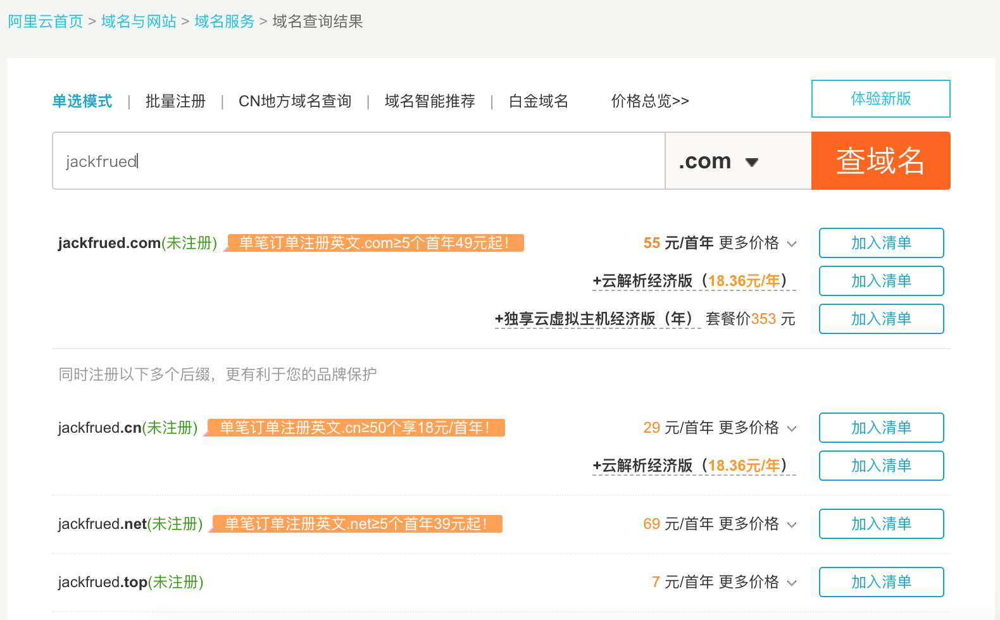
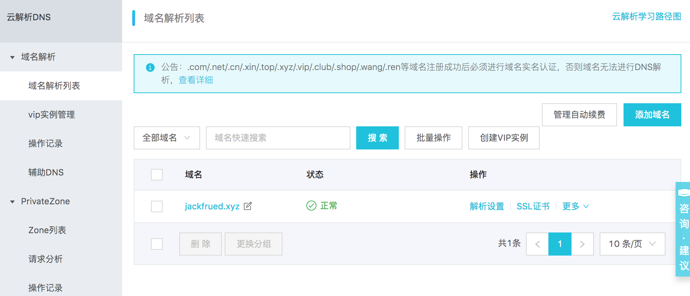
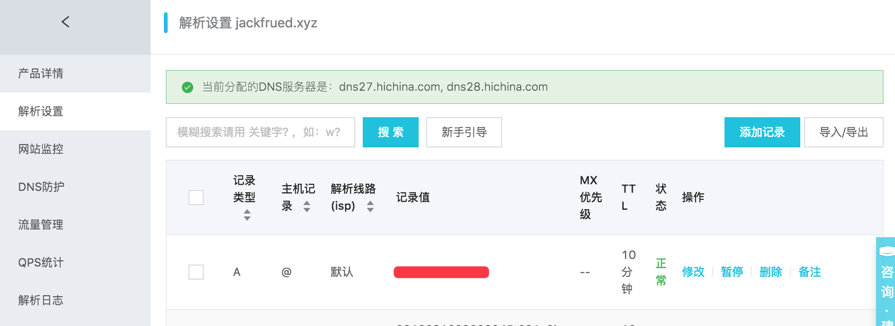
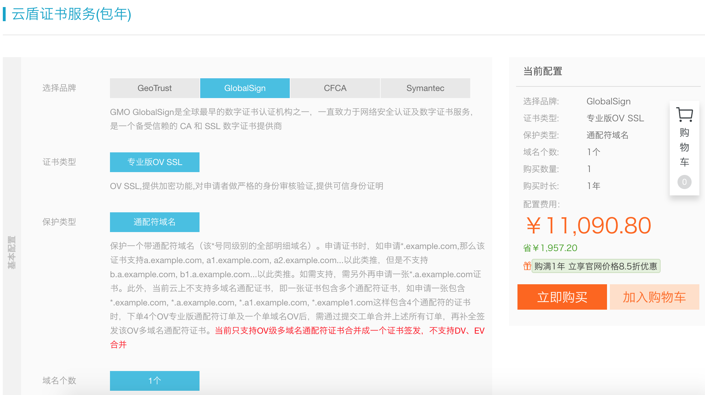

## Hướng dẫn triển khai dự án lên production

### Chuẩn bị đưa lên production

1. Công việc kiểm tra trước khi đưa lên production.

   ```Shell
   python manage.py check --deploy
   ```

2. Đặt `DEBUG = False` và cấu hình `ALLOWED_HOSTS`.

   ```Python
   DEBUG = False
   ALLOWED_HOSTS = ['*']
   ```

3. Các cấu hình liên quan đến bảo mật.

   ```Python
   # Thời gian duy trì kết nối HTTPS
   SECURE_HSTS_SECONDS = 3600
   SECURE_HSTS_INCLUDE_SUBDOMAINS = True
   SECURE_HSTS_PRELOAD = True

   # Tự động chuyển hướng sang kết nối an toàn HTTPS
   SECURE_SSL_REDIRECT = True

   # Tránh trình duyệt tự ý suy đoán kiểu nội dung
   SECURE_CONTENT_TYPE_NOSNIFF = True

   # Ngăn chặn tấn công XSS (Cross-Site Scripting)
   SECURE_BROWSER_XSS_FILTER = True

   # COOKIE chỉ được truyền qua giao thức HTTPS
   SESSION_COOKIE_SECURE = True
   CSRF_COOKIE_SECURE = True

   # Ngăn chặn tấn công Clickjacking - Sửa đổi header phản hồi HTTP
   # Không cho phép trang web hiện tại được nhúng trong thẻ <iframe>
   X_FRAME_OPTIONS = 'DENY'
   ```

4. Đưa thông tin nhạy cảm vào biến môi trường hoặc tệp riêng.

   ```Python
   SECRET_KEY = os.environ['SECRET_KEY']

   DB_USER = os.environ['DB_USER']
   DB_PASS = os.environ['DB_PASS']

   REDIS_AUTH = os.environ['REDIS_AUTH']
   ```

### Nâng cấp môi trường Python của máy chủ lên 3.x

> **Giải thích**: Nếu cần dọn sạch các bản cài đặt trước đó, chỉ cần xóa các tệp và thư mục tương ứng là được.

1. Cài đặt các thư viện phụ thuộc tầng dưới.

   ```Shell
   yum -y install zlib-devel bzip2-devel openssl-devel ncurses-devel sqlite-devel readline-devel tk-devel gdbm-devel libdb4-devel libpcap-devel xz-devel libffi-devel libxml2
   ```

2. Tải về mã nguồn Python.

   ```Shell
   wget https://www.python.org/ftp/python/3.7.6/Python-3.7.6.tar.xz
   ```

3. Xác thực tệp đã tải về.

   ```Bash
   md5sum Python-3.7.6.tar.xz
   ```

4. Giải nén và bung lưu trữ (untar).

   ```Shell
   xz -d Python-3.7.6.tar.xz
   tar -xvf Python-3.7.6.tar
   ```

5. Thực hiện cấu hình trước khi cài đặt (tạo Makefile).

   ```Shell
   cd Python-3.7.6
   ./configure --prefix=/usr/local/python37 --enable-optimizations
   ```

6. Build và cài đặt.

   ```Shell
   make && make install
   ```

7. Cấu hình biến môi trường PATH (cho người dùng hoặc toàn hệ thống) và kích hoạt.

   ```Shell
   vim ~/.bash_profile
   vim /etc/profile
   ```

   ```INI
   ... đoạn mã bên trên được lược bỏ ở đây ...

   export PATH=$PATH:/usr/local/python37/bin

   ... đoạn mã bên dưới được lược bỏ ở đây ...
   ```

    ```Shell
   source ~/.bash_profile
   source /etc/profile
    ```

8. Tạo liên kết mềm (symlink) - Bước này không bắt buộc nhưng thường sẽ rất hữu ích.

   ```Shell
   ln -s /usr/local/python37/bin/python3 /usr/bin/python3
   ```

9. Kiểm tra xem môi trường Python đã được cập nhật thành công hay chưa (lưu ý khi cài đặt Python 3 tuyệt đối không được làm hỏng Python 2 vốn có).

   ```Shell
   python3 --version
   python --version
   ```

### Cấu trúc thư mục dự án

Giả sử thư mục dự án là `project`, năm thư mục con bên dưới lần lượt là: `code`, `conf`, `logs`, `stat` và `venv` dùng để lưu trữ mã nguồn, tệp cấu hình, tệp log, tài nguyên tĩnh và môi trường ảo của dự án. Trong đó, thư mục con `cert` trong thư mục `conf` lưu trữ chứng chỉ và khóa bảo mật dùng để cấu hình HTTPS; mã nguồn dự án trong thư mục `code` có thể được checkout từ kho mã nguồn thông qua công cụ quản lý phiên bản; môi trường ảo có thể được tạo thông qua các công cụ như venv, virtualenv, pyenv,...

```
project
├── code
│   └── fangtx
│       ├── api
│       ├── common
│       ├── fangtx
│       ├── forum
│       ├── rent
│       ├── user
│       ├── manage.py
│       ├── README.md
│       ├── static
│       └── templates
├── conf
│   ├── cert
│   │   ├── 214915882850706.key
│   │   └── 214915882850706.pem
│   ├── nginx.conf
│   └── uwsgi.ini
├── logs
│   ├── access.log
│   ├── error.log
│   └── uwsgi.log
├── stat
│   └── css
│   └── images
│   └── js
└── venv
    ├── bin
    │   ├── activate
    │   ├── activate.csh
    │   ├── activate.fish
    │   ├── celery
    │   ├── celerybeat
    │   ├── celeryd
    │   ├── celeryd-multi
    │   ├── coverage
    │   ├── coverage3
    │   ├── coverage-3.7
    │   ├── django-admin
    │   ├── django-admin.py
    │   ├── easy_install
    │   ├── easy_install-3.7
    │   ├── pip
    │   ├── pip3
    │   ├── pip3.7
    │   ├── __pycache__
    │   ├── pyrsa-decrypt
    │   ├── pyrsa-decrypt-bigfile
    │   ├── pyrsa-encrypt
    │   ├── pyrsa-encrypt-bigfile
    │   ├── pyrsa-keygen
    │   ├── pyrsa-priv2pub
    │   ├── pyrsa-sign
    │   ├── pyrsa-verify
    │   ├── python -> python3
    │   ├── python3 -> /usr/bin/python3
    │   └── uwsgi
    ├── include
    ├── lib
    │   └── python3.7
    ├── lib64 -> lib
    ├── pip-selfcheck.json
    └── pyvenv.cfg
```

Dưới đây lấy Alibaba Cloud làm ví dụ để giải thích ngắn gọn cách đăng ký tên miền, phân giải tên miền và mua chứng chỉ do cơ quan có thẩm quyền cấp cho dự án.

1. [Đăng ký tên miền](https://wanwang.aliyun.com/domain/).

   

2. [Khai báo tên miền (ICP备案)](https://beian.aliyun.com/).

   

3. [Phân giải tên miền (DNS)](https://dns.console.aliyun.com/#/dns/domainList).

   

   

4. [Mua chứng chỉ SSL](https://www.aliyun.com/product/cas).

   

Có thể sử dụng công cụ tương tự như sftp để tải chứng chỉ lên thư mục `conf/cert`, sau đó dùng git để clone mã nguồn dự án vào thư mục `code`.

```Shell
cd code
git clone <url>
```

Quay trở lại thư mục dự án, tạo và kích hoạt môi trường ảo.

```Shell
python3 -m venv venv
source venv/bin/activate
```

Cài đặt lại các gói phụ thuộc của dự án.

```Shell
pip install -r code/teamproject/requirements.txt
```

### Cấu hình uWSGI

1. Cài đặt uWSGI.

   ```Shell
   pip install uwsgi
   ```

2. Chỉnh sửa tệp cấu hình của uWSGI (`/root/project/conf/uwsgi.ini`).

   ```INI
   [uwsgi]
   # Cấu hình đường dẫn gốc tiền tố
   base=/root/project
   # Cấu hình tên dự án
   name=teamproject
   # Chế độ daemon / tiến trình chủ master
   master=true
   # Số lượng tiến trình worker
   processes=4
   # Môi trường ảo
   pythonhome=%(base)/venv
   # Đường dẫn thư mục dự án
   chdir=%(base)/code/%(name)
   # Chỉ định trình thông dịch Python
   pythonpath=%(pythonhome)/bin/python
   # Chỉ định tệp module wsgi
   module=%(name).wsgi
   # Địa chỉ và cổng giao tiếp (IP và port của máy chủ của bạn)
   socket=172.18.61.250:8000
   # Đường dẫn tệp log
   logto=%(base)/logs/uwsgi.log
   ```

   > **Giải thích**: Trước tiên bạn có thể đổi vế trước dấu bằng của mục "địa chỉ và cổng giao tiếp" thành `http` để kiểm tra thử. Nếu chạy ổn định thì đổi lại thành `socket`, sau đó thông qua Nginx để thực hiện "tách biệt động - tĩnh" cho dự án (tài nguyên tĩnh giao cho Nginx xử lý, nội dung động giao cho uWSGI xử lý). Có thể khởi động máy chủ uWSGI theo cách dưới đây.

3. Khởi động máy chủ uWSGI.

   ```Shell
   nohup uwsgi --ini conf/uwsgi.ini &
   ```

### Cấu hình Nginx

1. Cài đặt Nginx.

    ```Shell
    yum -y install nginx
    ```

2. Chỉnh sửa tệp cấu hình toàn cục (`/etc/nginx/nginx.conf`).

    ```Nginx
    # Cấu hình user chạy tiến trình
    user nginx;
    # Số tiến trình worker (khuyên dùng bằng số core của CPU)
    worker_processes auto;
    # Log lỗi
    error_log /var/log/nginx/error.log;
    # Tệp lưu PID
    pid /run/nginx.pid;
    # Nạp các cấu hình module khác
    include /usr/share/nginx/modules/*.conf;
    # Chế độ làm việc (I/O multiplexing) và giới hạn kết nối
    events {
        use epoll;
        worker_connections 1024;
    }
    # Cấu hình liên quan đến HTTP server
    http {
        # Định dạng log
        log_format  main  '$remote_addr - $remote_user [$time_local] "$request" '
                          '$status $body_bytes_sent "$http_referer" '
                          '"$http_user_agent" "$http_x_forwarded_for"';
        # Log truy cập
        access_log  /var/log/nginx/access.log  main;
        # Bật chế độ truyền tệp hiệu năng cao
        sendfile            on;
        # Tối ưu hóa hiệu năng khi truyền tệp bằng sendfile
        tcp_nopush          on;
        # Vô hiệu hóa thuật toán Nagle để giải quyết độ trễ tương tác
        tcp_nodelay         on;
        # Thời gian giữ kết nối client
        keepalive_timeout   30;
        types_hash_max_size 2048;
        # Cấu hình kiểu MIME
        include             /etc/nginx/mime.types;
        # Mặc định sử dụng định dạng dòng nhị phân
        default_type        application/octet-stream;
        # Nạp các tệp cấu hình khác
        include /etc/nginx/conf.d/*.conf;
        # Nạp tệp cấu hình Nginx của dự án
        include /root/project/conf/*.conf;
    }
    ```

3. Chỉnh sửa tệp cấu hình cục bộ (`/root/project/conf/nginx.conf`).

    ```Nginx
    server {
        listen      80;
        server_name _;
        access_log /root/project/logs/access.log;
        error_log /root/project/logs/error.log;
        location / {
            include uwsgi_params;
            uwsgi_pass 172.18.61.250:8000;
        }
        location /static/ {
            alias /root/project/stat/;
            expires 30d;
        }
    }
    server {
        listen      443;
        server_name _;
        ssl         on;
        access_log /root/project/logs/access.log;
        error_log /root/project/logs/error.log;
        ssl_certificate     /root/project/conf/cert/214915882850706.pem;
        ssl_certificate_key /root/project/conf/cert/214915882850706.key;
        ssl_session_timeout 5m;
        ssl_ciphers ECDHE-RSA-AES128-GCM-SHA256:ECDHE:ECDH:AES:HIGH:!NULL:!aNULL:!MD5:!ADH:!RC4;
        ssl_protocols TLSv1 TLSv1.1 TLSv1.2;
        ssl_prefer_server_ciphers on;
        location / {
            include uwsgi_params;
            uwsgi_pass 172.18.61.250:8000;
        }
        location /static/ {
            alias /root/project/static/;
            expires 30d;
        }
    }
    ```

    Đến đây, chúng ta có thể khởi động Nginx để truy cập ứng dụng của mình, cả HTTP và HTTPS đều hoạt động tốt. Nếu Nginx đang chạy, sau khi sửa tệp cấu hình, chúng ta có thể dùng lệnh dưới đây để tải lại Nginx.

4. Khởi động lại máy chủ Nginx.

    ```Shell
    nginx -s reload
    ```

    hoặc

    ```Shell
    systemctl restart nginx
    ```

> **Giải thích**: Đối với dự án Django, có thể sử dụng lệnh `python manage.py collectstatic` để thu thập tài nguyên tĩnh về một thư mục chỉ định. Để làm được điều này, chỉ cần thêm cấu hình `STATIC_ROOT` trong tệp cấu hình `settings.py` của dự án là xong.

#### Cấu hình cân bằng tải (Load Balancing)

Trong cấu hình dưới đây, chúng ta sử dụng Nginx để thực hiện cân bằng tải, đóng vai trò là reverse proxy cho ba máy chủ Nginx khác (được tạo qua Docker).

```Shell
docker run -d -p 801:80 --name nginx1 nginx:latest
docker run -d -p 802:80 --name nginx2 nginx:latest
docker run -d -p 803:80 --name nginx3 nginx:latest
```

```Nginx
user root;
worker_processes auto;
error_log /var/log/nginx/error.log;
pid /run/nginx.pid;

include /usr/share/nginx/modules/*.conf;

events {
    worker_connections 1024;
}

# Cấu hình cân bằng tải cho dịch vụ HTTP
http {
	upstream xx {
		server 192.168.1.100 weight=2;
		server 192.168.1.101 weight=1;
		server 192.168.1.102 weight=1;
    }

	server {
		listen       80 default_server;
		listen       [::]:80 default_server;
		listen       443 ssl;
		listen       [::]:443 ssl;

        ssl on;
		access_log /root/project/logs/access.log;
		error_log /root/project/logs/error.log;
		ssl_certificate /root/project/conf/cert/214915882850706.pem;
		ssl_certificate_key /root/project/conf/cert/214915882850706.key;
		ssl_session_timeout 5m;
		ssl_ciphers ECDHE-RSA-AES128-GCM-SHA256:ECDHE:ECDH:AES:HIGH:!NULL:!aNULL:!MD5:!ADH:!RC4;
		ssl_protocols TLSv1 TLSv1.1 TLSv1.2;
		ssl_prefer_server_ciphers on;

		location / {
			proxy_set_header Host $host;
			proxy_set_header X-Forwarded-For $remote_addr;
			# proxy_set_header X-Real-IP $remote_addr;
			# proxy_set_header X-Forwarded-For $proxy_add_x_forwarded_for;
			proxy_buffering off;
			proxy_pass http://fangtx;
		}
	}
}
```

> **Giải thích**: Nginx khi cấu hình cân bằng tải mặc định sử dụng thuật toán WRR (Weighted Round Robin - luân phiên có trọng số). Ngoài ra nó còn hỗ trợ các thuật toán `ip_hash`, `fair` (cần cài đặt module `upstream_fair`) và `url_hash`. Bên cạnh đó, khi cấu hình module upstream có thể chỉ định các trạng thái của máy chủ bao gồm: `backup` (máy chủ dự phòng, chỉ phân phối yêu cầu tới máy này khi các máy khác không khả dụng), `down`, `fail_timeout` (thời gian tạm dừng dịch vụ sau khi số lần yêu cầu thất bại đạt tới `max_fails`), `max_fails` (số lần yêu cầu thất bại cho phép) và `weight` (trọng số luân phiên).

### Keepalived

Khi sử dụng Nginx để cấu hình cân bằng tải, chúng ta cần tính đến trường hợp máy chủ cân bằng tải bị sập (downtime). Để giải quyết vấn đề này, có thể dùng Keepalived để chuyển đổi dự phòng nóng giữa máy chủ cân bằng tải chính (master) và máy phụ (backup), đảm bảo tính sẵn sàng cao (High Availability) cho hệ thống. Cấu hình Keepalived tương đối phức tạp, thường do kỹ sư vận hành hệ thống chuyên trách (DevOps/SRE) thực hiện. Bạn có thể tham khảo một cấu hình cơ bản tại [《Cấu hình và sử dụng Keepalived》](https://www.jianshu.com/p/dd93bc6d45f5).

### Sao chép Master-Slave trong MySQL (MySQL Replication)

Dưới đây tiếp tục dựa trên Docker để minh họa cách cấu hình sao chép master-slave trong MySQL. Chúng ta chuẩn bị trước tệp cấu hình MySQL cũng như thư mục lưu trữ dữ liệu và log chạy MySQL, sau đó thông qua cơ chế ánh xạ data volume của Docker để chỉ định vị trí tệp cấu hình, dữ liệu và log cho container.

```Shell
root
└── mysql
    ├── master
    │   ├── conf
    |	└── data
    └── slave-1
    |	├── conf
    |	└── data
    └── slave-2
    |	├── conf
    |	└── data
    └── slave-3
    	├── conf
    	└── data
```

1. Tệp cấu hình MySQL (tệp cấu hình của master và slave cần `server-id` khác nhau).
   ```
   [mysqld]
   pid-file=/var/run/mysqld/mysqld.pid
   socket=/var/run/mysqld/mysqld.sock
   datadir=/var/lib/mysql
   log-error=/var/log/mysql/error.log
   server-id=1
   log-bin=/var/log/mysql/mysql-bin.log
   expire_logs_days=30
   max_binlog_size=256M
   symbolic-links=0
   # slow_query_log=ON
   # slow_query_log_file=/var/log/mysql/slow.log
   # long_query_time=1
   ```

2. Tạo và cấu hình master.

   ```Shell
   docker run -d -p 3306:3306 --name mysql-master \
   -v /root/mysql/master/conf:/etc/mysql/mysql.conf.d \
   -v /root/mysql/master/data:/var/lib/mysql \
   -e MYSQL_ROOT_PASSWORD=123456 mysql:5.7
   
   docker exec -it mysql-master /bin/bash
   ```

   ```Shell
   mysql -u root -p
   Enter password:
   Welcome to the MySQL monitor.  Commands end with ; or \g.
   Your MySQL connection id is 1
   Server version: 5.7.23-log MySQL Community Server (GPL)
   Copyright (c) 2000, 2018, Oracle and/or its affiliates. All rights reserved.
   Oracle is a registered trademark of Oracle Corporation and/or its
   affiliates. Other names may be trademarks of their respective
   owners.
   Type 'help;' or '\h' for help. Type '\c' to clear the current input statement.
   
   mysql> grant replication slave on *.* to 'slave'@'%' identified by 'iamslave';
   Query OK, 0 rows affected, 1 warning (0.00 sec)
   
   mysql> flush privileges;
   Query OK, 0 rows affected (0.00 sec)
   
   mysql> show master status;
   +------------------+----------+--------------+------------------+-------------------+
   | File             | Position | Binlog_Do_DB | Binlog_Ignore_DB | Executed_Gtid_Set |
   +------------------+----------+--------------+------------------+-------------------+
   | mysql-bin.000003 |      590 |              |                  |                   |
   +------------------+----------+--------------+------------------+-------------------+
   1 row in set (0.00 sec)
   
   mysql> quit
   Bye
   exit
   ```

   Tham số `-v` (`--volume`) được dùng khi tạo container Docker ở trên đại diện cho ánh xạ data volume, trước dấu hai chấm là thư mục máy chủ host, sau dấu hai chấm là thư mục bên trong container. Làm như vậy tương đương với việc mount thư mục máy host vào bên trong container.

3. Sao lưu dữ liệu trong bảng master (nếu cần thiết).

   ```SQL
   mysql> flush table with read lock;
   ```

   ```Bash
   mysqldump -u root -p 123456 -A -B > /root/backup/mysql/mybak$(date +"%Y%m%d%H%M%S").sql
   ```

   ```SQL
   mysql> unlock table;
   ```

4. Tạo và cấu hình slave.

   ```Shell
   docker run -d -p 3308:3306 --name mysql-slave-1 \
   -v /root/mysql/slave-1/conf:/etc/mysql/mysql.conf.d \
   -v /root/mysql/slave-1/data:/var/lib/mysql \
   -e MYSQL_ROOT_PASSWORD=123456 \
   --link mysql-master:mysql-master mysql:5.7
   
   docker run -d -p 3309:3306 --name mysql-slave-2 \
   -v /root/mysql/slave-2/conf:/etc/mysql/mysql.conf.d \
   -v /root/mysql/slave-2/data:/var/lib/mysql \
   -e MYSQL_ROOT_PASSWORD=123456 \
   --link mysql-master:mysql-master mysql:5.7
   
   docker run -d -p 3310:3306 --name mysql-slave-3 \
   -v /root/mysql/slave-3/conf:/etc/mysql/mysql.conf.d \
   -v /root/mysql/slave-3/data:/var/lib/mysql \
   -e MYSQL_ROOT_PASSWORD=123456 \
   --link mysql-master:mysql-master mysql:5.7
   
   docker exec -it mysql-slave-1 /bin/bash
   ```

   ```Shell
   mysql -u root -p
   Enter password:
   Welcome to the MySQL monitor.  Commands end with ; or \g.
   Your MySQL connection id is 2
   Server version: 5.7.23-log MySQL Community Server (GPL)
   Copyright (c) 2000, 2018, Oracle and/or its affiliates. All rights reserved.
   Oracle is a registered trademark of Oracle Corporation and/or its
   affiliates. Other names may be trademarks of their respective
   owners.
   Type 'help;' or '\h' for help. Type '\c' to clear the current input statement.
   
   mysql> reset slave;
   Query OK, 0 rows affected (0.02 sec)
   
   mysql> change master to master_host='mysql-master', master_user='slave', master_password='iamslave', master_log_file='mysql-bin.000003', master_log_pos=590;
   Query OK, 0 rows affected, 2 warnings (0.03 sec)
   
   mysql> start slave;
   Query OK, 0 rows affected (0.01 sec)
   
   mysql> show slave status\G
   *************************** 1. row ***************************
                  Slave_IO_State: Waiting for master to send event
                     Master_Host: mysql57
                     Master_User: slave
                     Master_Port: 3306
                   Connect_Retry: 60
                 Master_Log_File: mysql-bin.000001
             Read_Master_Log_Pos: 590
                  Relay_Log_File: f352f05eb9d0-relay-bin.000002
                   Relay_Log_Pos: 320
           Relay_Master_Log_File: mysql-bin.000001
                Slave_IO_Running: Yes
               Slave_SQL_Running: Yes
                Replicate_Do_DB:
             Replicate_Ignore_DB:
              Replicate_Do_Table:
          Replicate_Ignore_Table:
         Replicate_Wild_Do_Table:
     Replicate_Wild_Ignore_Table:
                      Last_Errno: 0
                      Last_Error:
                    Skip_Counter: 0
             Exec_Master_Log_Pos: 590
                 Relay_Log_Space: 534
                 Until_Condition: None
                  Until_Log_File:
                   Until_Log_Pos: 0
              Master_SSL_Allowed: No
              Master_SSL_CA_File:
              Master_SSL_CA_Path:
                 Master_SSL_Cert:
               Master_SSL_Cipher:
                  Master_SSL_Key:
           Seconds_Behind_Master: 0
   Master_SSL_Verify_Server_Cert: No
                   Last_IO_Errno: 0
                   Last_IO_Error:
                  Last_SQL_Errno: 0
                  Last_SQL_Error:
     Replicate_Ignore_Server_Ids:
                Master_Server_Id: 1
                     Master_UUID: 30c38043-ada1-11e8-8fa1-0242ac110002
                Master_Info_File: /var/lib/mysql/master.info
                       SQL_Delay: 0
             SQL_Remaining_Delay: NULL
         Slave_SQL_Running_State: Slave has read all relay log; waiting for more updates
              Master_Retry_Count: 86400
                     Master_Bind:
         Last_IO_Error_Timestamp:
        Last_SQL_Error_Timestamp:
                  Master_SSL_Crl:
              Master_SSL_Crlpath:
              Retrieved_Gtid_Set:
               Executed_Gtid_Set:
                   Auto_Position: 0
            Replicate_Rewrite_DB:
                    Channel_Name:
              Master_TLS_Version:
   1 row in set (0.00 sec)
   
   mysql> quit
   Bye
   exit
   ```

   Tiếp theo có thể làm theo cách tương tự để cấu hình `slave2` và `slave3`. Như vậy chúng ta đã có thể dựng nên một môi trường sao chép master-slave "1 master đi kèm 3 slave". Tham số `--link` dùng khi tạo container ở trên được sử dụng để cấu hình hostname (bí danh địa chỉ mạng) cho container trong mạng nội bộ.

Sau khi cấu hình xong sao chép master-slave, thao tác ghi dữ liệu nên thực hiện trên master, còn thao tác đọc dữ liệu nên hoàn thành trên slave. Để làm được điều này, trong dự án Django cần cấu hình `DATABASE_ROUTERS` và thông qua một lớp router định tuyến sao chép master-slave tự định nghĩa để thực hiện tách biệt đọc - ghi (read-write splitting), như sau:

```Python
DATABASE_ROUTERS = [
    # Các cấu hình khác được lược bỏ ở đây
    'common.routers.MasterSlaveRouter',
]
```

```Python
class MasterSlaveRouter(object):
    """Router định tuyến sao chép Master-Slave"""

    @staticmethod
    def db_for_read(model, **hints):
        """
        Attempts to read auth models go to auth_db.
        """
        return random.choice(('slave1', 'slave2', 'slave3'))

    @staticmethod
    def db_for_write(model, **hints):
        """
        Attempts to write auth models go to auth_db.
        """
        return 'default'

    @staticmethod
    def allow_relation(obj1, obj2, **hints):
        """
        Allow relations if a model in the auth app is involved.
        """
        return None

    @staticmethod
    def allow_migrate(db, app_label, model_name=None, **hints):
        """
        Make sure the auth app only appears in the 'auth_db'
        database.
        """
        return True
```

Nội dung trên tham khảo tài liệu chính thức của Django về [Cấu hình DATABASE_ROUTERS](https://docs.djangoproject.com/en/2.1/topics/db/multi-db/#topics-db-multi-db-routing) và đã được điều chỉnh mã nguồn cho phù hợp.

### Docker

Trên thực tế, điều phiền phức nhất khi triển khai dự án lên production là cấu hình môi trường chạy phần mềm. Sự khác biệt về môi trường sẽ mang lại vô vàn rắc rối cho khâu cài đặt và triển khai, và Docker ra đời chính là để giải quyết bài toán này. Về Docker, chúng ta đã giới thiệu trong các tài liệu trước đây, tiếp theo chúng ta sẽ bổ sung thêm một số kiến thức cần thiết về Docker.

1. Tạo tệp image.

   Lưu container thành image:

   ```Shell
   docker commit -m "..." -a "jackfrued" <container-name> jackfrued/<image-name>
   ```

   Sử dụng Dockerfile để build image:

   ```Dockerfile
   # Chỉ định tệp image nền tảng
   FROM centos:latest
   
   # Chỉ định thông tin người bảo trì
   MAINTAINER jackfrued
   
   # Thực thi lệnh
   RUN yum -y install gcc
   RUN cd ~
   RUN mkdir -p project/code
   RUN mkdir -p project/logs
   
   # Sao chép tệp tin
   COPY ...
   
   # Mở cổng mạng
   EXPOSE ...
   
   # Thực thi lệnh khi khởi động container
   CMD ~/init.sh
   ```

   ```Shell
   docker build -t jackfrued/<image-name> .
   ```

2. Nhập và xuất image.

   ```Shell
   docker save -o <file-name>.tar <image-name>:<version>
   docker load -i <file-name>.tar
   ```

3. Đẩy (push) lên máy chủ DockerHub.

   ```Shell
   docker tag <image-name>:<version> jackfrued/<name>
   docker login
   docker push jackfrued/<name>
   ```

4. Giao tiếp giữa các container.

   ```Shell
   docker run --link <container-name>:<alias-name>
   ```

Nếu chúng ta có thể hoàn tất việc triển khai dự án trong Docker, sau đó đóng gói toàn bộ container đã triển khai thành tệp image để phân phối và cài đặt, thì có thể giải quyết được những rắc rối gặp phải khi triển khai dự án trên nhiều node mạng khác nhau, hơn nữa toàn bộ quá trình triển khai có thể hoàn tất trong thời gian rất ngắn.

### Supervisor

[Supervisor](https://github.com/Supervisor/supervisor) là một công cụ quản lý tiến trình được viết bằng Python. Nó rất thuận tiện dùng để khởi động, khởi động lại (tự động khởi động lại chương trình khi bị crash) và dừng các tiến trình trên hệ điều hành tương tự Unix (Unix-like). Hiện tại Supervisor tạm thời chưa hỗ trợ Python 3, do đó bạn có thể cài đặt và chạy Supervisor bằng Python 2, rồi thông qua Supervisor để quản lý các chương trình Python 3.

> **Gợi ý**: Còn có một công cụ khác có tính năng tương tự Supervisor tên là Circus, hỗ trợ Python 3.

1. Cài đặt Supervisor.

   ```Shell
   virtualenv -p /usr/bin/python venv
   source venv/bin/activate
   pip install supervisor
   ```
   
2. Xem tệp cấu hình của Supervisor.

    ```Shell
    vim /etc/supervisord.conf
    ```

    ```INI
    ; Đoạn mã bên trên được lược bỏ ở đây
    ; The [include] section can just contain the "files" setting.  This
    ; setting can list multiple files (separated by whitespace or
    ; newlines).  It can also contain wildcards.  The filenames are
    ; interpreted as relative to this file.  Included files *cannot*
    ; include files themselves.
    [include]
    files = supervisord.d/*.ini
    ```

    Có thể thấy rằng mã cấu hình quản lý tự định nghĩa có thể đặt trong thư mục `/etc/supervisord.d`, và tên tệp chỉ cần có phần mở rộng là `ini`.

3. Viết tệp cấu hình của riêng mình `fangtx.ini` và đặt vào thư mục `/etc/supervisord.d`.

   ```INI
   [program:project]
   command=uwsgi --ini /root/project/conf/uwsgi.ini
   stopsignal=QUIT
   autostart=true
   autorestart=true
   redirect_stderr=true
   
   [program:celery]
   ; Set full path to celery program if using virtualenv
   command=/root/project/venv/bin/celery -A fangtx worker
   user=root
   numprocs=1
   stdout_logfile=/var/log/supervisor/celery.log
   stderr_logfile=/var/log/supervisor/celery_error.log
   autostart=true
   autorestart=true
   startsecs=10
   
   ; Need to wait for currently executing tasks to finish at shutdown.
   ; Increase this if you have very long running tasks.
   ;stopwaitsecs = 600
   
   ; When resorting to send SIGKILL to the program to terminate it
   ; send SIGKILL to its whole process group instead,
   ; taking care of its children as well.
   killasgroup=true
   ; Set Celery priority higher than default (999)
   ; so, if rabbitmq is supervised, it will start first.
   priority=1000
   ```

4. Khởi động Supervisor.

   ```Shell
   supervisorctl -c /etc/supervisord.conf
   ```

### Các dịch vụ khác

1. Các phần mềm mã nguồn mở thường dùng.

   | Chức năng | Giải pháp mã nguồn mở |
   | ------------------- | ------------------------------- |
   | Công cụ quản lý phiên bản | Git, Mercurial, SVN |
   | Quản lý lỗi (bug/defect) | Redmine, Mantis |
   | Cân bằng tải | Nginx, LVS, HAProxy |
   | Dịch vụ email | Postfix, Sendmail |
   | Dịch vụ HTTP | Nginx, Apache |
   | Hàng đợi thông điệp | RabbitMQ, ZeroMQ, Redis, Kafka |
   | Hệ thống tệp | FastDFS |
   | Dịch vụ dựa trên vị trí (LBS) | MongoDB, Redis |
   | Dịch vụ giám sát | Nagios, Zabbix |
   | CSDL quan hệ | MySQL, PostgreSQL |
   | CSDL phi quan hệ | MongoDB, Redis, Cassandra, TiDB |
   | Công cụ tìm kiếm | Elasticsearch, Solr |
   | Dịch vụ bộ nhớ đệm (cache) | Memcached, Redis |

2. Các dịch vụ đám mây thường dùng.

   | Chức năng | Dịch vụ đám mây khả dụng |
   | -------------- | -------------------------------------- |
   | Công cụ cộng tác nhóm | Teambition, DingTalk (钉钉) |
   | Nền tảng lưu trữ mã nguồn | GitHub, Gitee, CODING |
   | Dịch vụ email | SendCloud |
   | Lưu trữ đám mây (CDN) | Qiniu (七牛), OSS, LeanCloud, Bmob, Upyun (又拍云), S3 |
   | Push thông báo mobile | JPush (极光), Umeng (友盟), Baidu |
   | Nhắn tin tức thời (IM) | Easemob (环信), RongCloud (融云) |
   | Dịch vụ SMS | Yunpian (云片), JPush, Luosimao, Upyun |
   | Đăng nhập bên thứ ba | Umeng, ShareSDK |
   | Giám sát và thống kê website | Aliyun Monitoring, Jiankongbao, Baidu Cloud Observance, Xiaoniaoyun |
