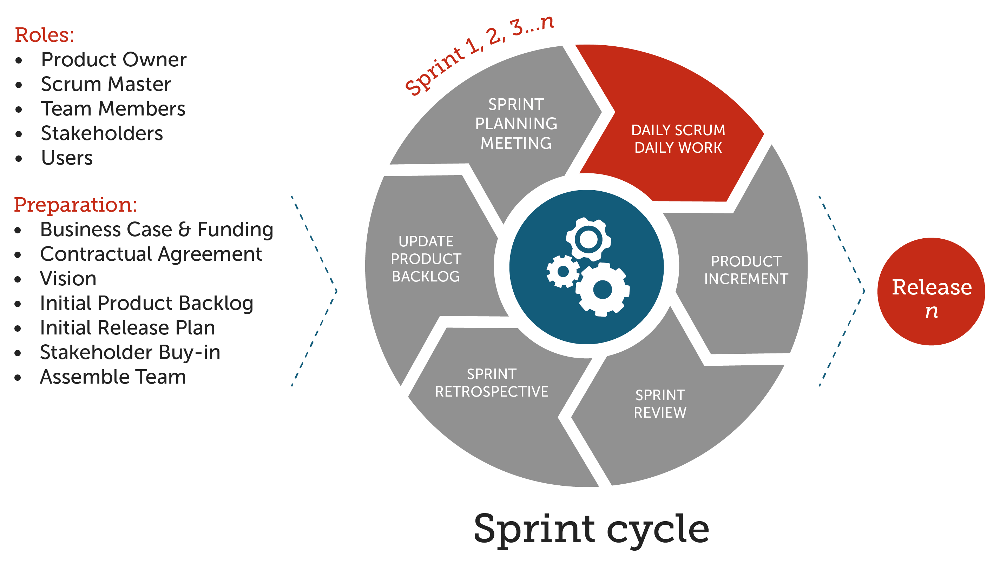
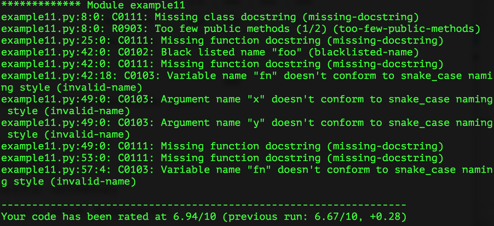
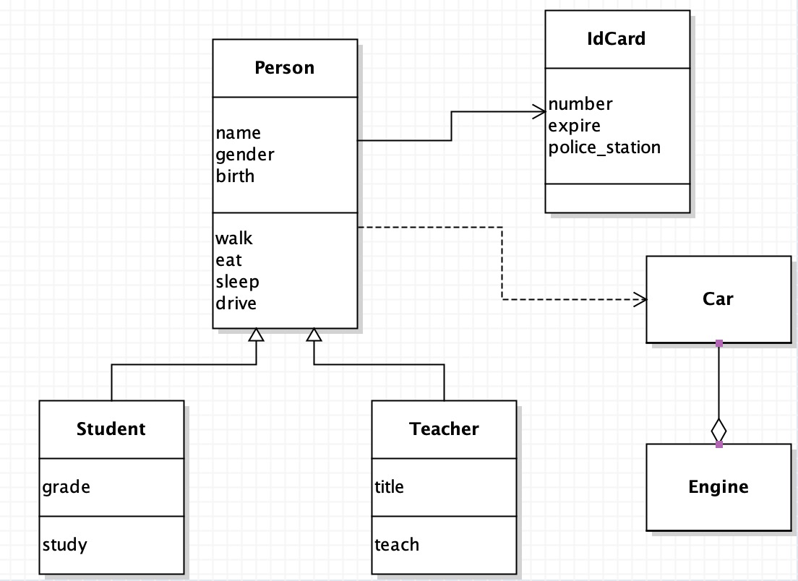

# Python - 100 ngày từ người mới đến chuyên gia

> Tác giả gốc: jackfrued  
> Kho này là bản dịch tiếng Việt của dự án [jackfrued/Python-100-Days](https://github.com/jackfrued/Python-100-Days). Nội dung gốc bằng tiếng Trung và mọi bản quyền thuộc về tác giả. Bản dịch được thực hiện cho cộng đồng người học Python tại Việt Nam.  
> Xem thêm [NOTICE.md](NOTICE.md), [CREDITS.md](CREDITS.md), [CONTRIBUTING.md](CONTRIBUTING.md).

## Python - 100 ngày từ người mới đến chuyên gia

> **Tác giả**: jackfrued
>
> Dự án được biên soạn nhằm giúp người học tiếp cận ngôn ngữ lập trình Python từ con số 0 đến cấp độ chuyên nghiệp, bao gồm lý thuyết nền tảng, cơ sở dữ liệu, phát triển web với Django, thu thập dữ liệu web và khoa học dữ liệu / học máy.
>
> **Bản dịch tiếng Việt**: Xem thêm thông tin chi tiết tại [NOTICE.md](NOTICE.md), [CREDITS.md](CREDITS.md) và [CONTRIBUTING.md](CONTRIBUTING.md).


### Phân tích lĩnh vực ứng dụng và định hướng nghề nghiệp của Python

Nói một cách đơn giản, Python là một ngôn ngữ lập trình "tao nhã", "rõ ràng" và "đơn giản".

 - Đường cong học tập thấp, người không chuyên cũng có thể nhanh chóng bắt đầu
 - Hệ thống mã nguồn mở với hệ sinh thái cộng đồng vô cùng mạnh mẽ
 - Ngôn ngữ thông dịch, khả năng đa nền tảng hoàn hảo
 - Ngôn ngữ định kiểu động, hỗ trợ cả lập trình hướng đối tượng và lập trình hàm
 - Mức độ quy chuẩn mã nguồn cao, tính dễ đọc vượt trội

Python có đất dụng võ trong tất cả các lĩnh vực sau:

 - Phát triển back-end - Python / Java / Go / PHP
 - DevOps - Python / Shell / Ruby
 - Thu thập dữ liệu (Crawler) - Python / C++ / Java
 - Giao dịch định lượng (Quantitative Trading) - Python / C++ / R
 - Khoa học dữ liệu - Python / R / Julia / Matlab
 - Học máy - Python / R / C++ / Julia
 - Kiểm thử tự động - Python / Shell

Là một lập trình viên Python, dựa theo sở thích cá nhân và định hướng nghề nghiệp, các lĩnh vực việc làm có thể lựa chọn cũng rất đa dạng:

- Kỹ sư phát triển Python back-end (máy chủ, nền tảng đám mây, giao diện dữ liệu API)
- Kỹ sư vận hành Python (vận hành tự động, SRE, DevOps)
- Chuyên viên phân tích dữ liệu Python (Data Analyst, Business Intelligence, vận hành số hóa)
- Nhà khoa học dữ liệu Python (Data Scientist, học máy, học sâu, chuyên gia thuật toán)
- Kỹ sư crawler Python (KHÔNG khuyến khích đi theo hướng này!!!)
- Kỹ sư kiểm thử Python (kiểm thử tự động, phát triển công cụ kiểm thử)

> **Giải thích**: Hiện tại, **con đường khoa học dữ liệu là một hướng đi vô cùng hot**, bởi vì dù là ngành công nghệ thông tin hay các ngành truyền thống đều đã tích lũy một lượng dữ liệu khổng lồ. Mọi ngành nghề đều cần các nhà khoa học dữ liệu tìm ra nhiều giá trị thương mại hơn từ dữ liệu hiện có, từ đó cung cấp căn cứ dữ liệu cho các quyết định của doanh nghiệp - đây chính là cái gọi là "ra quyết định dựa trên dữ liệu" (data-driven decision making).

Một vài lời khuyên dành cho người mới bắt đầu:

- **Make English as your working language.** (Hãy biến tiếng Anh thành ngôn ngữ làm việc của bạn)
- **Practice makes perfect.** (Trăm hay không bằng tay quen / Rèn luyện tạo nên sự hoàn hảo)
- **All experience comes from the mistakes you've made.** (Mọi kinh nghiệm đều bắt nguồn từ những sai lầm bạn từng mắc phải)
- **Don't be a freeloader.** (Hãy học cách chia sẻ, đừng chỉ biết nhận mà không cho đi)
- **Embrace AI to boost your productivity.** (Hãy đón nhận AI để nâng cao hiệu suất của bạn)

### Ngày 01~20 - Cơ sở ngôn ngữ Python

#### Ngày 01 - [Làm quen với Python](./Ngay01-20/01.lam-quen-voi-python.md)

1. Giới thiệu về Python
    - Biên niên sử Python
    - Ưu điểm và nhược điểm của Python
    - Lĩnh vực ứng dụng của Python
2. Cài đặt môi trường Python
    - Môi trường Windows
    - Môi trường macOS

#### Ngày 02 - [Chương trình Python đầu tiên](./Ngay01-20/02.chuong-trinh-python-dau-tien.md)

1. Công cụ viết mã nguồn
2. Xin chào thế giới (Hello World)
3. Chú thích mã nguồn của bạn

#### Ngày 03 - [Biến trong ngôn ngữ Python](./Ngay01-20/03.bien-trong-python.md)

1. Một số kiến thức phổ thông
2. Biến và kiểu dữ liệu
3. Quy tắc đặt tên biến
4. Sử dụng biến

#### Ngày 04 - [Toán tử trong ngôn ngữ Python](./Ngay01-20/04.toan-tu-trong-python.md)

1. Toán tử số học
2. Toán tử gán
3. Toán tử so sánh và toán tử logic
4. Ứng dụng toán tử và biểu thức
    - Chuyển đổi nhiệt độ Fahrenheit và Celsius
    - Tính chu vi và diện tích hình tròn
    - Kiểm tra năm nhuận

#### Ngày 05 - [Cấu trúc rẽ nhánh](./Ngay01-20/05.cau-truc-re-nhanh.md)

1. Xây dựng cấu trúc rẽ nhánh với `if` và `else`
2. Xây dựng cấu trúc rẽ nhánh với `match` và `case`
3. Ứng dụng cấu trúc rẽ nhánh
    - Tính giá trị hàm từng khúc (hàm phân đoạn)
    - Quy đổi điểm hệ 100 sang xếp loại
    - Tính chu vi và diện tích tam giác

#### Ngày 06 - [Cấu trúc vòng lặp](./Ngay01-20/06.cau-truc-vong-lap.md)

1. Vòng lặp `for-in`
2. Vòng lặp `while`
3. `break` và `continue`
4. Cấu trúc vòng lặp lồng nhau
5. Ứng dụng cấu trúc vòng lặp
    - Kiểm tra số nguyên tố
    - Ước số chung lớn nhất
    - Trò chơi đoán số

#### Ngày 07 - [Thực hành cấu trúc rẽ nhánh và vòng lặp](./Ngay01-20/07.thuc-hanh-re-nhanh-va-vong-lap.md)

1. Ví dụ 1: Các số nguyên tố trong phạm vi 100
2. Ví dụ 2: Dãy số Fibonacci
3. Ví dụ 3: Tìm số hoa thủy tiên (Narcissistic number)
4. Ví dụ 4: Bài toán trăm đồng trăm gà
5. Ví dụ 5: Trò chơi xúc xắc CRAPS

#### Ngày 08 - [Cấu trúc dữ liệu thông dụng: Danh sách - 1](./Ngay01-20/08.cau-truc-du-lieu-danh-sach-1.md)

1. Tạo danh sách (list)
2. Các phép toán trên danh sách
3. Duyệt qua các phần tử

#### Ngày 09 - [Cấu trúc dữ liệu thông dụng: Danh sách - 2](./Ngay01-20/09.cau-truc-du-lieu-danh-sach-2.md)

1. Các phương thức của danh sách
    - Thêm và xóa phần tử
    - Vị trí và tần suất xuất hiện của phần tử
    - Sắp xếp và đảo ngược phần tử
2. Biểu thức tạo danh sách (List comprehension)
3. Danh sách lồng nhau
4. Ứng dụng của danh sách

#### Ngày 10 - [Cấu trúc dữ liệu thông dụng: Tuple](./Ngay01-20/10.cau-truc-du-lieu-tuple.md)

1. Định nghĩa và các phép toán trên tuple
2. Thao tác đóng gói (pack) và giải nén (unpack)
3. Hoán đổi giá trị hai biến
4. So sánh giữa tuple và danh sách

#### Ngày 11 - [Cấu trúc dữ liệu thông dụng: Chuỗi](./Ngay01-20/11.cau-truc-du-lieu-chuoi.md)

1. Định nghĩa chuỗi (string)
    - Ký tự thoát (Escape character)
    - Chuỗi thô (Raw string)
    - Biểu diễn ký tự đặc biệt
2. Các phép toán trên chuỗi
    - Nối chuỗi và lặp chuỗi
    - Phép so sánh
    - Phép toán thành viên (`in`, `not in`)
    - Lấy độ dài chuỗi
    - Chỉ mục (indexing) và cắt lát (slicing)
3. Duyệt qua các ký tự
4. Các phương thức của chuỗi
    - Các thao tác liên quan đến chữ hoa / chữ thường
    - Thao tác tìm kiếm
    - Kiểm tra tính chất chuỗi
    - Định dạng chuỗi (Formatting)
    - Thao tác cắt tỉa khoảng trắng (Trim / Strip)
    - Thao tác thay thế
    - Tách chuỗi và ghép chuỗi (Split / Join)
    - Mã hóa và giải mã (Encode / Decode)
    - Các phương thức khác

#### Ngày 12 - [Cấu trúc dữ liệu thông dụng: Tập hợp](./Ngay01-20/12.cau-truc-du-lieu-tap-hop.md)

1. Tạo tập hợp (set)
2. Duyệt qua các phần tử
3. Các phép toán trên tập hợp
    - Phép toán thành viên
    - Phép toán hai ngôi (hợp, giao, hiệu, đối xứng)
    - Phép so sánh tập hợp
4. Các phương thức của tập hợp
5. Tập hợp bất biến (frozenset)

#### Ngày 13 - [Cấu trúc dữ liệu thông dụng: Từ điển](./Ngay01-20/13.cau-truc-du-lieu-tu-dien.md)

1. Tạo và sử dụng từ điển (dict)
2. Các phép toán trên từ điển
3. Các phương thức của từ điển
4. Ứng dụng của từ điển

#### Ngày 14 - [Hàm và module](./Ngay01-20/14.ham-va-module.md)

1. Định nghĩa hàm
2. Tham số của hàm
    - Tham số theo vị trí và tham số theo tên (từ khóa)
    - Giá trị mặc định của tham số
    - Tham số biến đổi (khả biến)
3. Quản lý hàm bằng module
4. Module và hàm trong thư viện chuẩn

#### Ngày 15 - [Thực hành ứng dụng hàm](./Ngay01-20/15.thuc-hanh-ung-dung-ham.md)

1. Ví dụ 1: Mã xác thực ngẫu nhiên
2. Ví dụ 2: Kiểm tra số nguyên tố
3. Ví dụ 3: Ước số chung lớn nhất và bội số chung nhỏ nhất
4. Ví dụ 4: Thống kê dữ liệu
5. Ví dụ 5: Chọn số ngẫu nhiên vé số song cầu (Double Color Ball)

#### Ngày 16 - [Sử dụng hàm nâng cao](./Ngay01-20/16.su-dung-ham-nang-cao.md)

1. Hàm bậc cao (Higher-order function)
2. Hàm ẩn danh (Lambda function)
3. Hàm từng phần (Partial function)

#### Ngày 17 - [Ứng dụng nâng cao của hàm](./Ngay01-20/17.ung-dung-cao-cap-cua-ham.md)

1. Decorator (Bộ trang trí)
2. Lời gọi đệ quy

#### Ngày 18 - [Nhập môn lập trình hướng đối tượng](./Ngay01-20/18.nhap-mon-lap-trinh-huong-doi-tuong.md)

1. Lớp (class) và đối tượng (object)
2. Định nghĩa lớp
3. Khởi tạo và sử dụng đối tượng
4. Phương thức khởi tạo
5. Các trụ cột của lập trình hướng đối tượng
6. Ví dụ thực hành hướng đối tượng
    - Ví dụ 1: Đồng hồ điện tử số
    - Ví dụ 2: Điểm trên mặt phẳng

#### Ngày 19 - [Lập trình hướng đối tượng nâng cao](./Ngay01-20/19.lap-trinh-huong-doi-tuong-nang-cao.md)

1. Khả năng hiển thị và decorator thuộc tính (`@property`)
2. Thuộc tính động
3. Phương thức tĩnh (`@staticmethod`) và phương thức lớp (`@classmethod`)
4. Kế thừa và đa hình

#### Ngày 20 - [Ứng dụng lập trình hướng đối tượng](./Ngay01-20/20.ung-dung-lap-trinh-huong-doi-tuong.md)

1. Trò chơi bài Poker
2. Hệ thống tính lương

### Ngày 21~30 - Ứng dụng ngôn ngữ Python

#### Ngày 21 - [Đọc ghi file và xử lý ngoại lệ](./Ngay21-30/21.doc-ghi-file-va-xu-ly-ngoai-le.md)

1. Mở và đóng file
2. Đọc và ghi file văn bản
3. Cơ chế xử lý ngoại lệ
4. Cú pháp trình quản lý ngữ cảnh (Context Manager)
5. Đọc và ghi file nhị phân

#### Ngày 22 - [Tuần tự hóa và giải tuần tự hóa đối tượng](./Ngay21-30/22.tuan-tu-hoa-va-giai-tuan-tu-hoa-doi-tuong.md)

1. Tổng quan về JSON
2. Đọc và ghi dữ liệu định dạng JSON
3. Công cụ quản lý gói pip
4. Sử dụng API mạng để lấy dữ liệu

#### Ngày 23 - [Đọc và ghi file CSV với Python](./Ngay21-30/23.doc-ghi-file-csv-voi-python.md)

1. Giới thiệu về file CSV
2. Ghi dữ liệu vào file CSV
3. Đọc dữ liệu từ file CSV

#### Ngày 24 - [Đọc và ghi file Excel với Python - 1](./Ngay21-30/24.doc-ghi-file-excel-voi-python-1.md)

1. Giới thiệu về Excel
2. Đọc file Excel
3. Ghi file Excel
4. Tùy chỉnh kiểu dáng (style)
5. Tính toán bằng công thức

#### Ngày 25 - [Đọc và ghi file Excel với Python - 2](./Ngay21-30/25.doc-ghi-file-excel-voi-python-2.md)

1. Giới thiệu về Excel
2. Đọc file Excel
3. Ghi file Excel
4. Tùy chỉnh kiểu dáng (style)
5. Tạo biểu đồ thống kê

#### Ngày 26 - [Thao tác với file Word và PowerPoint bằng Python](./Ngay21-30/26.thao-tac-file-word-va-powerpoint-voi-python.md)

1. Thao tác với tài liệu Word
2. Tạo bài thuyết trình PowerPoint

#### Ngày 27 - [Thao tác với file PDF bằng Python](./Ngay21-30/27.thao-tac-file-pdf-voi-python.md)

1. Trích xuất văn bản từ PDF
2. Xoay và ghép đè các trang
3. Mã hóa file PDF
4. Chèn watermark hàng loạt
5. Tạo file PDF mới

#### Ngày 28 - [Xử lý hình ảnh với Python](./Ngay21-30/28.xu-ly-hinh-anh-voi-python.md)

1. Kiến thức nhập môn
2. Xử lý hình ảnh với Pillow
3. Vẽ hình với Pillow

#### Ngày 29 - [Gửi email và tin nhắn SMS với Python](./Ngay21-30/29.gui-email-va-tin-nhan-voi-python.md)

1. Gửi email
2. Gửi tin nhắn SMS

#### Ngày 30 - [Ứng dụng biểu thức chính quy](./Ngay21-30/30.ung-dung-bieu-thuc-chinh-quy.md)

1. Kiến thức liên quan về biểu thức chính quy (Regex)
2. Hỗ trợ biểu thức chính quy trong Python
    - Ví dụ 1: Xác thực dữ liệu nhập vào
    - Ví dụ 2: Trích xuất nội dung
    - Ví dụ 3: Thay thế nội dung
    - Ví dụ 4: Tách câu văn dài

### Ngày 31~35 - Các nội dung liên quan khác

#### Ngày 31 - [Nâng cao ngôn ngữ Python](./Ngay31-35/31.python-nang-cao.md)

1. Các điểm kiến thức quan trọng
2. Cấu trúc dữ liệu và thuật toán
3. Cách sử dụng hàm
4. Kiến thức hướng đối tượng liên quan
5. Iterator và Generator
6. Lập trình đồng thời (Concurrency)

#### Ngày 32~33 - [Nhập môn Web front-end](./Ngay31-35/32-33.nhap-mon-web-front-end.md)

1. Dùng thẻ HTML xây dựng nội dung trang web
2. Dùng CSS định kiểu trang web
3. Dùng JavaScript xử lý hành vi tương tác
4. Nhập môn Vue.js
5. Sử dụng Element UI
6. Sử dụng Bootstrap

#### Ngày 34~35 - [Làm chủ hệ điều hành Linux](./Ngay31-35/34-35.lam-chu-he-dieu-hanh-linux.md)

1. Lịch sử phát triển hệ điều hành và tổng quan Linux
2. Các lệnh Linux cơ bản
3. Các tiện ích thực tế trong Linux
4. Hệ thống tệp (Filesystem) của Linux
5. Ứng dụng trình soạn thảo Vim
6. Biến môi trường và lập trình Shell
7. Cài đặt phần mềm và cấu hình dịch vụ
8. Truy cập và quản trị mạng
9. Các nội dung liên quan khác

### Ngày 36~45 - Cơ sở dữ liệu cơ bản và nâng cao

#### Ngày 36 - [Tổng quan về CSDL quan hệ và MySQL](./Ngay36-45/36.tong-quan-csdl-quan-he-va-mysql.md)

1. Tổng quan về cơ sở dữ liệu quan hệ
2. Giới thiệu về MySQL
3. Cài đặt MySQL
4. Các lệnh MySQL cơ bản

#### Ngày 37 - [Chi tiết về SQL - DDL](./Ngay36-45/37.chi-tiet-sql-ddl.md)

1. Tạo cơ sở dữ liệu và tạo bảng
2. Xóa bảng và chỉnh sửa bảng

#### Ngày 38 - [Chi tiết về SQL - DML](./Ngay36-45/38.chi-tiet-sql-dml.md)

1. Thao tác `INSERT`
2. Thao tác `DELETE`
3. Thao tác `UPDATE`

#### Ngày 39 - [Chi tiết về SQL - DQL](./Ngay36-45/39.chi-tiet-sql-dql.md)

1. Chiếu (Projection) và bí danh (Alias)
2. Lọc dữ liệu (`WHERE`)
3. Xử lý giá trị NULL
4. Khử trùng lặp (`DISTINCT`)
5. Sắp xếp (`ORDER BY`)
6. Hàm tổng hợp (Aggregate functions)
7. Truy vấn lồng nhau (Subquery)
8. Thao tác gom nhóm (`GROUP BY`)
9. Phép nối bảng (JOIN)
    - Tích Descartes
    - Nối trong (Inner Join)
    - Nối tự nhiên (Natural Join)
    - Nối ngoài (Outer Join)
10. Hàm cửa sổ (Window functions)
    - Định nghĩa cửa sổ
    - Hàm xếp hạng
    - Hàm lấy giá trị

#### Ngày 40 - [Chi tiết về SQL - DCL](./Ngay36-45/40.chi-tiet-sql-dcl.md)

1. Tạo người dùng
2. Cấp quyền (`GRANT`)
3. Thu hồi quyền (`REVOKE`)

#### Ngày 41 - [Tính năng mới của MySQL](./Ngay36-45/41.tinh-nang-moi-cua-mysql.md)

- Kiểu dữ liệu JSON
- Hàm cửa sổ (Window functions)
- Biểu thức bảng chung (CTE)

#### Ngày 42 - [View, hàm và thủ tục lưu trữ](./Ngay36-45/42.view-ham-va-thu-tuc.md)

1. View (Khung nhìn)
    - Kịch bản sử dụng
    - Tạo view
    - Hạn chế sử dụng
2. Hàm
    - Hàm tích hợp sẵn
    - Hàm do người dùng định nghĩa (UDF)
3. Thủ tục lưu trữ (Stored Procedure)
    - Tạo thủ tục
    - Gọi thủ tục

#### Ngày 43 - [Chỉ mục](./Ngay36-45/43.chi-muc.md)

1. Kế hoạch thực thi (Execution Plan)
2. Nguyên lý hoạt động của chỉ mục (Index)
3. Tạo chỉ mục
    - Chỉ mục thông thường
    - Chỉ mục duy nhất (Unique Index)
    - Chỉ mục tiền tố (Prefix Index)
    - Chỉ mục kết hợp (Composite Index)
4. Những điều cần lưu ý

#### Ngày 44 - [Kết nối CSDL MySQL từ Python](./Ngay36-45/44.ket-noi-mysql-tu-python.md)

1. Cài đặt thư viện bên thứ ba
2. Khởi tạo kết nối
3. Tạo con trỏ (Cursor)
4. Thực thi câu lệnh SQL
5. Thu thập dữ liệu qua con trỏ
6. Cam kết giao dịch (Commit) và khôi phục (Rollback)
7. Giải phóng kết nối
8. Viết kịch bản ETL

#### Ngày 45 - [Thực hành Hive](./Ngay36-45/45.thuc-hanh-hive.md)

1. Tổng quan về Hive
2. Thiết lập môi trường
3. Các lệnh thông dụng
4. Cú pháp cơ bản
5. Thao tác tạo bảng
6. Ghi dữ liệu
7. Các hàm thông dụng
8. Gom nhóm và tổng hợp
9. Thao tác lấy mẫu (Sampling)
10. Thao tác sắp xếp
11. Mở rộng hàng ngang (Explode / Lateral View)
12. Tối ưu hóa hiệu năng

### Ngày 46~60 - Thực chiến Django

#### Ngày 46 - [Bắt đầu nhanh với Django](./Ngay46-60/46.bat-dau-nhanh-voi-django.md)

1. Cơ chế hoạt động của ứng dụng Web
2. HTTP Request và HTTP Response
3. Tổng quan về framework Django
4. Bắt đầu nhanh trong 5 phút

#### Ngày 47 - [Đi sâu vào Model](./Ngay46-60/47.di-sau-vao-model.md)

1. Cấu hình cơ sở dữ liệu quan hệ
2. Sử dụng ORM để thực hiện các thao tác CRUD trên Model
3. Sử dụng trang quản trị Admin
4. Các thực tiễn tốt nhất cho Django Model
5. Tham khảo định nghĩa Model

#### Ngày 48 - [Tài nguyên tĩnh và yêu cầu Ajax](./Ngay46-60/48.tai-nguyen-tinh-va-yeu-cau-ajax.md)

1. Tải tài nguyên tĩnh
2. Tổng quan về Ajax
3. Hiện thực chức năng bình chọn bằng Ajax

#### Ngày 49 - [Cookie và Session](./Ngay46-60/49.cookie-va-session.md)

1. Theo dõi người dùng
2. Mối quan hệ giữa Cookie và Session
3. Cơ chế hỗ trợ Session của Django
4. Thao tác đọc ghi Cookie trong View function

#### Ngày 50 - [Tạo báo cáo và xuất file](./Ngay46-60/50.tao-bao-cao.md)

1. Tùy chỉnh Response Header qua `HttpResponse`
2. Xử lý tệp lớn bằng `StreamingHttpResponse`
3. Xuất báo cáo Excel bằng `xlwt`
4. Xuất báo cáo PDF bằng `reportlab`
5. Tạo biểu đồ giao diện bằng ECharts

#### Ngày 51 - [Ghi log và thanh công cụ Debug](./Ngay46-60/51.log-va-thanh-cong-cu-debug.md)

1. Cấu hình ghi log (logging)
2. Cấu hình Django-Debug-Toolbar
3. Tối ưu hóa mã nguồn ORM

#### Ngày 52 - [Ứng dụng Middleware](./Ngay46-60/52.ung-dung-middleware.md)

1. Middleware là gì
2. Các middleware tích hợp sẵn của Django
3. Tự định nghĩa middleware và các trường hợp ứng dụng

#### Ngày 53 - [Nhập môn tách biệt front-end và back-end](./Ngay46-60/53.nhap-mon-tach-biet-front-end-va-back-end.md)

1. Trả về dữ liệu định dạng JSON
2. Render trang web bằng Vue.js

#### Ngày 54 - [Kiến trúc RESTful và nhập môn DRF](./Ngay46-60/54.kien-truc-restful-va-nhap-mon-drf.md)

1. Tổng quan về REST
2. Nhập môn thư viện DRF (Django REST Framework)
3. Phát triển tách biệt front-end và back-end
4. Ứng dụng JWT (JSON Web Token)

#### Ngày 55 - [Kiến trúc RESTful và DRF nâng cao](./Ngay46-60/55.kien-truc-restful-va-drf-nang-cao.md)

1. Sử dụng Class-Based View (CBV)
2. Phân trang dữ liệu (Pagination)
3. Lọc dữ liệu (Filtering)

#### Ngày 56 - [Sử dụng bộ nhớ đệm](./Ngay46-60/56.su-dung-cache.md)

1. Định luật tối ưu website số 1
2. Cung cấp dịch vụ cache trong dự án Django bằng Redis
3. Đọc ghi cache trong View function
4. Sử dụng decorator để cache trang web
5. Cung cấp dịch vụ cache cho các API dữ liệu

#### Ngày 57 - [Tích hợp nền tảng bên thứ ba](./Ngay46-60/57.tich-hop-nen-tang-ben-thu-ba.md)

1. Điều khiển form tải lên file và xem trước hình ảnh
2. Cách phía server xử lý tệp tin được tải lên

#### Ngày 58 - [Tác vụ bất đồng bộ và tác vụ định kỳ](./Ngay46-60/58.tac-vu-bat-dong-bo-va-tac-vu-dinh-ky.md)

1. Định luật tối ưu website số 2
2. Cấu hình dịch vụ hàng đợi tin nhắn (Message Queue)
3. Bất đồng bộ hóa tác vụ bằng Celery trong dự án
4. Hiện thực tác vụ định kỳ bằng Celery trong dự án

#### Ngày 59 - [Kiểm thử đơn vị](./Ngay46-60/59.kiem-thu-don-vi.md)

#### Ngày 60 - [Triển khai dự án lên production](./Ngay46-60/60.trien-khai-du-an.md)

1. Kiểm thử đơn vị trong Python
2. Cơ chế hỗ trợ kiểm thử đơn vị trong Django
3. Sử dụng hệ thống quản lý phiên bản
4. Cấu hình và sử dụng uWSGI
5. Tách biệt động tĩnh (Static/Dynamic Separation) và cấu hình Nginx
6. Cấu hình HTTPS
7. Cấu hình phân giải tên miền (DNS)

### Ngày 61~65 - Thu thập dữ liệu web (Web Scraping / Crawling)

#### Ngày 61 - [Tổng quan về thu thập dữ liệu web](./Ngay61-65/61.tong-quan-thu-thap-du-lieu-mang.md)

1. Khái niệm web crawler và các lĩnh vực ứng dụng
2. Thảo luận về tính hợp pháp của web crawler
3. Các công cụ liên quan để phát triển web crawler
4. Cấu trúc của một chương trình crawler

#### Ngày 62 - Thu thập và phân tích dữ liệu

1. [Sử dụng thư viện bên thứ ba `requests` để thu thập dữ liệu](./Ngay61-65/62.lay-tai-nguyen-mang-voi-python-1.md)
2. [Ba phương pháp phân tích trang web](./Ngay61-65/62.phan-tich-trang-html-voi-python-2.md)
    - Phân tích bằng biểu thức chính quy (Regex)
    - Phân tích bằng XPath
    - Phân tích bằng CSS selector

#### Ngày 63 - Lập trình đồng thời trong Python

1. [Đa luồng](./Ngay61-65/63.lap-trinh-dong-thoi-trong-python-1.md)
2. [Đa tiến trình](./Ngay61-65/63.lap-trinh-dong-thoi-trong-python-2.md)
3. [I/O bất đồng bộ](./Ngay61-65/63.lap-trinh-dong-thoi-trong-python-3.md)

#### Ngày 64 - [Thu thập nội dung động với Selenium](./Ngay61-65/64.thu-thap-noi-dung-dong-voi-selenium.md)

1. Cài đặt Selenium
2. Tải trang web
3. Tìm kiếm phần tử và mô phỏng hành vi người dùng
4. Chờ ngầm định (Implicit wait) và chờ tường minh (Explicit wait)
5. Thực thi mã JavaScript
6. Vượt cơ chế chống crawler trong Selenium
7. Cấu hình trình duyệt không giao diện (Headless browser)

#### Ngày 65 - [Giới thiệu framework crawler Scrapy](./Ngay61-65/65.gioi-thieu-framework-crawler-scrapy.md)

1. Các thành phần cốt lõi của Scrapy
2. Quy trình làm việc của Scrapy
3. Cài đặt Scrapy và tạo dự án
4. Viết chương trình Spider
5. Viết Middleware và Pipeline
6. Tệp cấu hình Scrapy

### Ngày 66~80 - Phân tích dữ liệu bằng Python

#### Ngày 66 - [Tổng quan về phân tích dữ liệu](./Ngay66-80/66.tong-quan-phan-tich-du-lieu.md)

1. Trách nhiệm của chuyên viên phân tích dữ liệu (Data Analyst)
2. Bộ kỹ năng của chuyên viên phân tích dữ liệu
3. Các thư viện liên quan đến phân tích dữ liệu

#### Ngày 67 - [Chuẩn bị môi trường](./Ngay66-80/67.chuan-bi-moi-truong.md)

1. Cài đặt và sử dụng Anaconda
    - Các lệnh conda thông dụng
2. Cài đặt và sử dụng JupyterLab
    - Cài đặt và khởi chạy
    - Mẹo nhỏ khi sử dụng

#### Ngày 68 - [Ứng dụng NumPy - 1](./Ngay66-80/68.ung-dung-numpy-1.md)

1. Tạo đối tượng mảng (ndarray)
2. Các thuộc tính của đối tượng mảng
3. Thao tác chỉ mục trên đối tượng mảng
    - Chỉ mục thông thường
    - Chỉ mục mảng số (Fancy indexing)
    - Chỉ mục boolean
    - Cắt lát (Slicing)
4. Ví dụ: Sử dụng mảng để xử lý hình ảnh

#### Ngày 69 - [Ứng dụng NumPy - 2](./Ngay66-80/69.ung-dung-numpy-2.md)

1. Các phương thức của đối tượng mảng
    - Lấy thông tin thống kê mô tả
    - Các phương thức liên quan khác

#### Ngày 70 - [Ứng dụng NumPy - 3](./Ngay66-80/70.ung-dung-numpy-3.md)

1. Các phép toán trên mảng
    - Phép toán giữa mảng và vô hướng (scalar)
    - Phép toán giữa mảng và mảng
2. Hàm một ngôi phổ quát (Universal unary functions)
3. Hàm hai ngôi phổ quát (Universal binary functions)
4. Cơ chế lan truyền (Broadcasting)
5. Các hàm thông dụng trong NumPy

#### Ngày 71 - [Ứng dụng NumPy - 4](./Ngay66-80/71.ung-dung-numpy-4.md)

1. Vector
2. Định thức (Determinant)
3. Ma trận (Matrix)
4. Đa thức (Polynomial)

#### Ngày 72 - [Pandas từ cơ bản đến nâng cao - 1](./Ngay66-80/72.pandas-tu-co-ban-den-nang-cao-1.md)

1. Tạo đối tượng Series
2. Các phép toán trên đối tượng Series
3. Thuộc tính và phương thức của Series

#### Ngày 73 - [Pandas từ cơ bản đến nâng cao - 2](./Ngay66-80/73.pandas-tu-co-ban-den-nang-cao-2.md)

1. Tạo đối tượng DataFrame
2. Thuộc tính và phương thức của DataFrame
3. Đọc và ghi dữ liệu trong DataFrame

#### Ngày 74 - [Pandas từ cơ bản đến nâng cao - 3](./Ngay66-80/74.pandas-tu-co-ban-den-nang-cao-3.md)

1. Tái định hình dữ liệu (Reshaping)
    - Ghép nối dữ liệu (Concatenation)
    - Gộp dữ liệu (Merge / Join)
2. Làm sạch dữ liệu (Data Cleaning)
    - Giá trị thiếu (Missing values)
    - Giá trị trùng lặp (Duplicate values)
    - Giá trị ngoại lai (Outliers)
    - Tiền xử lý dữ liệu

#### Ngày 75 - [Pandas từ cơ bản đến nâng cao - 4](./Ngay66-80/75.pandas-tu-co-ban-den-nang-cao-4.md)

1. Phân tích đa chiều dữ liệu (Pivot / Aggregation)
    - Thu thập thông tin thống kê mô tả
    - Sắp xếp và lấy các giá trị đầu dòng
    - Gom nhóm và tổng hợp (GroupBy & Aggregation)
    - Bảng xoay (Pivot Table) và bảng chéo (Crosstab)
2. Trình bày dữ liệu

#### Ngày 76 - [Pandas từ cơ bản đến nâng cao - 5](./Ngay66-80/76.pandas-tu-co-ban-den-nang-cao-5.md)

1. Tính toán tăng trưởng cùng kỳ (YoY) và liên hoàn (MoM)
2. Tính toán theo cửa sổ trượt (Window calculations)
3. Xác định hệ số tương quan

#### Ngày 77 - [Pandas từ cơ bản đến nâng cao - 6](./Ngay66-80/77.pandas-tu-co-ban-den-nang-cao-6.md)

1. Sử dụng chỉ mục
    - Chỉ mục phạm vi (RangeIndex)
    - Chỉ mục phân loại (CategoricalIndex)
    - Chỉ mục đa cấp (MultiIndex)
    - Chỉ mục khoảng (IntervalIndex)
    - Chỉ mục ngày giờ (DatetimeIndex)

#### Ngày 78 - [Trực quan hóa dữ liệu - 1](./Ngay66-80/78.truc-quan-hoa-du-lieu-1.md)

1. Cài đặt và import matplotlib
2. Tạo canvas (Figure)
3. Tạo hệ trục tọa độ (Axes)
4. Vẽ biểu đồ
    - Biểu đồ đường (Line chart)
    - Biểu đồ phân tán (Scatter plot)
    - Biểu đồ cột (Bar chart)
    - Biểu đồ tròn (Pie chart)
    - Biểu đồ tần số (Histogram)
    - Biểu đồ hộp (Box plot)
5. Hiển thị và lưu biểu đồ

#### Ngày 79 - [Trực quan hóa dữ liệu - 2](./Ngay66-80/79.truc-quan-hoa-du-lieu-2.md)

1. Các biểu đồ nâng cao
    - Biểu đồ bong bóng (Bubble chart)
    - Biểu đồ miền (Area chart)
    - Biểu đồ radar (Radar chart)
    - Biểu đồ hoa hồng (Rose chart)
    - Biểu đồ 3D

#### Ngày 80 - [Trực quan hóa dữ liệu - 3](./Ngay66-80/80.truc-quan-hoa-du-lieu-3.md)

1. Seaborn
2. Pyecharts

### Ngày 81~90 - Học máy

#### Ngày 81 - [Bàn về học máy](./Ngay81-90/81.ban-ve-hoc-may.md)

1. Lịch sử phát triển của trí tuệ nhân tạo
2. Học máy là gì
3. Các lĩnh vực ứng dụng của học máy
4. Phân loại học máy
5. Các bước thực hiện bài toán học máy
6. Trải nghiệm bài toán học máy đầu tiên

#### Ngày 82 - [Thuật toán k láng giềng gần nhất](./Ngay81-90/82.thuat-toan-k-lang-gieng-gan-nhat.md)

1. Đo lường khoảng cách
2. Giới thiệu tập dữ liệu
3. Hiện thực phân loại bằng kNN
4. Đánh giá mô hình
5. Tinh chỉnh tham số
6. Hiện thực hồi quy bằng kNN

#### Ngày 83 - [Cây quyết định và Rừng ngẫu nhiên](./Ngay81-90/83.cay-quyet-dinh-va-rung-ngau-nhien.md)

1. Xây dựng cây quyết định
    - Lựa chọn đặc trưng
    - Phân chia dữ liệu
    - Cắt tỉa cây (Pruning)
2. Hiện thực mô hình cây quyết định
3. Tổng quan về Rừng ngẫu nhiên (Random Forest)

#### Ngày 84 - [Thuật toán Naive Bayes](./Ngay81-90/84.thuat-toan-naive-bayes.md)

1. Định lý Bayes
2. Thuật toán Naive Bayes
3. Nguyên lý thuật toán
    - Giai đoạn huấn luyện
    - Giai đoạn dự đoán
    - Hiện thực bằng mã nguồn
4. Ưu điểm và nhược điểm của thuật toán

#### Ngày 85 - [Mô hình hồi quy](./Ngay81-90/85.mo-hinh-hoi-quy.md)

1. Phân loại các mô hình hồi quy
2. Tính toán hệ số hồi quy
3. Giới thiệu tập dữ liệu mới
4. Hiện thực mã nguồn hồi quy tuyến tính
5. Đánh giá mô hình hồi quy
6. Đưa vào thành phần chuẩn hóa (Regularization)
7. Một cách hiện thực khác của hồi quy tuyến tính
8. Hồi quy đa thức
9. Hồi quy Logistic

#### Ngày 86 - [Thuật toán phân cụm K-Means](./Ngay81-90/86.thuat-toan-phan-cum-k-means.md)

1. Nguyên lý thuật toán
2. Mô tả toán học
3. Hiện thực bằng mã nguồn

#### Ngày 87 - [Thuật toán học kết hợp](./Ngay81-90/87.thuat-toan-hoc-ket-hop.md)

1. Phân loại thuật toán
2. AdaBoost
3. GBDT
4. XGBoost
5. LightGBM

#### Ngày 88 - [Mô hình mạng nơ-ron](./Ngay81-90/88.mo-hinh-mang-no-ron.md)

1. Cấu tạo cơ bản
2. Nguyên lý hoạt động
3. Hiện thực bằng mã nguồn
4. Ưu điểm và nhược điểm của mô hình

#### Ngày 89 - [Nhập môn xử lý ngôn ngữ tự nhiên](./Ngay81-90/89.nhap-mon-xu-ly-ngon-ngu-tu-nhien.md)

1. Mô hình túi từ (Bag of Words)
2. Vector nhúng từ (Word Vector)
3. NPLM và RNN
4. Seq2Seq
5. Transformer

#### Ngày 90 - [Thực hành học máy](./Ngay81-90/90.thuc-hanh-hoc-may.md)

1. Khám phá dữ liệu (EDA)
2. Kỹ thuật đặc trưng (Feature Engineering)
3. Huấn luyện mô hình
4. Đánh giá mô hình
5. Triển khai mô hình

### Ngày 91~99 - [Phát triển dự án nhóm](./Ngay91-100)

#### Ngày 91 - [Vấn đề và giải pháp trong phát triển dự án nhóm](./Ngay91-100/91.van-de-va-giai-phap-trong-phat-trien-du-an-nhom.md)

1. Mô hình quy trình phần mềm
   - Mô hình quy trình cổ điển (Mô hình thác nước - Waterfall)
     - Phân tích tính khả thi (nghiên cứu làm hay không làm), đầu ra là "Báo cáo phân tích tính khả thi".
     - Phân tích yêu cầu (nghiên cứu làm cái gì), đầu ra là "Đặc tả yêu cầu phần mềm (SRS)" và bản thiết kế nguyên mẫu giao diện sản phẩm (Prototype).
     - Thiết kế tổng thể và thiết kế chi tiết, đầu ra là sơ đồ mô hình khái niệm (sơ đồ ER), sơ đồ mô hình vật lý, sơ đồ lớp (Class diagram), sơ đồ tuần tự (Sequence diagram), v.v.
     - Lập trình / Kiểm thử.
     - Triển khai đưa lên production / Bảo trì.

     Nhược điểm lớn nhất của mô hình thác nước là không thể đón nhận sự thay đổi yêu cầu, phải kết thúc toàn bộ quy trình mới nhìn thấy sản phẩm, dễ làm tinh thần của nhóm sa sút.
   - Phát triển linh hoạt (Scrum / Agile) - Product Owner, Scrum Master, Đội ngũ phát triển - Sprint
     - Product Backlog (Câu chuyện người dùng, nguyên mẫu sản phẩm).
     - Cuộc họp lập kế hoạch (Đánh giá và ước lượng ngân sách/thời gian).
     - Phát triển hàng ngày (Họp đứng hàng ngày, kỹ thuật Pomodoro, lập trình cặp, kiểm thử trước, tái cấu trúc mã nguồn...).
     - Sửa lỗi (Mô tả vấn đề, các bước tái hiện, kiểm thử viên, người được chỉ định xử lý).
     - Phát hành phiên bản.
     - Cuộc họp đánh giá (Showcase / Review, người dùng cần tham gia).
     - Cuộc họp hồi tưởng (Retrospective, tổng kết lại chu kỳ sprint hiện tại).

     > Bổ sung: Tuyên ngôn phát triển phần mềm linh hoạt (Agile Manifesto)
     >
     > - **Cá nhân và tương tác** hơn là quy trình và công cụ
     > - **Phần mềm chạy tốt** hơn là tài liệu đầy đủ
     > - **Cộng tác với khách hàng** hơn là đàm phán hợp đồng
     > - **Phản hồi với sự thay đổi** hơn là bám sát kế hoạch

     

     > Vai trò: Product Owner (quyết định làm gì, người chốt yêu cầu cuối cùng), Scrum Master / Trưởng nhóm (giải quyết các vướng mắc, tập trung vào cách làm việc tốt hơn, che chắn các tác động bên ngoài đến nhóm phát triển), Nhóm phát triển (nhân sự thực thi dự án, cụ thể là lập trình viên và kiểm thử viên).

     > Chuẩn bị trước: Kịch bản kinh doanh và ngân sách, hợp đồng, tầm nhìn, yêu cầu sản phẩm ban đầu, kế hoạch phát hành ban đầu, cổ phần, thành lập đội ngũ.

     > Nhóm Agile thông thường có quy mô từ 8-10 người.

     > Ước lượng khối lượng công việc: Lượng hóa nhiệm vụ phát triển, bao gồm thiết kế nguyên mẫu, thiết kế logo, thiết kế UI, phát triển front-end, v.v., cố gắng chia nhỏ mỗi công việc thành nhiệm vụ nhỏ nhất với tiêu chuẩn thời gian hoàn thành không quá 2 ngày, sau đó ước lượng tổng thời gian dự án. Dán từng nhiệm vụ lên bảng Kanban, bảng chia làm 3 phần: To do (chờ làm), In progress (đang làm) và Done (đã hoàn thành).

2. Xây dựng đội ngũ dự án

   - Cơ cấu và vai trò trong nhóm

     ```mermaid
     graph TD
         CEO["Ban Giám đốc / Lãnh đạo"]
         PO["Product Owner / Quản lý sản phẩm"]
         SM["Scrum Master / Trưởng nhóm dự án"]
         TL["Tech Lead / Kiến trúc sư trưởng"]
         UI["UI/UX Designer"]
         FE["Nhóm Lập trình Front-end"]
         BE["Nhóm Lập trình Back-end"]
         QA["Nhóm Kiểm thử (QA / QC)"]
         DevOps["Nhóm Vận hành / DevOps"]

         CEO --> PO
         CEO --> SM
         PO --> UI
         SM --> TL
         TL --> FE
         TL --> BE
         SM --> QA
         TL --> DevOps
     ```

   - Quy chuẩn lập trình và đánh giá mã nguồn (Code review) (`flake8`, `pylint`)

     

   - Một số "quy ước" trong Python (vui lòng tham khảo [《Quy ước lập trình Python - Cách viết code chuẩn Pythonic》](./ngoai-truyen/quy-uoc-lap-trinh-python.md))

   - Các nguyên nhân ảnh hưởng đến tính dễ đọc của mã nguồn:

     - Chú thích code quá ít hoặc không có chú thích
     - Viết mã vi phạm các thực tiễn tốt nhất của ngôn ngữ
     - Lập trình theo phản mẫu (Anti-pattern: code spaghetti, lập trình copy-paste, lập trình kiêu ngạo, v.v.)
   
3. Giới thiệu các công cụ phát triển nhóm
   - Quản lý phiên bản: Git, Mercurial
   - Quản lý lỗi (Defect / Issue): [Gitlab](https://about.gitlab.com/), [Redmine](http://www.redmine.org.cn/)
   - Công cụ quy trình Agile khép kín: [ZenTao (Thiền Đạo)](https://www.zentao.net/), [JIRA](https://www.atlassian.com/software/jira/features)
   - Tích hợp liên tục (CI): [Jenkins](https://jenkins.io/), [Travis-CI](https://travis-ci.org/)

   Vui lòng tham khảo [《Vấn đề và giải pháp trong phát triển dự án nhóm》](./Ngay91-100/91.van-de-va-giai-phap-trong-phat-trien-du-an-nhom.md).

##### Chọn đề tài dự án và thấu hiểu nghiệp vụ

1. Xác định phạm vi chọn đề tài

   - CMS (Phía người dùng): Website tổng hợp tin tức, cộng đồng hỏi đáp/chia sẻ, website đánh giá phim/sách, v.v.
   - MIS (Người dùng + Quản trị): KMS (quản lý tri thức), hệ thống đánh giá KPI, HRS (nhân sự), hệ thống CRM, hệ thống chuỗi cung ứng, hệ thống quản lý kho, v.v.
   - Back-end cho App (Trang quản trị + Giao diện API): Mua bán đồ cũ, báo chí tạp chí, thương mại điện tử chuyên biệt, tin tức tổng hợp, du lịch, mạng xã hội, đọc sách, v.v.
   - Loại hình khác: Dựa theo kinh nghiệm làm việc và nền tảng ngành nghề của bản thân, nghiệp vụ dễ hiểu và dễ kiểm soát.

2. Thấu hiểu yêu cầu, phân chia module và phân công nhiệm vụ

   - Thấu hiểu yêu cầu: Động não (Brainstorming) và phân tích đối thủ cạnh tranh.
   - Phân chia module: Vẽ sơ đồ tư duy (XMind), mỗi module là một nhánh cây, mỗi chức năng cụ thể là một nút lá (diễn đạt bằng động từ), cần đảm bảo mỗi nút lá không thể sinh thêm nút mới, xác định độ quan trọng, mức độ ưu tiên và khối lượng công việc của từng nút lá.
   - Phân công nhiệm vụ: Do người phụ trách dự án căn cứ vào các chỉ số trên để phân bổ công việc cho từng thành viên trong nhóm.

   ```mermaid
   graph TD
       Root["Dự án Website/App"]
       M1["Phân hệ Người dùng"]
       M2["Phân hệ Bài viết / Nội dung"]
       M3["Phân hệ Bình luận"]
       M4["Phân hệ Quản trị (Admin)"]

       M1 --> M1_1["Đăng ký tài khoản"]
       M1 --> M1_2["Đăng nhập / Đăng xuất"]
       M1 --> M1_3["Quản lý trang cá nhân"]

       M2 --> M2_1["Đăng bài viết mới"]
       M2 --> M2_2["Duyệt / Xem bài viết"]
       M2 --> M2_3["Tìm kiếm nội dung"]

       M3 --> M3_1["Thêm bình luận"]
       M3 --> M3_2["Xóa bình luận"]
       M3 --> M3_3["Xem danh sách bình luận"]
       M3 --> M3_4["Bình chọn / Thích bình luận"]

       M4 --> M4_1["Quản lý người dùng"]
       M4 --> M4_2["Kiểm duyệt nội dung"]
       M4 --> M4_3["Thống kê dữ liệu báo cáo"]
   ```

3. OOAD và thiết kế cơ sở dữ liệu

  - Sơ đồ lớp trong UML (Ngôn ngữ mô hình hóa thống nhất)

    

  - Tạo bảng từ model (Kỹ thuật xuôi - Forward engineering), ví dụ trong dự án Django có thể dùng các lệnh sau để tạo bảng hai chiều:

    ```Shell
    python manage.py makemigrations app
    python manage.py migrate
    ```

  - Sử dụng PowerDesigner để vẽ sơ đồ mô hình vật lý (PDM).

    ```mermaid
    erDiagram
        TB_USER ||--o{ TB_COMMENT : "tạo"
        TB_POST ||--o{ TB_COMMENT : "chứa"
        TB_ROLE ||--o{ TB_USER : "gán cho"
        TB_ROLE ||--o{ TB_ROLE_PERM : "chứa"
        TB_PERM ||--o{ TB_ROLE_PERM : "thuộc về"

        TB_USER {
            int user_id PK "Mã người dùng"
            string username "Tên đăng nhập"
            string password "Mật khẩu mã hóa"
            string email "Email"
            int role_id FK "Mã vai trò"
            datetime created_at "Ngày tạo"
        }

        TB_POST {
            int post_id PK "Mã bài viết"
            string title "Tiêu đề bài viết"
            text content "Nội dung"
            int author_id FK "Tác giả"
            datetime published_at "Ngày xuất bản"
        }

        TB_COMMENT {
            int comment_id PK "Mã bình luận"
            text content "Nội dung bình luận"
            int user_id FK "Người bình luận"
            int post_id FK "Mã bài viết"
            datetime created_at "Thời gian bình luận"
        }

        TB_ROLE {
            int role_id PK "Mã vai trò"
            string role_name "Tên vai trò"
            string description "Mô tả vai trò"
        }

        TB_PERM {
            int perm_id PK "Mã quyền hạn"
            string perm_name "Tên quyền"
            string resource "Đường dẫn tài nguyên"
        }
    ```

  - Tạo model từ bảng dữ liệu (Kỹ thuật ngược - Reverse engineering), ví dụ trong dự án Django có thể dùng lệnh sau để tự sinh model:

    ```Shell
    python manage.py inspectdb > app/models.py
    ```

#### Ngày 92 - [Chi tiết về công nghệ container Docker](./Ngay91-100/92.chi-tiet-cong-nghe-container-docker.md)

1. Giới thiệu về Docker
2. Cài đặt Docker
3. Sử dụng Docker để tạo container (Nginx, MySQL, Redis, Gitlab, Jenkins)
4. Xây dựng Docker image (Viết Dockerfile và các chỉ lệnh liên quan)
5. Điều phối container (Docker Compose)
6. Quản lý cụm cluster (Kubernetes)

#### Ngày 93 - [Tối ưu hiệu năng MySQL](./Ngay91-100/93.toi-uu-hieu-nang-mysql.md)

1. Các nguyên tắc cơ bản
2. Storage engine InnoDB
3. Sử dụng chỉ mục và những điều cần lưu ý
4. Phân vùng dữ liệu (Partitioning)
5. Tối ưu hóa câu lệnh SQL
6. Tối ưu hóa cấu hình
7. Tối ưu hóa kiến trúc

#### Ngày 94 - [Thiết kế giao diện API mạng](./Ngay91-100/94.thiet-ke-api-mang.md)

1. Nguyên tắc thiết kế
    - Các vấn đề cốt lõi
    - Các vấn đề khác
2. Biên soạn tài liệu API

#### Ngày 95 - [Phát triển dự án thương mại với Django](./Ngay91-100/95.phat-trien-du-an-thuong-mai-voi-django.md)

##### Các vấn đề chung trong phát triển dự án

1. Cấu hình cơ sở dữ liệu (Đa cơ sở dữ liệu, sao chép Master-Slave, định tuyến cơ sở dữ liệu)
2. Cấu hình bộ nhớ đệm (Cache phân vùng, thiết lập key, thiết lập timeout, sao chép Master-Slave, khôi phục sự cố với Sentinel)
3. Cấu hình ghi log (Logging)
4. Phân tích và gỡ lỗi (Django-Debug-Toolbar)
5. Các module Python hữu ích (Tính toán ngày tháng, xử lý ảnh, mã hóa dữ liệu, API bên thứ ba)

##### Thiết kế REST API

1. Kiến trúc RESTful
   - [Hiểu về kiến trúc RESTful](http://www.ruanyifeng.com/blog/2011/09/restful.html)
   - [Hướng dẫn thiết kế RESTful API](http://www.ruanyifeng.com/blog/2014/05/restful_api.html)
   - [Thực tiễn tốt nhất cho RESTful API](http://www.ruanyifeng.com/blog/2018/10/restful-api-best-practices.html)
2. Biên soạn tài liệu giao diện API
   - [RAP2](http://rap2.taobao.org/)
   - [YAPI](http://yapi.demo.qunar.com/)
3. Ứng dụng [django-REST-framework](https://www.django-rest-framework.org/)

##### Phân tích các điểm trọng tâm và khó khăn trong dự án

1. Sử dụng cache để giải tỏa áp lực cho cơ sở dữ liệu - Redis
2. Sử dụng hàng đợi tin nhắn để giải phóng khớp nối (decoupling) và cắt giảm đỉnh tải (load shedding) - Celery + RabbitMQ

#### Ngày 96 - [Kiểm thử phần mềm và kiểm thử tự động](./Ngay91-100/96.kiem-thu-phan-mem-va-kiem-thu-tu-dong.md)

##### Kiểm thử đơn vị

1. Các loại kiểm thử
2. Viết kiểm thử đơn vị (`unittest`, `pytest`, `nose2`, `tox`, `ddt`...)
3. Độ bao phủ kiểm thử (`coverage`)

##### Triển khai dự án Django

1. Chuẩn bị trước khi triển khai
   - Các thiết lập quan trọng (`SECRET_KEY` / `DEBUG` / `ALLOWED_HOSTS` / Cache / Database)
   - HTTPS / `CSRF_COOKIE_SECURE` / `SESSION_COOKIE_SECURE`
   - Cấu hình liên quan đến ghi log
2. Ôn lại các lệnh Linux thông dụng
3. Cài đặt và cấu hình các dịch vụ Linux thông dụng
4. Sử dụng uWSGI/Gunicorn và Nginx
   - So sánh giữa Gunicorn và uWSGI
     - Đối với các ứng dụng đơn giản không cần tùy biến nhiều, Gunicorn là một lựa chọn tốt; đường cong học tập của uWSGI dốc hơn nhiều so với Gunicorn, các tham số mặc định của Gunicorn đã có thể đáp ứng hầu hết ứng dụng.
     - uWSGI hỗ trợ triển khai trên các môi trường không đồng nhất.
     - Do bản thân Nginx hỗ trợ uWSGI, khi chạy trên production thường triển khai ghép cặp Nginx với uWSGI, và uWSGI là một WSGI middleware đầy đủ tính năng và khả năng tùy biến cao.
     - Về mặt hiệu năng, Gunicorn và uWSGI thực tế thể hiện tương đương nhau.
5. Sử dụng công nghệ ảo hóa (Docker) để triển khai môi trường kiểm thử và môi trường production

##### Kiểm thử hiệu năng

1. Sử dụng AB (ApacheBench)
2. Sử dụng SQLslap
3. Sử dụng sysbench

##### Kiểm thử tự động

1. Sử dụng Shell và Python để kiểm thử tự động
2. Sử dụng Selenium để thực hiện kiểm thử tự động
   - Selenium IDE
   - Selenium WebDriver
   - Selenium Remote Control
3. Giới thiệu công cụ kiểm thử Robot Framework

#### Ngày 97 - [Phân tích điểm kỹ thuật website thương mại điện tử](./Ngay91-100/97.phan-tich-ky-thuat-website-thuong-mai-dien-tu.md)

1. Mô hình kinh doanh và các điểm yêu cầu cốt lõi
2. Thiết kế mô hình vật lý
3. Đăng nhập qua bên thứ ba (Third-party login / OAuth)
4. Làm nóng trước bộ nhớ đệm (Cache Warming) và truy vấn cache
5. Hiện thực chức năng giỏ hàng
6. Tích hợp chức năng thanh toán
7. Vấn đề Flash Sale (bán hàng chớp nhoáng) và Overselling (bán vượt số lượng)
8. Quản lý tài nguyên tĩnh
9. Giải pháp tìm kiếm toàn văn (Full-text search)

#### Ngày 98 - [Triển khai dự án lên production và tối ưu hiệu năng](./Ngay91-100/98.trien-khai-du-an-va-toi-uu-hieu-nang.md)

1. Tối ưu hóa cơ sở dữ liệu MySQL
2. Tối ưu hóa hiệu năng Web server
   - Cấu hình cân bằng tải với Nginx (Load Balancing)
   - Đảm bảo tính sẵn sàng cao với Keepalived (High Availability)
3. Tối ưu hóa hiệu năng mã nguồn
   - Đa luồng
   - Bất đồng bộ hóa
4. Tối ưu hóa truy cập tài nguyên tĩnh
   - Lưu trữ đám mây (Cloud Storage)
   - Mạng phân phối nội dung (CDN)

#### Ngày 99 - [Các câu hỏi thường gặp khi phỏng vấn](./Ngay91-100/99.cau-hoi-chung-khi-phong-van.md)

1. Cơ sở khoa học máy tính
2. Cơ sở Python
3. Các vấn đề liên quan đến Web framework
4. Các vấn đề liên quan đến crawler
5. Phân tích dữ liệu
6. Các câu hỏi liên quan đến dự án

### Ngày 100 - [Nội dung bổ sung](./Ngay91-100/100.noi-dung-bo-sung.md)

- Cẩm nang phỏng vấn
    - Cẩm nang phỏng vấn Python
    - Cẩm nang phỏng vấn SQL (Dành cho Data Analyst)
    - Cẩm nang phỏng vấn phân tích kinh doanh (Business Analyst)
    - Cẩm nang phỏng vấn học máy
- Nền tảng toán học cho học máy
- Học sâu
    - Thị giác máy tính (Computer Vision)
    - Mô hình ngôn ngữ lớn (Large Language Models - LLM)
