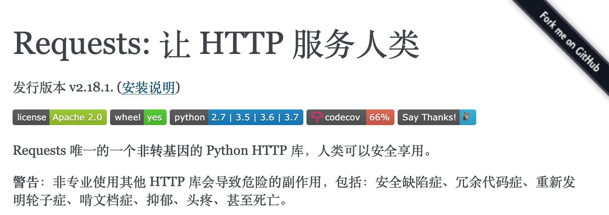

## Python thú vị

Bởi vì những đoạn mã dưới đây đều vô cùng đơn giản, đơn giản đến mức bạn có thể hoàn thành trực tiếp ngay trong môi trường tương tác của Python. Tất nhiên, môi trường tương tác đi kèm mặc định của Python khá bất tiện khi sử dụng, khuyến khích mọi người dùng ipython. Bạn có thể sử dụng lệnh dưới đây để cài đặt ipython, sau khi cài đặt thành công, gõ lệnh `ipython` để vào môi trường tương tác.

```Shell
pip install ipython
```

hoặc

```Shell
pip3 install ipython
```

Những ưu điểm trực quan nhất của ipython:

1. Có thể dùng `?` hoặc `??` để tra cứu trợ giúp.
2. Có thể dùng `!` để gọi các lệnh của hệ thống.
3. Có thể dùng phím `Tab` để tự động hoàn thành mã (auto-complete).
4. Có thể dùng các lệnh ma thuật (magic commands), chẳng hạn như `%timeit`.

### Không có công cụ chuyên dụng vẫn chỉnh sửa ảnh được bằng code

1. Cài đặt thư viện bên thứ ba pillow.

   PIL (Python Imaging Library) trên thực tế đã là thư viện chuẩn cho xử lý ảnh trên nền tảng Python. PIL có tính năng vô cùng mạnh mẽ trong khi API lại rất đơn giản, dễ sử dụng. Tuy nhiên PIL chỉ hỗ trợ đến Python 2.7 và đã nhiều năm không còn ai duy trì, vì vậy một nhóm tình nguyện viên đã xây dựng một phiên bản tương thích dựa trên PIL mang tên [Pillow](https://github.com/python-pillow/Pillow). Ngoài việc hỗ trợ Python 3.x, Pillow còn bổ sung rất nhiều tính năng mới hữu ích và thú vị.

   ```Shell
   pip install pillow
   ```

   hoặc

   ```Shell
   pip3 install pillow
   ```

2. Tải hình ảnh.

   ```Python
   from PIL import Image

   chiling = Image.open('chiling.jpg')
   chiling.show()
   ```

3. Áp dụng bộ lọc (filter).

   ```Shell
   from PIL import ImageFilter

   chiling.filter(ImageFilter.EMBOSS).show()
   chiling.filter(ImageFilter.CONTOUR).show()
   ```

4. Cắt và dán ảnh.

   ```Python
   rect = 220, 690, 265, 740 
   watch = chiling.crop(rect)
   watch.show()
   blured_watch = watch.filter(ImageFilter.GaussianBlur(4))
   chiling.paste(blured_watch, (220, 690))
   chiling.show()
   ```

5. Tạo ảnh gương (lật ảnh).

   ```Python
   chiling2 = chiling.transpose(Image.FLIP_LEFT_RIGHT)
   chiling2.show()
   ```

6. Tạo ảnh thu nhỏ (thumbnail).

   ```Python
   width, height = chiling.size
   width, height = int(width * 0.4), int(height * 0.4)
   chiling.thumbnail((width, height))
   ```

7. Ghép ảnh.

   ```Python
   frame = Image.open('frame.jpg')
   frame.show()
   frame.paste(chiling, (210, 150))
   frame.paste(chiling2, (522, 150))
   frame.show()
   ```

Những kiến thức trên cũng có nội dung tương ứng tại [Ngày 15](https://github.com/jackfrued/Python-100-Days/blob/master/Day01-15/15.%E5%9B%BE%E5%83%8F%E5%92%8C%E5%8A%9E%E5%85%AC%E6%96%87%E6%A1%A3%E5%A4%84%E7%90%86.md) trong dự án [Python-100-Days](https://github.com/jackfrued/Python-100-Days).

### Gửi video chúc mừng hàng loạt cho bạn bè WeChat

1. Cài đặt thư viện bên thứ ba itchat.

   [itchat](https://itchat.readthedocs.io/zh/latest/) là một giao diện mã nguồn mở cho tài khoản cá nhân WeChat, việc gọi WeChat bằng Python chưa bao giờ dễ dàng đến thế.

   ```Shell
   pip install itchat
   ```

   hoặc

   ```Shell
   pip3 install itchat
   ```

2. Đăng nhập WeChat.

   ```Python
   import itchat

   itchat.auto_login()
   ```

   > **Giải thích**: Dùng ứng dụng WeChat của bạn quét mã QR xuất hiện trên màn hình là hoàn tất thao tác đăng nhập. Sau khi đăng nhập mới có thể lấy thông tin bạn bè và gửi tin nhắn cho bạn bè.

3. Tìm bạn bè của mình.

   ```Python
   friends_list = itchat.get_friends(update=True)
   print(len(friends_list))
   luohao = friends_list[0]
   props = ['NickName', 'Signature', 'Sex']
   for prop in props:
       print(luohao[prop])
   ```

   > **Giải thích**: `friends_list` tương đương với một danh sách, phần tử đầu tiên trong danh sách chính là bản thân mình.

4. Chọn ngẫu nhiên 5 người bạn, lấy username, nickname và chữ ký (status) của họ.

   ```Python
   lucky_friends = random.sample(friends_list[1:], 5) 
   props = ['NickName', 'Signature', 'City']
   for friend in lucky_friends:
       for prop in props:
           print(friend[prop] or 'Không có thông tin này')    
       print('-' * 80)
   ```

5. Gửi tin nhắn văn bản cho bạn bè.

   ```Python
   itchat.send_msg('Rất cần một phong bao lì xì để cứu rỗi tâm hồn sa ngã này!!!', toUserName='@8e06606db03f0e28d0ff884083f727e6')
   ```

6. Gửi video hàng loạt cho những người bạn may mắn.

   ```Python
   lucky_friends = random.sample(friends_list[1:], 5) 
   for friend in lucky_friends:
       username = friend['UserName']
       itchat.send_video('/Users/Hao/Desktop/my_test_video.mp4', toUserName=username)
   ```

Sử dụng itchat còn làm được rất nhiều điều khác, chẳng hạn khi có bạn bè gửi tin nhắn cho bạn rồi thu hồi lại, nếu muốn xem tin nhắn đã bị thu hồi đó, itchat hoàn toàn có thể làm được (đăng ký một hàm hook nhận tin nhắn, vui lòng tham khảo [bài viết trên CSDN](https://blog.csdn.net/enweitech/article/details/79585043)); hay ví dụ khác, đôi khi chúng ta muốn biết một người bạn nào đó có xóa hay chặn (cho vào danh sách đen) mình hay không, cũng có thể tận dụng tính năng nhóm chat được đóng gói trong itchat, người không phải bạn bè hoặc nằm trong danh sách đen sẽ không thể thêm vào nhóm chat, thông qua giá trị trả về của hàm tạo nhóm chat là có thể xác định mối quan hệ giữa bạn và người đó.

### Xem tin tức nóng hổi không cần dùng ứng dụng client

1. Cài đặt thư viện requests. (Nhấp xem [tài liệu chính thức](https://2.python-requests.org/zh_CN/latest/))

   

   ```Shell
   pip install requests
   ```

   hoặc

   ```Shell
   pip3 install requests
   ```

2. Thu thập dữ liệu tin tức hoặc lấy dữ liệu tin tức thông qua giao diện API.

   ```Python
   import requests

   resp = requests.get('http://api.tianapi.com/allnews/?key=Vui_long_dung_key_ban_tu_dang_ky&col=7&num=50')
   ```

   > **Giải thích**: Ở trên sử dụng giao diện dữ liệu do TianAPI (天行数据) cung cấp. Nếu cần, bạn có thể tự vào trang web của [TianAPI](https://www.tianapi.com/) để đăng ký kích hoạt. Khi gọi giao diện cần điền mã key mà hệ thống cấp phát sau khi đăng ký thành công.

3. Dùng giải tuần tự hóa (deserialize) để phân tích chuỗi JSON thành dictionary và lấy danh sách tin tức.

   ```Python
   import json

   newslist = json.loads(resp.text)['newslist']
   ```

4. Duyệt qua danh sách tin tức bằng vòng lặp, tìm tin tức bạn quan tâm, ví dụ: Huawei.

   ```Python
   for news in newslist:
       title = news['title']
       url = news['url']
       if 'Huawei' in title or '华为' in title:
           print(title)
           print(url)
   ```

5. Gọi cổng SMS (SMS Gateway) để gửi tin nhắn đến điện thoại di động, thông báo tiêu đề tin tức đang theo dõi kèm đường dẫn liên kết.

   ```Python
   import re

   pattern = re.compile(r'https*:\/\/[^\/]*\/(?P<url>.*)') 
   matcher = pattern.match(url)

   if matcher:
       url = matcher.group('url')
       resp = requests.post(
           url='http://sms-api.luosimao.com/v1/send.json',
           auth=('api', 'key-Vui_long_dung_key_ban_tu_dang_ky'),
           data={
               'mobile': '13548041193',
               'message': f'Phát hiện tin tức bạn có thể quan tâm - {title}, xem chi tiết tại https://news.china.com/{url}. 【Khóa học nhỏ Python】'
           },
           timeout=10,
           verify=False
       )
   ```

   > **Giải thích**: Đoạn mã trên sử dụng dịch vụ cổng SMS do Luosimao (螺丝帽) cung cấp. Việc sử dụng cổng SMS để gửi tin nhắn sẽ mất phí, tuy nhiên hầu hết các nền tảng đều cung cấp một số lượng tin nhắn thử nghiệm miễn phí nhất định. Gửi tin nhắn SMS bắt buộc phải tuân thủ quy định của nền tảng, những tin nhắn vi phạm sẽ không thể gửi đi. Mẫu tin nhắn SMS ("Phát hiện tin tức bạn có thể quan tâm - ###, xem chi tiết tại https://news.china.com/###.") và chữ ký SMS ("【Khóa học nhỏ Python】") sử dụng ở trên cần đăng nhập vào nền tảng quản trị Luosimao để cấu hình. Nếu chưa rõ cách cấu hình, bạn có thể liên hệ với nhân viên chăm sóc khách hàng của nền tảng để được hướng dẫn.
