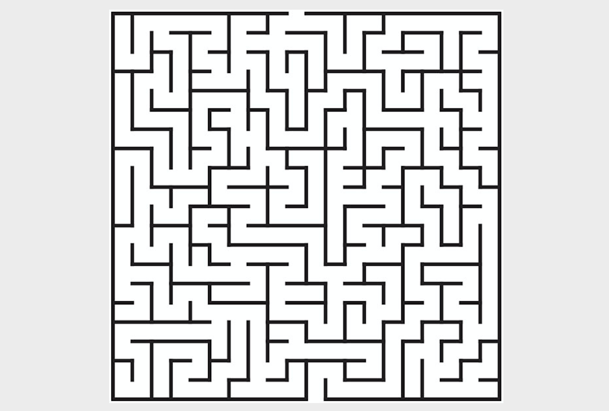
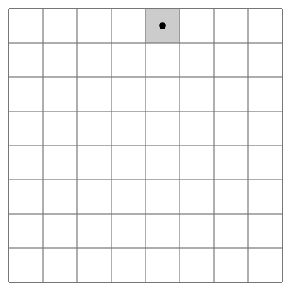
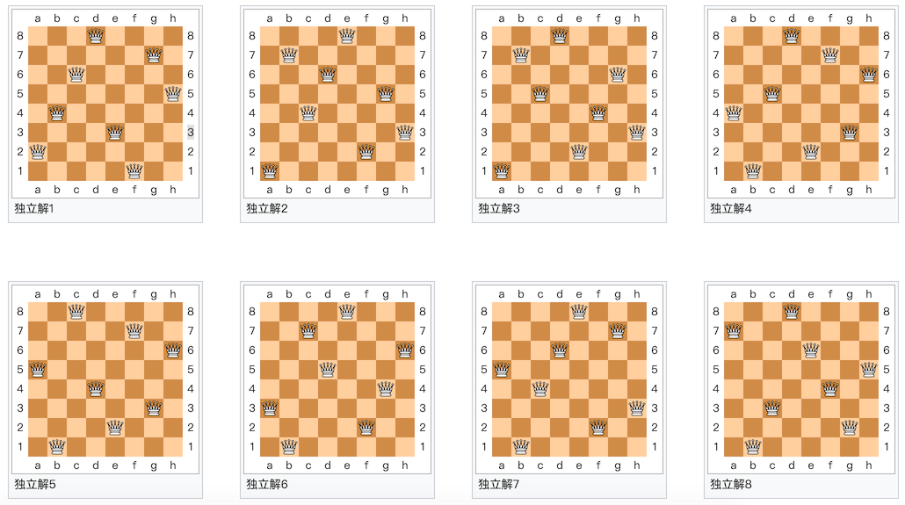

## Khóa học nhập môn thuật toán 2 - Tìm kiếm

Trong buổi học mở đầu tiên, chúng ta đã nói về phương pháp vét cạn. Phương pháp vét cạn còn được gọi là tìm kiếm thô bạo (brute-force search). Hôm nay, phương pháp quay lui (backtracking) mà chúng ta sắp tìm hiểu chính là một nhánh của tìm kiếm thô bạo. Tiếp theo đây, rất nhiều thuật toán mà chúng ta nhắc đến đều ít nhiều có liên quan đến khái niệm "đệ quy", vì vậy trước tiên chúng ta hãy cùng nói về "đệ quy".

### Đệ quy trong đời thực

Ngày xửa ngày xưa có một ngọn núi, trên núi có một ngôi chùa, trong chùa có một sư thầy già đang kể chuyện cho chú tiểu nghe! Chuyện kể rằng: Ngày xửa ngày xưa có một ngọn núi, trên núi có một ngôi chùa, trong chùa có một sư thầy già đang kể chuyện cho chú tiểu nghe! Chuyện kể rằng: Ngày xửa ngày xưa có một ngọn núi, trên núi có một ngôi chùa, trong chùa có một sư thầy già đang kể chuyện cho chú tiểu nghe! Chuyện kể rằng...

Nobita đang ở trong phòng, dùng TV thời gian để xem tình hình tương lai. Trên màn hình TV, Nobita đang ở trong phòng, dùng TV thời gian xem tình hình tương lai. Trên màn hình TV đó, Nobita lại đang ở trong phòng, dùng TV thời gian xem tình hình tương lai...

Định nghĩa đệ quy của giai thừa: $$0! = 1$$, $$n!=n*(n-1)!$$. Việc sử dụng chính đối tượng được định nghĩa để định nghĩa cho nó được gọi là định nghĩa đệ quy.

[Hiệu ứng Droste](https://vi.wikipedia.org/wiki/Hi%E1%BB%87u_%E1%BB%A9ng_Droste) là một dạng đệ quy trực quan. Trong bức ảnh, vật thể mà người phụ nữ cầm trên tay có một bức tranh nhỏ vẽ chính cô ấy đang cầm cùng vật thể đó, rồi bên trong bức tranh nhỏ lại có một bức tranh nhỏ hơn nữa vẽ cô ấy cầm cùng vật thể...


### Ứng dụng của đệ quy

Trong chương trình, nếu một hàm gọi lại chính nó một cách trực tiếp hoặc gián tiếp, chúng ta gọi đó là hàm đệ quy.

Viết hàm đệ quy có hai điểm cốt lõi:

1. Điều kiện dừng (thu hẹp) - khi nào thì kết thúc đệ quy.
2. Công thức đệ quy - mối quan hệ giữa mỗi phần tử với phần tử trước đó (hoặc *N* phần tử trước đó).

Ví dụ 1: Tính giai thừa.

```Python
def fac(num):
    if num == 0:
        return 1
    return num * fac(num - 1)
```

Python áp đặt giới hạn đối với độ sâu đệ quy (mặc định là 1000 tầng gọi hàm). Nếu muốn vượt qua giới hạn này, bạn có thể dùng phương pháp sau:

```Python
import sys

sys.setrecursionlimit(10000)
```

Ví dụ 2: Leo cầu thang - Cầu thang có *n* bậc, mỗi bước có thể đi 1 bậc, 2 bậc hoặc 3 bậc. Hỏi đi hết *n* bậc cầu thang có tất cả bao nhiêu cách đi khác nhau?

```Python
def climb(num):
    if num == 0:
        return 1
    elif num < 0:
        return 0
    return climb(num - 1) + climb(num - 2) + climb(num - 3)
```

**Lưu ý**: Hàm đệ quy ở trên sẽ có hiệu năng rất kém, bởi vì độ phức tạp thời gian tăng theo cấp số nhân.

Đoạn mã sau khi tối ưu hóa:

```Python
from functools import lru_cache


@lru_cache()
def climb(num):
    if num == 0:
        return 1
    elif num < 0:
        return 0
    return climb(num - 1) + climb(num - 2) + climb(num - 3)
```

Đoạn mã không sử dụng đệ quy:

```Python
def climb(num):
    a, b, c = 1, 2, 4
    for _ in range(num - 1):
        a, b, c = b, c, a + b + c
    return a
```

**Trọng tâm**: Khi có phương pháp tốt hơn, xin đừng cân nhắc dùng đệ quy.

### Thuật toán quay lui (Backtracking)

**Quay lui** là một nhánh thuộc [tìm kiếm thô bạo (brute-force)](https://vi.wikipedia.org/wiki/T%C3%ACm_ki%E1%BA%BFm_v%C3%A9t_c%E1%BA%A1n). Đối với một số bài toán tính toán nhất định, quay lui là một thuật toán tổng quát có thể tìm ra tất cả (hoặc một phần) lời giải, đặc biệt thích hợp cho các bài toán thỏa mãn ràng buộc (khi giải bài toán thỏa mãn ràng buộc, ta từng bước xây dựng các ứng viên giải pháp, và khi xác định một phần ứng viên nào đó không thể phát triển thành lời giải đúng thì lập tức từ bỏ tìm kiếm tiếp nhánh ứng viên đó cùng các ứng viên con mở rộng từ nó, quay ngược lại để thử nghiệm các phần ứng viên khác).

### Trường hợp kinh điển

Ví dụ 1: **Tìm đường trong mê cung**.



```Python
"""
Tìm đường trong mê cung
"""
import random
import sys

WALL = -1
ROAD = 0

ROWS = 10
COLS = 10


def find_way(maze, i=0, j=0, step=1):
    """Đi trong mê cung"""
    if 0 <= i < ROWS and 0 <= j < COLS and maze[i][j] == 0:
        maze[i][j] = step
        if i == ROWS - 1 and j == COLS - 1:
            print('=' * 20)
            display(maze)
            sys.exit(0)
        find_way(maze, i + 1, j, step + 1)
        find_way(maze, i, j + 1, step + 1)
        find_way(maze, i - 1, j, step + 1)
        find_way(maze, i, j - 1, step + 1)
        maze[i][j] = ROAD


def reset(maze):
    """Đặt lại mê cung"""
    for i in range(ROWS):
        for j in range(COLS):
            num = random.randint(1, 10)
            maze[i][j] = WALL if num > 7 else ROAD
    maze[0][0] = maze[ROWS - 1][COLS - 1] = ROAD


def display(maze):
    """Hiển thị mê cung"""
    for row in maze:
        for col in row:
            if col == -1:
                print('■', end=' ')
            elif col == 0:
                print('□', end=' ')
            else:
                print(f'{col}'.ljust(2), end='')
    print()


def main():
    """Hàm chính"""
    maze = [[0] * COLS for _ in range(ROWS)]
    reset(maze)
    display(maze)
    find_way(maze)
    print('Không có đường ra!!!')


if __name__ == '__main__':
    main()
```

**Giải thích:** Mã nguồn ở trên sử dụng cách đặt tường ngẫu nhiên để tạo mê cung. Để tìm hiểu phương pháp tạo mê cung tốt hơn, vui lòng tham khảo bài viết [《Đơn giản tạo mê cung Tile Based bằng phương pháp quay lui》](https://indienova.com/indie-game-development/generate-tile-based-maze-with-backtracking/).

Ví dụ 2: **Mã đi tuần (Knight's Tour)** - Quân mã trong cờ vua di chuyển theo luật của quân mã để đi qua tất cả các ô vuông trên bàn cờ, mỗi ô vuông chỉ được đi qua đúng một lần.



```Python
"""
Mã đi tuần
"""
import sys

SIZE = 8


def display(board):
    """Hiển thị bàn cờ"""
    for row in board:
        for col in row:
            print(f'{col}'.rjust(2, '0'), end=' ')
        print()


def patrol(board, i=0, j=0, step=1):
    """Đi tuần"""
    if 0 <= i < SIZE and 0 <= j < SIZE and board[i][j] == 0:
        board[i][j] = step
        if step == SIZE * SIZE:
            display(board)
            sys.exit(0)
        patrol(board, i + 1, j + 2, step + 1)
        patrol(board, i + 2, j + 1, step + 1)
        patrol(board, i + 2, j - 1, step + 1)
        patrol(board, i + 1, j - 2, step + 1)
        patrol(board, i - 1, j - 2, step + 1)
        patrol(board, i - 2, j - 1, step + 1)
        patrol(board, i - 2, j + 1, step + 1)
        patrol(board, i - 1, j + 2, step + 1)
        board[i][j] = 0


def main():
    """Hàm chính"""
    board = [[0] * SIZE for _ in range(SIZE)]
    patrol(board)


if __name__ == '__main__':
    main()
```

Ví dụ 3: **Tám quân hậu** - Làm thế nào để đặt tám quân hậu trên bàn cờ vua kích thước 8×8 sao cho không có quân hậu nào có thể ăn trực tiếp quân hậu khác? Để đạt được mục đích này, không có hai quân hậu nào được nằm trên cùng một hàng ngang, hàng dọc hoặc đường chéo.



**Giải thích**: Bài toán này quá kinh điển rồi, trên mạng có rất nhiều đáp án, xin để lại cho các bạn tự giải quyết.