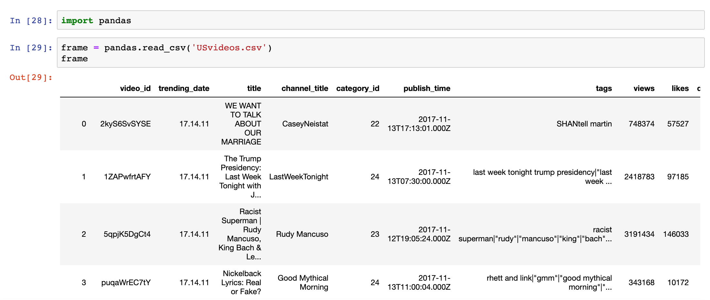

## Lập trình viên Python lương 500.000+ NDT viết code như thế nào

### Tại sao lại dùng Python để viết code

#### Không so sánh thì không thấy đau thương

> **Rất nhiều doanh nghiệp Internet và Internet di động đặt yêu cầu về hiệu suất phát triển (tốc độ ra mắt sản phẩm) cao hơn hiệu suất thực thi của chương trình**.

##### Ví dụ 1: hello, world

Phiên bản C:

```C
#include <stdio.h>

int main() {
    printf("hello, world\n");
    return 0;
}
```

Phiên bản Java:

```Java
class Example01 {
    
    public static void main(String[] args) {
        System.out.println("hello, world");
    }
}
```

Phiên bản Python:

```Python
print('hello, world')
```

##### Ví dụ 2: Tính tổng từ 1 đến 100

Phiên bản C:

```C
#include <stdio.h>

int main() {
    int total = 0;
    for (int i = 1; i <= 100; ++i) {
        total += i;
    }
    printf("%d\n", total);
	  return 0;
}
```

Phiên bản Python:

```Java
print(sum(range(1, 101)))
```

##### Ví dụ 3: Khởi tạo mảng (danh sách)

Phiên bản Java:

```Java
import java.util.Arrays;

public class Example03 {

    public static void main(String[] args) {
        boolean[] values = new boolean[10];
        Arrays.fill(values, true);
        System.out.println(Arrays.toString(values));

        int[] numbers = new int[10];
        for (int i = 0; i < numbers.length; ++i) {
            numbers[i] = i + 1;
        }
        System.out.println(Arrays.toString(numbers));
    }
}
```

Phiên bản Python:

```Python
values = [True] * 10
print(values)
numbers = [x for x in range(1, 11)]
print(numbers)
```

##### Ví dụ 4: Chọn số ngẫu nhiên cho xổ số hai màu (Double Color Ball)

Phiên bản Java:

```Java
import java.util.List;
import java.util.ArrayList;
import java.util.Collections;
import java.util.Scanner;
import java.util.concurrent.ThreadLocalRandom;

class Example03 {
    private static final List<Integer> RED_BALLS = new ArrayList<>();
    static {
        for (int i = 1; i <= 33; ++i) RED_BALLS.add(i);
    }
    
    public static void display(List<Integer> balls) {
        StringBuilder sb = new StringBuilder();
        for (int i = 0; i < balls.size(); i++) {
            sb.append(String.format("%02d ", balls.get(i)));
            if (i == 5) sb.append("| ");
        }
        System.out.println(sb.toString());
    }

    public static List<Integer> generate() {
        List<Integer> pool = new ArrayList<>(RED_BALLS);
        Collections.shuffle(pool);
        List<Integer> selectedBalls = pool.subList(0, 6);
        Collections.sort(selectedBalls);
        selectedBalls.add(ThreadLocalRandom.current().nextInt(1, 17));
        return selectedBalls;
    }
    
    public static void main(String[] args) {
        try (Scanner sc = new Scanner(System.in)) {
            System.out.print("Chọn ngẫu nhiên mấy vé: ");
            if (sc.hasNextInt()) {
                int num = sc.nextInt();
                for (int i = 0; i < num; ++i) {
                    display(generate());
                }
            }
        }
    }
}
```

Phiên bản Python:

```Python
import random

RED_RANGE = range(1, 34)
BLU_RANGE = range(1, 17)


def generate():
    red_balls = random.sample(RED_RANGE, 6)
    red_balls.sort()
    blue_ball = random.choice(BLU_RANGE)
    return red_balls, blue_ball


def display(sample):
    reds, blue = sample
    reds_str = ' '.join(f'{ball:02d}' for ball in reds)
    print(f'{reds_str} | {blue:02d}')


num = int(input('Chọn ngẫu nhiên mấy vé: '))
for _ in range(num):
    display(generate())
```

> **Lời nhắc ấm áp**: Hãy trân trọng cuộc sống, tránh xa mọi hình thức cờ bạc.

##### Ví dụ 5: Xây dựng một máy chủ HTTP đơn giản.

Phiên bản Java:

> **Giải thích**: Trước JDK 1.6, cần lập trình qua Socket, cụ thể lại chia thành hai cách là đa luồng và NIO. Từ JDK 1.6 trở đi, có thể sử dụng lớp `HttpServer` do package `com.sun.net.httpserver` cung cấp để thực hiện.

```Java
import com.sun.net.httpserver.HttpExchange;
import com.sun.net.httpserver.HttpHandler;
import com.sun.net.httpserver.HttpServer;

import java.io.IOException;
import java.io.OutputStream;
import java.net.InetSocketAddress;

class Example05 {

    public static void main(String[] arg) throws Exception {
        HttpServer server = HttpServer.create(new InetSocketAddress(8000), 0);
        server.createContext("/", new RequestHandler());
        server.start();
    }

    static class RequestHandler implements HttpHandler {
        
        @Override
        public void handle(HttpExchange exchange) throws IOException {
            String response = "<h1>hello, world</h1>";
            exchange.sendResponseHeaders(200, 0);
            try (OutputStream os = exchange.getResponseBody()) {
                os.write(response.getBytes());
            }
        }
    }
}
```

Phiên bản Python:

```Python
from http.server import HTTPServer, SimpleHTTPRequestHandler


class RequestHandler(SimpleHTTPRequestHandler):

    def do_GET(self):
        self.send_response(200)
        self.end_headers()
        self.wfile.write('<h1>hello, world</h1>'.encode())


server = HTTPServer(('', 8000), RequestHandler)
server.serve_forever()
```

hoặc

```Python
python3 -m http.server 8000
```

#### Một dòng code Python có thể làm được những gì

> **Nhiều khi, vấn đề của bạn chỉ cần một dòng code Python là có thể giải quyết xong**.

```Python
# Một dòng code thực hiện hàm tính giai thừa
fac = lambda x: __import__('functools').reduce(int.__mul__, range(1, x + 1), 1)

# Một dòng code thực hiện hàm tìm ước số chung lớn nhất (GCD)
gcd = lambda x, y: y % x and gcd(y % x, x) or x

# Một dòng code thực hiện hàm kiểm tra số nguyên tố
is_prime = lambda x: x > 1 and not [f for f in range(2, int(x ** 0.5) + 1) if x % f == 0]

# Một dòng code thực hiện sắp xếp nhanh (quicksort)
quick_sort = lambda items: len(items) and quick_sort([x for x in items[1:] if x < items[0]]) + [items[0]] + quick_sort([x for x in items[1:] if x > items[0]]) or items

# Tạo danh sách FizzBuzz
['Fizz'[x % 3 * 4:] + 'Buzz'[x % 5 * 4:] or x for x in range(1, 101)]
```

#### Mẫu thiết kế (Design Pattern) chưa bao giờ đơn giản đến thế

> **Python là ngôn ngữ kiểu động, rất nhiều mẫu thiết kế trong Python đã được đơn giản hóa hoặc làm mờ đi**.

Suy nghĩ: Làm thế nào để tối ưu hóa đoạn mã dưới đây.

```Python
def fib(num):
    if num in (1, 2):
        return 1
    return fib(num - 1) + fib(num - 2)
```

Mẫu Proxy (Proxy Pattern) trong Python có thể thực hiện thông qua decorator tích hợp sẵn hoặc tự định nghĩa.

```Python
from functools import lru_cache


@lru_cache()
def fib(num):
    if num in (1, 2):
        return 1
    return fib(num - 1) + fib(num - 2)


for n in range(1, 121):
    print(f'{n}: {fib(n)}')
```

> **Giải thích**: Thông qua decorator `lru_cache` của module `functools` trong thư viện chuẩn Python để thêm caching proxy cho hàm `fib`, lưu đệm kết quả trung gian khi thực thi hàm, tối ưu hiệu năng của code.

Mẫu Singleton (Singleton Pattern) trong Python có thể thực hiện thông qua decorator hoặc metaclass tự định nghĩa.

```Python
from functools import wraps
from threading import RLock


def singleton(cls):
    instances = {}
    lock = RLock()

    @wraps(cls)
    def wrapper(*args, **kwargs):
        if cls not in instances:
            with lock:
                if cls not in instances:
                    instances[cls] = cls(*args, **kwargs)
        return instances[cls]
```

> **Giải thích**: Các lớp cần triển khai mẫu Singleton chỉ cần gắn thêm decorator ở trên là xong.

Mẫu Prototype (Prototype Pattern) trong Python có thể thực hiện thông qua metaclass.

```Python
import copy


class PrototypeMeta(type):

    def __init__(cls, *args, **kwargs):
        super().__init__(*args, **kwargs)
        cls.clone = lambda self, is_deep=True: \
            copy.deepcopy(self) if is_deep else copy.copy(self)
```

> **Giải thích**: Thông qua metaclass, ta bổ sung một phương thức `clone` cho lớp được khai báo `metaclass=PrototypeMeta` nhằm sao chép đối tượng, tận dụng hàm `copy` và `deepcopy` trong module `copy` của thư viện chuẩn Python để lần lượt thực hiện sao chép nông (shallow copy) và sao chép sâu (deep copy).

#### Thu thập và phân tích dữ liệu chưa bao giờ đơn giản đến thế

> **Thu thập dữ liệu mạng là một trong những lĩnh vực mà Python xuất sắc nhất.**

Ví dụ: Lấy danh sách phim "Top 250" trên Douban.

```Python
import random
import time

import requests
from bs4 import BeautifulSoup

for page in range(10):
    resp = requests.get(
        url=f'https://movie.douban.com/top250?start={25 * page}',
        headers={'User-Agent': 'BaiduSpider'}
    )
    soup = BeautifulSoup(resp.text, "lxml")
    for elem in soup.select('a > span.title:nth-child(1)'):
        print(elem.text)
    time.sleep(random.random() * 5)
```

> **Sử dụng NumPy, Pandas, Matplotlib có thể dễ dàng thực hiện phân tích và trực quan hóa dữ liệu**.



### Tư thế chuẩn xác để viết mã Python

> **Viết code bằng Python thì phải viết ra những dòng code chuẩn Pythonic**.

#### Tư thế 1: Tư thế chuẩn cho cấu trúc rẽ nhánh

Code của lập trình viên chuyển ngữ sang Python:

```Python
name = 'jackfrued'
fruits = ['apple', 'orange', 'grape']
owners = {'name': 'jackfrued', 'age': 40, 'gender': True}
if name != '' and len(fruits) > 0 and len(owners.keys()) > 0:
    print('Jackfrued love fruits.')
```

Code chuẩn Pythonic:

```Python
name = 'jackfrued'
fruits = ['apple', 'orange', 'grape']
owners = {'name': 'jackfrued', 'age': 40, 'gender': True}
if name and fruits and owners:
    print('Jackfrued love fruits.')
```

#### Tư thế 2: Tư thế chuẩn để hoán đổi hai biến

Code của lập trình viên chuyển ngữ sang Python:

```Python
temp = a
a = b
b = temp
```

hoặc

```Python
a = a ^ b
b = a ^ b
a = a ^ b
```

Code chuẩn Pythonic:

```Python
a, b = b, a
```


#### Tư thế 3: Tư thế chuẩn để nối chuỗi từ chuỗi trình tự (sequence)

Code của lập trình viên chuyển ngữ sang Python:

```Python
chars = ['j', 'a', 'c', 'k', 'f', 'r', 'u', 'e', 'd']
name = ''
for char in chars:
    name += char
```

Code chuẩn Pythonic:

```Python
chars = ['j', 'a', 'c', 'k', 'f', 'r', 'u', 'e', 'd']
name = ''.join(chars)
```


#### Tư thế 4: Tư thế chuẩn khi duyệt danh sách

Code của lập trình viên chuyển ngữ sang Python:

```Python
fruits = ['orange', 'grape', 'pitaya', 'blueberry']
index = 0
for fruit in fruits:
    print(index, ':', fruit)
    index += 1
```

Code chuẩn Pythonic:

```Python
fruits = ['orange', 'grape', 'pitaya', 'blueberry']
for index, fruit in enumerate(fruits):
    print(index, ':', fruit)
```


#### Tư thế 5: Tư thế chuẩn khi tạo danh sách

Code của lập trình viên chuyển ngữ sang Python:

```Python
data = [7, 20, 3, 15, 11]
result = []
for i in data:
    if i > 10:
        result.append(i * 3)
```

Code chuẩn Pythonic:

```Python
data = [7, 20, 3, 15, 11]
result = [num * 3 for num in data if num > 10]
```


#### Tư thế 6: Tư thế chuẩn để đảm bảo độ mạnh mẽ (robustness) của mã

Code của lập trình viên chuyển ngữ sang Python:

```Python
data = {'x': '5'}
if 'x' in data and isinstance(data['x'], (str, int, float)) \
        and data['x'].isdigit():
    value = int(data['x'])
    print(value)
else:
    value = None
```

Code chuẩn Pythonic:

```Python
data = {'x': '5'}
try:
    value = int(data['x'])
    print(value)
except (KeyError, TypeError, ValueError):
    value = None
```


### Sử dụng công cụ Lint để kiểm tra quy chuẩn mã nguồn

Hãy đọc đoạn mã dưới đây, xem bạn có nhận ra những chỗ nào chưa hợp lý hoặc không tuân thủ quy chuẩn lập trình Python hay không.

```Python
from enum import *

@unique
class Suite (Enum):
    SPADE, HEART, CLUB, DIAMOND = range(4)

class Card(object):
    def __init__(self,suite,face ):
        self.suite = suite
        self.face = face


    def __repr__(self):
        suites='♠♥♣♦'
        faces=['','A','2','3','4','5','6','7','8','9','10','J','Q','K']
        return f'{suites[self.suite.value]}{faces[self.face]}'

import random

class Poker(object):
    def __init__(self):
        self.cards =[Card(suite, face) for suite in Suite
            for face in range(1, 14)]
        self.current=0
    def shuffle (self):
        self.current=0
        random.shuffle(self.cards)
    def deal (self):
        card = self.cards[self.current]
        self.current+=1
        return card
    def has_next (self):
        if self.current<len(self.cards): return True
        return False

p = Poker()
p.shuffle()
print(p.cards)
```

#### Cài đặt và sử dụng PyLint

Pylint là một công cụ phân tích mã nguồn Python. Nó phân tích các lỗi trong code Python, tìm kiếm những đoạn mã không tuân thủ tiêu chuẩn phong cách code (mặc định áp dụng phong cách PEP 8) và những đoạn code tiềm ẩn vấn đề.

```Bash
pip install pylint
pylint [options] module_or_package
```

Định dạng kết quả đầu ra của Pylint như sau:

> Tên module:Số dòng:Số cột: Loại thông báo Nội dung thông báo

Các loại thông báo gồm có:

1. C - Convention (Quy ước): Vi phạm quy ước lập trình Python (PEP 8).
2. R - Refactor (Tái cấu trúc): Code viết còn kém, cần tái cấu trúc.
3. W - Warning (Cảnh báo): Tồn tại vấn đề nhưng không ảnh hưởng tới việc chạy chương trình.
4. E - Error (Lỗi): Lỗi trong code làm ảnh hưởng tới việc chạy chương trình.
5. F - Fatal (Lỗi nghiêm trọng): Lỗi khiến Pylint không thể tiếp tục thực thi.

Các tham số thường dùng của lệnh Pylint:

1. `--disable=<msg ids>` hoặc `-d <msg ids>`: Vô hiệu hóa các loại thông báo chỉ định.
2. `--errors-only` hoặc `-E`: Chỉ hiển thị lỗi.
3. `--rcfile=<file>`: Chỉ định tệp cấu hình.
4. `--list-msgs`: Liệt kê danh sách các thông báo của Pylint.
5. `--generate-rcfile`: Tạo tệp cấu hình mẫu.
6. `--reports=<y_or_n>` hoặc `-r <y_or_n>`: Có tạo báo cáo kiểm tra hay không.

### Sử dụng công cụ Profile để phân tích hiệu năng mã nguồn

#### Module cProfile

`example01.py`

```Python
import cProfile


def is_prime(num):
    for factor in range(2, int(num ** 0.5) + 1):
        if num % factor == 0:
            return False
    return True


class PrimeIter:

    def __init__(self, total):
        self.counter = 0
        self.current = 1
        self.total = total

    def __iter__(self):
        return self

    def __next__(self):
        if self.counter < self.total:
            self.current += 1
            while not is_prime(self.current):
                self.current += 1
            self.counter += 1
            return self.current
        raise StopIteration()

        
cProfile.run('list(PrimeIter(10000))')
```

Kết quả thực thi:

```
   114734 function calls in 0.573 seconds

   Ordered by: standard name

   ncalls  tottime  percall  cumtime  percall filename:lineno(function)
        1    0.006    0.006    0.573    0.573 <string>:1(<module>)
        1    0.000    0.000    0.000    0.000 example.py:14(__init__)
        1    0.000    0.000    0.000    0.000 example.py:19(__iter__)
    10001    0.086    0.000    0.567    0.000 example.py:22(__next__)
   104728    0.481    0.000    0.481    0.000 example.py:5(is_prime)
        1    0.000    0.000    0.573    0.573 {built-in method builtins.exec}
        1    0.000    0.000    0.000    0.000 {method 'disable' of '_lsprof.Profiler' objects}
```

#### line_profiler

Gắn decorator `@profile` cho hàm cần phân tích hiệu năng thời gian, số lần thực thi và thời gian chạy của từng dòng code trong hàm này sẽ được đo lường chi tiết.

`example02.py`

```Python
@profile
def is_prime(num):
    for factor in range(2, int(num ** 0.5) + 1):
        if num % factor == 0:
            return False
    return True


class PrimeIter:

    def __init__(self, total):
        self.counter = 0
        self.current = 1
        self.total = total

    def __iter__(self):
        return self

    def __next__(self):
        if self.counter < self.total:
            self.current += 1
            while not is_prime(self.current):
                self.current += 1
            self.counter += 1
            return self.current
        raise StopIteration()


list(PrimeIter(1000))
```

Cài đặt và sử dụng thư viện bên thứ ba `line_profiler`.

```Bash
pip install line_profiler
kernprof -lv example.py

Wrote profile results to example02.py.lprof
Timer unit: 1e-06 s

Total time: 0.089513 s
File: example02.py
Function: is_prime at line 1

 #      Hits         Time  Per Hit   % Time  Line Contents
==============================================================
 1                                           @profile
 2                                           def is_prime(num):
 3     86624      43305.0      0.5     48.4      for factor in range(2, int(num ** 0.5) + 1):
 4     85624      42814.0      0.5     47.8          if num % factor == 0:
 5      6918       3008.0      0.4      3.4              return False
 6      1000        386.0      0.4      0.4      return True
```

#### memory_profiler 

Gắn decorator `@profile` cho hàm cần phân tích hiệu năng bộ nhớ, mức độ sử dụng bộ nhớ của từng dòng code trong hàm này sẽ được phân tích.

`example03.py`

```Python
@profile
def eat_memory():
    items = []
    for _ in range(1000000):
        items.append(object())
    return items


eat_memory()
```

Cài đặt và sử dụng thư viện bên thứ ba `memory_profiler`.

```Python
pip install memory_profiler
python3 -m memory_profiler example.py

Filename: example03.py

Line #    Mem usage    Increment   Line Contents
================================================
     1   38.672 MiB   38.672 MiB   @profile
     2                             def eat_memory():
     3   38.672 MiB    0.000 MiB       items = []
     4   68.727 MiB    0.000 MiB       for _ in range(1000000):
     5   68.727 MiB    1.797 MiB           items.append(object())
     6   68.727 MiB    0.000 MiB       return items
```

### Cách xây dựng tố chất nghề nghiệp toàn diện

#### Đúc kết phương pháp học tập

1. Nắm bắt bức tranh toàn cảnh
2. Xác định phạm vi
3. Định nghĩa mục tiêu
4. Tìm kiếm tài nguyên
5. Lập kế hoạch học tập
6. Chọn lọc tài nguyên
7. Bắt đầu học, nắm bắt trọng tâm không đi quá xa (YAGNI)
8. Bắt tay vào thực hành, vừa học vừa trải nghiệm
9. Làm chủ toàn diện, học đi đôi với hành
10. Sẵn sàng chia sẻ hướng dẫn người khác, dung hội quán thông

#### Quản lý thời gian

1. Nâng cao sự tập trung

2. Tận dụng tối đa các khoảng thời gian vụn vặt

3. Sử dụng phương pháp quả cà chua (Pomodoro)

4. Nhận diện thời gian đã bị lãng phí vào đâu

5. Bất kỳ hành động nào cũng đều tốt hơn là không hành động

   


#### Sách hay nên đọc

1. Định hướng nghề nghiệp: 《Kỹ năng mềm - Cẩm nang sinh tồn ngoài dòng code (Soft Skills)》
2. Chuỗi tác phẩm của Ngô Quân (吴军): 《Đỉnh sóng (浪潮之巅)》, 《Bí ẩn Thung lũng Silicon (硅谷之谜)》, 《Vẻ đẹp của toán học (数学之美)》,...
3. Quản lý thời gian: 《Trở thành người làm việc hiệu quả hơn》, 《Sơ đồ phương pháp Pomodoro (番茄工作法图解)》