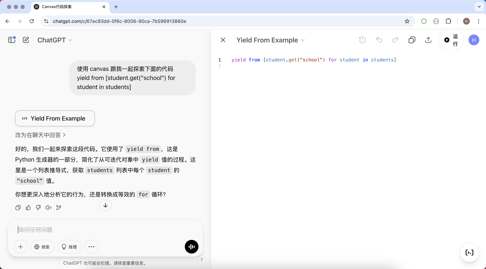
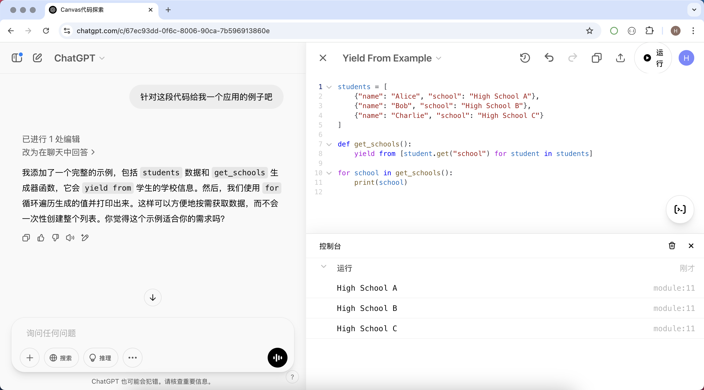
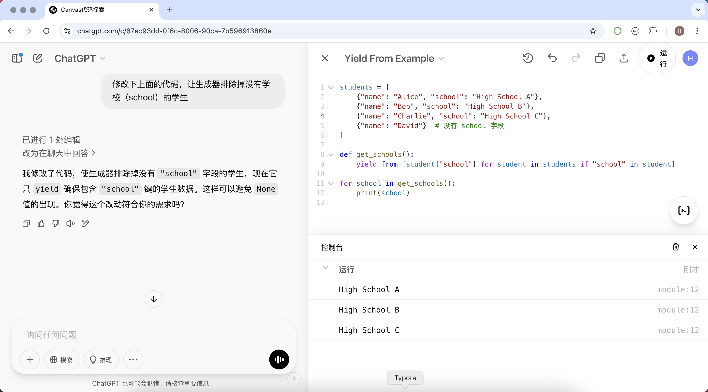
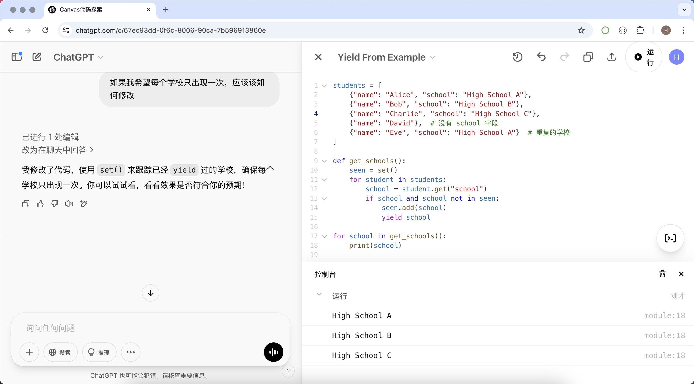
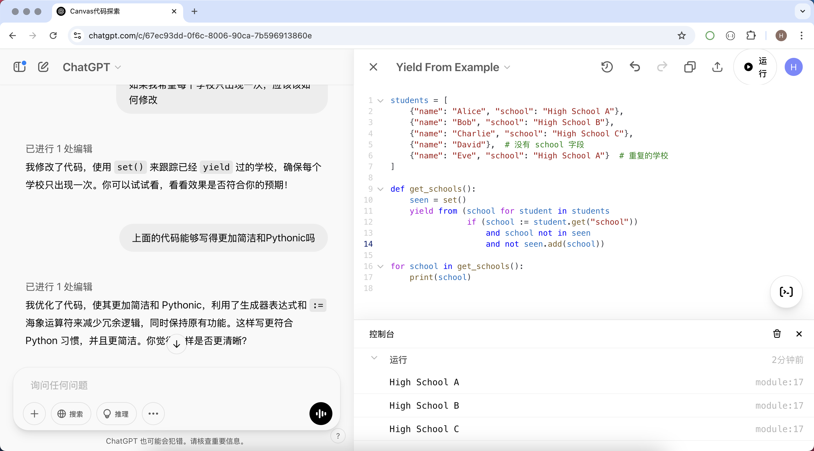

## Học lập trình với Canvas

Trong quá trình học lập trình, chúng ta thường xuyên cần viết, chỉnh sửa và tối ưu hóa mã nguồn. Tính năng Canvas của ChatGPT cung cấp một phương thức trực quan và hiệu quả giúp chúng ta hiểu sâu hơn cũng như nâng cao năng lực viết code. Dưới đây, chúng tôi xin giới thiệu ngắn gọn cách tận dụng tính năng Canvas của ChatGPT để học tập và nắm bắt mã nguồn.

### Các trường hợp sử dụng Canvas

#### 1. Chỉnh sửa và tối ưu hóa mã nguồn theo thời gian thực

Tính năng Canvas có thể đóng vai trò như một trình soạn thảo mã nguồn tương tác, cho phép chúng ta viết code trực tiếp bên trong đó, đồng thời chỉnh sửa và tối ưu hóa theo thời gian thực. Khi gặp sự cố về mã nguồn, bạn có thể đưa code vào Canvas và yêu cầu ChatGPT đưa ra đề xuất tối ưu. Ví dụ:

- Nhờ ChatGPT tái cấu trúc (refactor) mã nguồn, giúp code ngắn gọn và dễ đọc hơn.
- Yêu cầu ChatGPT giải thích logic của một đoạn code cụ thể, hỗ trợ việc hiểu các thuật toán hoặc mẫu thiết kế (design pattern) phức tạp.
- Lặp lại việc cải tiến code trong Canvas nhằm nâng cao hiệu suất chạy hoặc loại bỏ code dư thừa.

#### 2. Học các khái niệm lập trình và ví dụ minh họa

Đối với người mới bắt đầu, Canvas cũng là một công cụ học tập rất tốt. Bạn có thể nhập code ví dụ vào Canvas và yêu cầu ChatGPT giải thích tác dụng của nó. Ví dụ:

- Học cú pháp cơ bản, chẳng hạn như biến, vòng lặp, hàm, v.v.
- Học cấu trúc dữ liệu và thuật toán thông qua code mẫu, chẳng hạn như danh sách liên kết, thuật toán sắp xếp, v.v.
- Yêu cầu ChatGPT cung cấp ví dụ code và giải thích từng dòng cách thức hoạt động của nó.

#### 3. Debug và sửa lỗi mã nguồn

Trong quá trình lập trình, lỗi là điều không thể tránh khỏi. Canvas có thể giúp bạn nhanh chóng định vị và khắc phục lỗi:

- Dán đoạn code bị lỗi vào Canvas và để ChatGPT phân tích nguyên nhân lỗi.
- Yêu cầu ChatGPT đưa ra phương án sửa chữa và giải thích lý do phát sinh lỗi.
- Tiến hành debug nhiều lần thông qua Canvas để từng bước tối ưu hóa logic của code.

#### 4. Chú thích mã nguồn và tạo tài liệu

Việc viết chú thích (comment) và tài liệu rõ ràng có ý nghĩa sống còn đối với khả năng đọc hiểu của mã nguồn. Canvas có thể giúp chúng ta nhanh chóng tạo chú thích và tài liệu cho code:

- Để ChatGPT thêm chú thích chi tiết cho code, thuận tiện cho việc bảo trì và tìm hiểu sau này.
- Tự động tạo tài liệu API, thuận tiện cho làm việc nhóm.
- Tạo bản tóm tắt quy trình thực thi của code, giúp nhanh chóng nắm bắt logic mã nguồn.

### Ví dụ ứng dụng Canvas

```python
yield from [student.get("school") for student in students]
```

Trong quá trình học Python, giả sử bạn thấy đoạn code trên nhưng không hiểu ý đồ của nó, bạn có thể dùng câu lệnh gợi ý (prompt) như sau để bắt đầu cuộc trò chuyện với ChatGPT. Bạn thậm chí không cần nói cho nó biết bạn đang dùng ngôn ngữ lập trình nào, cũng không cần cung cấp ngữ cảnh của đoạn code này.

```
Hãy sử dụng canvas cùng tôi khám phá đoạn code dưới đây
yield from [student.get("school") for student in students]
```

Như hình bên dưới, ChatGPT đã đưa ra phản hồi về đoạn code trên, phía bên phải mở ra giao diện Canvas và đặt code của chúng ta vào trong đó.



Nếu câu trả lời trên vẫn chưa giúp bạn hiểu được đoạn code này, chúng ta có thể yêu cầu ChatGPT đưa ra ví dụ tương ứng, với prompt như sau:

```
Đối với đoạn code này hãy cho tôi một ví dụ ứng dụng nhé
```

Như hình bên dưới, ChatGPT đã sửa lại code trong Canvas giúp tôi, đưa ra một đoạn code Python hoàn chỉnh và có thể chạy được. Chúng ta có thể nhấn nút Run phía trên Canvas để thực thi đoạn code này. Canvas hiện đã hỗ trợ rất nhiều ngôn ngữ lập trình, ngôn ngữ bạn quen thuộc thì nó có lẽ cũng quen thuộc.



Nếu bạn đã hiểu thao tác trên, chúng ta có thể tiếp tục đặt câu hỏi: nếu trường `"school"` không tồn tại thì code của chúng ta cần sửa đổi như thế nào?

```
Hãy sửa đoạn code trên để generator loại bỏ những học sinh không có trường học (school)
```



Sau đó, chúng ta có thể tiến thêm một bước nữa dựa trên nhu cầu thực tế của mình, nhờ ChatGPT giúp sửa đổi code:

```
Nếu tôi muốn mỗi trường học chỉ xuất hiện một lần thì nên sửa thế nào
```



Đối với người viết Python, nếu bạn cảm thấy code mà ChatGPT sinh ra chưa đủ ngắn gọn, chưa đủ Pythonic, chúng ta có thể tiếp tục đặt câu hỏi:

```
Đoạn code trên có thể viết ngắn gọn và Pythonic hơn không
```



### Tổng kết

Tính năng Canvas của ChatGPT không chỉ đơn thuần là một trình soạn thảo mã nguồn, mà còn là một trợ lý lập trình thông minh. Cho dù bạn là người mới bắt đầu học lập trình hay là một nhà phát triển dày dạn kinh nghiệm, bạn đều có thể nâng cao khả năng đọc hiểu và viết code thông qua Canvas. Bằng việc không ngừng thực hành và khám phá, bạn có thể nắm vững các kỹ năng lập trình một cách hiệu quả hơn và nâng cao trình độ kỹ thuật của bản thân.