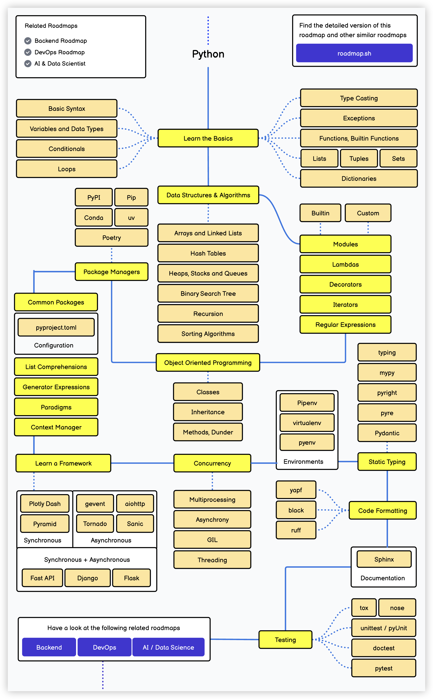
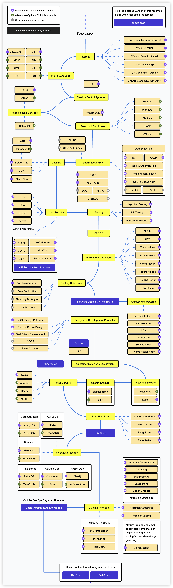
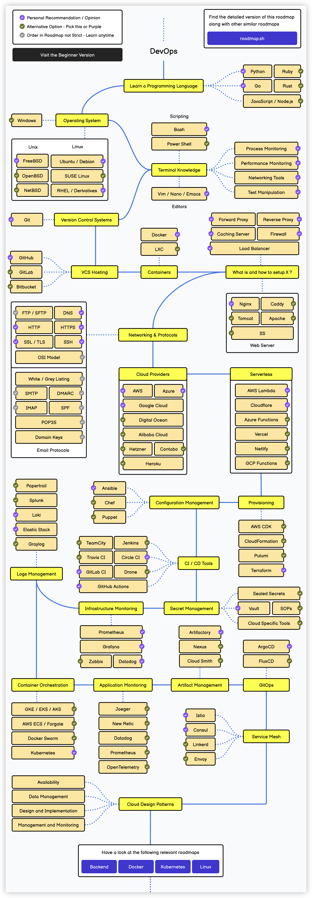
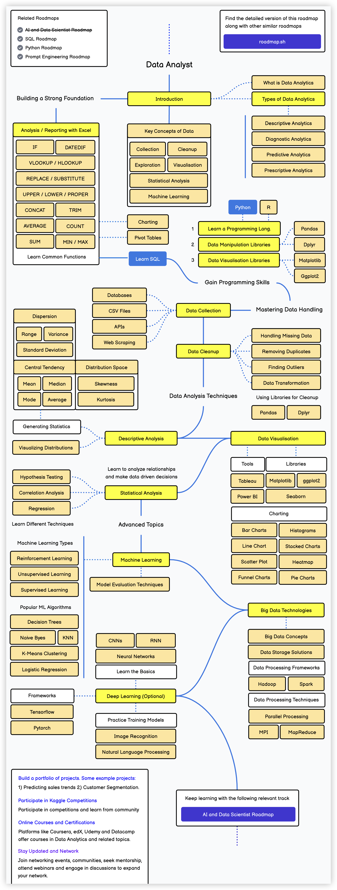
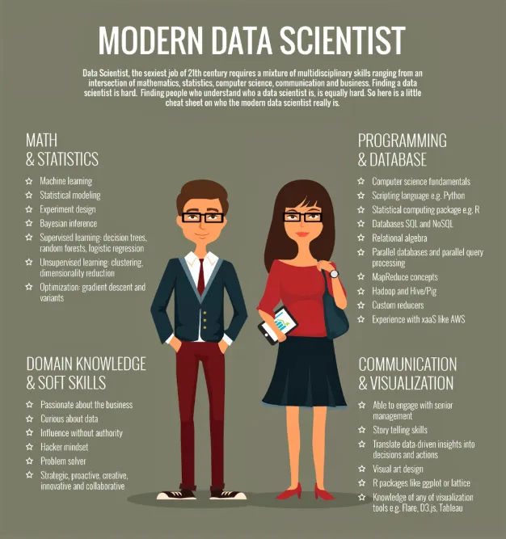

## Chia sẻ một số lộ trình học tập

Hôm nay tôi có ghé qua một trang web mang tên [Developer Roadmaps](https://roadmap.sh), trên đó có rất nhiều lộ trình học tập hữu ích. Trong đó có một lộ trình học Python khá hay, xin chia sẻ cùng mọi người. Nếu dùng Python để phát triển kỹ thuật phần mềm (lập trình back-end, phát triển API, phát triển ứng dụng, v.v.), thì những nội dung trên lộ trình này cơ bản đều cần phải tìm hiểu; còn nếu chỉ dùng Python như một công cụ hỗ trợ, thì việc học 20 bài trong tuyển tập [《Học Python từ con số 0》](https://www.zhihu.com/column/c_1216656665569013760) mà tôi đã tổng hợp trước đây là đã đủ rồi. Gần đây, tôi cũng đang làm mới lại nội dung 20 bài này, phiên bản sau khi làm mới sẽ được đánh dấu là "Bản 2025", và tôi cũng rất mong nhận được ý kiến đóng góp cũng như đề xuất của các bạn trong quá trình này.

Ở đây còn có ba lộ trình học tập liên quan khác, lần lượt là phát triển back-end (Backend), vận hành và phát triển (DevOps) và khoa học dữ liệu (Data Science). Lộ trình học lập trình back-end như hình dưới đây, nội dung khá đồ sộ, ngôn ngữ lập trình cốt lõi là Java hoặc Go. Cá nhân tôi không khuyến khích các bạn dùng Python để phát triển back-end; nếu đã nắm vững ngôn ngữ Python và đồng thời tích lũy được nhiều kiến thức về khoa học máy tính, bạn có thể thử sức với mảng phát triển ứng dụng AI, tôi tin rằng bạn sẽ thu hoạch được nhiều điều hơn. Các bạn có thể chú ý đến các mục được tích dấu màu tím, đó là các lựa chọn do tác giả khuyến nghị, và phần lớn cũng là những nội dung tôi muốn giới thiệu cho các lập trình viên back-end theo học.

Chúng ta hãy cùng xem tiếp lộ trình học tập của DevOps. Hiện tại DevOps cũng là một vị trí rất "hot" trên thị trường tuyển dụng, các bạn quan tâm có thể theo dõi.

Nếu đã học qua một số kiến thức liên quan đến Python và muốn dựa vào đó để chuyển hướng sang làm phân tích dữ liệu, bạn có thể tham khảo lộ trình học tập dưới đây. Cần lưu ý rằng, Python chỉ là một công cụ để làm phân tích dữ liệu; muốn trở thành một chuyên viên phân tích dữ liệu xuất sắc, bạn cần có tư duy dữ liệu tốt, đồng thời phải tích lũy đủ kiến thức nghiệp vụ, có như vậy mới có thể rút ra những hiểu biết sâu sắc về kinh doanh (business insights) từ dữ liệu, dùng dữ liệu để tối ưu hóa sản phẩm, thúc đẩy kinh doanh và thực sự mang lại sự hỗ trợ đắc lực cho việc ra quyết định.

Cuối cùng, xin nhắc lại với mọi người: những ai muốn điểm danh học tập thì nhớ để lại lời nhắn cho tôi ở [khu vực bình luận](https://zhuanlan.zhihu.com/p/23821670129) nhé! Nếu bạn muốn **bước chân vào ngành khoa học dữ liệu** (phân tích dữ liệu, khai phá dữ liệu, quản trị dữ liệu, v.v.) thì cũng có thể để lại lời nhắn cho tôi, năm nay tôi dự kiến sẽ tiếp tục xuất bản các nội dung liên quan.

