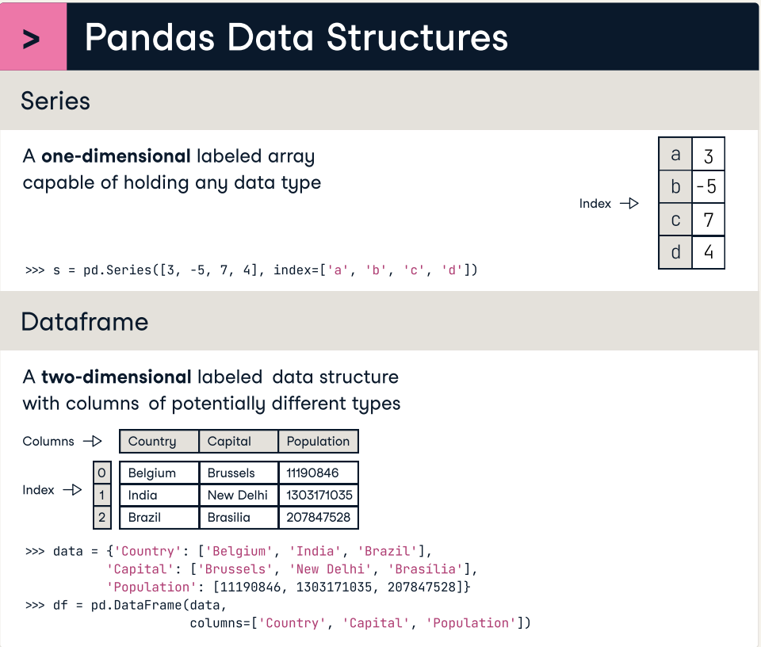
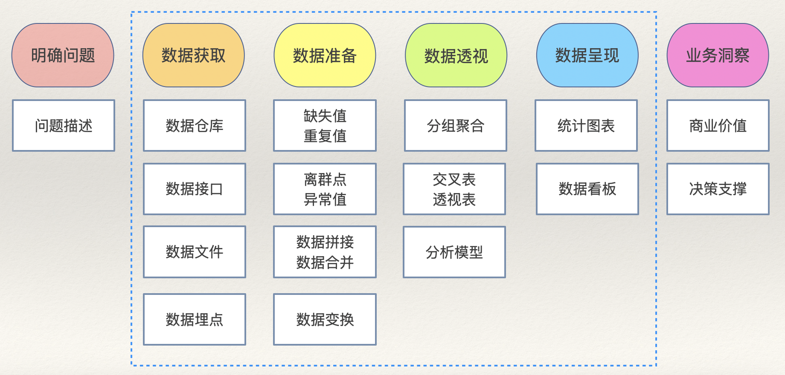

## Làm chủ nhanh thư viện pandas

Gần đây có một số bạn chia sẻ rằng, thư viện pandas dùng trong phân tích dữ liệu với Python có quá nhiều hàm và phương thức, khiến cho việc học và áp dụng trở nên rất rối rắm, mông lung. Trước đây tôi cũng từng giải đáp vấn đề này, hôm nay xin hệ thống lại một cách bài bản hơn. Dù sao thì thư viện này cũng đóng vai trò vô cùng quan trọng trong hệ sinh thái khoa học dữ liệu của Python. Mặc dù hiện tại đã xuất hiện nhiều thư viện thay thế cho pandas (như polars, cuDF, v.v.), nhưng phương pháp sử dụng nhìn chung cũng đại đồng tiểu dị.

### Ba lớp cốt lõi

Thư viện Pandas có ba lớp cốt lõi nhất, trong đó quan trọng nhất là kiểu `DataFrame`, đây là trọng tâm học tập, như hình dưới đây:



1. `Series`: Biểu diễn dữ liệu một chiều, tương tự như mảng một chiều (mảng có gắn nhãn), mỗi phần tử dữ liệu đều có chỉ mục (nhãn) riêng, có thể truy cập dữ liệu thông qua chỉ mục.
2. `DataFrame`: Biểu diễn dữ liệu hai chiều, tương tự như bảng tính Excel, cả hàng và cột đều có chỉ mục (nhãn) riêng, có thể truy cập hàng, cột và từng ô thông qua chỉ mục.
3. `Index`: Biểu diễn chỉ mục, cung cấp dịch vụ chỉ mục cho `Series` và `DataFrame`. `Index` có rất nhiều lớp con, phù hợp với các tình huống cần các loại chỉ mục khác nhau.

### Quy trình phân tích dữ liệu

Trọng tâm của việc học và sử dụng pandas là ứng dụng của `DataFrame`. Chúng tôi khuyên bạn nên nắm vững các hàm và phương thức tương ứng theo quy trình phân tích dữ liệu, làm như vậy thường sẽ đạt hiệu quả gấp bội mà tốn ít công sức hơn. Quy trình phân tích dữ liệu được minh họa như hình dưới đây, trong đó phần được khoanh bằng nét đứt màu xanh dương là phần có thể hoàn thành thông qua các công cụ BI (như Power BI, Tableau, v.v.) hoặc chương trình Python.



#### Thu thập dữ liệu

Thu thập dữ liệu còn có thể gọi là tải dữ liệu (load data), bản chất của nó là tạo ra đối tượng `DataFrame`. Bạn cần nắm vững các hàm sau:

1. Tải dữ liệu từ tệp CSV:

```python
pd.read_csv(
    filepath,      # Đường dẫn tệp CSV (có thể là đường dẫn tuyệt đối hoặc tương đối trên máy, hoặc một URL)
    sep,           # Ký tự phân cách trường (mặc định là dấu phẩy)
    header,        # Tiêu đề bảng nằm ở dòng thứ mấy
    encoding,      # Mã hóa tệp (mặc định utf-8)
    quotechar,     # Ký tự bao quanh chuỗi (mặc định là dấu ngoặc kép)
    usecols,       # Chỉ tải những cột nào
    index_col,     # Chỉ định cột làm chỉ mục
    dtype,         # Chỉ định kiểu dữ liệu của các cột
    converters,    # Chỉ định bộ chuyển đổi dữ liệu cho các cột
    nrows,         # Tải bao nhiêu dòng dữ liệu
    skiprows,      # Chỉ định các dòng cần bỏ qua
    parse_dates,   # Phân tích những cột nào thành ngày giờ (datetime)
    date_format,   # Định dạng ngày giờ
    true_values,   # Các giá trị được coi là giá trị boolean True
    false_values,  # Các giá trị được coi là giá trị boolean False
    na_values,     # Các giá trị được coi là giá trị rỗng (NA/NaN)
    na_filter,     # Có kiểm tra dấu hiệu giá trị rỗng hay không
    on_bad_lines,  # Cách xử lý khi gặp dòng có lỗi (tùy chọn: 'error', 'warn', 'skip')
    engine,        # Chỉ định công cụ cơ sở (ví dụ: có thể dùng engine Arrow nhanh hơn để xử lý dữ liệu lớn hơn)
    iterator,      # Có bật chế độ iterator hay không (giảm chi phí bộ nhớ khi xử lý dữ liệu lớn)
    chunksize,     # Kích thước khối dữ liệu mỗi lần tải trong chế độ iterator
)
```

2. Tải dữ liệu từ tệp Excel:

```python
pd.read_excel(
    io,           # Đường dẫn đến tệp workbook Excel
    sheet_name,   # Tên bảng tính (sheet)
    skip_footer,  # Bỏ qua bao nhiêu dòng ở cuối
)
```

> **Giải thích**: Hàm `read_excel` có nhiều tham số có tác dụng tương tự như `read_csv`, nên ở đây không nhắc lại nữa. Khi tải dữ liệu từ tệp Excel sẽ không có chế độ iterator.

3. Tải dữ liệu từ cơ sở dữ liệu hoặc kho dữ liệu:

```python
pd.read_sql(
    sql,          # Truy vấn SQL hoặc tên của bảng hai chiều
    con,          # Kết nối cơ sở dữ liệu
    parse_dates,  # Chỉ định các cột cần phân tích thành ngày giờ
    index_col,    # Chỉ định cột làm chỉ mục
    columns,      # Các cột cần tải
    chunksize,    # Kích thước khối dữ liệu tải mỗi lần
    dtype,        # Chỉ định kiểu dữ liệu của các cột
)
```

4. Các cách khác để tạo đối tượng `DataFrame`:

```python
pd.DataFrame(data=[[95, 87], [66, 78], [92, 89]], index=[1001, 1002, 1003], columns=['Verbal', 'Math'])
pd.DataFrame(data={'Verbal': [95, 66, 92], 'Math': [87, 78, 89]}, index=[1001, 1002, 1003])
```

Nếu muốn thao tác với dữ liệu hoặc chỉ mục trong `DataFrame`, bạn cần nắm vững các phép toán và phương thức dưới đây:

1. Xem thông tin:

```python
df.info()
```

2. Xem N dòng đầu/cuối:

```python
df.head(10)
df.tail(5)
```

3. Thao tác với cột:

```python
df['column_name']
df.colume_name
```

4. Thao tác với dòng:

```python
df.loc['row_index']
df.iloc[0]
```

5. Thao tác với ô:

```python
df.at['row_index', 'column_name']
df.iat[0, 0]
```

6. Xóa dòng hoặc cột:

```python
df.drop(
    labels,   # Chỉ mục của dòng hoặc cột cần xóa
    axis,     # axis=0: labels biểu thị chỉ mục dòng; axis=1: labels biểu thị chỉ mục cột
    index,    # Chỉ mục của dòng cần xóa
    columns,  # Chỉ mục của cột cần xóa
    inplace,  # Có xóa tại chỗ hay không (inplace=True biểu thị xóa trực tiếp, không trả về DataFrame mới)
)
```

7. Lọc dữ liệu:

```python
df.query(expr)  # Chỉ định điều kiện lọc thông qua biểu thức
df[bool_index]  # Lọc theo chỉ mục boolean
```

8. Lấy mẫu ngẫu nhiên:

```python
df.sampe(
    n,             # Số lượng mẫu
    frac,          # Tỷ lệ lấy mẫu
    replace,       # Lấy mẫu có hoàn lại hay không hoàn lại (mặc định False)
    random_state,  # Seed số ngẫu nhiên (seed giống nhau mỗi lần lấy mẫu sẽ cho kết quả giống nhau)
)
```

9. Đặt lại chỉ mục (reset index):

```python
df.reset_index(
    level,    # Đối với chỉ mục đa cấp (MultiIndex), chỉ định đặt lại cấp chỉ mục nào
    drop,     # Có loại bỏ chỉ mục hay không (drop=False biểu thị chỉ mục sẽ được chuyển thành cột thông thường)
    inplace,  # Có xử lý tại chỗ hay không (có trả về đối tượng DataFrame mới hay không)
)
```

10. Thiết lập chỉ mục (set index):

```python
df.set_index(
   keys,              # Chỉ định cột dùng làm chỉ mục
   drop,              # Có xóa cột dùng làm chỉ mục khỏi dữ liệu hay không (mặc định True)
   append,            # Có thêm cột chỉ định vào chỉ mục hiện có hay không (mặc định False)
   inplace,           # Có xử lý tại chỗ hay không (có trả về đối tượng DataFrame mới hay không)
   verify_integrity,  # Kiểm tra xem cột chỉ mục có giá trị trùng lặp hay không (mặc định False)
)
```

11. Điều chỉnh thứ tự chỉ mục:

```python
df.reindex()
df[fancy_index]       # Fancy indexing
df.loc[facy_index]    # Fancy indexing
df.iloc[fancy_index]  # Fancy indexing
```

12. Sắp xếp chỉ mục:

```python
df.sort_index(
    axis,         # Xác định chỉ mục dòng hay chỉ mục cột (mặc định 0)
    level,        # Đối với chỉ mục đa cấp, chỉ định cấp chỉ mục
    ascending,    # Tăng dần hay giảm dần (mặc định True)
    inplace,      # Có sắp xếp tại chỗ hay không
    kind,         # Thuật toán sắp xếp (mặc định 'quicksort')
    na_position,  # Giá trị rỗng đặt ở đầu hay ở cuối (mặc định 'last')
    key,          # Truyền vào hàm so sánh kích thước chỉ mục (tùy chỉnh quy tắc so sánh)
)
```


#### Tái định hình dữ liệu

1. Nối (tương tự như phép toán `UNION` trong SQL):

```python
pd.concat(
    objs,          # Container chứa nhiều đối tượng DataFrame
    axis,          # Nối dọc theo trục nào
    ignore_index,  # Có bỏ qua chỉ mục ban đầu hay không (mặc định False)
)
```

2. Hợp nhất (tương tự như phép toán `JOIN` trong SQL):

```python
pd.merge(
    left,         # Bảng trái
    right,        # Bảng phải
    how,          # Chỉ định phương thức nối bảng (mặc định 'inner' biểu thị inner join)
    on,           # Chỉ định trường nối bảng (nếu trường nối của hai bảng cùng tên)
    left_on,      # Chỉ định trường nối của bảng trái
    right_on,     # Chỉ định trường nối của bảng phải
    left_index,   # Có dùng chỉ mục của bảng trái để nối bảng hay không
    right_index,  # Có dùng chỉ mục của bảng phải để nối bảng hay không
    suffixes,     # Chỉ định hậu tố cho các cột trùng tên (mặc định ('_x', '_y'))
)
```


#### Làm sạch dữ liệu

1. Giá trị bị thiếu (Missing values):

```python
# Nhận diện giá trị bị thiếu
df.isna()
df.notna()
# Xóa giá trị bị thiếu
df.dropna(
    axis,     # Xóa dòng hay xóa cột (mặc định 0)
    how,      # Chỉ cần xuất hiện bất kỳ giá trị thiếu nào là xóa hay không (mặc định 'any')
    subset,   # Chỉ xóa giá trị rỗng đối với những dòng hoặc cột nào
    inplace,  # Có xóa tại chỗ hay không (có trả về đối tượng DataFrame mới hay không)
)
# Điền giá trị bị thiếu
df.fillna(
    value,    # Giá trị dùng để điền
    method,   # Phương pháp điền giá trị rỗng
    inplace,  # Có điền tại chỗ hay không (có trả về đối tượng DataFrame mới hay không)
)
# Nội suy bằng thuật toán nội suy
df.interpolate(
    method,   # Thuật toán nội suy (mặc định 'linear' biểu thị nội suy tuyến tính) 
    axis,     # Nội suy dọc theo trục nào
    inplace,  # Có nội suy tại chỗ hay không (có trả về đối tượng DataFrame mới hay không)
)
```

2. Giá trị trùng lặp:

```python
# Nhận diện giá trị trùng lặp
df.duplicated(
    subset,   # Nhãn cột dùng để xác định trùng lặp
    keep,     # Xử lý các mục trùng lặp như thế nào (mặc định 'first' biểu thị giữ lại mục đầu tiên)
)
# Xóa giá trị trùng lặp
df.drop_duplicates(
    subset,   # Nhãn cột dùng để xác định trùng lặp
    keep,     # Xử lý các mục trùng lặp như thế nào (mặc định 'first' biểu thị giữ lại mục đầu tiên)
    inplace,  # Có loại bỏ trùng lặp tại chỗ hay không (mặc định False)
)
# Thống kê số lượng giá trị không trùng lặp
df.nunique(axis)
```

3. Giá trị ngoại lai (Outliers):

Việc xử lý giá trị ngoại lai quan trọng nhất là khâu nhận diện. Bạn có thể sử dụng phương pháp xác định theo ngưỡng số trị, phương pháp z-score, Isolation Forest (rừng cô lập), v.v. để nhận diện các điểm dữ liệu dị biệt, sau đó kết hợp với ý nghĩa nghiệp vụ thực tế để đánh giá xem đó có phải là giá trị bất thường hay không. Đối với việc xử lý giá trị ngoại lai, thông thường là thay thế hoặc xóa bỏ; việc xóa có thể dùng phương pháp `drop` đã đề cập ở trên để xóa dòng hoặc xóa cột.

```python
# Thay thế giá trị ngoại lai
df.replace(
    to_replace,  # Giá trị bị thay thế
    value,       # Giá trị thay thế
    inplace,     # Có thay thế tại chỗ hay không (có trả về đối tượng DataFrame mới hay không)
    regex,       # Có kích hoạt thay thế bằng biểu thức chính quy (regex) hay không (mặc định False)
)
```

4. Tiền xử lý:

Tiền xử lý thường thao tác dữ liệu trên đối tượng `Series`. Giả sử biến `s` là một đối tượng `Series`, các thao tác cụ thể bao gồm:

- Tiền xử lý ngày giờ:

```python
s.dt.year                   # Năm
s.dt.quarter                # Quý
s.dt.month                  # Tháng
s.dt.day                    # Ngày
s.dt.hour                   # Giờ
s.dt.minute                 # Phút
s.dt.second                 # Giây
s.dt.weekday                # Thứ trong tuần
s.dt.to_period(freq)        # Chuyển đổi theo tần suất cụ thể
s.dt.floor(freq)            # Làm tròn xuống
s.dt.ceil(freq)             # Làm tròn lên
s.dt.round(freq)            # Làm tròn
s.dt.strftime(date_format)  # Định dạng chuỗi ngày giờ
s.dt.tz_localize(tz)        # Bản địa hóa múi giờ
s.dt.tz_convert(tz)         # Chuyển đổi múi giờ
```

- Tiền xử lý chuỗi:

```python
s.str.lower()       # Chuyển chuỗi thành chữ thường
s.str.upper()       # Chuyển chuỗi thành chữ in hoa
s.str.title()       # Viết hoa chữ cái đầu mỗi từ
# Tách chuỗi
s.str.split(
    pat,            # Ký tự phân cách hoặc biểu thức chính quy
    n,              # Số lần tách tối đa
    expand,         # Có mở rộng nội dung sau khi tách thành nhiều cột hay không (mặc định False)
)
# Trích xuất nội dung từ chuỗi
s.str.extract(
    pat,            # Biểu thức chính quy
    flags,          # Cờ xử lý biểu thức chính quy
    expand,         # Có mở rộng nội dung trích xuất thành nhiều cột hay không (mặc định True)
)
s.str.isalpha()     # Kiểm tra chuỗi có phải toàn chữ cái không
s.str.isnumeric()   # Kiểm tra chuỗi có phải toàn chữ số không
s.str.isalnum()     # Kiểm tra chuỗi có phải toàn chữ cái hoặc chữ số không
s.str.isspace()     # Kiểm tra chuỗi có phải toàn khoảng trắng không
s.str.startswith()  # Kiểm tra chuỗi có bắt đầu bằng nội dung chỉ định không 
s.str.endswith()    # Kiểm tra chuỗi có kết thúc bằng nội dung chỉ định không
# Kiểm tra chuỗi có khớp với biểu thức chính quy không
s.str.match(
    pat,            # Biểu thức chính quy
    flags,          # Cờ xử lý biểu thức chính quy
)
# Kiểm tra chuỗi có chứa nội dung chỉ định không
s.str.contains(
    pat,            # Chuỗi hoặc biểu thức chính quy
    flags,          # Cờ xử lý biểu thức chính quy
    regex,          # Có sử dụng biểu thức chính quy hay không (mặc định True)
)
# Thay thế
s.str.replace(
    pat,            # Nội dung bị thay thế (chuỗi hoặc biểu thức chính quy)
    repl,           # Nội dung thay thế
    n,              # Số lần thay thế tối đa (mặc định -1 biểu thị thay thế toàn bộ)
    flags,          # Cờ xử lý biểu thức chính quy
    regex,          # Có sử dụng biểu thức chính quy hay không (mặc định True)
)
s.str.strip()       # Cắt bỏ khoảng trắng thừa ở hai đầu chuỗi
s.str.join(sep)     # Nối nội dung thành chuỗi bằng ký tự phân cách chỉ định
# Ghép chuỗi
s.str.cat(
    others,         # Nội dung ghép nối
    sep,            # Ký tự phân cách
    na_rep,         # Ký tự đại diện cho giá trị rỗng
)
s.str.len()         # Lấy độ dài chuỗi
# Tìm vị trí chuỗi con
s.str.find(
    sub,            # Chuỗi con
    start,          # Vị trí bắt đầu
    end,            # Vị trí kết thúc
)
```

- Tiền xử lý kiểu phân loại (Categorical):

```python
# Sắp xếp lại thứ tự các hạng mục
s.cat.reorder_categories(
    new_categories,  # Thứ tự hạng mục mới
    inplace,         # Có xử lý tại chỗ hay không (mặc định False)
)
# Thêm hạng mục
s.cat.add_categories(
    new_categories,  # Hạng mục mới cần thêm
    inplace,         # Có xử lý tại chỗ hay không (mặc định False)
)
# Xóa hạng mục
s.cat.remove_categories(
    removals,        # Hạng mục cần xóa
    inplace,         # Có xử lý tại chỗ hay không (mặc định False)
)
# Xóa các hạng mục không được sử dụng
s.cat.remove_unused_categories(
    inplace,         # Có xử lý tại chỗ hay không (mặc định False)
)
# Đổi tên hạng mục
s.cat.rename_categories(
    new_categories,  # Tên hạng mục mới
    inplace,         # Có xử lý tại chỗ hay không (mặc định False)
)
```

- Nhị phân hóa (Biến giả / Dummy variables):

```python
pd.get_dummies(
    data,        # Series hoặc DataFrame cần chuyển đổi thành biến giả
    prefix,      # Chỉ định tiền tố cho các cột biến giả được tạo ra
    prefix_sep,  # Ký tự phân cách giữa tiền tố và tên cột
    dummy_na,    # Có tạo một cột riêng cho giá trị rỗng (NaN) hay không (mặc định False)
    columns,     # Chỉ định tên các cột cần chuyển đổi
    drop_first,  # Có xóa cột của hạng mục đầu tiên khỏi các biến giả tạo ra hay không (mặc định False)
)
```

- Rời rạc hóa (Chia khoảng / Binning):

```python
pd.cut(
    x,        # Dữ liệu đầu vào cần chia (dữ liệu một chiều)
    bins,     # Số khoảng chia hoặc các ranh giới khoảng cụ thể
    right,    # Khoảng có bao gồm cận phải hay không (mặc định False)
    labels,   # Chỉ định nhãn cho từng khoảng
    retbins,  # Có trả về mảng các ranh giới phân chia hay không (mặc định False)
    ordered,  # Các hạng mục trả về có thứ tự hay không (mặc định True)
)
pd.qcut(
    x,        # Dữ liệu đầu vào cần chia (dữ liệu một chiều)
    q,        # Số điểm chia hoặc các phân vị cụ thể
    labels,   # Chỉ định nhãn cho từng khoảng
    retbins,  # Có trả về mảng các ranh giới phân chia hay không (mặc định False)
)
```

- Tùy chỉnh phép biến đổi:

```python
s.map(arg)          # Chuyển đổi và ánh xạ dữ liệu ở cấp độ từng phần tử
df.map(func)        # Chuyển đổi và ánh xạ dữ liệu ở cấp độ từng phần tử
# Chuyển đổi dữ liệu ở cấp độ từng phần tử thông qua hàm chỉ định
s.apply(
    func,           # Hàm áp dụng lên từng phần tử
    convert_type,   # Cố gắng chuyển kết quả sang kiểu phù hợp nhất (mặc định True)
    args,           # Các tham số vị trí bổ sung truyền vào func
    kwargs,         # Các tham số từ khóa bổ sung truyền vào func
)   
# Chuyển đổi dữ liệu ở cấp độ hàng hoặc cột thông qua hàm chỉ định
df.apply(
    func,           # Hàm áp dụng lên từng hàng hoặc cột
    axis,           # Điều khiển chuyển đổi theo hàng hay theo cột
    result_type,    # Chỉ định kiểu trả về ('expand': mở rộng thành cột, 'reduce': trả về vô hướng, 'broadcast': phát rộng về hình dạng ban đầu)
    args,           # Các tham số vị trí bổ sung truyền vào func
    kwargs,         # Các tham số từ khóa bổ sung truyền vào func
)
s.transform(func)   # Chuyển đổi dữ liệu ở cấp độ từng phần tử thông qua một hoặc nhiều hàm chỉ định
df.transform(func)  # Chuyển đổi dữ liệu ở cấp độ hàng hoặc cột thông qua một hoặc nhiều hàm chỉ định
```

#### Phân tích đa chiều (Data Pivoting)

1. Thông tin thống kê mô tả:

```python
s.mean()     # Giá trị trung bình (mean)
s.median()   # Trung vị (median)
s.mode()     # Yếu vị (mode)
s.max()      # Giá trị lớn nhất
s.min()      # Giá trị nhỏ nhất
s.var(ddof)  # Phương sai (ddof đại diện cho bậc tự do hiệu chỉnh)
s.std(ddof)  # Độ lệch chuẩn (ddof đại diện cho bậc tự do hiệu chỉnh)
s.skew()     # Hệ số bất đối xứng (độ lệch - skewness)
s.kurt()     # Hệ số nhọn (kurtosis)
```

2. Phân tích tương quan:

```python
df.cov()         # Hiệp phương sai
df.corr(method)  # Hệ số tương quan (mặc định 'pearson' biểu thị hệ số tương quan Pearson; các tùy chọn khác gồm 'kendall' và 'spearman')
```

3. Sắp xếp và lấy giá trị đầu bảng:

```python
# Sắp xếp
s.sort_values(
    asending,     # Tăng dần hay giảm dần (mặc định True)
    inplace,      # Có sắp xếp tại chỗ hay không (mặc định False)
    kind,         # Thuật toán sắp xếp (mặc định 'quicksort')
    na_position,  # Vị trí đặt giá trị rỗng (mặc định 'last')
    key,          # Chỉ định quy tắc so sánh phần tử (hàm)
)
# Sắp xếp
df.sort_values(
    by,           # Căn cứ để sắp xếp
    ascending,    # Tăng dần hay giảm dần (mặc định True)
    inplace,      # Có sắp xếp tại chỗ hay không (mặc định False)
    kind,         # Thuật toán sắp xếp (mặc định 'quicksort')
    na_position,  # Vị trí đặt giá trị rỗng (mặc định 'last')
    key,          # Chỉ định quy tắc so sánh phần tử (hàm)
)
# Top N phần tử (đầu danh sách)
s.nlargest(
    n,            # N giá trị lớn nhất
    keep,         # Cách xử lý các giá trị trùng lặp (mặc định 'first')
)
# Top N phần tử (đầu danh sách)
df.nlargest(
    n,            # N giá trị lớn nhất
    columns,      # Chỉ định tên cột dùng để sắp xếp
    keep,         # Cách xử lý các giá trị trùng lặp (mặc định 'first')
)
# Top N phần tử (cuối danh sách)
s.nsmallest(
    n,            # N giá trị nhỏ nhất
    keep,         # Cách xử lý các giá trị trùng lặp (mặc định 'first')
)
# Top N phần tử (cuối danh sách)
df.nsmallest(
    n,            # N giá trị nhỏ nhất
    columns,      # Chỉ định tên cột dùng để sắp xếp
    keep,         # Cách xử lý các giá trị trùng lặp (mặc định 'first')
)
```

4. Gom nhóm tổng hợp (Group By):

```python
df.groupby(
    by,          # Chỉ định tên cột dùng để gom nhóm
    level,       # Đối với chỉ mục đa cấp, chỉ định cấp dùng để gom nhóm
    as_index,    # Có đặt các cột gom nhóm làm chỉ mục hay không (mặc định True)
    sort,        # Có sắp xếp kết quả gom nhóm hay không (mặc định True)
    observed,    # Chỉ xem xét các nhóm thực tế xuất hiện trong dữ liệu (mặc định False)
).aggregate(
    func,        # Một hàm đơn lẻ hoặc danh sách các hàm
    args,        # Các tham số vị trí biến đổi của hàm
    kwargs,      # Các tham số từ khóa của hàm
)
df.pivot(
    index,       # Chỉ định cột dùng làm chỉ mục
    columns,     # Cột dùng làm các cột mới 
    values,      # Cột dùng để điền các giá trị trong DataFrame mới
)
df.melt(
    id_vars,     # Các cột giữ nguyên không đổi trong quá trình chuyển đổi
    value_vars,  # Các cột cần chuyển đổi thành các hàng
    var_name,    # Chỉ định tên cột mới lưu trữ tên cột ban đầu
    value_name,  # Chỉ định tên cột mới lưu trữ giá trị dữ liệu ban đầu
)
```

5. Bảng tổng hợp (Pivot table):

```python
pd.pivot_table(
    data,          # Đối tượng DataFrame
    values,        # Cột cần tổng hợp tính toán
    index,         # Trường gom nhóm dữ liệu (chỉ mục hàng)
    columns,       # Trường gom nhóm dữ liệu (chỉ mục cột)
    aggfunc,       # Hàm tổng hợp (mặc định 'mean')
    fill_value,    # Giá trị dùng để điền vào ô trống
    margins,       # Có tính tổng cộng các hàng và cột hay không (mặc định False)
    margins_name,  # Tên của cột/hàng tổng cộng (mặc định 'All')
    observed       # Chỉ xem xét các nhóm thực tế xuất hiện trong dữ liệu (mặc định False)
)
```

6. Bảng chéo (Crosstab):

```python
pd.crosstab(
    index,         # Biến hàng trong bảng chéo
    columns,       # Biến cột trong bảng chéo
    values,        # Giá trị dùng để điền vào bảng chéo (tùy chọn)
    aggfunc,       # Hàm tổng hợp (tùy chọn)
    margins,       # Có tính tổng cộng các hàng và cột hay không (mặc định False)
    margins_name,  # Tên của cột/hàng tổng cộng (mặc định 'All')
)
```

#### Trình bày dữ liệu

```python
df.plot(
    figsize,   # Kích thước biểu đồ (tuple hai phần tử)
    kind,      # Loại biểu đồ
    ax,        # Hệ tọa độ vẽ biểu đồ
    x,         # Dữ liệu trục hoành
    y,         # Dữ liệu trục tung
    title,     # Tiêu đề biểu đồ
    grid,      # Có vẽ lưới tọa độ hay không
    legend,    # Có hiển thị chú giải (legend) hay không
    xticks,    # Vạch chia trục hoành
    yticks,    # Vạch chia trục tung
    xlim,      # Phạm vi giá trị trục hoành
    ylim,      # Phạm vi giá trị trục tung
    xlabel,    # Nhãn trục hoành
    ylabel,    # Nhãn trục tung
    rot,       # Góc xoay nhãn trục
    fontsize,  # Cỡ chữ nhãn trục
    colormap,  # Bảng màu (color map)
    stacked,   # Có vẽ biểu đồ chồng (stacked) hay không (mặc định False)
    colorbar,  # Có hiển thị thanh màu (color bar) hay không
)
```

Tham số quan trọng nhất của phương thức `plot` là `kind`, nó điều khiển loại biểu đồ sẽ vẽ, cụ thể như sau:

1. Biểu đồ đường (Line chart): `kind='line'`
2. Biểu đồ phân tán (Scatter plot): `kind='scatter'`
3. Biểu đồ cột (Bar chart): `kind='bar'`
4. Biểu đồ thanh ngang (Horizontal bar chart): `kind='barh'`
5. Biểu đồ tròn (Pie chart): `kind='pie'`
6. Biểu đồ tần số (Histogram): `kind='hist'`
7. Biểu đồ hộp (Box plot): `kind='box'`
8. Biểu đồ miền (Area chart): `kind='area'`
9. Biểu đồ ước lượng mật độ nhân (Kernel Density Estimation): `kind='kde'`

### Tổng kết

Các bạn có thể tìm một tập dữ liệu và thực hiện lại một lượt các kiểu dữ liệu, hàm và phương thức thông dụng nhất theo quy trình đã hướng dẫn ở trên, chắc chắn ấn tượng sẽ sâu sắc hơn rất nhiều. Để tìm hiểu nội dung chi tiết hơn, bạn nên đọc chuyên mục của tôi [《Phân tích dữ liệu dựa trên Python》](https://www.zhihu.com/column/c_1217746527315496960) hoặc xem video trên Bilibili [《Bộ ba phân tích dữ liệu Python》](https://www.bilibili.com/video/BV13t4y1a7TV/).