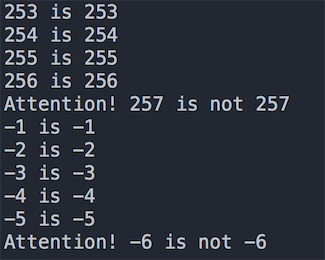
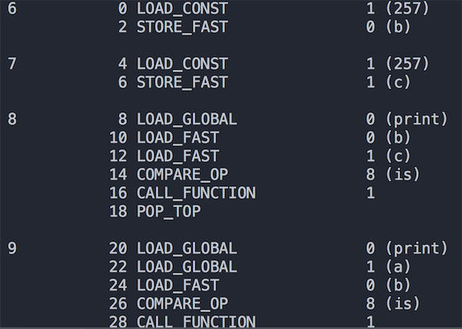
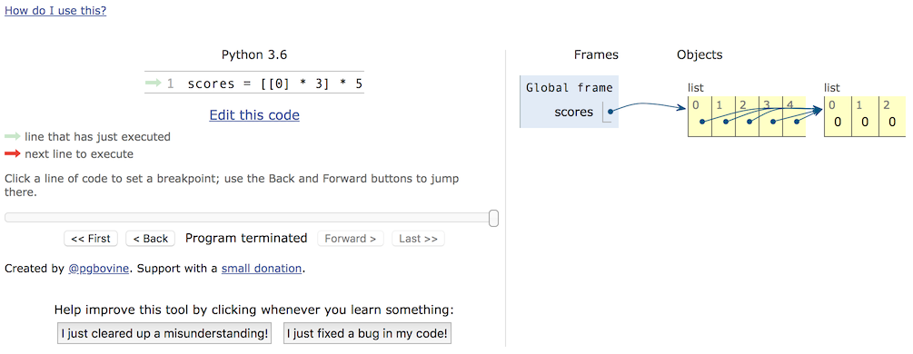
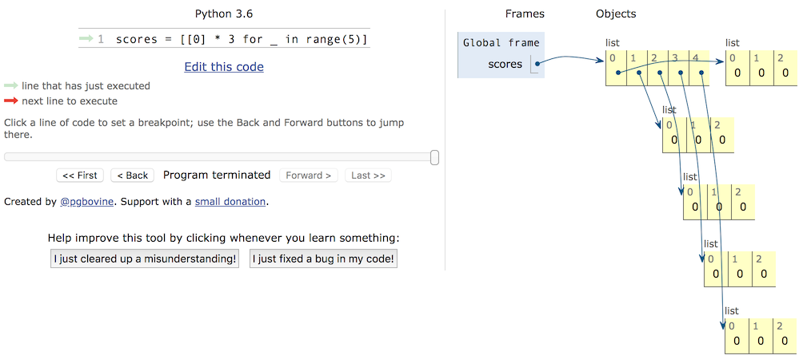

## Những cái bẫy chúng ta từng mắc phải

### Bẫy 1 - Bẫy so sánh số nguyên

Trong Python, mọi thứ đều là đối tượng, số nguyên cũng là đối tượng. Khi so sánh hai số nguyên có hai toán tử là `==` và `is`, sự khác biệt giữa chúng là:

- `is` so sánh xem giá trị id của hai đối tượng số nguyên có bằng nhau hay không, tức là so sánh hai tham chiếu có cùng trỏ tới một địa chỉ trong bộ nhớ hay không.
- `==` so sánh xem nội dung của hai đối tượng số nguyên có bằng nhau hay không, khi dùng `==` thực chất là gọi phương thức `__eq__()` của đối tượng.

Sau khi đã hiểu sự khác biệt giữa `is` và `==`, chúng ta hãy cùng xem đoạn code dưới đây để tìm hiểu những cái bẫy khi so sánh số nguyên trong Python. **Lấy trình thông dịch CPython làm ví dụ**, trước tiên mời các bạn xem đoạn code sau:

```Python
def main():
	x = y = -1
	while True:
		x += 1
		y += 1
		if x is y:
			print('%d is %d' % (x, y))
		else:
			print('Attention! %d is not %d' % (x, y))
			break
			
	x = y = 0
	while True:
		x -= 1
		y -= 1
		if x is y:
			print('%d is %d' % (x, y))
		else:
			print('Attention! %d is not %d' % (x, y))
			break


if __name__ == '__main__':
	main()
```

Một phần kết quả thực thi của đoạn code trên được thể hiện như hình dưới đây. Kết quả này xuất hiện là do CPython, vì mục đích tối ưu hóa hiệu năng, đã dùng một vùng đệm đối tượng (object pool) tên là `small_ints` để lưu trữ sẵn các đối tượng số nguyên thường xuyên được sử dụng. Các giá trị số nguyên được lưu trong `small_ints` được quy định trong khoảng `[-5, 256]`. Điều này có nghĩa là, nếu sử dụng trình thông dịch CPython, ở bất cứ nơi nào tham chiếu đến các số nguyên này đều không cần tạo lại đối tượng `int` mới, mà trực tiếp tham chiếu tới đối tượng có sẵn trong pool đệm. Nếu số nguyên nằm ngoài phạm vi này, thì ngay cả khi hai số nguyên có giá trị như nhau, chúng vẫn là các đối tượng khác nhau.



Tất nhiên, nếu chỉ dừng lại ở đó thì cái bẫy này chưa đáng nói. Nếu bạn đã hiểu quy tắc trên, chúng ta hãy xem tiếp đoạn code dưới đây:

```Python
a = 257


def main():
	b = 257  # Dòng 6
	c = 257  # Dòng 7
	print(b is c)  # True
	print(a is b)  # False
	print(a is c)  # False


if __name__ == "__main__":
	main()
```

Kết quả thực thi của chương trình đã được ghi trong phần chú thích của mã nguồn. Thật kỳ lạ đúng không! Rõ ràng giá trị của `a`, `b` và `c` đều giống hệt nhau, nhưng kết quả của phép toán `is` lại không hề như nhau. Tại sao lại xảy ra kết quả này? Trước tiên chúng ta hãy nói về khối mã (code block) trong chương trình Python. Cái gọi là khối mã là một đơn vị thực thi cơ bản nhỏ nhất của chương trình, một tệp module, thân của một hàm, một lớp, hay một dòng lệnh đơn lẻ trong chế độ tương tác đều được gọi là một khối mã. Đoạn code trên được tạo thành từ hai khối mã: `a = 257` là một khối mã, và hàm `main` là một khối mã khác. Tầng dưới của CPython để tăng cường hiệu năng hơn nữa đã đưa ra một thiết lập: đối với các số nguyên trong cùng một khối mã có giá trị không nằm trong phạm vi vùng đệm `small_ints`, nếu trong cùng khối mã đó đã tồn tại một đối tượng số nguyên có giá trị bằng nó, thì sẽ trực tiếp tham chiếu tới đối tượng đó, ngược lại mới tạo đối tượng `int` mới. Mọi người cần lưu ý rằng quy tắc này áp dụng cho kiểu số, còn đối với chuỗi thì cần phải xem xét độ dài của chuỗi, điều này các bạn có thể tự kiểm chứng.

Để kiểm chứng kết luận vừa rồi, chúng ta có thể mượn module `dis` (nghe tên là biết đây là module dùng để dịch ngược disassemble) để xem đoạn code này từ góc độ mã bytecode. Nếu chưa hiểu bytecode là gì, bạn có thể xem trước bài viết [《Bàn về nguyên lý vận hành của chương trình Python》](http://www.cnblogs.com/restran/p/4903056.html). Có thể dùng `import dis` để nhập module `dis` và sửa đổi code theo cách dưới đây:

```Python
import dis

dis.dis(main)
```

Kết quả thực thi của mã nguồn như hình dưới đây. Có thể thấy ở dòng 6 và dòng 7 của code, tức là giá trị 257 trong hàm `main` được tải từ cùng một vị trí, vì vậy chúng là cùng một đối tượng; trong khi đó biến `a` ở dòng 9 rõ ràng được tải từ một nơi khác, do đó tham chiếu đến một đối tượng khác.



Nếu muốn đào sâu hơn nữa về vấn đề này, bạn nên đọc bài viết [《Nguyên lý hiện thực hóa đối tượng số nguyên trong Python》](https://foofish.net/python_int_implement.html).

### Bẫy 2 - Bẫy danh sách lồng nhau

Trong Python có một kiểu dữ liệu tích hợp sẵn gọi là danh sách (list), nó là một container có thể dùng để chứa các đối tượng khác (chính xác hơn là tham chiếu của các đối tượng khác). Các đối tượng trong danh sách được gọi là các phần tử của danh sách, hiển nhiên chúng ta có thể đặt danh sách làm phần tử bên trong một danh sách khác, đó chính là danh sách lồng nhau (nested list). Danh sách lồng nhau có thể mô phỏng bảng biểu thực tế, ma trận, bản đồ game 2D (như khu vườn trong Plants vs Zombies), bàn cờ (như cờ vua, cờ vây), v.v. Nhưng khi sử dụng danh sách lồng nhau phải hết sức cẩn thận, nếu không rất dễ gặp phải tình huống vô cùng oái oăm. Dưới đây là một ví dụ nhỏ:

```Python
names = ['Quan Vũ', 'Trương Phi', 'Triệu Vân', 'Mã Siêu', 'Hoàng Trung']
subjs = ['Ngữ văn', 'Toán', 'Tiếng Anh']
scores = [[0] * 3] * 5
for row, name in enumerate(names):
    print('Vui lòng nhập điểm của %s' % name)
    for col, subj in enumerate(subjs):
        scores[row][col] = float(input(subj + ': '))
        print(scores)
```

Chúng ta muốn nhập điểm 3 môn học cho 5 học sinh, nên đã định nghĩa một danh sách có 5 phần tử, mà mỗi phần tử trong đó lại là một danh sách gồm 3 phần tử. Một danh sách chứa danh sách như vậy hoàn toàn tương ứng với một bảng dữ liệu gồm 5 hàng và 3 cột. Tiếp theo chúng ta dùng vòng lặp for-in lồng nhau để nhập điểm 3 môn của từng học sinh. Sau khi chương trình chạy xong, chúng ta phát hiện ra rằng điểm 3 môn của tất cả các học sinh đều giống hệt nhau, và chính là điểm của học sinh được nhập cuối cùng.

Để lấp phẳng cái bẫy này, trước hết chúng ta phải phân biệt rõ hai khái niệm: đối tượng và tham chiếu của đối tượng; và để phân biệt hai khái niệm này, trước tiên phải nói về vùng nhớ Stack và Heap. Chúng ta thường nghe mọi người nhắc đến từ "ngăn xếp" (stack) hay "đống" (heap), nhưng thực tế đây là hai khái niệm hoàn toàn khác biệt. Ai cũng biết rằng khi một chương trình chạy cần chiếm dụng một lượng không gian bộ nhớ nhất định để lưu trữ dữ liệu và mã lệnh, và vùng nhớ này về mặt logic có thể được phân chia cụ thể hơn. Các lập trình viên hiểu biết về các ngôn ngữ bậc thấp (như C) đều biết rằng bộ nhớ mà chương trình sử dụng về mặt logic có thể chia thành năm phần, theo thứ tự địa chỉ từ cao xuống thấp lần lượt là: ngăn xếp (stack), đống (heap), đoạn dữ liệu (data segment), đoạn dữ liệu chỉ đọc (static area) và đoạn mã (code segment). Trong đó, stack dùng để lưu trữ các biến cục bộ, biến tạm thời, cũng như các dữ liệu cần dùng để lưu và khôi phục hiện trường khi gọi hàm; phần bộ nhớ này được tự động cấp phát khi khối mã bắt đầu thực thi và tự động giải phóng khi khối mã kết thúc, thông thường do trình biên dịch tự động quản lý. Kích thước của heap không cố định, có thể cấp phát và thu hồi động, vì thế nếu trong chương trình có lượng lớn dữ liệu cần xử lý thì những dữ liệu này thường được đặt trên heap; nếu không gian heap không được giải phóng đúng cách sẽ dẫn đến rò rỉ bộ nhớ (memory leak). Các ngôn ngữ lập trình như Python, Java đều sử dụng cơ chế thu gom rác (garbage collection) để tự động quản lý bộ nhớ (tự động thu hồi vùng nhớ heap không còn sử dụng). Do đó trong đoạn code dưới đây, biến `a` không phải là đối tượng thực sự, nó là tham chiếu của đối tượng, tương đương với việc ghi lại địa chỉ của đối tượng trong vùng nhớ heap, thông qua địa chỉ này chúng ta có thể truy cập đến đối tượng tương ứng; tương tự, biến `b` là tham chiếu của container danh sách, nó tham chiếu đến container danh sách trên heap, mà trong container danh sách cũng không lưu trữ đối tượng thực sự, nó cũng chỉ lưu trữ tham chiếu của các đối tượng mà thôi.

 ```Python
a = object()
b = ['apple', 'pitaya', 'grape']
 ```

Sau khi hiểu rõ điều này, chúng ta hãy quay lại xem chương trình lúc nãy. Khi chúng ta thực hiện thao tác `[[0] * 3] * 5` trên danh sách, thực chất chỉ là sao chép địa chỉ của danh sách `[0, 0, 0]` này, chứ không hề tạo ra đối tượng danh sách mới. Do đó mặc dù trong container có 5 phần tử, nhưng cả 5 phần tử này đều tham chiếu tới cùng một đối tượng danh sách duy nhất. Điểm này có thể được chứng minh bằng cách dùng hàm `id` kiểm tra địa chỉ của `scores[0]` và `scores[1]`. Vì vậy đoạn code chính xác nên được sửa đổi theo cách sau:

```Python
names = ['Quan Vũ', 'Trương Phi', 'Triệu Vân', 'Mã Siêu', 'Hoàng Trung']
subjs = ['Ngữ văn', 'Toán', 'Tiếng Anh']
scores = [[]] * 5
for row, name in enumerate(names):
    print('Vui lòng nhập điểm của %s' % name)
    scores[row] = [0] * 3
    for col, subj in enumerate(subjs):
        scores[row][col] = float(input(subj + ': '))
        print(scores)
```

Hoặc:

```Python
names = ['Quan Vũ', 'Trương Phi', 'Triệu Vân', 'Mã Siêu', 'Hoàng Trung']
subjs = ['Ngữ văn', 'Toán', 'Tiếng Anh']
scores = [[0] * 3 for _ in range(5)]
for row, name in enumerate(names):
    print('Vui lòng nhập điểm của %s' % name)
    scores[row] = [0] * 3
    for col, subj in enumerate(subjs):
        scores[row][col] = float(input(subj + ': '))
        print(scores)
```

Nếu chưa thật sự hiểu rõ về việc sử dụng bộ nhớ, bạn có thể xem tính năng thực thi trực quan hóa mã nguồn được cung cấp trên [trang web PythonTutor](http://www.pythontutor.com/). Thông qua việc thực thi trực quan hóa, chúng ta có thể thấy rõ bộ nhớ được cấp phát như thế nào, từ đó tránh được những cái bẫy có thể gặp phải khi sử dụng danh sách lồng nhau hoặc sao chép đối tượng.





### Bẫy 3 - Bẫy từ khóa chỉ định phạm vi truy cập (Access modifier)

Những ai từng lập trình hướng đối tượng với Python đều biết rằng, lớp trong Python cung cấp hai quyền kiểm soát truy cập: một là công khai (public), hai là riêng tư (private - thêm hai dấu gạch dưới vào trước thuộc tính hoặc phương thức). Những ai đã quen dùng các ngôn ngữ lập trình như Java hay C# đều biết rằng, các thuộc tính trong lớp (trừu tượng hóa dữ liệu) thường là riêng tư nhằm mục đích bảo vệ dữ liệu; trong khi các phương thức trong lớp (trừu tượng hóa hành vi) thường là công khai vì phương thức là dịch vụ mà đối tượng cung cấp ra bên ngoài. Thế nhưng Python lại không hề đảm bảo tính riêng tư của các thành viên private từ cấp độ cú pháp, bởi vì nó chỉ thực hiện việc đổi tên đối với các thành viên được gọi là private trong lớp mà thôi. Nếu biết quy tắc đổi tên đó, bạn vẫn hoàn toàn có thể truy cập trực tiếp vào các thành viên private, hãy xem đoạn code dưới đây:

```Python
class Student(object):

    def __init__(self, name, age):
        self.__name = name
        self.__age = age

    def __str__(self):
        return self.__name + ': ' + str(self.__age)


stu = Student('jackfrued', 38)
print(stu._Student__name)
print(stu._Student__age)
```

Tại sao Python lại đưa ra thiết lập như vậy? Có một câu danh ngôn lưu truyền rộng rãi giải thích cho vấn đề này: "We are all consenting adults here" (Chúng ta ở đây đều là người trưởng thành). Câu nói này thể hiện quan điểm chung của rất nhiều lập trình viên Python: cởi mở tốt hơn khép kín, chúng ta nên tự chịu trách nhiệm cho hành vi của mình chứ không phải dựa vào cấp độ ngôn ngữ để hạn chế việc truy cập vào dữ liệu hay phương thức.

Vì vậy trong Python, chúng ta thực sự không cần thiết phải biến các thuộc tính hoặc phương thức trong lớp thành thành viên riêng tư bằng cách đặt tên bắt đầu bằng hai dấu gạch dưới, bởi vì điều đó chẳng mang lại ý nghĩa thực tế nào. Nếu muốn bảo vệ thuộc tính hoặc phương thức, chúng tôi khuyên bạn nên dùng thành viên được bảo vệ (protected) bắt đầu bằng một dấu gạch dưới đơn; mặc dù nó cũng không thể thực sự ngăn chặn việc truy cập các thuộc tính hay phương thức này, nhưng nó đóng vai trò như một lời nhắc nhở ngầm cho người gọi code biết rằng đây là thuộc tính hoặc phương thức không nên truy cập trực tiếp, và cách làm này cũng không hề ảnh hưởng đến việc lớp con kế thừa những thứ đó.

Cần nhắc nhở mọi người chú ý rằng: các phương thức đặc biệt (magic method) trong lớp Python như `__str__`, `__repr__`, v.v. không phải là thành viên private nhé! Mặc dù chúng bắt đầu bằng hai dấu gạch dưới, nhưng chúng cũng kết thúc bằng hai dấu gạch dưới; cách đặt tên như vậy không phải là cách đặt tên của thành viên private. Điểm này thực sự là một cái bẫy lớn đối với người mới bắt đầu.
