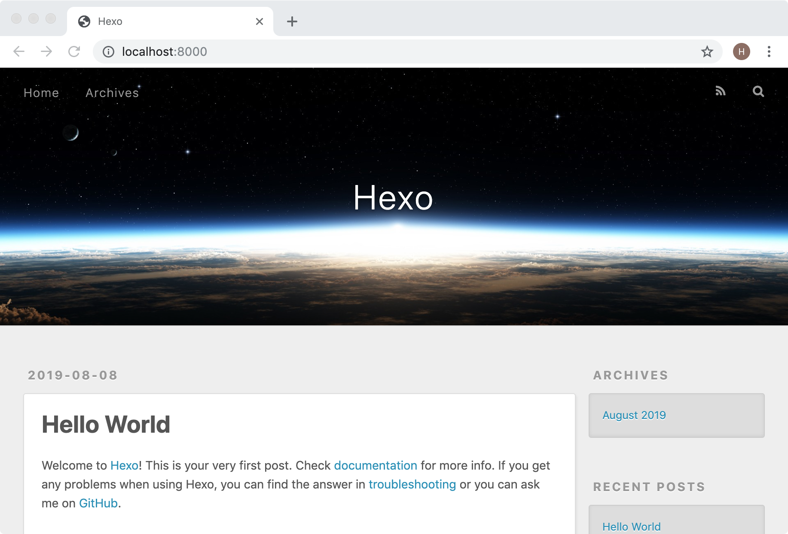
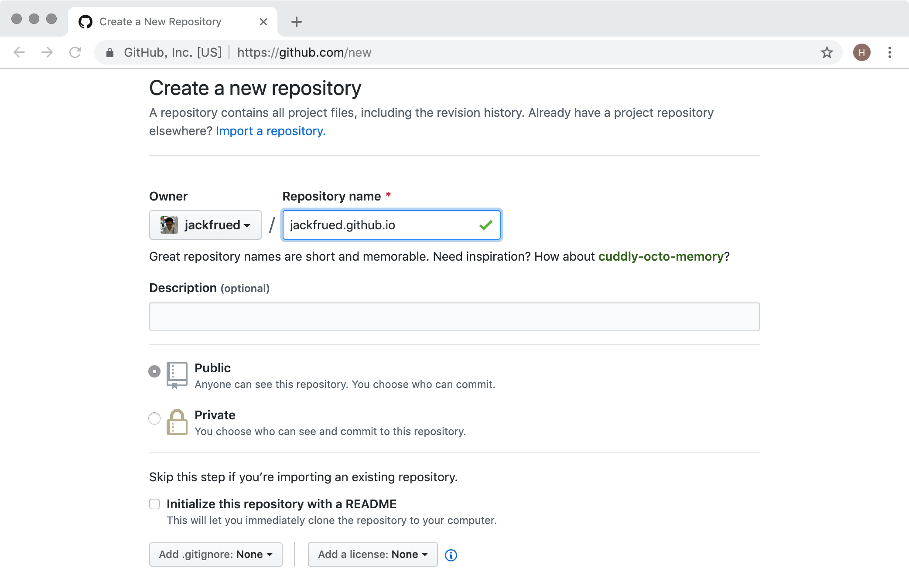
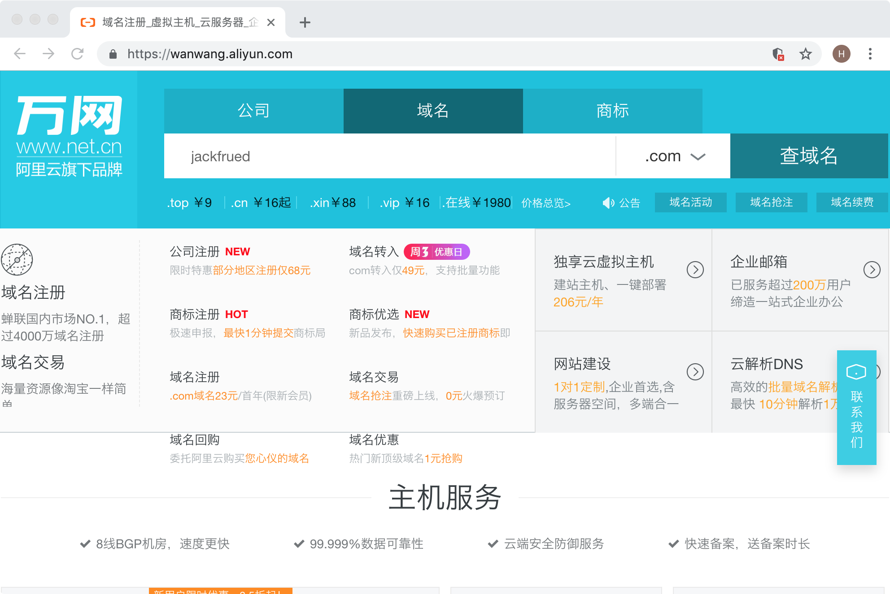
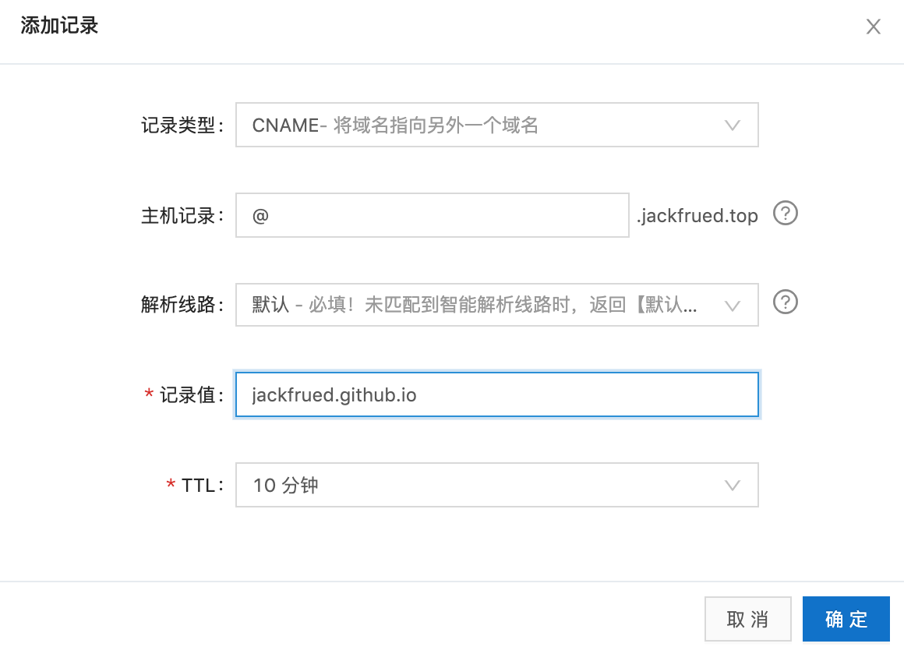

## Xây dựng blog cá nhân với Hexo

Đối với một lập trình viên, việc xây dựng một nền tảng blog cho riêng mình là một điều vô cùng ý nghĩa. Trước hết, blog có thể ghi lại chặng đường trưởng thành của bản thân, đồng thời cũng là sự đúc kết và lắng đọng sau một khoảng thời gian học tập và làm việc; ngoài ra, thông qua blog bạn có thể quảng bá bản thân, nâng cao sức ảnh hưởng của mình trên internet cũng như trong ngành, đặt nền móng vững chắc cho sự nghiệp tương lai tốt đẹp hơn. Vài năm trước có một cuốn sách bán chạy mang tên 《Kỹ năng mềm - Cẩm nang sinh tồn ngoài mã nguồn》 (Soft Skills: The software developer's life manual), tôi còn nhớ trong sách có một đoạn như thế này: "Tài năng âm nhạc của một ban nhạc pop đình đám có thể chẳng cao hơn ban nhạc chơi ở quán bar là bao, vậy tại sao họ lại có thể lưu diễn khắp thế giới và tạo nên hết kỷ lục đĩa bạch kim này đến kỷ lục khác? ... Bạn tiếp thị càng tốt thì tài năng của bạn mới càng có cơ hội bộc lộ một cách trọn vẹn nhất."

Nhân đây cũng xin nói thêm đôi lời: trong thời đại internet phát triển mạnh mẽ như ngày nay, chúng ta nên tiếp thị bản thân như thế nào? Xây dựng thương hiệu cá nhân là bước đầu tiên của việc tự tiếp thị. Đối với lập trình viên, điều dễ làm tốt nhất vẫn là xây dựng blog của riêng mình. Blog tương đương như một căn cứ địa của bạn trên không gian mạng, đặc biệt là khi bạn sở hữu một blog độc lập của riêng mình, bạn có thể làm rất nhiều điều mình muốn: vừa truyền tải tư tưởng của bản thân, vừa nâng cao tầm ảnh hưởng cá nhân, và dĩ nhiên nếu blog của bạn vận hành thật tốt, bạn còn có thể kiếm được lợi nhuận từ đó. Ngoài blog ra, livestream, các nền tảng video, gửi bài cộng tác, viết sách, tham gia các hoạt động kỹ thuật đều là những cách tự tiếp thị đáng cân nhắc. Tất nhiên, làm thương hiệu cá nhân cũng cần sự kiên trì bền bỉ, làm bữa đực bữa cái thì rất khó gặt hái được thành quả.

### Tổng quan về Hexo

Hexo là một framework blog nhanh chóng, ngắn gọn và hiệu quả. Nó có thể biên dịch (render) các tài liệu [Markdown](https://vi.wikipedia.org/wiki/Markdown) thành các trang web đẹp mắt, nhờ đó chúng ta có thể nhanh chóng tạo ra nội dung tĩnh cho website trong thời gian rất ngắn, mà định dạng Markdown đối với lập trình viên thì tin chắc rằng chẳng còn xa lạ gì. Muốn dùng Hexo để dựng blog cá nhân, tôi thực sự không nghĩ ra có tài liệu hướng dẫn nào tốt hơn [tài liệu chính thức](https://hexo.io/), rất khuyến khích mọi người đọc tài liệu chính thức để tìm hiểu về Hexo. Dưới đây tôi chỉ đưa ra một bản hướng dẫn sử dụng tóm tắt.

> **Giải thích**: **Markdown** là một ngôn ngữ đánh dấu siêu nhẹ, cho phép mọi người soạn thảo tài liệu bằng định dạng văn bản thuần túy dễ đọc dễ viết, đồng thời cũng hỗ trợ hình ảnh, biểu đồ, công thức toán học, có thể dùng để viết sách điện tử, tài liệu phần mềm, v.v., đồng thời cũng rất thuận tiện để chuyển đổi sang trang HTML hoặc tài liệu PDF.

Để sử dụng Hexo, trước tiên phải đảm bảo máy tính đã cài đặt môi trường [Node.js](https://nodejs.org/en/) và [Git](https://git-scm.com/). Node.js là môi trường có thể chạy mã JavaScript ở phía máy chủ, còn Git là công cụ quản lý phiên bản. Cài đặt Node.js chủ yếu là để sử dụng công cụ quản lý gói npm của nó, nên bạn không cần phải học bài bản kiến thức về Node.js trước; còn cài đặt Git là để tận dụng hệ thống quản lý phiên bản để clone mã nguồn cũng như đưa dự án blog lên lưu trữ trên các nền tảng của bên thứ ba. Nếu muốn học Git, tài liệu tốt nhất là cuốn [*Pro Git*](https://git-scm.com/book/vi/v2) trên trang web chính thức. Sau khi cài đặt hoàn tất, chúng ta có thể kiểm tra môi trường Node.js cũng như công cụ quản lý gói của nó đã cài đặt thành công hay chưa thông qua các lệnh dưới đây:

```Shell
node --version
npm --version
```

Có thể dùng lệnh sau để kiểm tra môi trường Git đã được cài đặt hay chưa:

```Shell
git --version
```

Chúng ta có thể dùng npm để cài đặt Hexo. npm là công cụ quản lý gói của Node.js, có tác dụng tương tự như công cụ pip của Python, có thể dùng để cài đặt các thư viện phụ thuộc và công cụ bên thứ ba. Khi sử dụng npm lần đầu tiên, chúng ta có thể đổi nguồn tải về của npm sang mirror Taobao của Trung Quốc, như vậy tốc độ tải về sẽ được nâng cao rõ rệt:

```Shell
npm config set registry https://registry.npm.taobao.org
```

Tiếp theo chúng ta dùng npm để cài đặt Hexo, lệnh như sau:

```Shell
npm install -g hexo-cli
```

Sau khi cài đặt thành công, bạn đã có thể dùng Hexo để tạo blog của riêng mình rồi.

### Xây dựng blog

> **Giải thích**: Nội dung dưới đây cơ bản dựa trên tài liệu chính thức của Hexo, khuyến khích các bạn đọc tài liệu chính thức.

Đầu tiên chúng ta dùng lệnh sau để tạo một thư mục chuyên lưu trữ dự án blog, lệnh này sẽ clone dự án blog và giao diện mặc định từ GitHub về máy:

```Shell
hexo init blog
```

Tiếp theo chúng ta di chuyển vào thư mục này và xem cấu trúc thư mục:

```Shell
cd blog
ls -lR
```

```
total 232
-rw-r--r--    1 Hao  staff    1768  8  8 01:15 _config.yml
drwxr-xr-x  274 Hao  staff    8768  8  8 01:19 node_modules
-rw-r--r--    1 Hao  staff  109972  8  8 01:19 package-lock.json
-rw-r--r--    1 Hao  staff     443  8  8 01:15 package.json
drwxr-xr-x    5 Hao  staff     160  8  8 01:15 scaffolds
drwxr-xr-x    3 Hao  staff      96  8  8 01:15 source
drwxr-xr-x    3 Hao  staff      96  8  8 01:15 themes
```

> **Giải thích**: Trong dấu nhắc dòng lệnh của môi trường Windows có thể dùng lệnh `dir` để xem cấu trúc thư mục. Cần giải thích thêm: `_config.yml` là tệp cấu hình của dự án blog; `package.json` là tệp chứa danh sách các gói phụ thuộc của dự án; `scaffolds` lưu trữ các mẫu tệp Markdown, tức là nội dung mặc định được điền sẵn khi thêm một tệp Markdown mới; trong thư mục `source` có một thư mục tên là `_posts`, lát nữa chúng ta có thể đặt các tệp Markdown đã viết xong vào thư mục này để Hexo xử lý thành các trang tĩnh của blog, các trang tĩnh được sinh ra sẽ nằm trong thư mục `public`; thư mục `themes` lưu trữ các giao diện (theme) mà blog sử dụng.

Sau đó chúng ta dùng lệnh dưới đây để cài đặt các gói phụ thuộc cần thiết cho dự án (tệp `package.json` đã chỉ định các gói này):

```Shell
npm install
```

Sau khi hoàn thành các thao tác trên, chúng ta đã có thể trực tiếp tạo trang blog bằng lệnh sau:

```Shell
hexo generate
```

Lệnh này cũng có thể viết tắt thành:

```Shell
hexo g
```

Trước đó khi cài đặt các phụ thuộc, dự án đã bao gồm một gói phụ thuộc tên là `hexo-server`. Gói này giúp chúng ta khởi động một máy chủ dựa trên Node.js để chạy dự án blog. Sử dụng lệnh sau để khởi động máy chủ:

```Shell
hexo server
```

Lệnh này cũng có thể viết tắt thành:

```Shell
hexo s
```

```
INFO  Start processing
INFO  Hexo is running at http://localhost:4000 . Press Ctrl+C to stop.
```

Từ thông báo khi chạy lệnh có thể thấy máy chủ đã bắt đầu hoạt động và sử dụng cổng 4000, có thể dùng tổ hợp phím `Ctrl+C` để dừng máy chủ. Nếu muốn đổi cổng mà máy chủ sử dụng, bạn có thể thêm tham số `-p` khi khởi động; nếu muốn máy chủ sau khi khởi động tự động mở trình duyệt mặc định truy cập vào trang web, có thể dùng tham số `-o`, như dưới đây:

```Shell
hexo s -p 8000 -o
```

Đến đây, chúng ta đã có thể nhìn thấy trang chủ do Hexo tạo ra khi chưa qua cấu hình và chưa thêm tệp Markdown cá nhân nào, như hình bên dưới:



Tiếp theo chúng ta chỉnh sửa tệp cấu hình của blog:

```Shell
vim _config.yml
```

```YAML
# Hexo Configuration
## Docs: https://hexo.io/docs/configuration.html
## Source: https://github.com/hexojs/hexo/

# Site
title: Chuyên mục kỹ thuật của jackfrued
subtitle: Truyền đạo, thụ nghiệp, giải hoặc, chia sẻ niềm vui mà tri thức mang lại
description:
keywords:
author: jackfrued
language: vi
timezone:

# URL
## If your site is put in a subdirectory, set url as 'http://yoursite.com/child' and root as '/child/'
url: http://jackfrued.top
root: /
permalink: :year/:month/:day/:title/
permalink_defaults:

# Directory
source_dir: source
public_dir: public
tag_dir: tags
archive_dir: archives
category_dir: categories
code_dir: downloads/code
i18n_dir: :lang
skip_render:

# Writing
new_post_name: :title.md # File name of new posts
default_layout: post
titlecase: false # Transform title into titlecase
external_link: true # Open external links in new tab
filename_case: 0
render_drafts: false
post_asset_folder: false
relative_link: false
future: true
highlight:
  enable: true
  line_number: true
  auto_detect: false
  tab_replace:
  
# Home page setting
# path: Root path for your blogs index page. (default = '')
# per_page: Posts displayed per page. (0 = disable pagination)
# order_by: Posts order. (Order by date descending by default)
index_generator:
  path: ''
  per_page: 10
  order_by: -date
  
# Category & Tag
default_category: uncategorized
category_map:
tag_map:

# Date / Time format
## Hexo uses Moment.js to parse and display date
## You can customize the date format as defined in
## http://momentjs.com/docs/#/displaying/format/
date_format: YYYY-MM-DD
time_format: HH:mm:ss

# Pagination
## Set per_page to 0 to disable pagination
per_page: 10
pagination_dir: page

# Extensions
## Plugins: https://hexo.io/plugins/
## Themes: https://hexo.io/themes/
theme: landscape

# Deployment
## Docs: https://hexo.io/docs/deployment.html
deploy:
  type:
```

Dưới đây là phần giải thích các tùy chọn liên quan trong tệp YAML:

| Tham số | Mô tả |
| --- | --- |
| `title` | Tiêu đề website |
| `subtitle` | Tiêu đề phụ của website |
| `description` | Mô tả về website |
| `keywords` | Từ khóa website, có thể dùng dấu phẩy để phân tách nhiều từ khóa |
| `author` | Tên tác giả |
| `language` | Ngôn ngữ website sử dụng |
| `timezone` | Múi giờ website sử dụng, mặc định dùng múi giờ trên máy tính |
| `url` | Địa chỉ website |
| `root` | Thư mục gốc website |
| `source_dir` | Thư mục tài nguyên, dùng để chứa nội dung, mặc định là thư mục source |
| `public_dir` | Thư mục công khai, dùng để chứa các tệp tĩnh được tạo ra, mặc định là thư mục public |
| `tag_dir` | Thư mục thẻ (tag), mặc định là thư mục tags |
| `archive_dir` | Thư mục lưu trữ (archive), mặc định là thư mục archives |
| `category_dir` | Thư mục chuyên mục (category), mặc định là thư mục categories |
| `auto_spacing` | Tự động thêm khoảng trắng giữa tiếng Trung và tiếng Anh, mặc định false |
| `titlecase` | Chuyển tiêu đề thành viết hoa chữ cái đầu, mặc định false |
| `external_link` | Mở liên kết ngoài trong tab mới, mặc định true |
| `relative_link` | Đổi liên kết thành đường dẫn tương đối so với thư mục gốc, mặc định false |
| `default_category` | Phân loại mặc định |
| `date_format` | Định dạng ngày, mặc định YYYY-MM-DD |
| `time_format` | Định dạng giờ, mặc định HH:mm:ss |
| `per_page` | Số lượng bài viết hiển thị trên mỗi trang, mặc định 10, 0 biểu thị không phân trang |
| `pagination_dir` | Thư mục phân trang, mặc định là thư mục page |
| `theme` | Tên giao diện hiện tại |
| `deploy` | Thiết lập phần triển khai |

Chúng ta có thể sao chép các tệp Markdown đã soạn thảo vào thư mục `source/_posts`. Ở phía trên cùng của mỗi tệp Markdown, chúng ta có thể thêm Front-matter để mô tả các thông tin như bố cục, tiêu đề, chuyên mục, thẻ tag, ngày xuất bản của bài viết. Cái gọi là Front-matter chính là phần nằm ở trên cùng của mỗi tệp Markdown được ngăn cách bởi cặp dấu `---`, có thể thiết lập các nội dung sau trong Front-matter:

| Tham số | Mô tả | Giá trị mặc định |
| --- | --- | --- |
| `layout` | Bố cục | |
| `title` | Tiêu đề | |
| `date` | Ngày tạo | Ngày tạo tệp |
| `updated` | Ngày cập nhật | Ngày cập nhật tệp |
| `comments` | Bật tính năng bình luận của bài viết | true |
| `tags` | Thẻ tag (không áp dụng cho phân trang) | |
| `categories` | Chuyên mục (không áp dụng cho phân trang) | |
| `permalink` | Ghi đè URL bài viết | |

Ví dụ:

```Markdown
---
title: Quy ước lập trình Python
categories: 
- Cơ bản về Python
tags:
- Python
- PEP8
date: 2019-8-1
---
## Quy ước Python

Từ "quy ước" ở đây chỉ "cách làm theo thói quen, biện pháp thông thường, cách làm thường dùng", từ tương ứng trong tiếng Anh là "idiom". Do Python có những khác biệt khá rõ rệt so với nhiều ngôn ngữ lập trình khác về cú pháp cũng như cách sử dụng, vì vậy nếu một nhà phát triển Python không nắm vững những quy ước này thì sẽ không thể viết ra mã nguồn chuẩn "Pythonic". Dưới đây chúng tôi tổng hợp một số đoạn code mang tính quy ước thường dùng trong quá trình lập trình Python.

1. Giúp code vừa có thể import vừa có thể thực thi độc lập.
   if __name__ == '__main__':

2. Dùng cách sau để kiểm tra logic "đúng" hoặc "sai".
   if x:
   if not x:
```

Sau khi hoàn thành các công việc trên, chúng ta có thể dùng lệnh sau để dọn dẹp các nội dung đã sinh ra trước đó:

```Shell
hexo clean
```

Tiếp theo chúng ta có thể dùng các lệnh đã nói trước đây để tạo lại và chạy dự án blog:

```Shell
hexo generate
hexo server -p 8000 -o
```

### Đưa blog lên lưu trữ trên GitHub

Chúng ta có thể tận dụng dịch vụ [Pages](https://pages.github.com/) của GitHub để lưu trữ blog. Trên trang chủ của GitHub Pages có sẵn hướng dẫn cách đưa website lên lưu trữ. Dĩ nhiên bước đầu tiên là bạn phải đăng ký một tài khoản GitHub cho riêng mình, sau khi đăng nhập thành công mới có thể tiến hành các thao tác tiếp theo.

1. Tạo một repository dựa trên tên người dùng của bạn, tên kho chứa **nhất định** phải đặt theo định dạng "tên_người_dùng.github.io". Ví dụ: tên người dùng của tôi trên GitHub là jackfrued, vậy kho chứa dự án blog của tôi nhất định phải đặt tên là jackfrued.github.io.

   

2. Chỉnh sửa tệp cấu hình `_config.yml` của dự án blog, thiết lập sử dụng GitHub để triển khai dự án blog này.

   ```Shell
   vim _config.yml
   ```

   ```YAML
   # Lược bỏ nội dung phía trên
   # Deployment
   ## Docs: https://hexo.io/docs/deployment.html
   deploy:
     type: git
     repo: https://github.com/jackfrued/jackfrued.github.io.git
     branch: master
   ```

   Trong cấu hình trên, `type` chỉ định dùng git để triển khai dự án, `repo` chỉ định URL của kho git nơi triển khai dự án (ở đây chúng ta dùng địa chỉ HTTPS, nếu trước đó đã cấu hình cặp SSH key thì cũng có thể dùng địa chỉ SSH), `branch` chỉ định nhánh code đồng bộ lên kho (thông thường nhánh `master` là nhánh phát hành thành quả công việc cuối cùng, còn gọi là nhánh chính của dự án).

3. Cài đặt plugin triển khai mang tên `hexo-deployer-git`, thông qua plugin này bạn có thể thực hiện triển khai chỉ bằng một dòng lệnh.

   ```Shell
   npm install hexo-deployer-git --save
   ```

4. Có thể dùng lệnh sau để triển khai lên GitHub chỉ bằng một thao tác:

   ```Shell
   hexo deploy -g
   ```

   Hoặc:

   ```Shell
   hexo generate -d
   ```

5. Tiếp theo, nhập [jackfrued.github.io](https://jackfrued.github.io) vào trình duyệt là bạn có thể thấy blog của mình rồi. Giờ đây tất cả mọi người trên thế giới đều có thể truy cập blog của bạn qua URL này. Bạn có nhận thấy rằng URL truy cập blog này chính là tên kho chứa mà chúng ta đã đặt lúc nãy không? Vì tên người dùng bạn đăng ký trên GitHub là duy nhất, nên tên miền này cũng là độc nhất vô nhị trên toàn thế giới.

### Gắn blog với tên miền riêng của bạn

Mặc dù chúng ta đã có thể truy cập blog thông qua tên miền do GitHub cung cấp, nhưng nếu không muốn "ở nhờ nhà người khác", bên cạnh việc tận dụng dịch vụ lưu trữ miễn phí của GitHub Pages, chúng ta hoàn toàn có thể gắn blog vào tên miền riêng của mình. Nếu chưa mua tên miền, chúng ta có thể mua trên các trang web cung cấp dịch vụ tên miền (như: [Vạn Võng / HiChina](https://www.hichina.com/), [GoDaddy](https://www.godaddy.com/)).



> **Giải thích**: Hiện tại việc quản lý tên miền ngày càng nghiêm ngặt, khi mua tên miền cần điền nhiều thông tin cá nhân và xác thực danh tính thì mới nhận được tên miền.

Giả sử hiện tại tôi đã mua một tên miền mang tên "jackfrued.top", làm thế nào để liên kết nó với tên miền "jackfrued.github.io"? Chúng ta có thể tận dụng [bảng điều khiển Alibaba Cloud](https://dns.console.aliyun.com/) hoặc [DNSPod](https://www.dnspod.cn/) để thực hiện dịch vụ phân giải tên miền (DNS). Sau khi đăng nhập thành công vào nền tảng phân giải tên miền, bạn có thể thêm hoặc chọn tên miền của mình để cấu hình phân giải. Nhấn nút "Thêm bản ghi", tạo một bản ghi phân giải tên miền loại CNAME. Bản ghi CNAME đại diện cho việc phân giải một tên miền sang một tên miền khác, như hình dưới đây:



Sau khi hoàn thành bước này, bạn vẫn chưa thể truy cập ngay vào dự án blog thông qua tên miền riêng. Cuối cùng, bạn cần thêm một tệp có tên là `CNAME` vào thư mục `source` của dự án blog (xin lưu ý tên tệp này phải viết hoa toàn bộ), nội dung tệp này như sau:

```
jackfrued.top
```

Bạn có thể dọn dẹp các nội dung đã sinh ra trước đó, sau đó tạo lại dự án và xuất bản lên GitHub là xong! Giờ đây chúng ta đã sở hữu một blog với tên miền độc lập, hy vọng mọi người có thể tận dụng nó để làm những điều có ý nghĩa (ghi lại quá trình trưởng thành, chia sẻ kinh nghiệm làm việc, nâng cao tầm ảnh hưởng cá nhân).

Cố lên nhé, các lập trình viên!